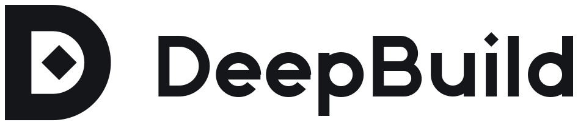

<h1 align="center">
  <picture>
    <source media="(prefers-color-scheme: dark)" srcset="brand/readme-dark.svg">
    
  </picture>
</h1>

<p align="center"><b>Where your agents show, not tell.</b><br>Describe it, and your agents show you: films, figures, 3D scenes, and a live map of their own work.</p>

<p align="center">
  <a href="https://github.com/windoliver/deepbuild/milestones"></a>
  
  <a href="LICENSE"></a>
</p>

DeepBuild is an agent-native studio for everything visual. Describe a 2D motion piece, a figure, a 3D scene or a film, and your AI agents make it as data. The app draws it natively and checks it the way code is checked, so a miss comes back as a fix, not a reroll.

**You stay the director.** You describe and decide on taste; agents do the rest. One app shows every agent at work, asks you only what needs a person, and counts nothing as done until a check proves it. It all runs on your machine.

<p align="center">
  <a href="docs/images/deepbuild-hero.mp4"></a>
</p>
<p align="center"><sub>Concept film with prototype footage of the app, October 2026. <a href="docs/images/deepbuild-hero.mp4">Watch the full film</a> with sound (76 s, 1080p, 60 fps).</sub></p>

## How it fits together

- **Make.** Agents write documents, never code: shots, looks, motion and sound. The canvas draws them in 2D and 3D, and every frame is a pure function of time, so a scrub matches the export.
- **See.** Every session from every agent sits in one app: what it's doing, what it changed and what it drew.
- **Steer.** Only what needs a person reaches you: a taste call, an approval or a step only you can take. Your answer goes straight back to the running agent, and you're never asked the same thing twice.
- **Trust.** When an agent says it's done, DeepBuild runs the checks itself and returns one of five verdicts. A skipped check is never green.

## Status

The repository skeleton runs locally; the app and hub are still in development. Version 0 (R1) brings every Claude Code and Codex session into one app, with the asks that need you and proof at every stop. The canvas core lands in R2, and films, figures and 3D scenes in R6. Follow along in the [milestones](https://github.com/windoliver/deepbuild/milestones).

## Run the checkout

Use a supported Node.js LTS release, **22.19 or newer**, and Rust with Cargo,
`rustfmt` installed (included in the default rustup toolchain).
On macOS, also install the Xcode Command Line Tools for the native linker.

```sh
git clone https://github.com/windoliver/deepbuild.git
cd deepbuild
npm install
npm run build
npm link
deep --help
scripts/preflight
```

`npm run build` compiles every TypeScript workspace and the
`crates/deep-hook` binary. `npm link` exposes the built `deep` command on your
npm prefix's `bin` directory, which must be on `PATH`. Both binaries currently
provide help and version output only. Setup, hooks and hub commands land in
later issues; running this skeleton does not install hooks or start a service.

All checks run locally. `npm run release:check` and `npm run preflight` invoke
that exact same `scripts/preflight` entry point; there are no GitHub workflows.
The preflight performs one strict TypeScript build, Rust formatting, Vitest,
Cargo tests (which compile the Rust binary) and the small runner regression
suite. It also refuses GitHub workflows and reports failures without stopping
later checks. It does not repeat builds, run release optimization or benchmark
placeholder commands. The separate `npm run typecheck` also checks test and
Vitest-config types when needed; the preflight build checks production sources.

Issue #12 remains incomplete: real parity/snapshot checks, performance budgets
and merge-base benchmarking are not implemented in this minimal skeleton.

## Documentation

| Goal | Start here |
| --- | --- |
| See how it's built | [Technical design](docs/technical-design.md) |
| Build on the canvas | [Canvas primitives](docs/canvas-primitives.md), field by field |
| Pick up a task | [Issues](https://github.com/windoliver/deepbuild/issues): each links the sections and fields it builds |
| Work here with an agent | [AGENTS.md](AGENTS.md) · [CONTRIBUTING.md](CONTRIBUTING.md) |
| Use the mark | [Brand kit](brand/) |

## License

[Apache-2.0](LICENSE)
