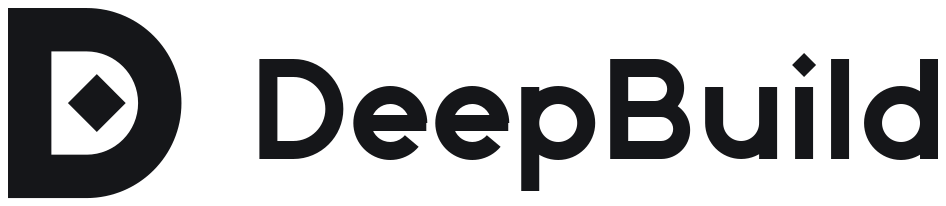

<h1 align="center">
  <picture>
    <source media="(prefers-color-scheme: dark)" srcset="brand/readme-dark.svg">
    
  </picture>
</h1>

<p align="center"><b>Where your agents show, not tell.</b><br>Describe it, and your agents show you: films, figures, 3D scenes, and a live map of their own work.</p>

<p align="center">
  <a href="https://github.com/windoliver/deepbuild/milestones"></a>
  
  <a href="LICENSE"></a>
</p>

DeepBuild is an agent-native studio for everything visual. Describe a 2D motion piece, a figure, a 3D scene or a film, and your AI agents make it as data. The app draws it natively and checks it the way code is checked, so a miss comes back as a fix, not a reroll.

**You stay the director.** You describe and decide on taste; agents do the rest. One app shows every agent at work, asks you only what needs a person, and counts nothing as done until a check proves it. It all runs on your machine.

<p align="center">
  <a href="docs/images/deepbuild-hero.mp4"></a>
</p>
<p align="center"><sub>Concept film with prototype footage of the app, October 2026. <a href="docs/images/deepbuild-hero.mp4">Watch the full film</a> with sound (76 s, 1080p, 60 fps).</sub></p>

## How it fits together

- **Make.** Agents write documents, never code: shots, looks, motion and sound. The canvas draws them in 2D and 3D, and every frame is a pure function of time, so a scrub matches the export.
- **See.** Every session from every agent sits in one app: what it's doing, what it changed and what it drew.
- **Steer.** Only what needs a person reaches you: a taste call, an approval or a step only you can take. Your answer goes straight back to the running agent, and you're never asked the same thing twice.
- **Trust.** When an agent says it's done, DeepBuild runs the checks itself and returns one of five verdicts. A skipped check is never green.

## Status

The repository skeleton runs locally; the app and hub are still in development. Version 0 (R1) brings every Claude Code and Codex session into one app, with the asks that need you and proof at every stop. The canvas core lands in R2, and films, figures and 3D scenes in R6. Follow along in the [milestones](https://github.com/windoliver/deepbuild/milestones).

## Run the checkout

Use Node.js **24.22 or newer** (`deep` refuses an older one, naming it) and rustup: `rust-toolchain.toml` pins Rust
1.99.1 with `rustfmt` and `clippy`, which rustup installs on first use. On
macOS, also install the Xcode Command Line Tools; on Linux, install GNU time at
`/usr/bin/time`.

```sh
git clone https://github.com/windoliver/deepbuild.git
cd deepbuild
npm install
npm run build
npm link
deep --help
scripts/preflight
```

`npm run build` compiles the TypeScript workspaces and the Rust workspace under
`crates/`, the `deep-hook` binary among it, and `npm link` puts the built `deep` command in your npm prefix's `bin`
directory, which must be on `PATH`. Run `npm run build` again after each pull:
`deep` runs the built files, not the source.

`deep --help` and `deep doctor` change nothing. The first `deep status`,
`deep inbox` or `deep setup` sets DeepBuild up for your user: it adds its hooks
to Claude Code's user settings (and Codex's, if you have Codex) in watch-only
mode, registers its MCP server and skill, and starts the hub as a login service.
Then start a Claude Code or Codex session in any repo, and `deep status` lists
it. `deep setup --undo` removes all of it and keeps your record in
`~/.deepbuild`.

`scripts/preflight` runs every check locally; `npm run preflight` and
`npm run release:check` run the same entry point, and there are no GitHub
workflows. Its lanes are the `checks` list in `scripts/lanes.mjs`, from
`typecheck`, `lint` and `unit` to `parity quick` and `proof`, then `perf`. A
failed lane reports its first error and a fix, later lanes still run, and `perf`
is `BLOCKED` when they fail. The checks with their builds must finish within the
`preflight` budget in `benchmarks/budgets.json`, 15 minutes today.

`lint` also runs `scripts/repo-rules.mjs`, which fails on GitHub workflows,
agent hooks or plugins in a repo's `.claude` or `.codex` settings, secrets such
as home paths and tokens, and any dependency `scripts/repo-rules.json` doesn't
list, and it reports the change's size against the merge base. To add a
dependency, list it there with its exact spec and why the task needs it. To keep
a deliberate fixture value, add an `allowedFindings` entry with its path, kind,
the SHA-256 of the exact value and why.

`perf` compares the checkout with its merge base on `origin/main` using the
budgets in `benchmarks/budgets.json`: p50 and p95 time and peak memory for each
command, plus one run of the whole check workload. p50, the workload's CPU
time and peak memory must stay within a budget's margin; p95 and wall time,
which machine load moves, have only absolute limits. When the change adds or
modifies files under the declared test paths (`testPaths` in
`scripts/lanes.mjs`), the workload runs once more without them, and that run is
what is compared with the merge base; the full run is held only to the caps,
and both runs and the CPU the change's own tests account for are reported. A budget is
frozen once it reaches main, and a new one records `INITIAL` with its reason. A
clone made with `--single-branch` needs `git fetch origin main` first.

## Verdicts on GitHub

DeepBuild can post each verdict as a commit status with the context `deepbuild/verdict`, on the commit it covers. A PASS is `success`; INCONCLUSIVE and BLOCKED are `pending`; FAIL and INVALID are `failure` and `error`. A verdict on uncommitted work waits for a pushed commit with the same files. A head that holds a commit neither a session made nor an account of yours pushed stays `pending`, with `untrusted head` in the description.

Nothing posts until the repo has a delivery rule, and every repo starts with it off. Turn it on in `~/.deepbuild/config.json`, naming the accounts that push for you.

Only the gate should turn a commit green, so make two GitHub Apps and install both on the repo:

- **The gate's app** posts every status. It needs "Commit statuses: write". Its key is used only by the hub.
- **The agents' app** gives each session DeepBuild starts its own short-lived token for that repo. It needs "Contents: write", "Pull requests: write" and "Issues: write". The token can push branches, open PRs and comment. It can't post a status, and the hub revokes it when its session ends, even if the hub restarted in between. Each push it makes is recorded with its session and the person who approved the session's run, never the commit's author. Your own `GH_TOKEN` stays with the hub and never reaches a session.

Put each app's private key in your login Keychain, then name both apps in your settings:

```bash
security add-generic-password -s deepbuild.github.gate -a deepbuild -w "$(cat gate.private-key.pem)"
```

```json
{ "github": { "delivery": { "owner/name": "on" }, "yours": ["your-account"],
    "gate": { "app_id": 1234, "key": "deepbuild.github.gate" },
    "agents": { "app_id": 5678, "key": "deepbuild.github.agents" } } }
```

Until `github.gate` is set, the hub posts with the `GH_TOKEN` or `GITHUB_TOKEN` in its own environment, which the rules below don't count.

DeepBuild never changes branch protection or the repo's rules itself. `deep gate rules` prints the two rulesets the repo needs:

- The default branch requires `deepbuild/verdict` from the gate's app. Only an admin, through the forge's bypass, updates or deletes the branch, and the gate's app updates it only by merging a pull request it passed, so no agent's token merges or pushes it.
- Only an admin makes, moves or deletes a `deep/approved/` tag.

Put each one on as the repo's admin:

```bash
deep gate rules --json | jq -c '.rulesets[]' | while read -r r; do echo "$r" | gh api -X POST repos/OWNER/NAME/rulesets --input -; done
```

A push you make yourself through the bypass is recorded as unguarded, and never reads PASS.

## Land changes in turn

From your checkout of the repo, `deep land judge --repo <checkout> --json` judges each open pull request whose body says `Closes #n`, `Fixes #n` or `Part of #n`. It judges the change on its merge with the default branch's head, the commit that will land, by its issue's definition, and posts the verdict's status on that merge commit. It lands nothing. `deep land --repo <checkout> --json` then lands the PASSes one at a time, in the order they came:

- If main or the branch moved since its verdict, the change is judged again first. Checks whose inputs didn't change carry, and only the rest run.
- A change that no longer merges goes back to the session working its issue, naming the files that conflict. It reaches no person and nothing lands.
- Any other result but PASS holds the change, with the word, so FAIL, INVALID, BLOCKED and INCONCLUSIVE never land. A requirement drafted `settled_by: "budget-window"` has no check and doesn't hold it: the change lands, and the issue stays open with a comment naming that requirement until the scheduled budget window settles it.
- An issue closes when its change lands, never before.
- After each landing the default branch is read back. A tree other than the one its verdict covered stops landings, names the files and marks main red in `scripts/main-watch.mjs`, whatever the forge said it merged.

Landings go through the forge's pull request merge with the gate's app once `github.gate` names it: the rules let the gate's app update the default branch through a pull request's merge, never a push. Give the gate's app "Contents: write", "Pull requests: write" and "Issues: write" beside "Commit statuses: write"; its landing token has no statuses. Until `github.gate` is set, landings go with your own login (`GH_TOKEN`, `GITHUB_TOKEN` or `gh auth token`), which must then be the repo's admin. DeepBuild never closes a pull request. `deep work --repo <checkout> --issues <n,...> --once --json` makes one pass of a run over a set: an open pull request from before the run that links an issue in the set joins as its attempt, and no second one starts beside it. Others idle past 7 days are listed under `stale`.

`deep work "work through #100, #101 and #102 with Claude Code and Codex, two at a time" --repo <checkout>` runs a set with no app. Its words become one `deep start approve` ask, which also says each session pushes its own branch and opens a pull request. Answer it yes with `deep inbox answer`, and the hub works the set by itself:
- An issue starts once everything it's blocked by is done. Its blockers are read from the forge's blocked-by links and from the body's `### Depends on` list. Done means landed with a PASS, or landed with only a budget window's requirement open, or listed in `.deepbuild/closed-before-gate.json` as the commit that added that file holds it. A closed issue whose pull request never merged isn't done.
- The issue that unblocks most starts first, then the lowest number. The approved agents take turns.
- An issue whose `Runs on:` line names a machine this host can't serve (Mac, Spark) waits and says so.
- An attempt's pull request is judged and landed in turn, and its session stops once it lands. A session that ends first, or whose turn ends with nothing changed, is replaced by a next attempt in the same worktree, uncommitted files kept. Three replaced attempts on an issue, in any agents and models, become one ask.
- An issue whose session asks you something gives up its slot: its session stops, and it starts again once you answer and a slot is free.
- `deep work show --repo <checkout>` prints each issue's state word and what it waits for, as the record's `work.state` holds them. `deep work pause` stops new starts while running turns finish.

## Approve an edit to a check

An edit that could weaken a check, such as a skipped or loosened test, passes the local guard only with a person's signed tag under `deep/approved/` on its commit. Signers come from one list in the repo, `.deepbuild/approvers`, an SSH allowed-signers file. The guard reads it from the merge base, never from your working tree, your home folder or a variable, so every checkout gets the same verdict. Any one person on it approves a commit, whoever's agent wrote it.

The list takes only keys that need a touch or a biometric for every signature, `sk-ssh-ed25519@openssh.com` and `sk-ecdsa-sha2-nistp256@openssh.com`, so no agent running as you can sign. A key in a plain file is refused on the list, and a signature made without a touch approves nothing. Make one on a security key:

```bash
ssh-keygen -t ed25519-sk -f ~/.ssh/deepbuild_approver
echo "you@example.com namespaces=\"git\" $(cat ~/.ssh/deepbuild_approver.pub)" >> .deepbuild/approvers
```

Adding or removing a key needs a signature from a key already on the list. The first list lands on the default branch by your own push. To approve a commit:

```bash
git -c gpg.format=ssh -c user.signingkey=~/.ssh/deepbuild_approver tag -s deep/approved/<name> -m 'Approves: <path>' <commit>
git push origin refs/tags/deep/approved/<name>
```

An agent's call that signs or pushes such a tag is refused by the `no-approval-tag-sign` and `no-approval-tag-push` guards, and the forge refuses its push.

## Documentation

| Goal | Start here |
| --- | --- |
| See how it's built | [Technical design](docs/technical-design.md) |
| Build on the canvas | [Canvas primitives](docs/canvas-primitives.md), field by field |
| Pick up a task | [Issues](https://github.com/windoliver/deepbuild/issues): each links the sections and fields it builds |
| Work here with an agent | [AGENTS.md](AGENTS.md) · [CONTRIBUTING.md](CONTRIBUTING.md) |
| Use the mark | [Brand kit](brand/) |

## License

[Apache-2.0](LICENSE)
