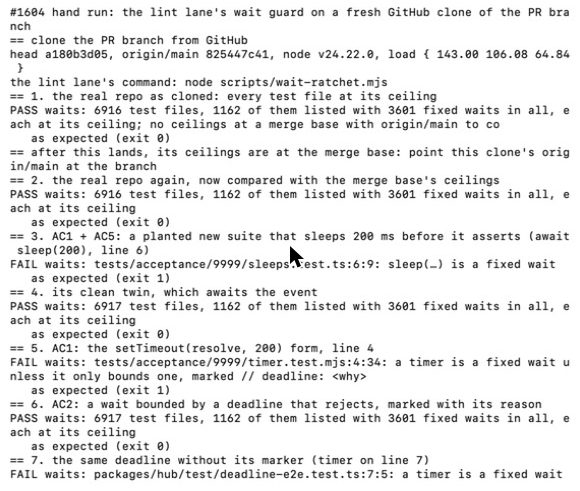
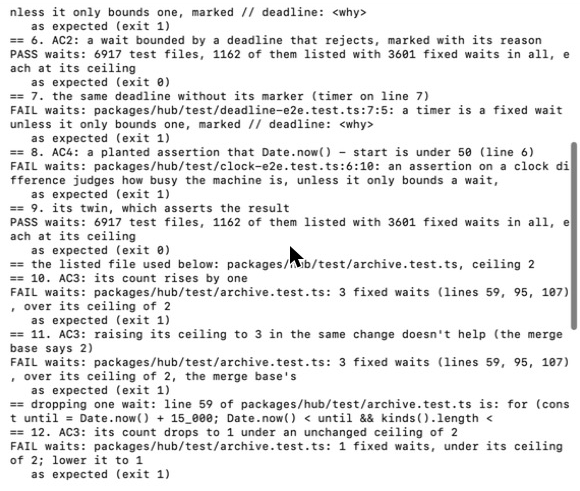
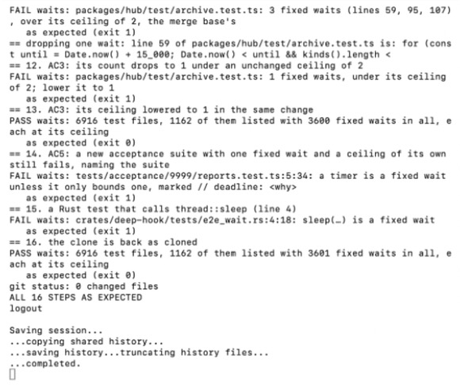

# #1604 by hand: the lint lane's wait guard on a fresh clone

`e2e.sh` clones the PR branch from GitHub, takes the wait guard's command from the lint lane in `scripts/lanes.mjs`, and runs it on the real repo, then on each planted file the issue names, with the clean twin of each plant. Steps 2 to 16 point the clone's `origin/main` at the branch head, so the merge base holds the ceilings, as it will once this lands. `e2e.log` is the full output of the run the screenshots show (head a180b3d05, Node 24.22.0, one-minute load 143; the guard times nothing, so load doesn't change its result).

| Step | What | Result |
|---|---|---|
| 1, 2 | The real repo, before and after the ceilings are at the merge base | PASS: 6,916 test files, 1,162 listed, 3,601 fixed waits |
| 3, 4 | AC1, AC5: a new suite's test that runs `await sleep(200)` before it asserts, then its twin that awaits the event | FAIL naming `tests/acceptance/9999/sleeps.test.ts:6`, then PASS |
| 5 | AC1: the `setTimeout(resolve, 200)` form | FAIL naming `…/timer.test.mjs:4` |
| 6, 7 | AC2: a 30 s deadline that rejects, marked `// deadline: <why>`, then unmarked | PASS, then FAIL naming line 7 |
| 8, 9 | AC4: `expect(Date.now() - start).toBeLessThan(50)`, then its twin | FAIL naming line 6, then PASS |
| 10, 11 | AC3: a listed file at its ceiling of 2 gains a wait; then its ceiling is raised to 3 too | FAIL naming the file, both times (the merge base's ceiling holds) |
| 12, 13 | AC3: the same file drops a wait; then its ceiling is lowered to 1 | FAIL ("lower it to 1"), then PASS |
| 14 | AC5: a new suite with one fixed wait and a ceiling of its own | FAIL naming `tests/acceptance/9999/` |
| 15 | A Rust test calling `std::thread::sleep` | FAIL naming line 4 |
| 16 | The clone as cloned | PASS, git status clean |

