# Evidence for #191: the physics behavior kit

The issue's Proof: the kit's report on Rapier for both targets, each planted backend's failure with what it names, and
the run with a test fixture excluded by caps.

- `kit-rapier-aarch64-apple-darwin.json`: `deep-physics` `{"call":"backend"}` and `{"call":"behavior_kit"}` on the shipped
  debug build, macOS arm64. Verdict `pass`: 34 fixtures pass, each `measured` beside its `answer` and `tolerance`; the six
  character and `place` cells of the sensor matrix read `excluded_by_caps`, since Rapier's caps claim no
  `character_controller` until #182.
- `kit-rapier-wasm32-unknown-unknown.json`: the same `behavior_kit` through `node scripts/physics-wasm32.mjs`. Verdict
  `pass`, the same 40 results.
- `test-backends.json`: `behavior_kit` on the `test-backends` build under each test backend and planted kit, with every
  failing result's `what`:

| Run | Verdict | Fails |
|---|---|---|
| `--backend friction_average` | fail | slide_geometric (2.543 m against 3.186 m, 3%), slide_min, slide_max, slide_multiply; slide_average passes |
| `--backend no_joint_limits` | fail | hinge_limit (largest angle 179°, joint `pin`), slider_limit |
| `--backend restitution_min` | fail | bounce_max (0.246 m against 0.81 m), bounce_average, bounce_geometric, bounce_multiply |
| `--backend drops_cap` | pass | none; `test_capped` and `ccd_wall` read excluded_by_caps |
| `--backend drops_cap --planted kit_runs_excluded` | fail | `test_capped` and `ccd_wall`, refused by the caps; the character cells, refused at check |
| `--backend query_ignores_groups` | fail | queries, naming the hit on a body the ray's groups filter out |
| `--backend rapier_caps` | refused | refused before any fixture runs, naming `soft_bodies` |
| `--backend no_soft_bodies` | pass | none |
| `--backend rapier_caps --planted kit_admits_unfixtured` | pass | the planted kit admits the candidate (the acceptance test fails it) |
| `--backend loose_tolerance` | fail | free_fall at 2.2% against the interface's 1%, though its manifest declares 5%; others its 2% gravity moves |
| `--planted pair_filter_default` | fail | sensor/static/kinematic and sensor/kinematic/kinematic write nothing |
| `--planted swept_collision_off` | fail | ccd_wall: the ball's centre passes the far face, naming the body and the step |

Readings beside the answers on Rapier (macOS arm64): free fall 4.9152 m (4.905), projectile 10.179 m (10.194), pendulum
2.0109 s (2.0099), bounces 1.2–1.7% under e²h, slides within 0.4%, slope hold 0.2 mm, slope slide 1.326 m (1.314), hinge
30.000° (≤ 30.5°), slider 0.500 m (≤ 0.505), motor 89.99°/s, first contact at step 55 (0.4515 s), 4.4145 m/s (4.429),
sensor entry at step 39 (0.3193 s), rest 62 steps after the speed falls under 0.05 m/s (≤ 60 + 2), the fast ball's first
contact at step 6.

## Pictures of the fixture worlds

Each picture is the canvas's own drawing (`deep-gpu` `view3d`, 640 × 360) of a behavior-kit fixture's world, posed from `deep-physics`'s bake of the interface's fixture at the steps its measure reads, made by `node scripts/kit-191-shots.mjs docs/evidence/191/pictures`. Earlier steps draw in grey, the last in sand, static bodies in stone, and a sensor as a wire box. The captions are here, outside the frames.

| Picture | What it shows |
|---|---|
| 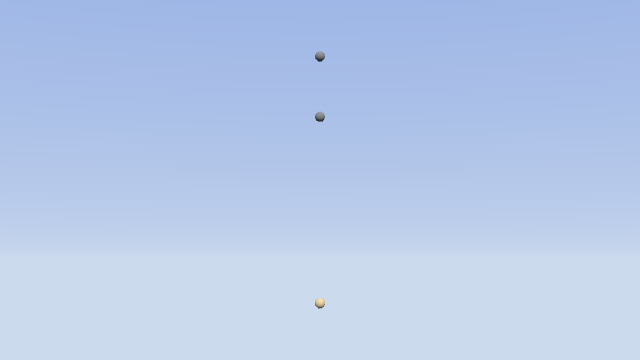 | Free fall: the ball at 0, 0.5 and 1 s; the kit reads its drop at 1 s. |
| 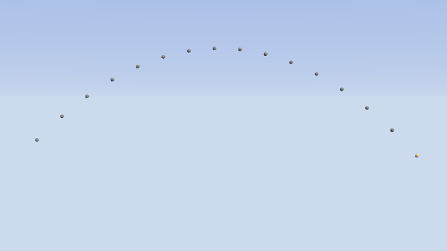 | Projectile: every 0.1 s of its arc; the kit reads where it returns to launch height. |
| 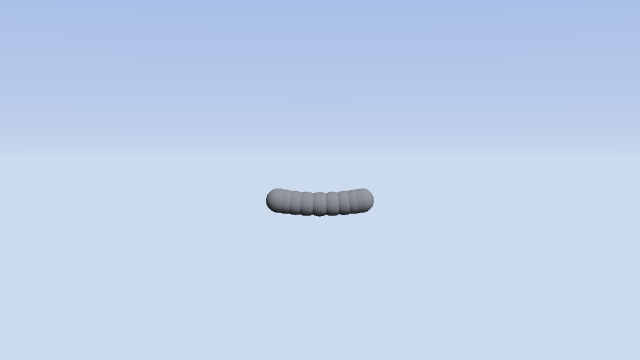 | Pendulum: the bob every 0.1 s over 2 s, one period swung out and back. |
| 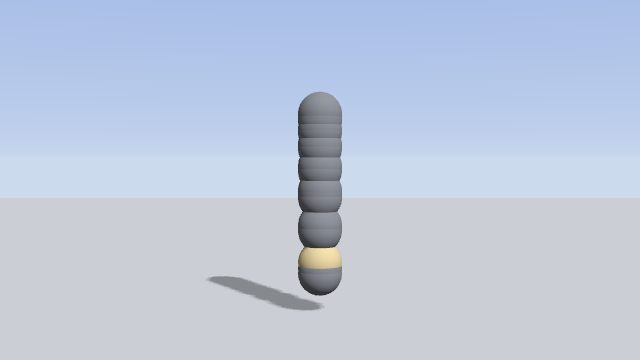 | Bounce under max: the fall, the contact and the first bounce; the kit reads its height. |
| 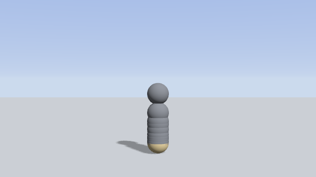 | Bounce under multiply: the same drop, the lowest first bounce. |
| 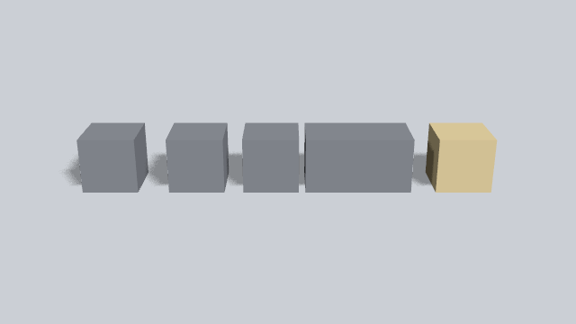 | Slide under geometric: the box every 1/6 s for 2/3 s from 5 m/s, then at rest (1.5 s). |
| 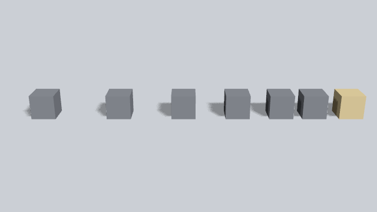 | Slide under min: the lowest friction, the longest slide, every 1/3 s and then at rest (3 s). |
| 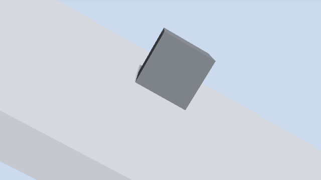 | Slope at friction 0.6: the box at 0, 1 and 2 s, held in place. |
| 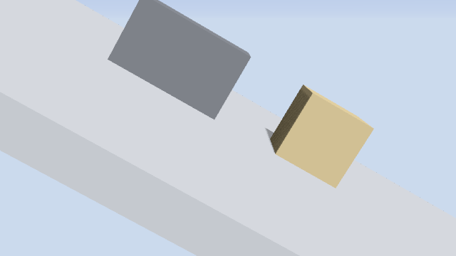 | Slope at friction 0.5: the box at 0, 1 and 2 s, sliding down. |
| 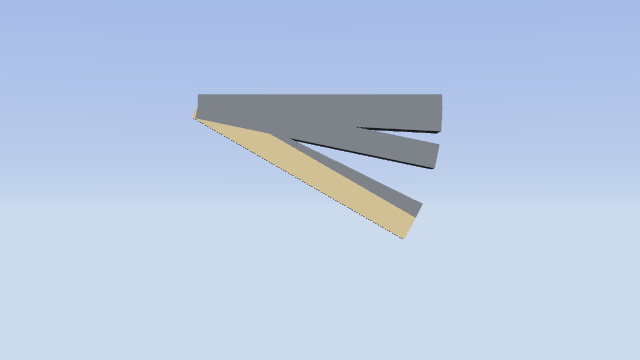 | Hinge limited to 30°: the bar falls and stops at its limit. |
| 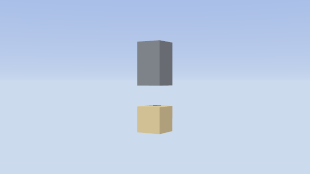 | Slider limited to 0.5 m: the car slides down and stops at its limit. |
| 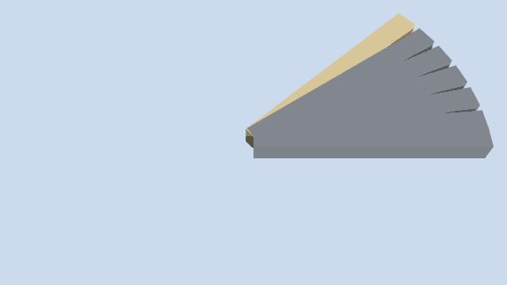 | Hinge motor at 90°/s, seen from above: the bar every 1/12 s for 0.5 s. |
| 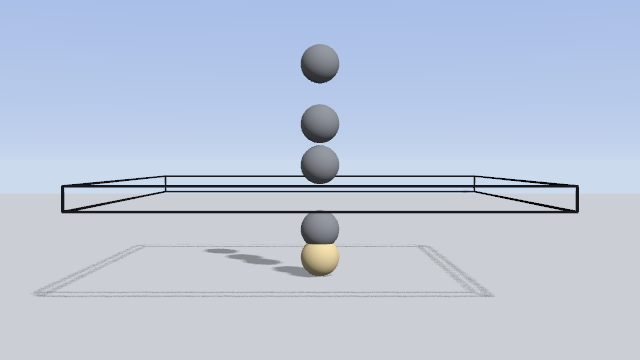 | The dropped ball: entering the sensor slab (step 39) and first touching the floor (step 55). |
| 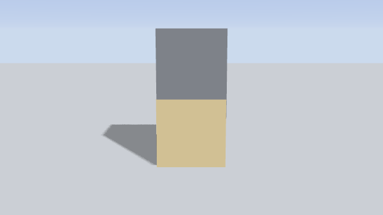 | Sleep: the box settles; the kit reads the steps from slowing to rest. |
| 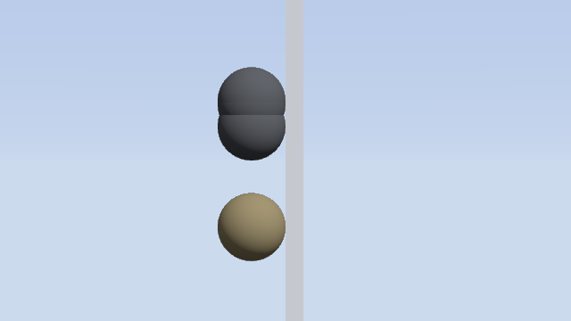 | Fast ball with ccd, side on, the wall edge on: steps 6 to 24, held on the wall's near side. |
| 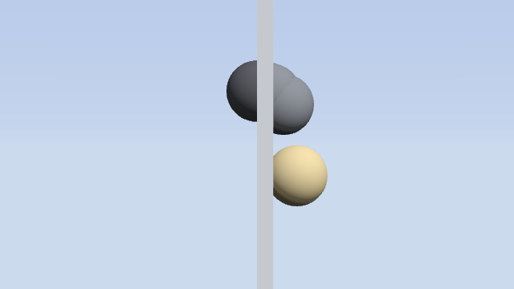 | Planted wrapper, swept collision off, the same view: the ball works through and ends past the far face. |
| 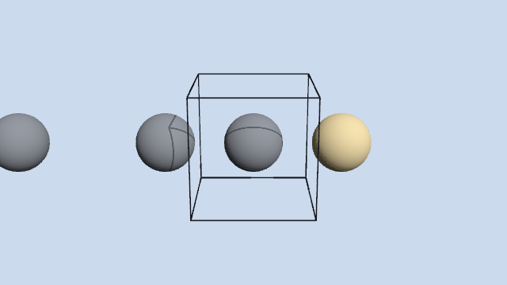 | Static sensor crossed by a dynamic ball: at 0, the enter step 75, 120 and the exit step 165. |
| 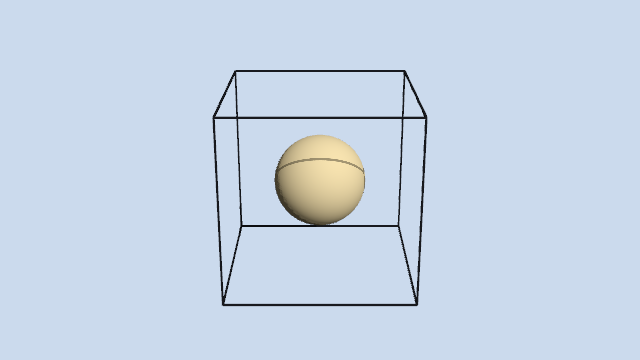 | A ball inside the static sensor from the start, deactivated at step 240. |
| 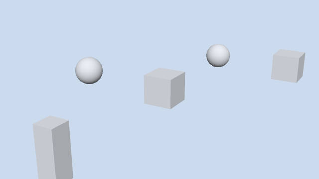 | The query world: spheres, boxes and a capsule in three groups, two spheres sharing a place. |

Looking at them found three ways the first pictures hid what they should show, and no physics fault. A body at rest drew its copies on top of the measured one, so repeated poses are now drawn once. An opaque sensor hid the ball inside it, so sensors draw as wire boxes. The fast ball was first drawn with the wall face on, which hid the ball that went through, so it is now drawn side on with the wall edge on. The bake's numbers behind the fast-ball pictures: with `ccd`, the ball's centre stops at x = 9.950 m, its surface on the wall's near face, its first contact at step 6, then it falls along the wall at g (nothing presses it into the wall). With swept collision off, its centre lands on the near face at step 6, its first contact is written at step 7, and it works through to x = 10.065 m, past the far face at 10.02 m, by step 24.
