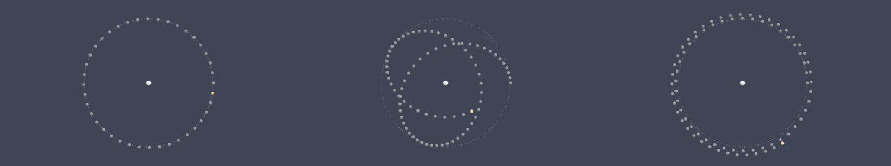
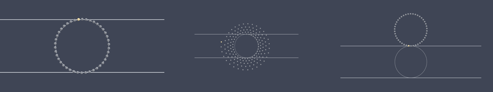
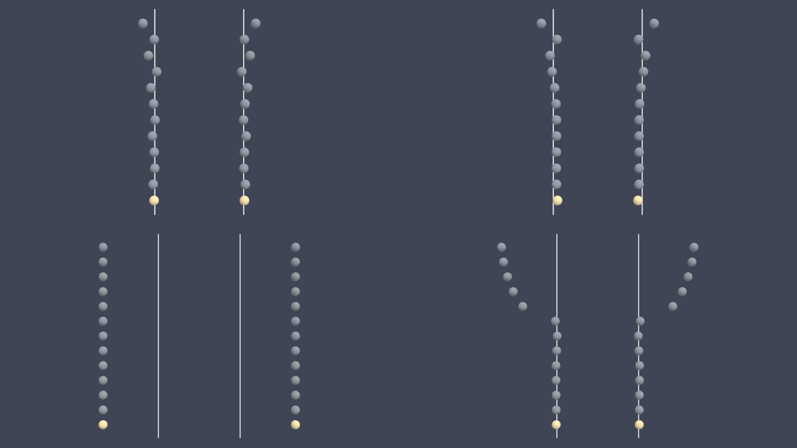

# #1931 evidence: three force laws with worked answers

Readings from this change's `deep-physics` (Rapier 0.36.1, macOS arm64, release build; the test backend on the
`test-backends` debug build; wasm32 through `node scripts/physics-wasm32.mjs`), on the blind suite's own worlds at
120 Hz with `gravity_scale: 0`. The blind suite (`tests/acceptance/1931/`) reads 17 of 17 on this change in one run;
at the base `a0d3713a7` it reads 17 failing, each at an assertion of its own: every world is refused there with
`physics.unsupported` at `forces/<ID>/kind`, naming this issue.

Worked answers: 2π√(m r³ ÷ |k|) = 4.0000 s; m·v ÷ (q·B) = 0.5 m; 2π·m ÷ (q·B) = 1.0472 s; 2^(1/6) × σ = 0.561231 m.

## Each planted law and the admitted 4-substep orbit, first

| Run under `--planted` | Result |
|---|---|
| `inverse_square_one_over_r`, the orbit | leaves 2 m within 1% at step 10 and falls to 1.0672 m; kit `inverse_square_orbit` `fail`: measured 1.0672 m where the answer is 2 m within 1%, `step` 10, period 2.2525 s |
| `check_admits_force_substeps`, the orbit at `substeps: 4` | the check raises no error; the body leaves 2 m within 1% at step 157 of a first turn of 480, its energy −9.8696 J at the launch and −9.6699 J there |
| `magnetic_force_held`, the gyration | 6.3451 m/s at 5 s, lowest y −1.5136 m; kit `magnetic_gyration` `fail`, `speed` 6.3451 m/s |
| `magnetic_b_cross_v`, the gyration | speed 3.0000 m/s throughout, y from −0.0001 m to +1.0002 m; kit `magnetic_gyration` `fail`, `y` [0.0000, 1.0000], radius 0.5000 m |
| `lennard_jones_no_factor_2`, the pair released 0.7 m apart | 0.50000 m apart at 10 s; kit `lennard_jones_rest` `fail`: measured 0.5000 m where the answer is 0.5612 m within 0.5% |
| `lennard_jones_no_cutoff`, the pair released 1.3 m apart | 0.56102 m apart at 10 s |

## The three laws

| World | Reads |
|---|---|
| the orbit, 1 substep, 8 s | 1.9871 m to 2.0133 m from the point at every step; back on its start line after 4.0005 s |
| the orbit at `substeps: 4` | refused: `out_of_range` at `substeps`, naming the force and its kind |
| the gyration, 5 s | speed 2.999998 to 3.000000 m/s; y from −1.0002 m to +0.0001 m at 1 substep, −1.0000 m to 0.0000 m at the kit's 4 |
| the pair released 0.7 m apart, 10 s | 0.561229 m apart (nearest 0.5185 m on the way) |
| the pair released 1.3 m apart, 10 s | 1.300000 m apart |
| `min_distance: 0`; `sigma: 0` | refused: `out_of_range` at `forces/<ID>/kind/min_distance`, at `forces/<ID>/kind/sigma`, `actual` 0; a bake of either answers no state |
| `lennard_jones` over 257 bodies; over 256 | refused: `over_budget` at `forces/<ID>/applies_to`, `actual` 257; taken |

Scope sentences no criterion reaches, read once by hand on the same build: inside `min_distance` the pull holds at
its value there (0.8333 m/s gained in a step at 0.05 m with `min_distance: 0.1`, 3.3333 m/s without it), and at the
point itself it is 0; a velocity along the field is unchanged after 1 s; `strength: 2` on a magnetic force halves the
circle (0.2500 m) and keeps the speed; `cutoff` left out is 2.5 × sigma (a pair 1.3 m apart stays, one 1.2 m apart
closes); `cutoff: 0` and a missing `sigma` are refused naming the field.

## The kit's report

`behavior_kit` on the reference backend: 67 rows, verdict `pass`, on `aarch64-apple-darwin` and on
`wasm32-unknown-unknown`, the three rows the same on both to every digit printed.

| Fixture | Measured | Answer | Tolerance | Beside it |
|---|---|---|---|---|
| `inverse_square_orbit` | 2.013262 m, the distance farthest from the answer | 2 m | 1% | `period` 4.000484 s |
| `magnetic_gyration` | 0.500005 m | 0.5 m | 1% | `speed` 2.999990 m/s, the one farthest from 3; `y` [−1.000001, 0.000008] m |
| `lennard_jones_rest` | 0.561229 m | 0.561231 m | 0.5% | |

The test backend `claims_force_laws` (caps `ccd`, `inverse_square`, `magnetic`, `lennard_jones`) is admitted and
passes the three. With `--planted kit_without_force_law_fixtures` the kit holds 65 of its 68 fixtures and refuses it
before any runs: "claims_force_laws is a candidate whose caps() claim inverse_square, magnetic, lennard_jones, which no
fixture of the behavior part tests".

## #191's first criterion's test

`tests/acceptance/191/ac1-reference-kit.test.ts` holds every fixture's world to 4 substeps and reads 0 of 2 on this
change, naming `inverse_square_orbit` and `lennard_jones_rest`, which this issue's Scope puts at 1. Its blind redraft,
`tests/acceptance/191-redraft-1931/`, holds a world with `inverse_square` or `lennard_jones` to 1 substep and every
other to 4: 2 of 2 at the base and 2 of 2 on this change. The frozen file is not edited; the swap is the owner's
(`REDRAFT.md`).

## Pictures and films

Each world drawn by the canvas (`deep-gpu`'s view3d) from this change's own bake of it: the body once every few steps,
the last one in sand, over what the worked answer says in stone (the point and the circle, the two y lines, the two
rest places). Planted runs use the same world and the same drawing. Nothing here judges; the tables above hold the
numbers.

| Sheet | Left to right |
|---|---|
|  | The orbit over its first turn, on the worked circle 2 m from the point; planted `inverse_square_one_over_r`, which falls inside it to 1.067 m; planted `check_admits_force_substeps` at `substeps: 4` over 8 s, which spirals out past it |
|  | The gyration over one turn, on the worked circle of 0.5 m between y = −1 m and 0 m; planted `magnetic_force_held` over 5 s from farther back, speeding up and spiralling out; planted `magnetic_b_cross_v`, the same circle on the +y side |
|  | One time a row from the top. Top: the pair released 0.7 m apart every 0.2 s for 2 s, then at 10 s, settling on the worked rest places; planted `lennard_jones_no_factor_2`, settling inside them at 0.500 m. Bottom: the pair released 1.3 m apart every 0.83 s for 10 s, which stays; planted `lennard_jones_no_cutoff`, which pulls it in to 0.561 m |

The single pictures are `pictures/<world>[-<planted>]-<hash>.png`, named by the frame's hash. The films show the same
strobes growing a step at a time: `pictures/film-orbit.mp4` (9 s), `pictures/film-gyration.mp4` (6 s) and
`pictures/film-pair.mp4` (4.5 s).

The base run, each test failing at an assertion of its own, is `base-run.txt`.
