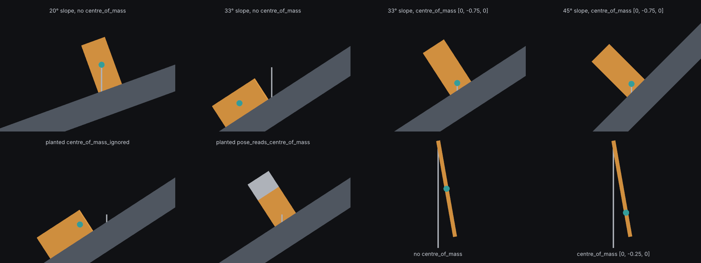

# #2240 evidence: a body's centre of mass as a field

Readings from this change's `deep-physics` (Rapier 0.36.1, macOS arm64, release build) at 120 Hz and 4 substeps, taken
by the blind suite (`tests/acceptance/2240/`), which reads 14 of 14 on this change; at the base it read 14 of 14
failing, the field being one the reader didn't know.

## The planted programs, failing

| Planted | What it reads | Where the real program reads |
|---|---|---|
| `centre_of_mass_ignored`, the box on the 33° slope with `centre_of_mass: (0, −0.75, 0)` | turns 90.26°; the kit's `box_slope_33_centre` fails, naming `box` | 0.0012° |
| `centre_of_mass_ignored`, the bar with the centre 0.75 m from the hinge | 1.6414 s; the kit's `bar_period_centre` fails against 1.865 s | 1.8653 s |
| `centre_of_mass_parallel_axis`, the same bar | 1.9534 s; the kit's `bar_period_centre` fails against 1.865 s | 1.8653 s |
| `check_accepts_centre_outside`, the point (0, 3, 0) on the 2 m box | no issue, and the bake builds the box | refused, below |
| `pose_reads_centre_of_mass`, the box at rest on level ground | `box_pose` 0.75 m lower at every step | the same position within 0.02 mm |

## The box on a slope

A 100 kg box 1 m wide and 2 m tall on a static slope, both of friction 2, baked 3 s. Its turn is the most it turns from
how it was built at any step.

| Slope | `centre_of_mass` | Turn | Tips at |
|---|---|---|---|
| 20° | none | 0.0030° | atan(0.5 ÷ 1.0) = 26.57° |
| 33° | none | 90.26°, past 45° | 26.57° |
| 33° | (0, −0.75, 0) | 0.0012° | atan(0.5 ÷ 0.25) = 63.43° |
| 45° | (0, −0.75, 0) | 0.0015° | 63.43° |

## The bar

A uniform bar 1 m long on a hinge at its top end, released from 10°, baked 5 s.

| `centre_of_mass` | Period | Worked answer | Off |
|---|---|---|---|
| none | 1.64139 s | 2π√(2L ÷ 3g) × (1 + θ² ÷ 16) = 1.64107 s | 0.02% |
| 0.75 m from the hinge | 1.86529 s | 2π√((L² ÷ 12 + 0.75²) ÷ (0.75 g)) × (1 + θ² ÷ 16) = 1.86510 s | 0.01% |

## Pictures

`node docs/evidence/2240/shoot.mjs` draws the kit's six fixture worlds of this issue through `deep-gpu`'s `view3d`,
which bakes each world itself and moves the drawn body by one `pose` output and nothing else. The camera is
orthographic and square on. The teal disc rides at the point the body's weight acts at; the pale line hangs from where
that point starts (the box) or from the hinge (the bar).

Top row, the box at 3 s: on 20° with no `centre_of_mass` it stands, on 33° it has fallen over, and on 33° and 45° with
`centre_of_mass: (0, −0.75, 0)` it stands. Bottom row: the planted `centre_of_mass_ignored` on the 33° world with the
field, fallen over; the planted `pose_reads_centre_of_mass`, the box drawn 0.75 m down its own axis into the slope, its
true place in stone; the bar at 0 s with its weight at its middle and 0.75 m from the hinge.

| The box's four runs, 3 s at 30 fps | The bar's two runs released together, 4 s at 60 fps |
|---|---|
|  |  |

The script then reads the pixels of all 846 frames and holds them to `deep-physics`'s own bake of the same world at each
frame's step: the sand body's outline as a rectangle (its middle, which is the body's origin, its long axis and its two
sides) and the disc's middle. The most any frame is off, with a pixel 14.6 mm in a box frame and 3.75 mm in a bar frame:

| Fixture | Frames | Middle | Long axis | Sides | Disc | The kit's measure, from the frames alone | From the bake | The kit's answer |
|---|---|---|---|---|---|---|---|---|
| `box_slope_20` | 91 | 0.02 px | 0.01° | 0.04 px | 0.06 px | turned 0.01° | 0.0030° | under 1° |
| `box_slope_33` | 91 | 0.17 px | 0.16° | 0.59 px | 0.19 px | turned 90.17° | 90.26° | past 45° |
| `box_slope_33_centre` | 91 | 0.01 px | 0.03° | 0.20 px | 0.08 px | turned 0.04° | 0.0012° | under 1° |
| `box_slope_45_centre` | 91 | 0.03 px | 0.00° | 0.69 px | 0.13 px | turned 0.00° | 0.0015° | under 1° |
| `bar_period` | 241 | 0.41 px | 0.17° | 0.66 px | 0.32 px | period 1.6448 s | 1.6414 s | 1.6411 s within 1% |
| `bar_period_centre` | 241 | 0.40 px | 0.14° | 0.66 px | 0.32 px | period 1.8663 s | 1.8653 s | 1.8651 s within 1% |

The script fails a frame more than a pixel off in place, a pixel and a half in a side or half a degree in turn, and a
measure off the kit's answer. Held to a bake that isn't theirs, the same frames read off it: `box_slope_33_centre`'s
against the planted `centre_of_mass_ignored`'s bake, 130 px in the middle and 90° in turn; `bar_period_centre`'s
against the bake of the bar with no `centre_of_mass`, 36 px in the middle. Its readings are in `check.json`.

What the pictures don't show: a planted program can't run inside `view3d`, so its two pictures pose the box from
`deep-physics --planted`'s bake and no frame of theirs is read. The refusals and the step hashes have no picture. The
box that falls over is at its most turned, 90.26°, at step 166, between two frames, and comes to rest at 90.00° in the
picture's plane, turned 2.4° about the slope's normal; the frames' 90.17° is the box at rest, read 0.17° off.

The files here are from debug binaries built on the tree merged with main (`81c6b9c340f6`). On binaries built from this
change before the merge, the script wrote the same four files, byte for byte.

## Refusals (check)

| World | Result |
|---|---|
| `centre_of_mass` on a static body | `out_of_range` at `bodies/box/centre_of_mass`: "only a dynamic body takes centre_of_mass, and this body's kind is static" |
| on a kinematic body | the same, naming kinematic |
| on a character body | the same, naming character |
| (0, 3, 0) on the 2 m box | `out_of_range` at `bodies/box/centre_of_mass`: "centre_of_mass (0, 3, 0) lies outside the bounds of this body's shapes: x from -0.5 to 0.5, y from -1 to 1 and z from -0.5 to 0.5 m" |
| (0, −0.75, 0), and (0, −1, 0) on its base | accepted |

## Step hashes

The 45° world with the centre written, sought to 1.5 s (restored at step 140) and played on: its 221 step hashes are the
straight run's, the last `6b96d3719b3d96dd`. Thirteen worlds with no `centre_of_mass` (the box on three slopes, the bar,
#251's lap and eight drawn worlds of one and two shapes a body): 4,573 step hashes, each the same string as on the merge
base `9d0256132543`, and again, after main was merged, as on `81c6b9c340f6`.

## Kit

`box_slope_20`, `box_slope_33`, `box_slope_33_centre`, `box_slope_45_centre`, `bar_period` and `bar_period_centre` pass
natively and on wasm32, with the other 58 fixtures.

## A vehicle body

The kit's fixture car (1,000 kg, its chassis 0.5 m tall) takes the field as any dynamic body does. No criterion reads
it, so these are readings, not a test.

| `centre_of_mass` | Check | Settled on its springs (3 s) | Most lean in the 15° turn at 3 m/s |
|---|---|---|---|
| none | accepted | y 0.5379 m, four wheels touching | 0.133° |
| (0, −0.2, 0) | accepted | y 0.5379 m, four wheels touching | 0.084° |
| (0, 0.6, 0) | refused at `bodies/car/centre_of_mass`, naming y from -0.25 to 0.25 | not built | |

## Unit tests

`the_bounds_a_centre_of_mass_is_held_to_are_the_built_shapes` holds the check's bounds to the built shapes' for turned
boxes, capsules, hulls and compounds; with the turns about X, Y and Z composed the other way round it fails, naming the
body. `a_written_centre_of_mass_keeps_the_mass_the_shapes_give` fails when a body with the field reads its shapes' mass
from its shapes alone (0 kg against 500 kg).
