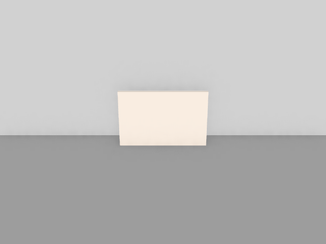
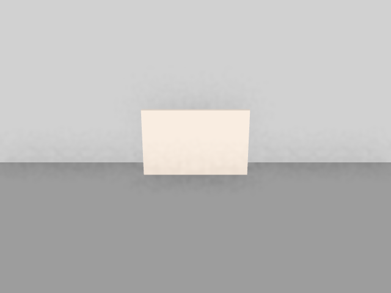
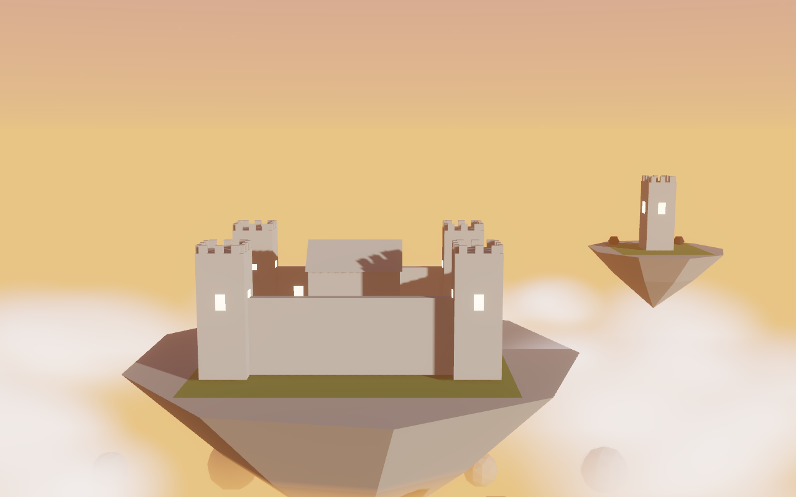

# #2516 — renderer comparison frames, not goldens

These are unmodified PNGs from `deep-gpu run` / `view3d`, captured under the renderer's GPU lease on the reference Mac17,10 (macOS build 26B8119). Both sides were rendered in the same capture run: the independently built drafting base `1c4d1f0e2aaad8c6a6573848823566d04ff73d17`, and merged PR commit `c7b6f97233c4f37828cfdcaccf7081a014defc8a`. Binary and image SHA-256 digests are in [frames.json](frames.json).

The room uses #418's frozen room and look helpers, at 640 × 480. The castle uses `packs/examples/castle.json`, `castle.look.json` and its composite pack, at 1280 × 800. AO is at every shipped default on both sides: radius 0.5 m, strength 1, eight samples, half resolution, multi-bounce and specular on.

These images are for the issue's one owner taste call only. No numerical criterion judges a picture. **No owner decision has been recorded; AC7 remains INCONCLUSIVE.** The four files reproduce the hashes already shown in the session, now also linked on the PR. They do not replace, bless, or re-record any golden.

| Scene | Main | Change |
|---|---|---|
| #418 room |  |  |
| Castle |  |  |

## Five-run GPU measurement

[The timing record](timings-803322230a66.json) is the frozen `timing.test.ts` run on the same merged commit: one discarded warm-up run, then five runs of every 8/16 × half/full setting on the castle at 1920 × 1080. Each setting keeps 30 frames per run (150 pooled); it records per-pass p50/p95 and each run's median. GPU timestamps are resolved after the frame. The real timed grant and the renderer's GPU lease were held; thermal state was nominal, AC power, Low Power Mode off, and all ten start/end loads were 14.19–16.17 on 18 cores.

The original machine home in `lease` was redacted to `~`, and the JSON body rehashed for the public filename. No readings, settings, loads, fingerprint fields or percentile values changed. The run originally wrote `timings-deb3a10afa23.json`; its raw external copy is retained. The [Cost line](../../canvas-primitives.md#look-look1-ao) carries all 24 rounded p50/p95 values, verified by the unchanged acceptance check. Per-pass percentiles are not a whole-frame percentile and establish no unmeasured class-budget pass.

The independent acceptance harness names `docs/evidence/2516/` for these PR captures and timing records. These repository-local artifacts are kept for the explicit AC6/AC7 deliverables, not used as the application's evidence store; raw runs and larger linear/depth/ID targets remain external. See [the closure report](../../../reports/2516-closure.md) for the run outcomes, required failing checks, and unrun gates.
