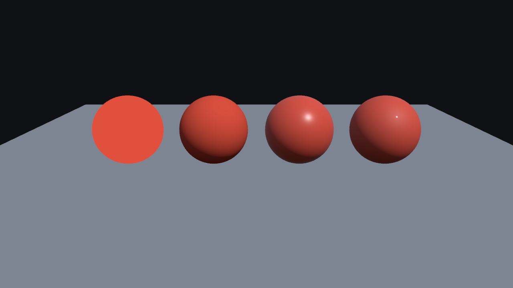
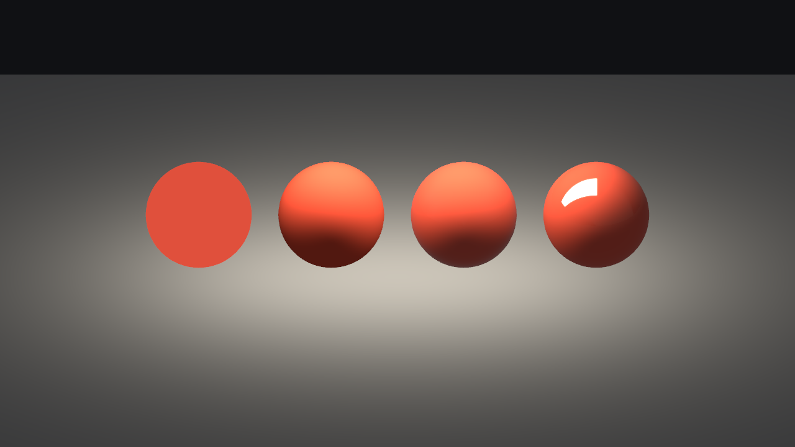
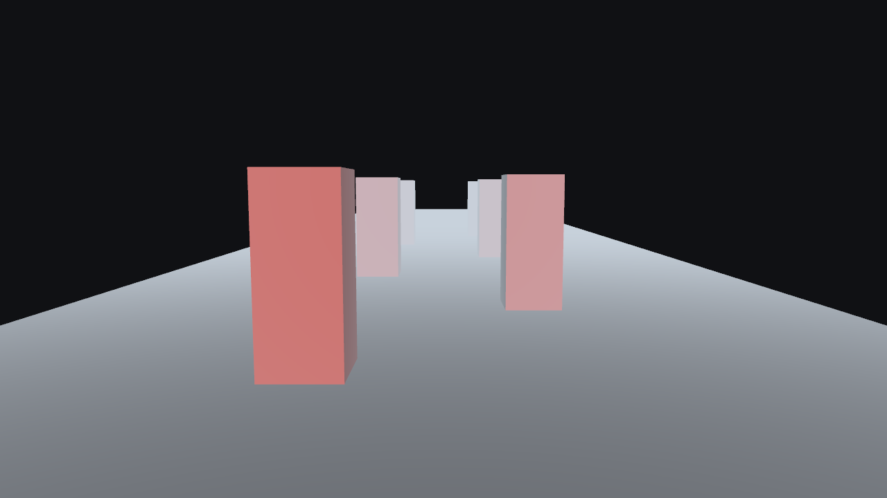

# Evidence for #3032: scenes written in the words familiar@1 now decides

Each scene is one document in the web 3D library's words, checked and expanded by `deep-show` through `packs/familiar-1.1.0`, and its expanded items drawn by `deep-gpu`'s `view3d` at 1280 × 720 under a look with no tone map at exposure scale 1.

Drawn by stand-in binaries while this head waits for the machine's build slot: a `deep-show` built from main `c8d9684f0`, an ancestor of this branch's base, checks and expands each scene, and a `deep-gpu` another session built from its own checkout draws it. Neither holds this change's Rust, which these stills don't exercise: they read the pack's data alone. A run on this head's own binaries writes this folder again, with the refusals the document check gives.

## A sun, a hemisphere light and four materials

- Words: `sun-hemisphere-materials.words.json`; still: `sun-hemisphere-materials.png`, sha256 `66917fdfdd6f4e753ee7fca3641f6ec6d9e6a3ab2f9a67ed9f950f1f262b491b`
- Presented with no error; expanded: ball_basic → lathe@1; ball_lambert → lathe@1; ball_physical → lathe@1; ball_standard → lathe@1; basic → material@1; camera → camera@1; floor → material@1; ground → slab@1; hemisphere → sky@1; lambert → material@1; physical → material@1; standard → material@1; sun → light.sun@1

## A rect area light and an ambient light, seen by an orthographic camera

- Words: `area-light-ambient-orthographic.words.json`; still: `area-light-ambient-orthographic.png`, sha256 `9c6aad34aa4075a5489731707a80681e8b37bb6a08879dc20e8bac4fddefc19f`
- Presented with no error; expanded: ambient → sky@1; ball_basic → lathe@1; ball_lambert → lathe@1; ball_physical → lathe@1; ball_standard → lathe@1; basic → material@1; camera → camera@1; floor → material@1; ground → slab@1; lambert → material@1; panel → light.area@1; physical → material@1; standard → material@1

## Exponential squared fog over a row of posts under a sun

- Words: `fog-exp2.words.json`; still: `fog-exp2.png`, sha256 `857b33c3282ffef8b31de71e8a515e322367ddf23083ad93a5b228cbc8aadb01`
- Presented with no error; expanded: camera → camera@1; floor → material@1; fog → sky@1; ground → slab@1; lambert → material@1; post_0 → slab@1; post_1 → slab@1; post_2 → slab@1; post_3 → slab@1; post_4 → slab@1; post_5 → slab@1; sun → light.sun@1

## What `deep_kinds` answers for each of the twenty

| Word | State | Recipe, or reason and what to write instead |
|---|---|---|
| `DirectionalLight` | mapped | `familiar.directional_light@1`: illuminance = intensity, kept in lux: the library lights a surface that faces the light with color × intensity as its irradiance; Color sRGB to linear; it shines from position, (0, 1, 0) unwritten, toward target |
| `AmbientLight` | mapped | `familiar.ambient_light@1`: ambient_top = ambient_low = color × intensity ÷ π: the library's intensity is an irradiance in lux, ours the radiance a white surface reflects; Color sRGB to linear; one sky a document, the first sky@1 it holds |
| `HemisphereLight` | mapped | `familiar.hemisphere_light@1`: ambient_top = skyColor × intensity ÷ π and ambient_low = groundColor × intensity ÷ π, mixed by the normal's height as the library mixes them; Colors sRGB to linear; position straight up only, the library's default; one sky a document, the first sky@1 it holds |
| `RectAreaLight` | mapped | `familiar.rect_area_light@1`: power = π × intensity × width × height: the library's intensity is the face's luminance in cd/m², ours the lumens the face sends out; size [width, height] in metres; Color sRGB to linear; it shines along its local −Z, its rotation (XYZ) through the rotation matrix to ours (Rz·Ry·Rx) |
| `OrthographicCamera` | mapped | `familiar.orthographic_camera@1`: view_width = right − left; the frustum's centre, ((left + right) ÷ 2, (top + bottom) ÷ 2), moves the position and target in the view's plane; the view's height follows the frame, as the library's does when the frustum's aspect is the frame's; local −Z forward to our target |
| `MeshBasicMaterial` | mapped | `familiar.basic_material@1`: unlit: true, so it draws its color whatever lights it; Color sRGB to linear base_color |
| `MeshLambertMaterial` | mapped | `familiar.lambert_material@1`: specular_level 0, so it reflects by its diffuse lobe alone; Color sRGB to linear base_color; emissive × emissiveIntensity to emission × emission_strength |
| `MeshPhongMaterial` | refused | no_counterpart: familiar.standard_material@1, whose roughness shapes the highlight where the library's `specular` and `shininess` shape a Blinn-Phong lobe ours never draws |
| `MeshPhysicalMaterial` | mapped | `familiar.physical_material@1`: color, roughness, metalness to metallic and emissive as MeshStandardMaterial's; clearcoat to coat; sheen to sheen.weight; thickness and attenuation to absorption, an attenuationDistance of 0 for the library's Infinity; iridescenceThicknessRange's upper end to the film's thickness in nm; anisotropyRotation in degrees; specularIntensity ÷ 2 to specular_level; Colors sRGB to linear |
| `MeshToonMaterial` | refused | no_counterpart: familiar.standard_material@1, which lights a surface in one continuous lobe where the library's gradient map lights it in bands |
| `Group` | refused | superseded: group@1 as itself, an item its children name in `parent` that draws nothing and gives them its transform |
| `Mesh` | refused | superseded: the geometry word's own item, familiar.box@1 and the rest, which draws as the mesh and names the material word's item in its `material` |
| `Scene` | refused | superseded: the document itself, whose items are the scene's children and whose one sky@1 holds the background, the ambient light and the fog |
| `Fog` | refused | no_counterpart: sky@1 with `fog_curve: {linear: {near, far}}`, whose ramp is a straight line over the distance from the eye where the library's is a smoothstep over depth |
| `FogExp2` | mapped | `familiar.fog_exp2@1`: fog_density = density in 1/m under fog_curve exp2, a share of 1 − exp(−(density × d)²) in both; ours reads d from the eye and mixes in linear light, the library reads depth along the view axis and mixes the encoded picture; Color sRGB to linear; one sky a document, the first sky@1 it holds |
| `InstancedMesh` | refused | imperative: instance@1, whose `of` names the item that stands for the geometry and its material and whose `pos`, `rot` and `scale` hold a row for each element where the library takes a setMatrixAt call |
| `Sprite` | refused | superseded: mark.image@1, a picture by its hash on one quad at the item's place, turned to the view and sized on screen or in metres |
| `Line` | refused | superseded: mark.line@1, whose `points` are the geometry's positions in metres |
| `Points` | refused | superseded: mark.point@1, one item a point or its `chunks` for many, at the geometry's positions in metres |
| `TorusKnotGeometry` | refused | no_counterpart: tube@1 along a curve@1 through the knot's own points, since no builder sweeps a (p, q) knot |
| `ShaderMaterial` | refused | renderer: material@1, whose fields say what a surface is, or a material operator a pack composes from the public steps, since nothing of ours runs shader text as written |
| `ACESFilmicToneMapping` | open | undecided |
