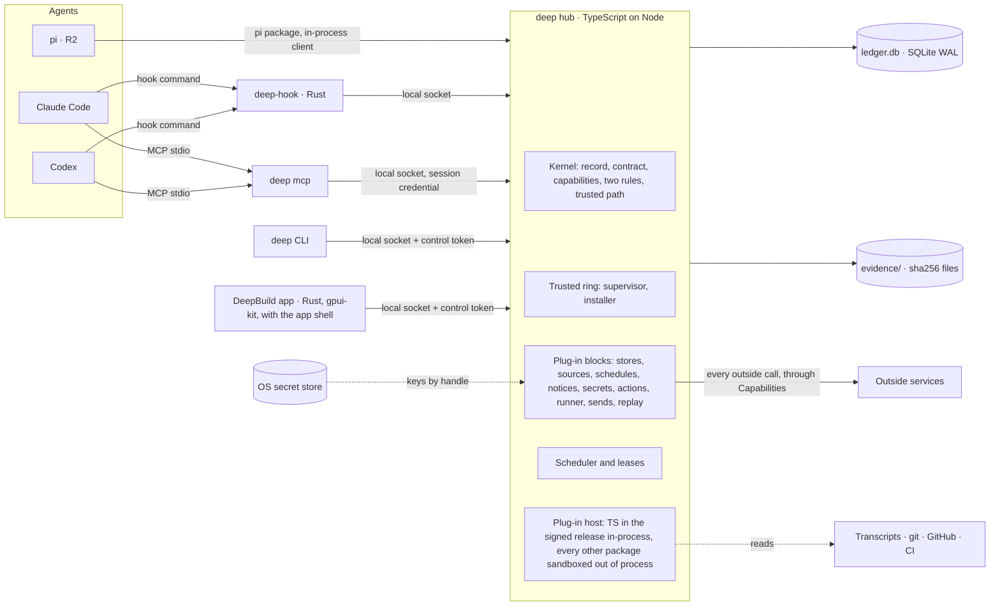
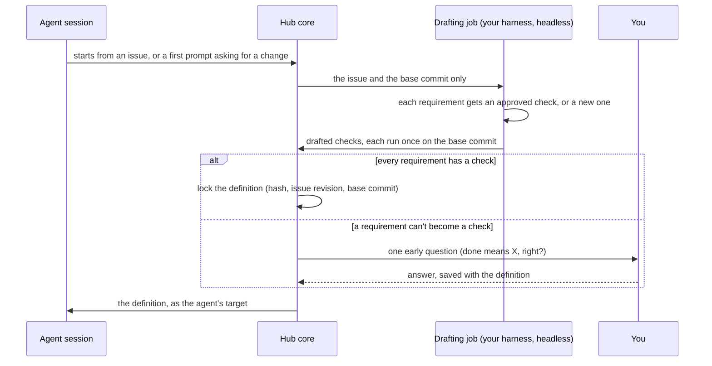
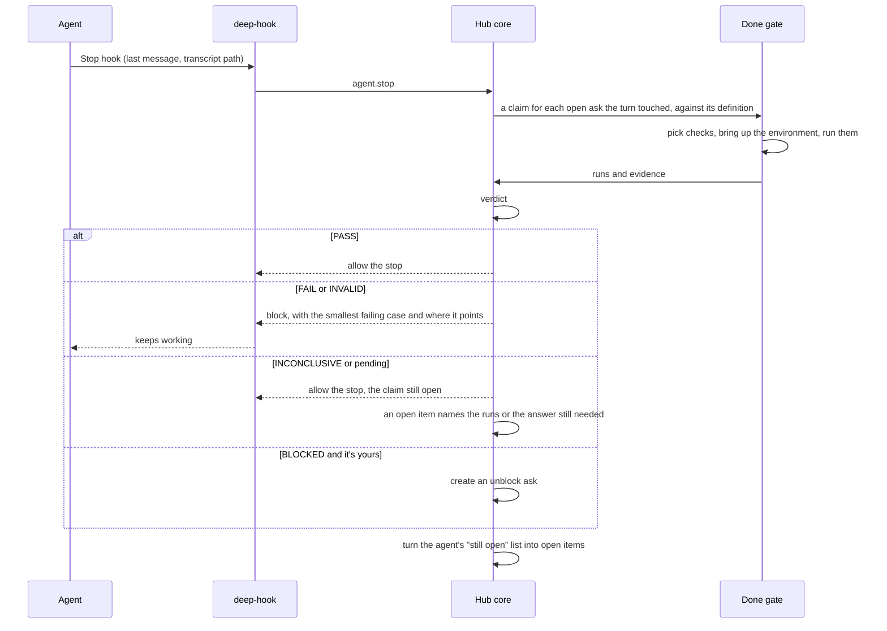
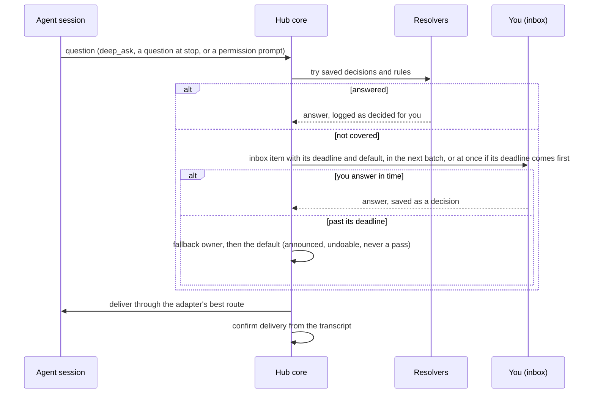

# DeepBuild: technical design

> Version 0 is the DeepBuild app, one native desktop app where you see, steer and answer every Claude Code and Codex session as it works, on a small base: one TypeScript process per user, the hub, plus a tiny Rust hook client that every agent hook calls. The hub owns the record: an append-only SQLite event log and a folder of evidence named by content hash. It routes asks to you only when a person is needed, delivers your answers back into running sessions through each agent's adapter, and runs gates that turn an agent's claim into one of five verdicts. Extensions inside DeepBuild's signed release load into the hub as TypeScript modules; any other package, such as one your agent builds, runs sandboxed, out of process. Version 0 runs from the repo checkout on the maintainer's machine. From R2 the app is a signed download that carries the hub, the hook client and the `deep` command, so people who start from the app never need npm; npm ships the same hub and CLI for terminal-first installs and CI. Everything runs on your machine and sends nothing anywhere by default.

The prototype app is in `app/` on the `public-history-oct15/spike-gpui-app` branch of the private DeepBuildAI/deepbuild repo. It holds the Map's city, the castle builder and the GPU handoff with its measurement; the house, the physics lab and the dial gauge survive only as screenshots. This page covers how version 0 (release R1) is built. Dates start the day building starts: until then the plan gives the order and the dependencies, and R1 takes six weeks from that day: five to build and one of real use. The code, the issues and the Markdown copy of both docs live in [windoliver/deepbuild](https://github.com/windoliver/deepbuild).

<a id="scope"></a>

## What version 0 builds, and what waits

### In version 0

- **The core:** the record, gates, asks and the adapter contract.
- **Adapters:** Claude Code (terminal and desktop app) and Codex (CLI and app). pi follows in R2.
- **Done gate:** judges every stop that did work against the definition of done of each open ask, and puts its verdict in the chat as one line. Checks come from the repo's `.deepbuild/` specs and from each task's definition of done, drafted at the start from the issue and the code as it was, by a job that never sees the agent's work. The agent's own plan steps can only send a claim back. Nobody writes the specs by hand: they're drafted from what each repo already runs and from your wiki, agents propose journeys, and you approve once.
- **Your wiki:** on the app's first launch or the first `deep` command, DeepBuild writes what it learns from your history as markdown pages, every line with its source. Where your history disagrees, it keeps at most five open questions, each asked when it matters. Agents read a short slice when they start and search the rest, through an index any extension can replace. Your agent reads your history [by reference](#reading), and every learned change is kept in a [history you can roll back](#learned).
- **Checks:** shell commands and browser journeys with Playwright; a review check, where a second model reviews the diff and its valid findings come back as one send-back of structured items (file, line, rule and the quoted text), with the reviewer's prose folded away; and a numbers check that re-runs the query behind each number a claim states, with an independent recount where one exists.
- **First spike:** the hooks in the Claude desktop app and Codex Desktop, where 409 of 422 replayed sessions ran: a held stop, a block with a reason, and the verdict line in the chat. Where a hook can't act, delivery falls back to the next prompt. A Codex app session whose hooks don't fire is watch-only: recorded from its transcript, with verdicts and answers on your next prompt. Codex's Stop hook waits 600 seconds by default, with no ceiling, so setup sets it once to 45 minutes and never changes it after, since Codex asks you to trust a hook again when its timeout changes; a check that can't end at least 5 s before it delivers its verdict on the next prompt.
- **Asks:** the inbox, a resolver that reuses your saved decisions, and delivery back into sessions. Every ask has a deadline and a default you can undo, so none waits forever.
- **Surfaces:** the CLI, the app (built with gpui-kit, after a two-day spike) and the MCP tools. The app's canvas ships only what the line and receipts need: one document format with kinds and validation, a basic clock (canvas time in full lands in R6), the look with its status map and legend, a basic layered layout, bindings, salience, sheets and the evidence player. A view that lists asks shows every open ask.
- **Readings:** your time and agent spend from transcripts, the time each stop was held from the record, plus lifecycle numbers from git and GitHub, enough to judge Decision 1.
- **Verdicts on GitHub:** a commit status that branch protection can require. The PR comment and `deep report` follow in R2.
- **Environment:** `deep env up` with leases on ports, test accounts, phone numbers, simulators, screens and GPUs, each with a cap and a cooldown. Processes are tracked by run token and start time, never by PID alone.
- **Trust:** a transcript archive before agents delete old sessions, a doctor, and check health.

### Later, as extensions

- In R2: infra cost for the vendors you use, then the infra map in R3; full cross-vendor FinOps waits until a team asks.
- Policy beyond exact saved decisions, the memory keep-or-remove list, and fixes for recurring errors. Graph and vector indexes for the wiki, and a code graph, each rebuilt from its pages. Taste rules: after the same kind of taste call (same screen, same kind of change) gets the same answer from you three times, never by a default, a rule is offered whose bounds are checks on the recorded element boxes, such as the total and the pay button staying in view; once you accept it, the resolver applies it, and prices, totals and outward-facing changes stay excluded. An outside memory service as an extension, for people who already run one: wiki claims go into a bank per repo, `deep_search` uses its fused keyword, vector, graph and time recall, and its banks are read as one more memory source. It brings its own model and server, so it's never the default. Size budgets learned from the change sizes you accept and your "too complicated" remarks.
- In R2: parallel sessions (notices to each agent and dry merges, on the session map R1 already keeps) and plan usage per account and per task, built on the window readings R1's runner already takes for your reserve. See [Parallel and plans](#parallel).
- Team claims and merge checks across teammates' machines, with notices that cross through the forge: branches and a claim on the issue.
- CI policies, receipts in a signed attestation format, and exports beyond GitHub: the status line, the weekly brief and OpenTelemetry.
- In R2: chat-app journeys with leased real accounts, because driving your own bots by hand is a large share of what you type. After them in R2, app journeys on an iOS simulator or an Android emulator, as an extension (see the journeys row). Journeys through a real phone number, text messages and desktop apps come later.
- Agent spend caps, leased remote test machines, and the feature map that keeps itself current. Your own other machines, over SSH, come in R3 through the [blocks for work on your other machines](#hosts).
- In R2: the pi package, npm packaging with prebuilt binaries and the Claude Code plugin, the PR comment and `deep report`, and the OTLP receiver.
- In R2, first: start, route and chat with every session from the app, so you never leave it to manage sessions across apps and terminals. The box starts a session in Claude Code, Codex or pi, in the agent you pick or the one DeepBuild names when you pick none, in a worktree of its own and the account you choose, and takes your words for a running turn, the next turn or an open card; every session, wherever it started, shows in one list, and one that has ended resumes in the app. paseo is one route among others: without it, the box starts Claude Code and pi in a terminal the hub hosts and Codex through app-server, on the same session contract (see [Starting a session from the app](#start)).
- In R2: a paseo adapter, so every agent you run through paseo, including those with no hooks of their own, gets the done gate, policy answers and deep's MCP tools, and Needs you reaches paseo's phone and desktop apps. The box drives those sessions too, start to finish, and each return comes back as a card; an Agents page keeps every agent's version, MCP servers, skills and account room in one place.
- In R4: speed and cost ceilings that only move down. Raising one needs before-and-after numbers and its owner's yes, and a measured improvement lowers it.
- The team server and the enterprise preset, and fleets of agents in the cloud, on the few things the core keeps for them (see [Scale later](#scale)).
- In R6: playbooks (`deep create`), the line that draws each one in Work, scheduling within each account's plan windows, the agent and account picker, scores with replayed improvements, and ACP as the generic route for driven sessions of other agents, on the session contract that Claude Code's, Codex's and pi's own routes follow from R2. Child sessions that a lead starts itself (subagents, agent-team teammates, sessions in their own worktrees) are gated in R2 instead, through Claude Code's SubagentStop, TaskCreated, TaskCompleted and TeammateIdle hooks, with write leases on paths and a merge that is a claim of its own.

<a id="arch"></a>

## One hub per user, a tiny hook client, and extensions in-process



| Component | What it does | Runs as |
|---|---|---|
| deep hub | The only writer to the record. It hosts the core and the extensions, serves the app and the CLI over its socket, schedules check runs, holds leases, and tracks every process it starts by run token and start time, in its own process group, so it stops only what it can prove it started. Every connection gets one role from the credential it presents (see [Socket roles](#roles)), and each event is stamped with that writer. It runs as a per-user service that starts at login on every platform (see [Platforms](#ship)), and it is safe to restart, because every consumer keeps its position in the event log, the `log_pos` of the last event it holds (see [One event log](#data)). It also runs the blocks plug-ins build on: their stores in the record, every call to an outside source, their schedules, notices, sends, secret handles and model jobs (see [Blocks for plug-ins](#real-work)). | One long-running Node process per user, listening on a local socket only you can open: `~/.deepbuild/hub.sock` with mode 0600 on macOS and Linux, a named pipe limited to your user on Windows |
| deep-hook | Called by every agent hook. It reads the hook's JSON from stdin, adds the agent name, the event, and a sequence number and an ID taken when the hook started, matches the call against every guard entry in `~/.deepbuild/rules.json`, which the hub rewrites at each install, forwards that to the hub with the entries that matched, and prints the hub's reply. If the hub isn't running, or doesn't acknowledge the request in time (see the [hook protocol](#interfaces)), it applies the entries marked fail-closed, otherwise allows the action, and saves the event to a local spool the hub replays when it starts, so a stopped hub never blocks your agents and never loses what they did. Rules marked fail-closed still block. The defaults are no killing processes by name or port, and no CI workflow dispatch without approval. It can only append events and read `rules.json`; it never holds the control token. | A Rust binary started once per hook call; most of it is the shell matcher every guard runs through |
| DeepBuild app | One native desktop app: native on macOS, and the same app on Windows and Linux later. On first launch it shows one button, Set up: one click runs the same steps as `deep setup` (your history into the wiki, the hooks in watch-only mode, the hub at login), and nothing else is asked. The first `deep` command does the same without a click, for scripts and CI. There is no Settings page. In R1 its window opens on Needs you; every session sits in the sidebar by repo, with its state and its count of asks; and the Map and Numbers sit under Views. A session's page has tabs for its line (from the issue through what done means, the agent, the claim, the checks and you to the PR), its asks, its checks and, from R2 with the cell grid, its terminal when the hub hosts it, and a box that sends to its agent: into the session through the adapter's delivery (a steer read at its next step, never an interrupt; for a session that can't be woken, with its stop hold or at its next prompt), or, from R2, as a new session started from the app (see [Starting a session from the app](#start)) or opened in the agent's own app or CLI, with your words as its prompt, its definition of done drafted first from your words and the source session's evidence passed by reference. From R2, the line tab shows the session's newest return card open under the line, and earlier returns folded to one line each, newest first, above the box. DeepBuild watches that session like any other; from R2 it starts and drives Claude Code, Codex and pi sessions itself, through `deep.startSession`, while ACP and playbooks stay in R6. The Map draws the project as a transit map: journeys as lines; code parts as stations, joined later by services (the infra map, R3) and paid tools (the money extension); lenses for proof, cost and moving work, where moving work shows sessions by repo, a conflict a dry merge found (from R2) as a dashed attention line, who holds which lease, and the disk each session uses; stories; and a panel per station. It is a projection of the record (parts by folder and route, evidence by what each check covers, sessions by the files they touch, costs from bill readings). From R2, a 3D mode draws the same record as a city on the canvas's GPU layer: repos as districts, parts as buildings sized by code and colored by proof, sessions as lights over the parts they change, a journey’s run as a light along its road, and a time slider that replays the day; or, instead of a city, parts and services as nodes on tiers of glass and stone, linked by conduits. Map layers draw in it too, their rows bound to readings, so the same view is a live picture of what you run, with no code per frame (see [A map beyond code](#map-beyond-code)). Later, the money extension adds a Bills and schedules section to Numbers: what every tool you pay for costs day by day, code or not, from sources read on schedules you set in words. Next to the views sits a box where you say what you want in words, such as changing a rule or removing DeepBuild from an agent; your own agent turns the words into a proposed change, on your plan. The menu bar (the tray on Windows and Linux) shows one count; notifications carry each ask's question, its default and when the default applies, open the ask's card when clicked and answer nothing, and carry the notices you asked for; and the hub starts at login. In R2, on macOS first, what needs you also hangs on a line under the menu bar, shown when the pointer rests at the top edge for the dwell the line's own spike measures, never while a menu is open, or with a shortcut, its asks listed as rows and one at a time presented and answered on its question card there; the same box builds extensions too (Add anything). In R6 a playbook gets a line of its own, its lanes in parallel. Open in Claude or Codex uses the apps' own links. It talks only to the hub's app API, over the socket with the control token. Every view, panel, gadget and tab is a plug-in, the shipped ones included, and so is the layout; the app shell draws only the window frame, the question card, access and key prompts, and notifications, and nothing can cover the card. The shipped views register through the same panel registry an extension uses, and a view that replaces one passes that view's kit at install, in a replica: Needs you's `needs-you@1`, the sidebar's `session.row@1` and the return card's `return.card@1`, and for any other view the checks every panel passes; the question card, the one count and notifications stay the app shell's. Extension panels are small JavaScript programs: gpui-shell, gpui-kit's embedded QuickJS engine, runs each one with an empty gpui-shell policy, so whatever it can do comes through DeepBuild's modules under the grant you approved, and draws it with the same Rust components as the rest of the app. Shipped panels run in the app, on the UI thread, under a 4 ms per-update budget. Panels your agent built run in a separate panel host process with the JIT off and send element trees, because gpui-shell's runtimes share the UI thread and aren't a sandbox. An extension raises a question through the ask API and tells you something you asked for through a notice. Show what changed outlines every piece you or your agent added or changed, with the sentence it came from. Reports open in your browser; the app has no web view. In R1 it's built from the checkout; from R2 it ships signed, and notarized on macOS. It sends nothing off the machine. The two-day spike decided the toolkit; see "The app's toolkit" under [Decided](#decided). | Rust · gpui-kit, resident |
| deep CLI | `deep status`, `deep inbox`, `deep show`, `deep open`, `deep run`, `deep env up`, `deep doctor`, `deep setup`, `deep spec` (a repo's spec: show it, draft one now, or change it in words) and `deep install`. The first `deep` command sets everything up, so nobody has to run `deep setup`; it does the same steps without asking anything, for scripts and CI. `deep off` turns every gate into watch-only at once, once the OS confirms you, as an escape hatch, while the fail-closed guards, the `.deepbuild/` guard and the core's floor hold as they do with the hub down and in safe mode, so only `deep setup --undo` removes them; `deep debug bundle` writes a redacted bundle for bug reports. When the hub is down, read commands open the database read-only. | Node, short-lived |
| deep mcp | The MCP server agents call: ask, wait, add an open item, run a check, declare a claim, attach evidence, start the environment. It forwards each call to the hub with a credential scoped to the session it serves, or, in a process that serves several, to the session each call binds to, so it can't read or act on another session. While the hub is down or restarting, it stays connected to its agent with the same tool list, answers each call within a second that the hub is unreachable, never with a success, and reconnects when the hub is back. | One stdio process per agent session |
| Trusted ring | The app shell, in the app: the window frame, the question card, access and key prompts, and notifications; nothing can draw over the card. The card counts as shown only once it's on screen, arms after a short interval, re-arms when it moves, is covered or changes, refuses synthetic clicks, and fails closed if the app dies. The canvas core, in the app: the compositor, the only part that draws or touches the GPU; inside it, a small core plus first-party canvas modules compiled in (2D marks, data views, motion, the 3D scene, physics, media and the rest), each registering kinds, arrays, operators and passes into closed phases; plug-ins and agents hand it documents and patches, and it checks, evaluates, draws and composes them. The device and media gate, in the app: sound only after your gesture, a screen or window only through the system picker, and the camera and microphone only through the OS permission while a shortcut is held. The supervisor, in the hub: starts every process with a run token, tracks it, enforces grants and the sandbox, and stops only what it started; it is the local implementation of `host@1`, the one contract every place that runs work follows (see [Scale later](#scale)). The installer, in the hub: checks, installs, updates and rolls back every piece. Plug-ins can't replace or extend the ring. | Part of the app and the hub, never a plug-in |
| Extensions | Everything beyond the kernel and the trusted ring, including the done gate, journeys, resolvers and adapters. The TypeScript modules inside DeepBuild's signed release load into the hub. Any other package runs sandboxed, out of process, whoever wrote it: anything your agent built or changed, a package someone else published, and extensions in other languages, over JSON-RPC on stdio. That split guards you against code from outside the release, not the hub against a bug in a first-party extension: those are held by their kits, the hot-path test and the local preflight, and safe mode starts the hub with none loaded. | In the hub (inside DeepBuild's signed release only), or as sandboxed child processes |

Everything lives under `~/.deepbuild/` (`%LOCALAPPDATA%\DeepBuild` on Windows): `config.json`, `ledger.db`, `wiki/`, `evidence/`, `rules.json`, `extensions/`, `jobs/` (one folder per headless job DeepBuild runs), `worktrees/` (from R2, one per session you start from the app's main box) and `logs/`. Per-repo specs live in the repo under `.deepbuild/`, so they're reviewed like code, and a guard stops agents from editing them.

<a id="data"></a>

## One event log, with tables built from it

The `events` table is the source of truth. Every other table is a projection the hub can rebuild by replaying events. IDs are ULIDs, so they sort by time. Each event also gets a `log_pos` when the hub appends it: its position in the event log, an integer only the hub assigns, which only grows and is never reused, kept apart from the event's ID, its identity, and its `seq`, its order within its session. The hub hands out log positions from a block it records with `synchronous=FULL` before it uses any of them, so a power cut can skip log positions but never hands one out twice, and a skipped run is a gap a consumer refetches over and finds empty. The hub gives each event its `log_pos` inside the commit that writes it, so log positions commit in order and a gap a consumer sees never fills later. A `log_pos` stays far below 2^53, so it travels as a JSON number. A project is identified by its repo root and remote URL. A session is identified by the agent's own session ID plus its worktree path. The log runs in WAL mode. A commit that records a verdict, a decision, an answer or a send's key uses `synchronous=FULL`, so it survives a power cut; the busy event stream batches with `synchronous=NORMAL`, and a stream event lost to a power cut leaves its claim INVALID, never PASS: after a start with no clean stop recorded, every claim still open is INVALID, cause events lost, unless its session had ended before the last `synchronous=FULL` commit, since only a session still running then can have written events the cut dropped. On macOS a `synchronous=FULL` commit runs with SQLite's `fullfsync` on, since a plain fsync there leaves the write in the drive's cache, where a power cut can still lose it. The hub's event loop never waits on a disk sync: the one writer connection, its commits and its WAL checkpoints run on a worker thread, and the event loop answers a hook without waiting for that hook's own event, which commits in the next batch. Nor does the event loop parse, scrub or hash a payload: a worker thread parses each hook request line, keeps its kind's catalogue fields, scrubs them and hashes what goes to evidence, as it does each transcript line read for a backfill or a tail, and the loop only reads lines, acknowledges, routes and writes replies, so one large tool output never holds up another session's hook.

```
CREATE TABLE events (
  id          TEXT PRIMARY KEY,          -- ULID; a hook's event keeps the one deep-hook minted
  log_pos     INTEGER NOT NULL UNIQUE,   -- position in the event log: assigned by the hub at append, only grows, never reused
  ts          INTEGER NOT NULL,          -- ms since epoch
  project_id  TEXT,                      -- hash of repo root + remote, or a workspace's id
  session_id  TEXT,                      -- agent session id
  seq         INTEGER,                   -- order within the session: ns since the epoch when the hook started, stamped by deep-hook; 0 to 2^63 - 1, read back exactly
  agent       TEXT,                      -- an adapter's registered name, such as claude-code or codex, or deep
  writer      TEXT NOT NULL,             -- hook | mcp:<session> | app | cli | ext:<id>, from the connection, never the payload
  actor       TEXT NOT NULL,             -- the person behind it, from the credential: you, until other people join
  scope       TEXT NOT NULL,             -- who may see it: you today; a project or a team later
  kind        TEXT NOT NULL,             -- session.start, tool.before, claim.made, run.finished, ask.created …
  subject     TEXT,                      -- claim, ask or change id this event is about
  data        TEXT NOT NULL,             -- JSON, validated against the kind's schema
  evidence    TEXT                       -- JSON array of sha256 hashes
) STRICT;

-- Projections, rebuilt from events:
-- sessions(id, thread_id, parent_id, agent, project_id, worktree, branch, pid, status, last_seen)
--   thread_id joins IDs rotated by /clear, /compact or a fork; parent_id links an agent another agent started
-- claims(id, session_id, kind, subject_ref, text, created, verdict_id)
--   verdict_id: the claim's newest verdict; a verdict that rises adds a row and never edits one
-- definitions(id, task_ref, thread_id, issue_rev, base_commit, requirements, budget, hash, locked_at)
--   one per ask, shared by every attempt; each requirement: its sentence, the checks that cover it,
--   each check's oracle (code, a model or a person) and the depth it needs; drafted without the session's work
-- attempts(task_ref, attempt, session_id, child_id, worktree, base)   -- the first PASS settles the task
-- checks(id, project_id, name, type, spec_hash, lane, min_runs, owner, protected)
-- runs(id, check_id, claim_id, host, needs, commit, env_fingerprint, started, ended, outcome, tests_run, evidence)
--   host: where it ran, local in R1; needs: the cores, memory, stack slot, GPUs and expected time it asked for
-- verdicts(id, claim_id, outcome, reasons, requirements, created)   -- requirements: each one's outcome, which a chip's status binding reads
-- asks(id, kind, key, question, options, recommended, default, provisional, session_id, owner, fallback, deadline, later_until,
--      pinned_to, status, outcome, batch_id, created, answered)
--   pinned_to: the commit, document revision or evidence hash the ask shows; an answer after it moved says what changed
--   outcome: answered | decided_for_you | escalated | defaulted | unanswerable | cancelled | superseded | moot | unanswered
--   kind: authority | unblock | taste | exception | choice | definition; a provisional taste or choice lets work go on, undoable
--   an ask with no deadline, fallback or default fails its schema; later_until never passes the deadline
-- decisions(id, key, scope, answer, by, ask_id, state, created, overruled_by)
--   state, for a decision that answers later asks: active | frozen | revoked
-- leases(kind, key, mode, holder, expires)   -- kind: a declared lease.kind@1 (ports, accounts, phone numbers, screens, simulators and GPUs by exact key, paths by glob, document ID prefixes, CPU slots as a pool); mode: exclusive | shared; holder: a session, or a document prefix's writer
--   a lease ends when its holder has ended or its attempt was replaced, and every process the supervisor recorded for it is proven gone;
--   a process it couldn't prove never holds a lease open, and a port such a process still listens on is skipped by the next lease's free check;
--   past expires it is only stale
-- evidence(hash, kind, redaction, license, step_times)   -- step_times let the player open a video at a check's step
-- commits(sha, session_id, worktree, created)   -- recorded from the hooks, never from commit trailers
-- rollups(source, span, start, evidence)   -- span: minute | hour; one row per source and window, from reading.rollup events; a removed minute file's values resolve to the hour rollup, and a removed hour file's read missing
-- layer_rows(layer, project, parent, level, evidence, log_pos)   -- each map layer's rows as they were, from layer.rows events
```

Each event kind carries a schema version. Migrations only move forward, and every projection can be rebuilt from the log. A projection is a function of the events alone, in `log_pos` order. It reads no clock, setting, file or evidence bytes, and a state that comes from time, such as a stale lease or a defaulted ask, comes from an event that says so. A seeded property test over at least 1,000 generated streams checks that each table after live appends equals the same table rebuilt from the log, compared row by row in primary-key order with values as stored. Its streams mix ties in `seq`, clock steps inside and between turns, PostToolUse after Stop, spool batches replayed late and twice, and a kind at two schema versions.

Every adapter maps its agent's events onto the same few shapes, so rules, notices and gates never branch on an agent's name. A tool call has a kind (shell, read, edit, write, search, fetch, mcp, or unknown, which guards treat as change) plus the command and the paths it touches, each path with `..` and symlinks resolved, and an MCP call also names its server and tool; Codex's `apply_patch` becomes an edit with the paths from every path line in it (`*** Add File:`, `*** Update File:`, `*** Delete File:` and `*** Move to:`), each resolved against the session's working folder, with `..` and symlinks resolved; a patch with a path line the adapter can't read is denied before it runs. The adapter reads path lines as Codex does, with spaces allowed around each marker, and also reads a patch Codex takes from a shell command (`apply_patch` or `applypatch`, directly or in a heredoc after an optional `cd`), whose paths resolve against that folder; a patch that names another environment (`*** Environment ID:`) has paths the adapter can't resolve, so it is denied too. A permission request has a kind (tool, plan, question or mode) and is answered allow, deny or cancel, for this call or for the session, optionally with edited input. The adapter takes allow or deny only from the answer's `decision`, never from an option's label or your words: `allow` allows, and `deny` or `none` denies, with your words as the reason. DeepBuild never picks an agent's option that writes a lasting rule into the agent's own settings: standing rules live only in your decisions, where you can see, overrule and roll them back. An attention event says a session finished, failed, is waiting on a permission, or is unknown; silence never counts as finished. A stop names its cause from a closed set: sign-in required, token refresh failed, plan window spent (with its reset time), rate limited or overloaded, refusal, max turns, context overflow, tool schema rejected, agent crashed, timed out, or unknown. The adapter reads it from hook payloads, transcript error records and rate-limit records, never from the agent's text. Each turn reports its usage: input, cached and output tokens, cost, how full the context window is, and the model that actually answered, so a quiet switch away from the model you chose shows. Usage says whether it covers the turn or the session so far, each agent's counting rules live in its facts, and a cost says whether it was reported, estimated from a named rate card, or unpriced; missing usage never reads as zero. It reads "not captured" instead, never $0 or 0 tokens, and every usage count says whether it is exact or an estimate.

### Evidence

- Each file is stored once at `evidence/ab/cdef….png`, named by its SHA-256, with its type and size in the log. A receipt that cites a hash can't point at a swapped file. A screenshot, a video frame or a recording is checked at intake: its leading bytes must match the type its slot declares, and its end must be there (a PNG's `IEND` chunk, a JPEG's end-of-image marker, an MP4's boxes adding up to the file with its `moov` box among them). A file cut short is kept as truncated, naming what's missing, and one of another type is refused, so its slot reads truncated or missing, never captured, and a half-written screenshot can never become a baseline.
- Retention defaults to 30 days, except evidence behind a decision, or an archived transcript a `transcript.archived` event links, which is kept. A series' uncited batch files leave after 24 hours and its uncited minute rollups after 7 days, and the newest `layer.rows` file for each installed layer, parent and level is kept while the layer is installed; older ones follow this retention. A verdict whose evidence retention removed is never reused: a later claim that would carry its results runs those checks again and gets its own runs and verdict, while the old verdict and its runs stay in the record as they were. Evidence is never written into a repo.
- An image you paste into a session is evidence too, stored by hash with the message it came with and the change it's about. A bug report becomes a check the fix must pass; a taste remark becomes a decision with the image as its baseline, which taste rules read; a journey screen is never compared with it (Screens, in the journeys row).

### Privacy

- Transcript text is redacted on the way in: keys, tokens and anything that matches a secret pattern.
- Redaction also works by value. For each run, the hub keeps in memory the exact values it injected or holds by handle (secret values, credentials that env-local loads, and its own tokens) and the value of each environment variable it passes to a process when the variable's name marks a secret (it contains `TOKEN`, `KEY`, `SECRET`, `PASSWORD` or `AUTH`), its value matches a secret pattern, or its value is one word of 16 characters or more that isn't a path or a list of paths. Short and plain values, such as `CI=true`, `NODE_ENV=test`, `TZ=UTC` or a leased port, stay as they are. It scrubs them from output, logs, traces and transcript text, in raw, base64 and URL-encoded forms and across output chunks, before any evidence is hashed. Base64 is matched at each of the three byte offsets a value can start at, in both the standard and URL-safe alphabets. A journey that types a secret into a field that isn't a password field marks its later screenshots and video `redaction: incomplete`, and `deep report` shows your home folder as `~`.
- Hook payloads are redacted on the way in like transcript text: what an event keeps of one, such as a tool call's command and a prompt's text, is scrubbed by pattern and by value before the event is appended. A canary sweep in the local preflight puts a scrub-list value and a pattern-shaped key into a prompt, a command and its output, with the hub up, and then down and back up, then searches every file under the state folder (the ledger, its WAL, the spool, logs, evidence and a debug bundle) for each scrubbed form. Any hit names the file and fails. An event keeps only its kind's fields in the event catalogue, such as a tool call's kind, paths and command, never the call's whole input or output, which the archived transcript holds. A field longer than the read cap of 8,192 characters, such as a heredoc in a command, is scrubbed whole before it is cut, so no part of a value that spans the cut stays in the event: the event keeps the first 8,192 characters of the scrubbed text, and the whole scrubbed text is evidence by hash.
- A seeded property test of at least 1,000 cases holds the scrub to its forms. A scrub-list value of 16 to 4,096 bytes, written raw, URL-encoded with hex of either case, or as base64 at each offset in either alphabet, is placed in random text and cut into chunks at random byte offsets, including inside the value and its encoding. It never appears in what is stored, and the same text without the value is stored byte for byte.
- Content-free mode keeps only counts, durations, error signatures and verdicts, never text.
- Nothing leaves the machine unless an extension that syncs is installed and turned on.
- Files that leave the machine, for a hosted job tool, a provider or a send, go only by hash from the evidence store, never by path. The store records each file's origin from the writer's connection, never from the call: made by DeepBuild (a render, a capture, a journey, a job's output or an export), chosen by you in the app (a paste, a drop or a file picker), or put there by an agent; a file made from others, such as a job's output, keeps origin agent when any of its inputs was put there by an agent. The first two need no ask of their own, though the redaction, license and spend rules still apply; a file an agent put there leaves only after an ask that names its hash and where it goes, asked once for that pair. When an agent names a path for the hub to read, such as evidence it attaches, the hub resolves `..` and every link first and reads only inside that session's working folder, and it answers a path outside it exactly as it answers one that doesn't exist, so an agent can't use the hub to read outside its own folder or to learn what's on the disk. Each receipt lists every file that went out, by hash and destination.

<a id="learned"></a>

### The learned layer

Learning only ever changes a layer that sits on a base it can't touch. The base is the kernel's two rules, the four product invariants, the specs you approved, and your decisions and answers. Only you change the base, in words, as a diff you approve, and the core refuses a learned change aimed at it. The learned layer holds wiki claims, the slice agents read at session start, rules DeepBuild offers such as taste rules, improvements to extensions and playbooks, and reusable step specs, such as how to run shop's journeys or how a research step should cite sources. It also holds how each repo's definitions of done get drafted, learned from checks the working agent disputed, your overrules and bugs that got through after a PASS; a learned change that would have dropped a check that once caught a real bug is held for you. Each closed task and each piece of rework is kept as a fix record: the problem, the failure class, the gap in the definition that let it through, the mechanism of the fix, and the check that now proves it. When a definition is drafted, fix records from every repo are found by keyword, and each suggestion names its source record, its mechanism, and the condition it depends on. A learned change, a trial and every replay that scores the design are fitted on sessions before a cutoff and scored on the sessions after it, and report both. A replay's plan is frozen before either side runs: the task IDs, the variants, the models, the repeats, the metrics and the comparison rule. A missing, failed or duplicated pair stays in the count and never shows improvement, a missing metric stays missing rather than zero, and a cohort too small or too noisy to decide is INCONCLUSIVE: it can't widen a standing rule, and it doesn't by itself revoke one. And it holds the compositions that join pieces together (see [Composition](#composition)), which can be rewired as they prove themselves. Every learned change is an event in the record, and the layer is a projection rebuilt from those events like the other tables. It learns during normal work, from the hooks, not in separate training runs.

```
// kinds: learn.proposed · learn.applied · learn.widened · learn.rolled_back · learn_check.made (the core's refusal from what it read)
{ "layer": "learned",                           // "base" only for changes you make; learning can't write it
  "target": "wiki:repos/shop.md#start-api",     // a claim, the start slice, a rule, an extension, a playbook or a step spec
  "diff": "…",                                  // one small change
  "evidence": [{ "at": "session:01J9…#m214", "quote": "…" }],  // handles and the exact quotes behind it
  "scope": "session:01J9…",                     // session:<id> → repo:<id> → all
  "replay": { "tasks": 20, "regressions": 0 },  // when the change alters behavior
  "applied_by": "you",                          // or "rule:<id>", the local-first rule or one you approved; never an agent
  "supersedes": null }                          // the learned change this one replaces
```

- **Small, with its evidence.** Each change is one small diff that cites, by handle, the sessions and quotes behind it, and, when it alters behavior, its replay result on past tasks. A change whose quotes aren't at their handles is refused. The layer judges a change from the record alone; a quote in a transcript or an evidence file is bytes the projection never reads, so the core reads it at append and records a refusal as `learn_check.made` in the change's own commit, and a refused or held change stays in the log with its reason. A learned change's `target` is a closed list: a wiki claim, a start-slice entry, a rule DeepBuild offers, an extension patch, a playbook, a step spec, how definitions are drafted, or a composition. A start-slice entry resting only on outside content (a fetch's, a search's or an MCP call's result, or an agent's own words, which may repeat one: its turns, a subagent's report, a compaction summary) is refused unless a clause of a decision of yours is the line it adds (a labelled clause is what follows its label, and nothing when the label is a negation: "never: X" promotes nothing); a change citing one your decision promoted rests on that decision. Any other tool's result reads as first-hand, so a check's output counts, and so does a file the agent wrote and read back. The start slice always holds every rule you typed and every decision whose scope covers the session, and a learned change that would remove or reword one is refused, naming it.
- **Local first.** A change applies to the session it came from, then widens to the repo after it helps again in later sessions with no regression on replay; the local-first rule applies both steps. It widens to all your repos only with your OK or under a rule you approved. Evidence that can't decide never widens anything; the change stays where it is. Agents propose changes with `deep_propose`; they can't apply or widen any change, including their own. Claims learned at install have no session to start in, so they start at the scope their evidence covers: a fact seen in one repo's sessions applies to that repo, and a habit seen across your repos applies everywhere, because it describes how you already work rather than a new lesson.
- **Snapshots are positions in the log.** A snapshot is an event ID. The layer as it stood then is rebuilt by replaying the learned events up to it, so nothing is copied.
- **Rollback is a compensating event.** Rolling back appends `learn.rolled_back`, and nothing is deleted. Rolling back one change flags every later change that supersedes it or cites it. Rolling back everything learned since a date compensates each learned change after that point, newest first. The rollback is recorded like any other change.
- **A history you can ask about.** "What did you learn this week?", asked in the app's box or of your agent, lists the learned changes since then, each with its evidence, scope and replay result.

<a id="reading"></a>

### Reading by reference

When DeepBuild needs free text read (your history at install, the replays when you try an extension side by side, a premise review, a change summary), it never pastes transcripts or evidence into a prompt. Your own agent, headless and on your plan, gets handles instead: `session:<id>`, with `#<message>` for one message, `ev:<sha256>` for an evidence file, and `wiki:<page>#<claim>` for a wiki claim. A `session:` handle resolves through the record: the archive stores each transcript copy as evidence, and a `transcript.archived` event links the session to it, so reading a session never depends on an extension's folder or the agent's own files. It reads them through a small read-only query API, such as `deep find`, which returns matching handles with a line of context each, and `deep read <handle> --slice`, which returns one slice of what a handle points to. Output is capped per call, at 8,192 characters by default, and a reply cut at the cap says where to continue.

- **Code and sub-reads.** The agent works through the material with code, such as counting or filtering what `deep find` returns, and hands small reads to its own sub-agents, which run in parallel. Token-heavy material, such as traces and long logs, is read only inside a sub-read, and only the sub-read's answer comes back. Where the agent can choose a model, sub-reads run on a smaller one, and the final answer and any premise review get the strongest one you have.
- **Small stays inline.** A tool result that fits under the cap comes back whole. Handles are for transcripts, evidence and anything larger, and every slice says which part of its source it covers.
- **Answers cite handles.** Findings come back only as a structured answer, checked against a JSON Schema, and every finding cites a handle and the exact quote. Before writing anything, DeepBuild checks that each quote is at its handle and that the handle was actually delivered to that agent in that session, and drops any finding that fails either check. A quote is at its handle when it is a byte-exact substring of the redacted slice that handle names, after Unicode NFC and collapsing each whitespace run to one space; a quote from a transcript cites its message (`#<message>`), never the whole session. The record itself is never summarized away; a summary can help find things but is never cited.
- **Plan usage.** Each reading job shows the plan usage it took, and waits when the plan window is down to your reserve. At install, 212 sessions are read with 38 sub-reads, about 4% of one 5-hour window, instead of pasting millions of tokens.

<a id="verdicts"></a>

## How runs become one of five verdicts

```
verdict(claim):
  results = runs of every check selected for the claim
  every rule below is tested, and the highest
     by the precedence line wins
  if any check is missing something outside the code,
     or is inherited: a spec check, or one for unchanged
     behavior, that also fails on the merge base          → BLOCKED   (cause, owner, since)
  if any check ran nothing, can't fail, or, for a fix,
     also passes on the base commit, or no check, not
     even the agent's own, covers the claim or one of
     its requirements at the depth it needs               → INVALID   (which check or requirement, why)
  if any check that isn't inherited failed on every
     real run of the commit                               → FAIL      (smallest failing case, and where it points)
  if any check, once its runs end, has fewer clean
     runs than it needs, passed and failed on real
     runs of the commit, or
     a requirement is covered at its depth only by
     the agent's own checks                               → INCONCLUSIVE (runs still needed, or the check to approve)
  otherwise                                               → PASS

precedence when several apply:  FAIL > INVALID > BLOCKED > INCONCLUSIVE > PASS
a check with runs still to come, and nothing it needs missing, is pending
  until they end, and the rules above judge it then; a requirement whose
  oracle is you is pending until you answer, and INCONCLUSIVE, naming the
  ask, if that ask ends unanswered; pending ranks just above PASS,
  so nothing passes while anything is pending, any other verdict is made
  at once, and a verdict only rises as pending results land
a late run whose recorded reads withdraw a result carried to the claim
  changes that check's inputs, not its pending results: the check's
  result goes stale, as on a new commit, and it runs again on the
  claim's commit
two run records with one run ID and different outcomes make their
  check INVALID, naming the run, never a verdict that depends on
  which arrived first
a check that never starts on a claim's snapshot, because a quick check of
  the snapshot failed or was INVALID, its stop's reply kept the agent working,
  its session's loop went on, or a newer claim changed the check's inputs
  first, stays pending on that claim with no run: the claim never passes on
  it, it is never read as a check that ran nothing, and nothing waits on it
  (Slow runs start when the turn ends, A loop's turn end isn't a hand-back,
  and Latest snapshot wins, in An agent says it's done)
every non-PASS check result also becomes an open item
every run keeps its output and how it ended, a failed or stopped run included:
  passed, failed, ran nothing, missing (cause, owner), overran, stopped or uncounted;
  a run you stop, or that a hub restart or a crash of its own runner cuts short,
  is stopped and makes its check INCONCLUSIVE; a crash of what the check runs is failed;
  each failed test also records where it failed, read from the tool's report:
  on an assertion its check names, or elsewhere (Failing on an assertion, below);
  a loaded run, or one whose result can't decide the check, such as pixels
  read on another machine, is uncounted and counts neither way;
  a check runner returns one of these, never a verdict
a timing check that fails while other work loads the machine past its core count
  is rerun alone once; the loaded run is kept and counts neither way

runs needed for a check that may be flaky:
  n = ceil( ln(0.05) / ln(1 − p) )   p = the failure rate you accept
  p = 10% → 29 clean runs     p = 45% → 6     p = 1% → 299
a check that passed and failed on one commit needs no more runs there:
  a new commit that changes the check's inputs, a waiver, quarantine or
  your answer closes it
after a run fails before its check has the runs it needs,
  up to two more runs start, and a pass among them ends its runs
  every real run failed → FAIL; a pass and a fail → INCONCLUSIVE
an overran run counts as a failed run: three overruns → FAIL, naming
  the deadline; an overrun and a pass → INCONCLUSIVE; for a fix, a base
  run that overran after its tests started counts as failing on the base
  only when the check names that deadline as its assertion, as a fix for
  a hang does
a check that was INCONCLUSIVE on the parent commit, with none of its
  inputs changed, stays INCONCLUSIVE on the new commit
```

- **One table, one reference.** Every rule in this design that sets a verdict, a run outcome or pending is a row in one table, with its condition, its verdict and what the verdict names. The engine is checked against a reference: a pure function, kept in test code and never imported by the engine, from a claim's run records, coverage and definition to its verdict. Property tests generate claims and require that the two agree; that the verdict is one of the five or pending for every input and doesn't change when records arrive in another order or one arrives twice; that it is the highest, by precedence, of the rows that apply; that it is never PASS while any check is pending, ran nothing or can't fail, while a requirement lacks a counted check at its depth, or while a requirement is covered only by the agent's own checks; that once a verdict other than PASS is made, results of runs already started only raise it; that a check that never started on its claim's snapshot keeps the claim from passing and is never read as one that ran nothing; that a result never carries across a different commit, check digest, environment profile or tool version, and always carries when none of those nor its inputs changed and its evidence is still kept; and that the same open item raised twice has one ID while items with different scopes have two. A planted engine that returns the first matching rule, ranks pending below PASS, keys results by commit alone, or reads a check that never started as one that ran nothing fails them. The same table is also a model in Lean 4, kept beside the reference and never imported by the engine. Its proofs show, for every claim of the model, that the verdict is one of the five or pending, that it is the highest row that applies, that it is never PASS on the conditions above, that it depends only on the set of records, and that it only rises as pending results land while the check's inputs stay the same. Each of those theorems may rest only on Lean's standard axioms, and the model lists every assumption it makes, each a place where its proofs say nothing about the engine. A generator in the model prints seeded claims with the model's verdict and per-check and per-requirement outcomes, and the engine must equal it on every one, so a row the reference leaves out still has an oracle.
- **Run counts, exactly.** n is the least whole number with (1 − p)^n ≤ 0.05, found by exact comparison on p as a decimal, not by rounding a quotient of logarithms. p must lie strictly between 0 and 1 and carry its unit; any other value, 0 and 100% included, makes the check BLOCKED, naming the value. A check that declares neither `runs` nor `accept` needs one clean run.
- **Fail before, pass after.** For a fix, the check also runs on the merge base, in a temporary checkout from DeepBuild's own object store, created and removed by `deep`, so your repo's worktree list, refs and objects stay unchanged and nothing is fetched behind your back. A check that passes there can't prove the fix, so it's INVALID. `deep` never stashes and never touches another worktree. The base run takes the check's own files (its tests, fixtures, expected outputs and runner config) from the claim's commit and the rest from the merge base, with the same dependency install the head run had. It proves the fix only when the test IDs the claim's run passed were collected on the base and at least one of them failed there on an assertion its check names (Failing on an assertion, below). A base run that ran nothing, failed before any of those tests started (a missing file, an import, an install or a build), overran before any started, or failed only elsewhere, such as with a `TypeError` from calling a function the fix adds, proves nothing, and the check is INVALID, naming why. A fix for a failure that comes and goes, such as a flaky test, declares it in its definition: `on_base: fails_sometimes {rate}`, the share of base runs that fail, which the definition locks, so neither the agent nor the claim changes it. Its check runs on the base up to n times by the runs-needed rule, n = ceil(ln(0.05) ÷ ln(1 − rate)), and stops at the first run that fails on an assertion its check names, which proves the fix; n base runs with no such failure make the check INVALID, naming the rate and the runs. On the claim's commit the same check needs n clean runs, as any check that may be flaky does, so a change that only makes the failure rarer never passes.
- **Failing on an assertion.** A crash of what a check runs fails it on the claim's commit, but on the base it shows only that the code the check reaches isn't there yet, not that the check's assertion can fail. So each failed test records where it failed, read from the tool's report as its counts are: the file and line of its innermost frame in the check's own files, and whether the failure is the test framework's own assertion failure, such as a matcher's result, an `AssertionError` or the framework's fail call. A test fails on an assertion only when both hold at an assertion its check names: one in its definition's `asserts`, or, for a check with no such list, any expect or assert line in its own test files and any journey end-state check whose oracle is code; a model's reading is never one. Every other failure is elsewhere: an error thrown while working out an assertion's operands, such as a `TypeError` from `expect(f())` on a base with no `f`, since nothing was compared; a 404 a client throws before any step; a missing fixture; a setup or hook that fails; a step that overran, unless the check names that deadline as its assertion; and any failure the report can't place. An assertion that catches a thrown error, such as `not.toThrow` or `rejects`, counts only when the caught error's stack runs through the code under test, a file of the commit outside the check's own files: a fix for a crash names one, such as `expect(() => f([])).not.toThrow()`, while the same assertion around a call to a name the base lacks fails elsewhere, as does one whose caught error the report doesn't place. In a browser test or journey, a locator that times out inside an `expect`, such as `toBeVisible` on an element the base lacks, is that expect failing, which is how a web-first assertion fails, so it counts; `expect.poll` and `toPass` count by their last attempt's failure. A timeout in an action outside an expect, such as a `click`, a `fill` or a `goto`, is elsewhere.
- **Check health.** Each run records how many tests actually ran. A run of zero tests, or a step that was skipped, counts as INVALID, never as a pass. A command whose exit status is masked can't fail: `|| true`, `|| exit 0`, `; true`, `set +e`, a pipe without `pipefail`, or a CI step marked `continue-on-error`, in the command itself or in a package script, Makefile or justfile target it runs. Spec drafting and `deep_propose` leave such a command out with the reason, such as "exit status masked by `|| true`"; the validity gate sends back a claim that cites a run of one; and a check whose command is masked is INVALID, naming the mask. The list also names `|| :`, `|| echo`, `; exit 0`, a leading `!`, a `trap` that exits 0, a `-` before a Makefile or justfile recipe line, `make -i` or `-k`, `.IGNORE`, `--if-present`, `--passWithNoTests` and a command left running with `&`. Counts, and where each failed test failed, come from the report file the runner asks the tool to write, never from its output.
- **Proof depth.** Each approved feature or journey names the depth of proof it needs: a unit test, an integration test, a journey against the app's environment, in a browser or on a simulator or emulator, or a live run. A deeper proof satisfies a shallower requirement, never the reverse, so a green unit test can't close a claim that needs a journey; a check too weak for a requirement doesn't count as its cover, so a requirement with no check at its depth is INVALID. A machine-checked proof counts at unit depth for the property its theorem states, about the code it targets, and never for a deeper requirement.
- **Numeric contracts.** A check that compares computed numbers with a reference, such as a kernel's output against a plain implementation of the same math, declares its contract in its `contract` field: the reference and the precision it computes in, the type the code under test must accumulate in, and an absolute and a relative tolerance per output, each with its unit. It compares every element of every output, never a sample: each run's report gives, per output, how many elements it compared and its largest error, read from the report file as test counts are, and a count below the output's size makes the check INVALID, naming the output. A report whose outcome is INVALID makes the check INVALID whether or not it gives reasons. The contract also names a precision twin: the reference itself, accumulating in a narrower type the contract names, such as FP16 where it says FP32, put in place of the code under test. The check must fail on the twin at one of its named assertions (Failing on an assertion, above), as a fix's check must on the base; a tolerance loose enough to pass the twin can't tell the precision the contract states from a narrower one, so the check is INVALID, naming the twin's largest error. A requirement about computed numbers is covered only by a check with a contract, so a check that compares only shapes, types or finiteness is too weak for it (Proof depth, above). A tolerance only tightens. A change that raises a bound or narrows the accumulation type is refused even with your approval, and so is a waiver of a failure that lies inside the looser bound. A looser contract lands only as a new check with its own ID, proposed with `deep_propose` with the old and new contracts and runs of both on the same inputs, before and after the change that needs it; once you approve it, it replaces the old check for later claims, verdicts made on the old one stay as they were, and every receipt line that counts the new check says its tolerance was loosened, from what and when. A tighter contract applies once you approve it, and the largest error each run records sits beside the tolerance on its receipt, so a tightening can be proposed from the record.
- **Speed claims name their baseline.** A speed a claim states, such as "1.8× faster" or "40 µs at batch 8", is a number the numbers check re-runs, and the query behind it is a timing check. That check names its baseline: the library and its release, or the commit, it compares with, the merge base by default for the repo's own code; the toolchain on each side, such as the compiler, the GPU driver and the runtime libraries, by version; and the machine, by its environment fingerprint. Both sides run on that machine in one run, on cold caches: after a warm-up that only compiles and loads, each timed repeat starts with the data caches flushed where the platform allows it, such as an L2 flush before each GPU launch, and each repeat's report says whether its caches were flushed. A repeat that wasn't flushed, in a check that doesn't declare warm caches, makes it INVALID, naming the repeat; a check that can only time warm caches declares it, and its receipt line reads warm. A speed claim whose timing check names no baseline, or a baseline that doesn't resolve to a pinned release or a commit, is INVALID, naming what's missing; a side that ran with another toolchain than the check names, or on another machine, makes the timing a reading, so the claim is INCONCLUSIVE. The stated speed is judged as a timing result is, on five runs a side (Every task carries its own budgets, in [Numbers version 0 has to hold](#perf)).
- **Coverage, claim by claim.** Each check lists the feature, claim or requirement IDs it covers. The verdict is computed per claim, then rolled up by a validator under the precedence above, and agents never write verdict fields. A claim or requirement no check covers can't pass, and each journey includes at least one negative case, so a check that can't fail shows up.
- **Held-out variants.** The agent sees its definition's checks as its target, so the gate also runs each check that has fixtures on sibling fixtures the working agent never sees: made by the fixture's own generator from another seed, or by a transform that must not change the answer, such as renamed IDs, a shifted time, a mirrored scene or an extra row. They are kept by hash beside the locked definition and never sent to the agent, a run on one counts as a run of its check, and a change that special-cases the visible fixture fails its unseen twin. DeepBuild's own preflight runs the same variants of its issues' acceptance tests, from a seed drawn at each run and recorded.
- **Evidence states.** Every evidence slot in a result is captured, not requested, missing (with a reason) or truncated (with counts). Only captured, complete evidence supports PASS; evidence missing for a cause outside the code makes the claim BLOCKED, and any other gap makes it INCONCLUSIVE. Each line of a receipt also names its proof (the agent's statement, a static check, a test run, a real journey or your decision), and a lower proof is never shown as a higher one.
- **Pinned to a commit.** A verdict covers exactly one commit. A new commit marks it stale, and only checks whose inputs changed run again. A check's inputs are the paths it declares, or the whole commit if it declares none, plus the files its runs read, which the check runner records; a changed path that no check's declared inputs cover reruns every check on the claim. Reads count from every run of the check, a late run on an earlier commit included: when such a run reads a path the change touched, the result carried to the claim is withdrawn and goes stale, and the check runs again on the claim's commit. The key is the commit, the check definition's digest, the environment profile (browser build, viewport, locale and time zone, and for an app journey the device model, OS runtime, appearance and a fixed status bar) and the tool versions, and for a journey with goal steps, whether each one replayed or ran live and which model acted, and a result never carries across a mismatch. A verdict on a document that is the work also pins to that document's revision hash and to the revision of each document it shows, so any writer's patch to either marks it stale as a new commit would. Verdict records are hashed too, leaving out display fields such as local paths, and each PASS says how many clean runs confirm it. Each requirement in a verdict lists the runs it counted by handle, and each run names the commit it ran on, so a result carried from an earlier commit shows as carried, and the reference function recomputes the verdict from exactly those records. A claim on a worktree with uncommitted changes covers a snapshot. Off the hub's event loop, `deep` copies the session's index to a temporary file, clears any assume-unchanged or skip-worktree mark in the copy, adds every tracked file and every untracked file git doesn't ignore, and writes the tree and a commit whose parent is HEAD into DeepBuild's own object store, reading the repo's objects as alternates, so your index, refs and objects stay unchanged; on a clean worktree the snapshot is HEAD. The snapshot commit carries a fixed author, committer, date and message, so the same tree on the same HEAD is the same commit, and a stop whose tree and HEAD equal the last snapshot's reuses it and writes nothing. Every check of the claim runs in a temporary checkout of that commit, made as the merge-base checkout is, never in the live worktree, so the agent's later edits never change a running check. Ignored folders a check declares, or that its earlier runs read, such as installed dependencies, are cloned into the checkout copy-on-write, or copied where the file system can't clone, never linked, and the run's environment fingerprint names them. An edit after the snapshot makes its verdict stale. A run still going when a newer claim changes its inputs follows [Latest snapshot wins](#claims). A ref in DeepBuild's store holds each snapshot while an open claim or an open ask cites it, or while any evidence of a verdict on it is kept, so one behind a decision stays ([Evidence](#evidence)); otherwise the ref goes once the snapshot is 30 days old, and the store prunes what nothing else holds, off the hub's event loop. A result whose snapshot is gone never carries, as one whose evidence is gone doesn't. A temporary checkout is removed once no run on it is running or queued, and one a crash left is removed when the hub starts. A commit status goes only to a pushed commit whose tree is the snapshot's.
- **The stack a check runs against.** A journey, an API journey or any other check that needs the app running runs against a stack its environment starts from that check's own temporary checkout: the claim's snapshot, or the merge-base checkout for a base run. It never runs against a stack started from the live worktree, such as the one an agent's `deep env up` runs for its own work, since a dev server there serves whatever the agent edits next and often reloads it mid-run. The core, never the environment, works out which tree a stack served for a run, from the supervisor's records of every process the stack ran while the run lasted: each host process's working folder, and the files it read where the platform records reads, as it does for check runs; and each container's bind mounts and the build context of its image. The stack served the checkout's tree only when none of these lies in the live worktree or in another checkout of the repo, and every image built from the repo's files was built from a context equal, by digest, to the same files in that checkout. Each run records the tree its stack served. A run whose stack served another tree, such as the live worktree's, or a newer snapshot's after a swap partway through the run, or a tree the records can't place, is uncounted, naming the process, mount or image and the tree it came from; its check's next run on that snapshot, when one may still start there (Latest snapshot wins, in the queue), gets a stack started from its checkout with no kept product, and when that run's stack serves another tree too, the run is missing, naming the same, so the check is BLOCKED, as with a stack that never came up. Each run also starts from the state the stack's seed step left, or with empty services where there is none: its own database cloned from the seed's template, carrying the seed's record, its other services' volumes copied from the template, and app processes started for that run alone, so no run reads what an earlier run wrote. A stack starts, and its start steps run, only for a run that may start: a fast-lane check's inside the hold, and a slow-lane check's once its run leaves the queue (Slow runs start when the turn ends). So a stop whose reply keeps the agent working spends nothing on a stack for its slow checks, and a warm stack never starts a run of its own. For the lanes (Fast and slow lanes), a run's recorded time leaves out its stack's start, which is recorded step by step, and a check's expected time adds the start its stack needs now: the median of each start step that will run, because its inputs changed or no product of it is kept, the per-run part (the database clone, the app's start and its health check), and the wait for a free stack. So a journey that fits the fast-lane budget on a warm stack, 4 s with a 3 s per-run part, runs in the slow lane from the start on a claim whose lockfile change makes its stack install, migrate and seed again for 90 s.
- **Open items as records.** A BLOCKED or INCONCLUSIVE claim's open item names the evidence that would close it: the depth, the environment and the runs needed. Its ID is a hash of its normalized text and scope, so the same item raised twice is one record, and each change cites the revision it replaces. Normalized means Unicode NFC, case folded, white space collapsed and trailing punctuation dropped, with numbers, paths and names kept; scope is the repo, the task and the requirement ID. A waiver matches error text after the same normalization, with temporary paths, process IDs, addresses and timestamps replaced by placeholders. It closes only when qualifying evidence arrives, or by your answer or a rule, and it reaches you only through an ask; no agent can withdraw it or mark it out of scope.
- **Where, not just what.** A FAIL goes back with the smallest failing case and the parts it points to, worked out from the evidence with no model: the file and line of each of the failure's stack frames, the code the failing test covers, and, for a journey, the first step that differs from the last PASS and the files behind that feature. It also names any part the plan said it would change that the diff didn't touch.
- **Whose checks count.** A claim can pass on checks from the approved spec, on checks in the task's definition of done, fixed at the start by a job that never sees the work (see [Flows](#definition)), and on proposals someone other than the claimant approved. The agent's own proof steps, from its plan or written during the work, bind only the agent: they can send its claim back, but never pass it alone. A requirement covered only by the agent's own checks stays INCONCLUSIVE and asks whether to approve one of them; an approved one joins the spec. A check proposed because work slipped past the checks that passed it, an escape after PASS such as a revert or a follow-up fix, names that verdict, and it can be approved only once it fails, at an assertion it names, on the commit the escaped verdict passed, as a fix's check must on the base. Once you approve it, the gate runs it once over the code already in: on the default branch's head, in a temporary checkout and in the slow lane. Each failure there becomes an inherited fix task, one per cause, before any claim touches that code, and the readings count it as an escape the new check found. Those runs are new evidence: no verdict already made changes, and every later claim whose inputs the check covers runs it, as it runs any spec check. An approved check whose recorded read files, or the package script, Makefile or justfile target it runs, are changed by the claim's diff counts for that claim as the agent's own check: it can send the claim back, never pass it. A check's own files are the files it declares as its tests, fixtures and expected outputs, the runner config it loads, the package script, Makefile or justfile target it runs, and any other file its runs read under the repo's test, fixture and script folders. The code under test is an input for staleness, never an own file.
- **One cause, one send-back.** Failures traced to one change go to that change's owner together, not one per check: your agent gets one send-back with the smallest failing case, and a teammate's commit gets one drafted request.
- **Predictions first.** `deep_claim` records what the agent expects each check to show before it runs. A run that disagrees is reported as a contradiction, so an explanation made up afterwards is visible.
- **Known failures are waivers.** A failure is accepted only by its exact error text, through `deep_propose` and your approval, never by the agent whose claim it would cover. Each is linked to that claim and has an end date or the condition that ends it, such as an upstream fix landing. One whose check now passes ends itself, and its end is reported. The check keeps running and recording while it lasts, what it covers shows as unwatched, and any other failure still fails. Closing an open item without evidence, as out of scope or won't fix, is a waiver too. A quarantined check works the same way: it stops gating but keeps running on a schedule and recording.
- **Protection.** Specs under `.deepbuild/`, the expected outputs they reference, and each definition of done's drafted checks (kept under `.deepbuild/`) are protected by a guard that is fail-closed. An agent proposes a change with `deep_propose`. A proposal runs at once, but it decides nothing until the owner approves it. The guard is a first refusal; the record is the proof. The gate judges each claim on the specs and drafted checks at the revision you approved, kept by digest in the hub, and the definition's hash covers the bytes of each drafted check and each expected output it references. A write the guard didn't recognize changes no check: the claim is judged on the approved bytes, and the difference becomes a proposal naming the files.

<a id="interfaces"></a>

## Five ways in, all onto the same core

### Hook protocol (deep-hook and the hub)

```
// request, one JSON line on the socket; seq is when the hook started, in nanoseconds
// since the Unix epoch, as a decimal string; id is the event's ULID, minted then too
{ "v": 1, "agent": "claude-code", "event": "PreToolUse", "seq": "1760013451123456789",
  "id": "01K74FKZVK8Q2X5R7M3N9P4T6W", "pid": 81234, "ppid": 81200,
  "matched": [ …the guard entries in rules.json the call matched, by name… ],
  "payload": { …the agent's hook JSON, unchanged… } }

// acknowledgement, the hub's first line back, within 20 ms of reading the request;
// hold_until_ms is when a reply that waits is due, in ms since the epoch, or null
{ "ack": "01K74FKZVK8Q2X5R7M3N9P4T6W", "hold_until_ms": null }

// reply: the hub's adapter has already mapped it to the agent's own output
{ "exit": 0, "stdout": "{\"hookSpecificOutput\":{…}}", "stderr": "" }
```

`seq` is the wall clock's time in nanoseconds since the Unix epoch, read once when the hook starts, and `id` is a ULID deep-hook mints at the same moment, the event's identity from then on. The spool keeps each request byte for byte, so a replayed event keeps both, and the hub appends each ID once. Each append takes the next `log_pos`, so a replayed event reaches every consumer that resumes after the last `log_pos` it holds, however old its ID and `seq`: a permission request spooled while the hub was down still becomes an ask you see. A JavaScript number can't hold such a stamp exactly: 1760013451123456789 and 1760013451123456790 both become 1760013451123456768. So on every JSON wire and in every JSON file (deep-hook's request and spool, the hub's socket, `deep mcp`, the CLI, the app API, and the record's JSON and evidence), `seq` is a canonical decimal string: digits only, with no sign, no exponent and no leading zero unless it is 0. Code compares it as an exact integer, a BigInt in TypeScript and a 64-bit integer in Rust, never as a JavaScript number or a float. The record stores it as an SQLite `INTEGER` and reads it back as a BigInt. It runs from 0 to 9,223,372,036,854,775,807, the largest signed 64-bit integer, and the hub refuses a `seq` outside that range or in any other form, such as a JSON number, with the reason.

The hub answers every hook request with an acknowledgement line within 20 ms of reading it, `{ "ack": <the event's id>, "hold_until_ms": <ms or null> }`, before any reply that waits. deep-hook acts as it does with the hub down when no acknowledgement arrives within 50 ms of the hook's start, or when no reply has come by the acknowledged `hold_until_ms`, so only a hold the hub acknowledged ever waits. A call deep-hook let through because the hub was late is spooled marked late, and when its event lands it names the guard entries it matched. A reply the hub writes after deep-hook has gone is recorded as not delivered.

deep-hook writes each spooled request as one append of one line. The hub skips a cut line, records it as a refused line naming its offset, and keeps every line after it. The hub removes a spool file only once every event it held is in a `synchronous=FULL` commit.

### Extension API (TypeScript, in-process)

```
export default function (deep: Deep) {
  deep.on(event, handler)              // session.start · tool.before · tool.after · prompt.submit
                                     // agent.stop · pr.opened · merged · released · schedule
                                     // handler → { context?, deny? }: add context for the agent, or deny with a reason
                                     // outside DeepBuild's signed release, both fill templates the manifest declares, with typed values only
  deep.registerCheck(type, runner)     // runner(spec, ctx) → { outcome, testsRun, failures[], evidence[] }
                                     // failures: per failed test, where it failed (file, line, a caught error's stack) and whether as an assertion failure, from the tool's report
  deep.registerResolver(resolver)      // resolver(ask) → { answer, because } | undefined
  deep.registerSource(name, source)    // { host, secret, quota, timeout, freshFor } → readings with unit, source and as-of time
                                     // or reader(cursor) → { events[], cursor } for streams such as transcripts
                                     // keyTest?: one call that tests a secret's value as you enter it
                                     // shape?, delivery?: a number, a vector, a named layout or a series of up to 10,000 named values, and the latest value or every value since a playing piece's last step
                                     // or mcp: { server, tool, args }: server is a URL the grant names or a command the manifest names; only a tool counted as read; args may name {row}
                                     // while_shown?: { every ≥ 10 s }, a cadence run only while a view that binds the source is shown
  deep.registerEnvironment(name, env)  // env.up(spec, lease, checkout) → handle · env.down(handle)
                                     // checkout: the folder to start from; the core works out the tree a stack served from the supervisor's records
  deep.registerStateSource(name, source) // read() → items · compare(item, expected) → diff · undo(change) → plan | cannot (R2)
  deep.lease(resource, mode)            // resource: { kind, key }, its kind a lease.kind@1 a plug-in declares as data; mode: exclusive | shared
                                     // → a lease held by the caller, or a refusal naming the holder; it ends only on proof, never on its expiry
  deep.registerView(name, panel, area) // a JavaScript panel in the app, hosted by gpui-shell
                                     // under an empty gpui-shell policy plus DeepBuild's modules, or an export
                                     // area: sidebar · home · a tab in any panel · the line, or replace a shipped view
  deep.readNow(view)                   // re-read every source a view binds, each through its quota
  deep.registerLayer(name, layer)      // a map layer: rows(project) → rows and links, each row with its anchor and what supports it (R2)
                                     // children(id, level) → rows, called only when that level is reached; every answer is recorded
  deep.registerFacts(name, reader)     // what parts hold, read from the repo's files with no model: reader(repo, paths) → facts with file and line (R2)
  deep.registerAdapter(name, adapter)  // install(), mapHook(), deliver(answer, session), start(task), doctor(), facts
                                     // facts: adapter.facts@1 data that names the agent versions it covers, each field naming the core rule that reads it
                                     // optional, each only with its conformance test: readUsage() · classifyStop() · skills()
                                     // adapter.caps: { holdStop, wakeIdle, steer, followUp, answerPermission, nativeTools, mcp, rewrite, editInput, errorTurnHook, startTurn }
                                     // rewrite: the adapter can rewrite a command before it runs · editInput: a permission reply may carry edited input
                                     // errorTurnHook: a turn that ends in an error runs a hook · startTurn: a hook can start a turn
                                     // adapter.unsupported: the operations it names as missing, per surface
                                     // each returns { outcome: "unsupported", operation, surface }, never a no-op success
                                     // start(task) → a driven session: startTurn · steer(turn) · followUp · interrupt · respond(permission) · history() · handle
  deep.startSession(task)              // { agent, repo, worktree, home, mode, prompt } through that agent's adapter, on your own sign-in, in the home picked (R2)
                                     // only your Send starts one: a plug-in's call waits as a draft in the box until you send it
  deep.registerScheduler(scheduler)    // scheduler(task, plans) → { agent, model, when, why } (R6)
  deep.registerIndex(name, index)      // over the wiki: upsert(claims) · search(q) → hits with sources · dropSource(uri) · rebuild(pages)
                                     // neighbors() and vectors() only when the backend can
                                     // the hub re-attaches each hit's provenance (outside or inside, and its sources) from the claim records, never from the index
                                     // and drops a hit whose claim is outside the calling session's scope, superseded, rolled back or drifted out of the slice, reading each from the claim records
  deep.store(kind, schema)             // the plug-in's own data, kept in the record; its schema only moves forward
  deep.schedule(name, cadence, job)    // no overlap, a deadline per run, one catch-up run after sleep
  deep.registerAction(name, schema, fn) // what panels, your words and agents' MCP tools can do to its data; declares read, change or send, and for a change the store kinds it changes (R2)
                                     // a change or send returns its report { verified, checked }; the hub records action.entered and action.reported
  deep.notices.send(notice)            // only for a notice you asked for; cites fresh readings; once per key
  deep.secret(name)                    // a handle; the hub adds the value to the request, never the plug-in
  deep.runner.run(job)                 // a model job on your harness or a model plug-in, with a budget and a deadline
  deep.registerJob(kind, job)          // an offline job kind: { schema, outputs, key, output_checks, qualification } (R6)
  deep.registerJobTool(kind, tool)     // a tool for a registered kind, a hosted model among them: { name@version, params, run, qualification } (R6)
  deep.canvas.read(doc, query)         // a revision's evaluated values and occurrences by stable ID, with content keys; read only
  deep.canvas.play(piece, run)         // a piece played headless in a replica from a seed and entries: its track, values and frames by hash
  deep.registerModel(name, endpoint, host?) // a model the runner can use, such as a vLLM server here or on one of your hosts; runs under that machine's GPU lease, cost in GPU-hours (R3)
  deep.send(message)                   // anything that leaves your machine for a person: an ask, or a standing rule
  deep.registerChannel(name, channel)  // a way to reach you: deliver({ summary, link, thread_key }) → delivered | stalled | timed_out (R2)
                                     // receive() → { thread_key, answer, signature | account_link_id }; the hub checks the proof and decides what the answer counts as
  deep.provide(name@major, kind, schema) // an output other pieces may use: readings, actions, notice kinds, views or checks
  deep.use(name@major, { from?, optional? }) // an output interface; the hub resolves it by type to an installed provider,
                                     // the one named in from first; typed and pinned to a version
  deep.stream(name, panel)             // ordered output for one panel, with backpressure; never written to the record
  deep.rawInput(panel)                 // every key, paste and IME text from you, only while that panel has focus
  deep.registerDevice(class, bridge)   // entries for a device class (a registered one, or the plug-in's own ext.<plugin>.<name>@major of up to 256 B, which has no backend and passes the class kit at install), to device controls that name this plug-in on the piece you focused; stamped as this plug-in on arrival, never with a gesture serial (R6)
  deep.registerPort(name, port)        // a piece's port: its listed entries and occurrences out, readings in, only after a person clicks Connect, only while it plays live; it says whether its gear makes sound, which makes the plug-in a device gate owner whatever the document says (R6)
  deep.record.append(event) · deep.record.query(filter) · deep.evidence.put(file) → sha256
                                     // query reads the core's event kinds and the plug-in's own; another plug-in's come only through a use
  deep.asks.create(ask) · deep.config.get(key)
}
```

**A first plug-in.** Most plug-ins need few of these methods. The extension guide starts with the first-plug-in tier: `on`, `registerView`, `registerSource`, `store`, `schedule`, `registerAction`, `secret`, `notices.send`, `send`, `asks.create`, `provide`, `use` and `readNow`; a weather panel needs three of them and the stocks view seven. A method marked with a later release above arrives in that release, and a contract entry stays preview, outside the break diff, until a shipped piece of its release calls it (see [Socket roles and contract versions](#roles)). The guide is generated from the published contract and the hub-slot table (see [Composition](#composition)), with two worked examples, one in TypeScript and one over JSON-RPC, and a test fails when it drifts from them, as for the skill.

**Several handlers, one reply.** When more than one extension handles a hook, the host joins their replies in a fixed order, never by the order they loaded or finished in: the extensions inside DeepBuild's signed release first, then every other package, each group by extension ID. A deny stands, and no other handler can remove it; contexts join up to the hook's total context bound, and past it the later group is cut first, each of its blocks to an equal share of the room left, never ahead of a deny; a handler that misses the hook's deadline is recorded in the reply as failed; and a reply that arrives after its request was answered can't change a later one. A failure takes the hook's existing fast-rule or watch-only policy. A guard entry in block mode that the call matched decides before any extension is asked: that call is answered at once, with no hold.

**Context is typed.** An extension outside DeepBuild's signed release adds context for the agent, and gives a deny's reason, only by filling templates its manifest declares, with typed values: handles, numbers, values from a closed list and its own name. A reading marked outside, a source's free-text field and transcript text never fill one, and a handler that puts any of them in its context or its reason is recorded as failed, naming the field. The host labels each block with the extension's name, so an agent never takes an extension's words for yours or for a check's.

**Add anything** (R2) writes an extension from one sentence, typed into the app's box or given to `deep extend "…"`. The box is the general way to talk to DeepBuild: add something, change a rule, or remove it from an agent. From R2 it also talks to agents: on a session's page your words go to that session, and in the main box a request for work starts a session, as [Starting a session from the app](#start) below says. To continue a session, the box resumes it by its exact ID in its own folder, only once its process has ended. When the resume fails in a way the adapter classifies as final, such as a transcript the agent deleted, or the route is known to be down before anything is sent, it starts fresh in the same worktree with the record's handles, and the return card says so. A timeout or a dropped connection after the agent may have taken the prompt is an unknown outcome: it's reconciled from the agent's own record before anything is sent again, started fresh or sent another way, and only a classified final failure, never transport errors, marks a session as one that can't be resumed. On a resume or a fresh start, the session first hears one block from the record: the change and send calls its task's earlier attempts completed, with their results, and those that started with no recorded end, marked outcome unknown, to check before acting on them. A send whose input, made canonical as the agent's facts say, matches one an earlier attempt on the same task completed is denied at PreToolUse with that send's result. A session the box starts from a session's page works in the source session's worktree under path leases, unless you pick New worktree (see below). When the box can't tell whether words are for DeepBuild or for an agent, it shows both and sends only on your pick. What the box attaches to your words (a selection, a document revision or an open ask) goes by handle, each with its status when it's sent: resolved, or detached when it no longer resolves, with who removed or closed it; a detached one is stated in one line, and the agent is told to ask you rather than guess. What comes back is a return card, never the agent's text. Your own agent, Claude Code or Codex, runs headless on your own sign-in and plan, with the extension guide, the examples and the conformance kit. DeepBuild has no model or API key of its own. Each build shows the plan usage it took, and builds wait when the plan window is down to your reserve. The agent writes a package: JavaScript panels and cards for the app, watchers and schedules, a manifest of what it may touch (folders, the clipboard, the screen only while a shortcut is held, a small window by the cursor, notifications, hosts, credentials by name, schedules, the agent, and the part of the record it reads), tests and a README. Before you see it, DeepBuild runs the conformance suite, the package's own tests, a headless render of each panel, a dry run on your recent recorded data, and an access check that it touched only what it declared. A failure goes back to the agent like any other claim. Then one approval shows what the extension can do, what it can't, and any access it asked for that the sentence doesn't need. It installs pinned at user level after your yes, `deep off` covers it, and removing it leaves no trace. A generated extension can't pass a check, write a decision or answer an ask. Canvas content takes the same path. The agent writes a pack or a kit: recipes, pack kinds with their rules, programs, function tables, libraries and providers. Before you see it, DeepBuild runs the pack check with each kind's kit and every fixture, and a dry run that expands each example and your recent documents. One approval names its programs by hash, its providers' fuel caps and its kinds, and it installs pinned at user level. Until you approve it, a pack the working agent wrote binds only its own claims.

An extension can have your agent look at the screen and point, or act on the screen with the agent's own computer-use tools, never typing into an agent's session or terminal. Anything outward-facing (send, buy, post, delete) is an ask, and every action is recorded with screenshots. Extensions improve with use. DeepBuild records, on your machine only, how each one is used: opens, dismissals, undos, errors and gestures. When a pattern shows up, it proposes a change in plain words, your agent builds it, and the change is replayed against your recorded uses. A change that alters a past result is held for you. After you approve three changes alike that stay inside the access you already granted, it offers a rule; with your yes, later changes like them apply on their own, each with one-click undo. New access always asks. An improvement to a package someone else published is a patch layer over its pinned version: an update proposes each patch again against the new version, and a patch that no longer applies waits for you, so your changes and the publisher's never merge silently.

<a id="start"></a>

**Starting a session from the app** (R2). The main box, or the box on a session's page, starts work in Claude Code, Codex or pi. Before Send it shows a start card under your words: the repo, the agent and why it was named, the account, the worktree and its base, and the permission mode, each filled from the page you're on, your last pick or the rules below, and each one you can change. Words may suggest a repo, shown on the card, but never choose one, and with no repo on the card Send stays off. Only your Send starts a session (see [Threats](#security)). Send drafts the task's definition of done from your words first, as for any ask, and starts the session on the first route that can run it: paseo's session contract when paseo runs, or else DeepBuild's own. On its own route the supervisor starts Claude Code and pi as their unmodified CLIs in a terminal the hub hosts, under a run token, with your words as the first prompt's argument, never typed in, and Codex through app-server, as the Decided row on Codex sessions `deep` starts says. The launch reuses what the runner already knows: the binary on your login shell's PATH and the versions its facts cover, with your login shell's environment minus the variables that mark a nested session, plus the account's one home variable; a started session is a session, never a job. Its hooks fire as in any session, so deep-hook gates it. A hosted terminal is held by a small host process the supervisor starts for it, so the session keeps running when the app quits or the hub restarts, and the hub reattaches when it starts. Each route declares its flags and names what it can't do: the hosted CLI names interrupt, which is your Esc in its focused terminal tab, or Pause. The card says which route it took, in one line.

**A worktree for each session you start** (R2). A session started from a session's page works in that session's worktree under path leases. One started from the main box, or with New worktree picked on the card, gets a worktree of its own. Through paseo, it's paseo's own worktree workspace. On DeepBuild's own route, the hub runs `git worktree add` through the supervisor, off its event loop, against the repo's own checkout, into `~/.deepbuild/worktrees/<repo>/<task>`, on a new branch from the remote-tracking default branch as last fetched. It never fetches on its own: the card says how old that fetch is, and a stale base is recorded, not refused. `worktree.created` names the task as the worktree's owner, with its base commit. The session takes its own leases there, ports per worktree as env-local leases them and paths under path leases, as a child in a worktree of its own does. DeepBuild never runs git inside an existing worktree and touches no other worktree's index or files. A worktree goes only after its task has settled (merged, kept or released) and you press Remove on its row, which records `worktree.removed`; nothing removes it on its own, and one with uncommitted edits or commits on no remote branch can't be removed there, and its row says why.

**Who does the work** (R2). You pick the agent on the start card, or let DeepBuild name one. With none picked, the card names one before you send, with its reason in one line, by the first of these that holds: the repo's default agent, which is a decision you saved at the repo's scope, such as "use Codex in checkout-web"; else the agent of the repo's most recent task that reached PASS, from the record; else the agent of your most recent session; else the first agent setup found. An agent is passed over, with the reason shown, when the latest window reading of the account the card would use for it is at your reserve, or when no route here can start it, and the next one is named. Naming one is a reading, never an ask, and it never holds your start back: a session you start is your own work, which no reading holds (see [Plan usage](#parallel)). The account is named the same way, without the reserve: the repo's default account, else the home that agent last ran in for this repo, else the agent's default home. From R6 the scheduler slot, `deep.registerScheduler`, can replace this rule and is tried side by side like any other, and the picker's "allowed for this repo" is the agents a decision at the repo's scope names, or every installed agent when none does.

**Your words, from one box.** On a session's page the box sends to that session. While a turn runs it offers two sends (R2): Steer adds your words to the running turn, read at its next step, and After this turn queues them as a follow-up that starts the next turn; with the session idle, Send starts its next turn. A surface that can't steer offers only After this turn and says why, and neither send interrupts. From R1, words from a session's page or a note on its row reach a running Claude Code or Codex turn as PostToolUse context at its next tool call, labelled as yours and delivered once; a turn with no further tool call gets them at its stop hold, and an idle session by the route its flags allow (see [What each agent gives us](#adapters)). Every message the app sends into a session (a note, a steer, a follow-up, words on a card or a start's first prompt) carries its origin: the record keeps it as `from: app` with its delivery's request ID, matched by that ID whichever route carried it, the waiter included, and a block added as context is labelled as yours, sent from the app. It opens a task as a prompt you typed would, and like any text in a session it never answers an authority ask or saves a decision. Words sent from the box or a note while the session has an open ask count as text typed in the session: they can close a question that needs no authority, as its answer only, recorded as answered from the app and never saved as a decision; an authority ask stays open, and its card shows the words beside it, so the same question never comes to you twice. On the question card itself you can type: its answer field takes your words, an image or both, which answer only that ask, are kept with that answer beside its `decision` and are never saved as a decision; with no option chosen they record `decision: none`, and on an authority card the card says before it arms that your words go as the reason and nothing will run, so a typed "yes" is never authority (see the canvas reference's [Question card](./canvas-primitives.md#question-card)).

**Every session in one place** (R2). Every session shows in the sidebar, wherever it started: from the app, in your terminal, in the Claude desktop app or in the Codex app. One started elsewhere stays yours while it runs: DeepBuild watches it and sends it a note or your box's words by the route its adapter allows, and never moves it, so your own Codex sessions stay as they are. Once its process has ended, by its SessionEnd or the session map, its row offers Resume in the app: on your click, the hub resumes it by its exact ID in its own folder, with the resume command its facts name, in a terminal the hub hosts, and from then on it's a hosted session; an agent whose facts name no resume command offers Open instead. While its process still runs, Resume resumes nothing and says where it runs, since two processes on one thread would write one transcript. A session's page adds three things beside its line, asks and checks: a Changes tab, its diff against its base, with the committed part from the hub's mirror of the repo's objects and uncommitted edits from what the hooks reported, never by running git in its worktree, drawn as code and read only; a header with its worktree, branch, base and how far behind the default branch it is, and every lease it holds; and, for a session the hub hosts, its terminal tab, while a session in a terminal the hub doesn't host says where it runs, with Open. Archive on a row hides it until the session shows new activity: it deletes nothing, ends no lease and stops nothing, and a row with an open ask, a held lease, a running process or unpushed commits can't be archived and says why.

**The app extends itself** (R2). Every screen can change, the shipped ones included: you or your agent can add, move, change or remove any view, panel, gadget or tab, or the layout itself, and your version runs in the sandbox while the shipped one stays one click away. There's no separate section for added pieces; they sit where you put them. A change starts on the lowest rung that can make it: first composing pieces you already have, then editing a view's small declarative document (filters, sorts, columns, which gadgets go where) without writing code, and only a change neither can express becomes a JavaScript panel. gpui-shell loads a panel's script into the running app with no rebuild, the app draws it with the same components as everything else, and the headless render check fails a panel that draws over the question card. Every change carries its origin: the sentence (or, for a suggestion, the pattern behind it), the agent and plan usage of the build, the checks it passed, its grant and its history. Show what changed, a switch in the app's title bar, outlines exactly what differs from what DeepBuild shipped, including changes extensions made, and names each one's sentence; a click opens that origin, with Roll back and Remove. Only the question card and access prompts are fixed.

**Suggestions** (R2). The hub counts exact repeats in the record, and a reading job in your own agent, on your plan, finds any other pattern a small addition would answer: the same question asked of agents again and again ("did it deploy?" nine times in a week), or a panel opened on nearly every claim. It offers something for each: a gadget, or a tab in a panel. Your agent builds the suggestion in a copy first, on your plan, and waits when the plan window is down to your reserve; only a suggestion that passes the same checks as any build is shown. A suggestion is never an ask. It doesn't count in Needs you, one shows at a time, it waits on the home screen and in Add anything with no notification, because only an ask or a notice you asked for reaches you, and Not now mutes it for a month. Adding it takes one tap; anything it needs beyond reading what you already granted is an ask, as always. Accepted suggestions and their origins are learned-layer events, so they roll back like any learned change.

The API's own acceptance test uses seven sentences: "Hang every screenshot I take on a line under the menu bar", "When I hold ⌥Space, look at my screen and point at what I ask about", "Watch the receipts inbox and tell me when a receipt bounces for a real order", "Add a stocks view: my watchlist with live prices, a chart per stock, and alerts when a price crosses a target", "Host my agents' terminals in tabs and keep them running when I quit the app", "Show this repo as a 3D city I can fly into, each part with a summary from my code wiki over MCP", and "Show my services as a live 3D map, each link's request rate from my metrics server, with a Read now button and a notice when a service's error rate passes 2%". The fourth uses the store, source, schedule, notice, secret and action blocks below; the fifth uses the stream, canvas, raw input and run-as-you blocks; the sixth uses a map layer, the map's fact readers and a source over MCP; and the seventh uses a map layer, a source, Read now, while shown, series and a notice. Given only the docs, how well agents build them is a reading, never a pass or fail: each sentence is built 5 times in Claude Code and 5 times in Codex, each agent's version pinned, and the reading records the share built with no repair round and the median number of repair rounds. A sentence under 4 of 5 first-try builds, a bar one bad run passes, which a build that works 90% of the time meets 92% of the time and one that works half the time 19%, or with a median above 1 repair round, in either agent opens one open item on the extension guide, naming the sentence, the agent and the step that failed. What passes or fails is one recorded package from a run in each agent, replayed: it passes conformance and its sentence's own checks, and the same package with a planted fault is refused.

**Trying an extension side by side** (R2). Any extension can run next to the one in use as a shadow copy: say "try the graph memory as my memory" in the app's box or to your agent, or run `deep try <extension>`. The copy gets the same events and keeps its own store, but only the active one reaches agents. A copy runs on recorded source calls and replayed sessions where it can. Where it must run live, it draws from the active piece's quota at a lower priority, so the active piece never sees a refusal it wouldn't see alone; it never takes an exclusive lease, and it never reserves a budget. The copy's runs, readings, notices, sends and asks are recorded for the comparison only, and none reaches you, an agent, a verdict or another piece. After a while, a week by default, DeepBuild replays your past sessions against both and compares them. For memory modules, registered with `deep.registerIndex`, it compares five things: the facts you had to repeat to agents that each would have supplied at session start, wrong or stale facts, the tokens each adds to a session start, latency, and any cost, since an outside memory service makes its own model calls. Check runners (`deep.registerCheck`) and schedulers (`deep.registerScheduler`) are tried the same way, on the same replayed sessions. You get one decision: switch, keep both, or remove the copy. Each keeps its own store, so switching back is instant. This is how you pick a memory module: the default wiki index, an outside memory service or a graph memory. From R6, a pack version is tried the same way: `deep try pack@2` re-checks each of your documents that names the version in use, in a replica, and reports it as equal or the first value that differs, and an upgrade is a dry-run patch per document, applied only by your decision.

**Trials DeepBuild proposes** (R4). The same copies let DeepBuild improve its own parts. A part that fills a hub slot with a kit can run a challenger beside the piece in use: the memory index (keywords, meaning, a graph or an outside memory service), a check kind's runner, how resolvers match, and the model behind summaries and drafts, a local one served by vLLM included, and, once they land, the scheduler and a job kind's tools. A part with no slot, such as how definitions of done are drafted or when asks are batched, gets a trial only once it fills one, drafting first as a job kind. How flaky checks are told from real failures stays in the validator: its parameters are data, and a challenger's values are tried only by replaying past runs, never by changing a verdict. A trial declares before it starts what will judge it, its budget and how long it runs, and it never reaches agents. A winner is proposed as one learned change, or applies under a standing rule you set for that part. A change that would drop a check that once caught a real bug waits for you, and trials wait when a plan window is down to your reserve. DeepBuild proposes a trial when a part's measure drifts or a new method is available, and you can start one in words. A research source you choose, such as the releases and papers you follow, can propose a challenger too; it runs only as a trial, judged by measures set before it starts, and never applies on its own. Each slot that can be tried names a fixed judge in its kit: a memory index is judged on a labelled corpus of replayed sessions whose repeated facts are listed by exact key, and a check runner or resolver on the labelled verdict set and the seeded false "done" cases. Each such kit carries a planted worse challenger, an index with no hits or a runner that passes every run, that must lose on the declared measures, or the trial can't start. A challenger wins only when the one-sided 95% bound of its paired difference beats the piece in use on every declared measure; otherwise the trial is INCONCLUSIVE.

Adapters declare what they can do, and delivery and gates choose a route from those flags as each session has shown them, never from an agent's name: hold a stop when it can, steer into a running turn when it can, wake an idle session when it can, and otherwise wait for the next prompt. A flag counts for a session only once our hook has been seen firing there for that event, our hook is trusted wherever the agent asks for trust, and the agent's version is one its facts cover; watch-only mode and `deep off` narrow it further. A flag never seen working counts as absent and delivery takes the next route, and what a session has shown resets only when it starts again. Sessions come in two kinds that produce the same events. Observed sessions are the ones you start in your own terminal or app, and deep-hook watches them. Driven sessions are the ones DeepBuild starts itself: from the app from R2, for Claude Code, Codex and pi, and from R6 through playbooks and, for other agents, ACP. A driven session follows one contract for every agent: create or resume, start a turn, steer into it, queue a follow-up, interrupt, answer a permission, and replay history from the agent's own transcript. Each adapter names the operations a surface can't do, a steer names the turn it targets, and a stop counts only when the agent acknowledges the interrupt or its process is gone; until then it reads "stopping, not verified", and tool calls in flight at the stop are unknown effects. ACP, the Agent Client Protocol, is the generic route for driven sessions of other agents (R6), so an agent that speaks it needs only facts, kept as data like an adapter's: its pinned bridge version, its permission quirks, a check of the exact model before the first prompt, and its timeouts. Its permission requests go to the resolver like any other, none is approved by default, and its plan updates are the agent's own report, never evidence.

The contract still defines four kinds of thing: the record, gates, asks and adapters. Every use case, from the done gate to parallel sessions, plan usage and playbooks, is a plug-in on them; the product doc's table maps each one. The core refuses anything that would break an invariant. A check runner can't return a passed run without its results. A resolver answers an ask for you only by naming what covers it, which the core checks: an active decision or rule of the ask's kind and scope (for a taste call, an explicit rule), a budget you approved, or a request you typed in that thread that names the action; it sends an unblock back to the agent only by naming the tool, grant, lease or credential the agent can use. Any other answer is refused, and the ask goes on to you. Nothing reaches you except an ask or a notice you asked for. None of this is specific to code. The adapters today are for coding agents (Claude Code, Codex, pi and Cursor), but claims, checks, asks and playbooks work the same for the non-code tasks those agents do, such as a weekly report whose numbers are checked against their sources before you approve sending it.

| Interface | Shape | Used by |
|---|---|---|
| JSON-RPC | The same methods as the extension API, over stdio as JSON lines | Extensions and adapters written in any other language |
| MCP tools | `deep_ask` (waits, says "still waiting" before the agent's tool timeout, and tells the agent the ask's deadline and default), `deep_wait`, `deep_claim`, `deep_propose` (proposes a check, a journey, a spec change, a learned change such as a wiki claim, or a change you asked your agent for in words, such as removing DeepBuild from an agent, and disputes a check in the task's definition of done; nothing in the base applies until you approve it, a learned change starts only in the session it came from, and no agent can apply or widen one), `deep_run`, `deep_open_item`, `deep_evidence`, `deep_env`, `deep_status`, `deep_search`, which searches your wiki, past decisions, verdicts and open items read-only, every hit with its source, and `deep_show`, which draws any canvas document (a figure, a map, a chart, a sheet or a before-and-after) on the agent's own claim or ask, or on the prompt its turn answers, or as its own layer on the project map, and returns the document's issues, its audit and snapshots: you see it when you open them, it is never pushed, and a picture is never proof. `deep_drive` drives a replica, a headless copy of the app on a fixture or a read-only, redacted copy of your record: it locates by role, name or canvas item, clicks, types and drags, waits for the app to settle, and sees through text snapshots, screenshots and video, all as evidence by hash. Its input mints no gesture serials, so it never answers your asks, and only its assertions count as a check. From R6, three more tools serve documents. `deep_kinds` lists kinds, recipes, packs, presets and check kinds with compact schemas, and the canvas modules this core has, with their versions and the module-set digest, and maps the words of other 3D tools (Unreal and Blender) onto them with their conversions. It lists piece recipes first, each with one example, since a document that holds one piece recipe and its parameters is where an agent starts. It also serves the installed core's guides and a gallery of verified example documents, searched, shown and read in pages that say when they're cut and where the next one starts; each example is pinned by its hash, read and never run, and one whose bytes don't match is never served. That corpus, not memory or a newer release's docs, is the authority for what this core can do. It lists every registry and its entries in one shape: the name and version, the registry, the origin (first-party, a pack, a plug-in or an agent), whose claims it binds, its schema, an example, its stability (with the issue that tracks a preview entry), `since` and, once replaced, `deprecated_since` and `replaced_by`, its digest, its kit result and its cost at defaults, so an agent finds a library, a provider, a pack program, a kit, a job tool, a check kind, a control kind or an ease instead of writing it again. Hub slots list beside the registries in the same shape, marked as slots: each with its interface, how many may fill it, its fills with their kit results, and its planted wrong fill. `deep_query` returns a revision's evaluated rows, series, provenance and diffs by stable ID, with a coverage block, never raw meshes. Its summary gives counts by kind, writer layer and canvas module, budget use and open issues in one reply, and its why names the canvas module and operator that wrote each value, with that operator's reads. `deep_job` runs asset jobs, light bakes, simulations, renders and generation jobs and returns outputs by hash with a receipt; it changes no document, and a paid call still asks. `deep_show` gains shots, sheets, turntables, diagnostic modes and readings, and `deep_run` the loop's check kinds. Two resources need no tool call: `deep://schedule/<core version>`, the sealed phase plan (R2), and `deep://modules`. `deep://registries/<core version>` needs none either: every registry the seal took, with its entries and kit results, and every hub slot with its fills and their kit results. Every canvas reply carries the core's version, the module-set digest and `issues_since` for the documents the calling session writes. None of them runs an agent's code outside the sandbox (`sandbox@1`). A drawing is a document, which the app draws with the same components as its own views; any code it holds is its sandboxed logic, and it can't hide, move or restyle anything of yours. `deep show --check --snap` also takes steps on the agent's own panel or document, such as click, hover and type, and returns a snapshot and the issues after each; it can't reach the question card or another piece's panel. Each action or output a plug-in declares for agents is served from a second server entry, `deep-actions` (R2), through two tools: one finds actions and returns their schemas, and one calls an action by name with a request ID. An action's schema follows three rules the install checks: a change action names the store kinds it changes, and an agent can read each of them through an action or a reading; one field name has one type across a piece's schemas; and an output that is only a success flag or a status message is refused, since a failure is raised as an error. The `deep` server keeps only the core tools, and each action's schema is validated at install and left out if it fails, so one bad schema can't make a client drop `deep_ask`. An action that only reads runs, one that changes your data needs a standing rule or an ask, and one that sends always asks. Agents get no tool to answer, decide or overrule. Each tool's description says what its result does not prove. Errors share one shape: a code from a closed set, whether a retry can help, one remediation action, the value it refused at the path it names (`actual`, scrubbed as evidence is and cut at the read cap), and handles to any partial evidence; an error that needs a person names the question it raised in Needs you. Every code reads at `deep://codes/<code>`, with no tool call: what it means, the planted entry that raises it alone, the clean twin beside it and its fix, generated from its code family's schema and its kit, so the page can't drift from what the code does; a code no planted entry raises fails the preflight, naming it. The tool set stays small and flat, and its published schemas are tested against the strict validators of the model APIs agents use, since one unsupported pattern can make a client drop every tool. | Claude Code and Codex. pi registers the same tools natively. |
| App API | Reads (`inbox · sessions · changes/:id · evidence/:sha · numbers`), `views/shown` and `views/hidden` (R2), `asks/:id/answer` (a choice, your words or an image), `decisions/:id/overrule`, and a live event stream, as JSON lines on the hub's socket. Each frame carries its event's `log_pos` and goes out only once its append commits. A consumer subscribes after the last `log_pos` it holds, ignores a frame whose `log_pos` it already has, and when a frame's `log_pos` isn't the next one, refetches from its last `log_pos` before it moves on, then moves to the `log_pos` the refetch reflects, so a gap that stays empty is crossed once. Every read returns the `log_pos` it reflects, so the app subscribes from exactly there and misses nothing appended between the read and the stream. A consumer more than 10,000 frames behind is cut off with the reason `fell_behind`, never dropped silently, and resumes from its last `log_pos`. The stream's first frame and every read carry the hub's start ID, new at each start, and a consumer that sees a new one redoes its reads instead of resuming, since frames it got before a power cut may be gone. In the app, one record reader holds the stream and its `log_pos` and feeds every view, so no two views show the record as of different log positions; a guard in the app's local preflight fails any other module that subscribes to the stream or calls the reads. Every request needs the control token, and any request carrying a browser Origin is refused. There is no HTTP server for a UI, and the hub listens on no network port of its own: inbound traffic reaches it only through a plug-in you turned on, such as the OTLP receiver or a tunnel. | The app and the CLI |
| OTLP (optional) | An OpenTelemetry receiver on 127.0.0.1 that turns an agent's own telemetry into events: Claude Code's tool spans, the time each call waited on you, and each model request's cost. `deep doctor` flags an agent whose telemetry is set to a protocol or an address the receiver can't read, and a model or tool name the agent's facts don't list folds to `other` before it becomes a reading. During a journey run it also takes the service's own spans that carry the run's ID, which skip the agent fold and go into the run's evidence as one file, never as events (see [First-party extensions](#extensions)). A service the run's stack starts in a container can't reach 127.0.0.1 on the Mac, so for that run alone the receiver also listens on the container engine's host-gateway address and takes a request there only when it carries that run's token in its `x-deep-run` header; env-local passes each of the stack's services the OpenTelemetry endpoint and that header, the host-gateway address for a container and 127.0.0.1 for a process on the Mac, and the listener closes when the run's stack is torn down, so no other container, and no other run's service, writes into a run's evidence | Agents that export OpenTelemetry, and services during a journey run |
| CLI | `deep setup · spec · extend · try · doctor · status · map · inbox · show · open · find · read · run · claim · env up\|down · report · off\|on · debug bundle · install · hub start\|stop` | You, and scripts |

<a id="blocks"></a>

### Building blocks

The kernel is only a contract, in five parts: the record, the contract itself (the shapes and APIs), capabilities, two rules and the trusted path. Every outside call DeepBuild itself makes, from the hub or a plug-in, goes through capabilities: a grant, a quota and secrets only by handle, with the supervisor enforcing the grant of every process it starts. That covers a GitHub status or comment, a channel's message and every source read. Every call capabilities refuse, for its grant, its quota or its schema, is recorded as a `capability.refused` event, with the writer taken from the caller's connection, never from the call's arguments or headers, the grant clause or limit it broke, and a digest of the call, never its values. An agent's own calls to its model provider aren't capability calls: they're the agent's, made with its own sign-in, even in a job DeepBuild's runner starts. Nor are a shared piece's reads in the web player, which fetches only the public sources the piece declares, from the viewer's browser with no credential. The two rules are: *PASS needs real runs, at the depth the claim needs, of checks its own agent didn't write*; and *each question gets one answer, or its announced default at the deadline*, which is no for anything irreversible and can always be undone. A trusted ring ships with it: the app shell, the canvas that draws everything on screen, the device and media gate, the supervisor and the installer, the only code beyond the kernel that no plug-in can replace. The canvas core inside the ring is built like the hub: a small core, canvas modules as its parts, and data packs and the extension host as its only extensions; the programs, libraries, providers and validators a pack carries run only under `sandbox@1`, the first-party sandbox module, and the operators it writes in the WGSL subset are lowered to the core's own steps. Canvas modules are ring code; plug-ins can't replace or extend them. The core's four kinds of thing (the record, gates, asks and adapters) are what the contract defines, and the done gate, the resolvers and each agent's adapter are plug-ins on it. Agents and extensions work with the blocks below and nothing else. Every block changes the same way: proposed, checked, approved, recorded, and rolled back with a compensating event. Blocks are meant to be composed; see [Composition](#composition). The skill and the MCP tool descriptions are generated from this table, and a test fails when they drift apart. The skill carries only what the tools can't teach, when to use each block and what it never does, and never a tool's parameters, which agents read from the tool's schema. For canvas work it also carries the order to work in: start from a piece recipe or a kind `deep_kinds` lists, check the document before rendering it, render small and read the issues, fix by patch, and render in full only once the numbers pass; it judges by numbers, never by eye. When no kind or field does what a piece needs, the agent raises an open item with `deep_open_item` naming what's missing, instead of approximating it.

| Block | Built on | Agents, through MCP | Extensions, through the API | Never |
|---|---|---|---|---|
| Event | Record | `deep_search`; `deep find` and `deep read` by reference | `deep.on`, `deep.record.append` for their own kinds, `deep.record.query` for the core's kinds and their own, `deep.registerSource` | Written under another writer's name, changed or deleted |
| Claim | Contract | `deep_claim`, with the result it expects from each check | The done gate judges every stop that did work, and every PR | Given a verdict by its own agent |
| Check | Two rules | `deep_run`; `deep_propose` a check, journey or feature | `deep.registerCheck` for a new kind of check; a panel journey clicks, types and reads a panel headless; `deep.canvas.read` and `deep.canvas.play` give its runner a document's evaluated data and a piece played headless, read only, and play takes its seed and entries from the check's input, never from the working agent | Edited once protected, or the only cover for a claim when that claim's agent wrote it |
| Verdict | Two rules | `deep_status` reads it, with the smallest failing case and where it points | Read only; the validator alone computes it | Written by an agent or an extension, or a PASS resting on a model's judgment alone: each assertion names its oracle, code, model or person |
| Ask | Two rules, trusted path | `deep_ask`, `deep_wait` | `deep.asks.create` | Answered by an agent, or by an extension except by naming a decision, rule, budget or request of yours that the core checks |
| Decision and rule | Record, trusted path | `deep_propose` a rule | `deep.registerResolver`, matching by kind and scope | Applied or widened by an agent |
| Evidence and open item | Record | `deep_evidence`, `deep_open_item` | `deep.evidence.put` | An open item closed by its own agent without evidence |
| Spec | Two rules | `deep_propose` a change | spec-draft drafts it; the done gate reads it | In force before you approve it |
| Task definition of done | Two rules | `deep_status` reads it; `deep_propose` disputes one of its checks | spec-draft drafts it at the start, from the issue and the base commit only | Drafted from the working session's work, or changed by it |
| Environment and lease | Capabilities | `deep_env` | `deep.registerEnvironment`; `deep.lease` for a resource of a declared `lease.kind@1` | A process stopped that DeepBuild can't prove it started |
| State source (R2) | Record, capabilities | None | `deep.registerStateSource`: what a thing is now, a compare with what should hold, and the undo for a change | A change called undoable whose undo fails, or a read past its grant |
| Screen and panel | Contract, capabilities | `deep_propose` a change in words; `deep_show` draws any canvas document (a figure, a map, a chart, a sheet) on its own claim, ask or prompt, or as its own layer on the project map, and returns the document's issues, its audit and snapshots to the agent; from R2 it also carries the agent's patches to a document it writes, dry run first; `deep_drive` drives a replica of the app headless and returns its snapshots, screenshots and recordings by hash and its assertions' results | `deep.registerView`, with pages that take parameters, ⌘K commands and colors for its own data | Drawn over the question card, run past its grant, painted in the status colors except through a status binding, pushed to you, or taken as proof |
| Adapter | Contract | None | `deep.registerAdapter` | Used to answer an ask |
| Index | Record | `deep_search` goes through it | `deep.registerIndex` | The source of truth; the wiki's pages are |
| Session (R2) and playbook (R6) | Contract | None: a session starts only on your Send in the app's box, and a playbook through your words, as `deep create` | `deep.startSession`, whose call waits as a draft in the box until you send it, and `deep.registerScheduler` | Started without your Send, or run past a step's checks |
| Store | Record | Through the plug-in's actions | `deep.store` | Read or written by another plug-in, or lost when the plug-in's code rolls back |
| Source and reading | Capabilities, record | `deep_search` finds readings | `deep.registerSource`, over HTTP or as one MCP tool counted as read; `deep.readNow`; while shown; series | Called from a panel or past its quota, or a reading without its source and as-of time, or a tool not counted as read |
| Schedule | Contract | None | `deep.schedule` | Two runs at once, or a run without a deadline |
| Notice | Two rules, trusted path | None | `deep.notices.send` | Sent without your asking, sent twice for one cause, counted as a question, or built on a stale reading |
| Secret | Trusted path, capabilities | None | `deep.secret` | Its value seen by a plug-in or agent, or put in a URL, a log, the record or a prompt |
| Action | Contract, capabilities | Your words in the app's box; agents find it and call it through `deep-actions`, typed from its schema: reads run, changes need a standing rule or an ask, sends always ask | `deep.registerAction`, declaring read, change or send | Run with inputs its schema refuses, by an agent beyond what it declared, or for another piece through an edge without the rule or ask an agent's call needs |
| Runner | Contract, capabilities | Your harness takes the jobs by default | `deep.runner.run` | Its answer used as a verdict, or a canned text passed off as an answer |
| Job (R6, with the agent tools for scenes) | Contract, capabilities | `deep_job` runs a registered kind and returns its outputs by hash with a receipt | `deep.registerJob` for a new kind, with its schema, outputs, key, output checks and qualification; `deep.registerJobTool` for a tool of a registered kind, a hosted model among them, so the asset tools, the speech engines and the score and foley renderers are registered lists, and so are the encode, wrap and import kinds' tools | Run in the canvas core or a frame, change a document, count as a verdict, or hand an item an output before the kind's output checks pass |
| Send | Two rules, trusted path | None | `deep.send` | Sent without an ask or a standing rule, or sent twice |
| Channel | Trusted path, capabilities | None | `deep.registerChannel`: it delivers and receives; the hub renders, routes and checks each answer's proof | Given a secret, code or evidence, its answer counted on its own word, or counted as authority unless the hub verified the signature of a device you paired, which is the trusted path |
| Replay and clock | Record, contract | None | Recordings of every source call with secrets stripped, and a clock tests can move | Used outside tests, or replayed with a secret in it |
| Stream | Contract, capabilities | None | `deep.stream` | Written to the record, read by a panel it wasn't opened for, or losing output without saying so |
| Canvas | Contract | None | A cell grid and a canvas of primitives bound to data, with levels of detail, registered for panel scripts and updated by changes | Drawn outside its panel or over the question card |
| Map layer | Record, contract | Point and ask on its rows | `deep.registerLayer`: rows and links, each citing by name what supports it, children by level, sizes and colors bound to readings | A row nothing supports, a model's answer or an outside reading as a row's support, a status color without a status binding, or another layer's rows moved or restyled |
| Fact reader | Contract, capabilities | None | `deep.registerFacts`: what parts hold, each fact with its file and line, out of process with read access to the repo only | A model call, a fact without its file and line, or a guess where the repo says nothing |
| Raw input | Trusted path, capabilities | None | `deep.rawInput` | Sent by an agent, or delivered to a panel you haven't focused |
| Device bridge | Trusted path, capabilities | None | `deep.registerDevice` for a device class, with the access word `device:<class>` | Given a gesture serial, written as you, or delivered to a piece you haven't focused |
| Port | Trusted path, capabilities | None | `deep.registerPort`; a piece declares its ports, and a person's Connect opens one | Opened without a person's Connect, sent to on a seek, a replay or an export, or carrying state, pixels or anything about the viewer |
| Run-as-you permission | Capabilities, trusted path | None | Declared in the manifest | Granted by an agent, implied by a narrower grant, or left with a process the supervisor can't track |
| Physics | Contract, record | `deep_show` a world document; its runs, bakes and goldens come back through checks | A world document kind (shapes, bodies, character bodies and vehicle bodies, joints, forces, inputs, occurrences, outputs), a backend interface with Rapier pinned, occurrences baked as occurrence lists, bindings to canvas objects | Code run per step, a body created mid-run, a GPU simulation's result used in a check, or a claim passed by a clip |
| Media | Capabilities, trusted path | `deep_show` a film or a sound document; an agent's own drawings stay silent | Asset, strip, track, bus, processor and emitter kinds; sounds spawned by occurrences; a device gate and a sandboxed media worker the app owns; the access words sound, microphone and camera; synths that play presets over a closed node list live | Sound that starts without your gesture, a capture without the system picker or the OS permission, or without its indicator, a microphone combined with network access you didn't see, or a voice cloned from evidence |
| Handoff (later) | Contract | None | Declared in the manifest | An update that drops a running session without saying so |

<a id="real-work"></a>

### Blocks for plug-ins that do real work

A dry run of a stocks view (a watchlist, live prices, a chart per stock and price alerts) showed what the first blocks lacked. Each block below was also checked against a weather panel, a CI dashboard and the vendor bill readers planned for money, so none is shaped around one app.

- **Store.** A plug-in's own data (a watchlist, alert rules, settings, a cache) lives in the record under the plug-in's name, as kinds it declares with a JSON Schema, and the hub rebuilds a table from them like any projection. A schema change is a forward migration, checked like any change. Rolling back the plug-in's code keeps its data, and a generation that can't read the current schema can't be installed. Removing the plug-in asks once before its data goes.
- **Source and reading.** An outside service a plug-in reads, such as a market feed, the weather, a CI system or a vendor's bills, is declared once: its host, the secret it needs, its quota (calls per minute and per day, for one account at the provider), a timeout and how long an answer stays fresh. The hub makes every call. It enforces the timeout and the quota, caches answers, backs off after failures, records each call's cost, and turns each value into a reading with its unit, source and as-of time. An answer served from the cache keeps the as-of time of the call that fetched it, and a failed call makes no reading, so a value bound to it grays with its age once it's past its freshness. Panels and actions never call the network themselves. A source may also declare its shape (a number, a vector of up to 16, or a fixed record in a named layout) and its delivery: the latest value, or every value since a playing piece's last step, up to 16 a step, which the piece's logic reads as it reads control entries, so a burst is never cut to its last value. In a match, a piece may name one player whose copy alone fetches its sources and sends each reading as one of its own entries; the Join prompt says so. A source may also be one tool on an MCP server: a remote server at a URL whose host the grant names, over streamable HTTP, or a local stdio server, a command the manifest names, that the supervisor starts in the platform sandbox under the plug-in's grant and a run token. The hub records the server's tool list at install, at each session it opens with the server and on the server's list-changed notice, with each tool's schema digest, and checks it before the first call after any of these. It holds the server's session and makes every call, with the same quota, timeout, cache and cost record. It calls only a tool counted as read by a facts entry or your decision on the trusted path, never by the server's hints or the tool's name; an unknown tool counts as change, and a decision about a tool lapses when its schema changes, as for agents' MCP calls (see [Threats](#security)). A source's arguments may name `{row}`, the anchor of the map row it is bound to; each row's call counts against the quota, rows the quota can't serve in a run make no reading and go first in the next, and the cache keys on the arguments. A structured result maps through the source's schema: a number with a unit, or a value from a closed list the schema names, is a reading, and free text, any field the schema doesn't type, and everything from a source that its manifest declares outside, or that you mark outside in its approval sentence, is a reading marked outside. Panels show an outside reading with its source and age, no check, verdict, notice or map row cites it, and it never fills an extension's hook context. A secret reaches a remote server by handle, as a header on its host, and a local one through `deep mcp-exec`, never in a config file.
- **Schedule.** A plug-in job runs on a cadence: every five minutes, a cron line, or only while a calendar function says so, such as market hours. Runs of one schedule never overlap, and each has a deadline. A run missed while the computer slept or the hub was down runs once on wake, not once per missed slot. Each run renews the schedule's claim, so a schedule that keeps failing shows up as a failing claim with an owner. A run passes only on a change its job declared (a store write, a reading, a notice or a send of a kind it names) as the hub recorded it, and a run that ends with a no-op its job declares, such as no price crossing a target, is uncounted. Any other end gets its verdict on that claim: a missing secret, grant or source is BLOCKED, naming it, and the schedule makes no runs until you supply it, then runs at once and keeps its cadence; a rate limit or a 5xx from the provider, or a run whose every call the hub's own quota refuses, is INCONCLUSIVE, and the schedule holds until one call to the source gets an answer, or for the quota until the time it gives, those calls spaced first by the cadence and then doubling, up to 6 h; any other error is FAIL, each next run waits twice the last gap, up to 6 h, until one passes, and after 5 FAILs in a row the schedule pauses, with you as the owner, until you resume it; and a run whose process died is INVALID and says, for each send it started, whether it went out: sent, not sent or unknown.
- **Read now, and while shown.** A view's own Read now button, which its panel draws, a ⌘K command or your words call `deep.readNow(view)`, which re-reads every source the view binds, at once, each through its own quota. A source answered in the last 2 s keeps that answer; a call the quota refuses marks its values `quota`, with the time it can run; and each value updates as its reading lands. Schedules keep their cadence. A source may also declare `while_shown: {every}`, at least 10 s, a cadence the hub runs once, however many views bind the source, while one of them is shown, stopping within one period once none is. The app reports `views/shown` and `views/hidden` on the app API and repeats `views/shown` for each shown view every 5 s: a view counts as shown only while its window is visible and not minimized, on an awake display, with your session unlocked; a replica never counts, and a view not repeated within 10 s counts as hidden. A while-shown cadence its quota can't serve is refused at install, naming both; for a source whose args name `{row}` the check counts one row, and rows the quota can't serve in a period read `quota` and go first in the next. Since while shown adds calls only while you look, a notice you create on a source that runs only while shown gives the plug-in's job that checks that notice a schedule of its own, reading the source each run, at the source's while-shown cadence unless the notice names a slower one, and the notice's sentence says so. While a view is shown, that schedule stands in for the while-shown cadence, so the source is called once a period. A plug-in that declares no job that checks the notice has the notice refused when you create it, naming the notice.
- **Series.** A source whose shape is a series, up to 10,000 named values a call (a call past that makes no reading and fails, naming the count), such as a request rate per service, records each call as one `reading.batch` event that holds only the source, the call's as-of time and the hash of one evidence file with the values. That event is the file's evidence put, so a call adds one event, never one per value, and series count toward the record's size budget. A reading handle names one series as `reading:<source>#<series>`. A bound value resolves through the batch at the frame's pinned log position, so a replay shows what the live view showed while the batch is kept. A value belongs to the window of its as-of time, and a window closes once its end plus the source's timeout has passed. For each minute and each hour that closes, the hub writes one evidence file of the source's rollups (min, max, mean, last and count per series), named by a `reading.rollup` event. Past 24 hours the hub deletes a batch's file and its values resolve to their minute rollup; past 7 days, a minute rollup's file, and its values resolve to their hour rollup; each shows the window's `last` and says rollup. Past 30 days the evidence store's retention removes the hour rollup, and the values read missing. A batch or rollup that a check, notice or decision cites is never deleted early: it follows the evidence store's retention, as any evidence they cite does, and a kept batch is always resolved through. A value whose file is gone or fails its hash reads missing with that cause, never zero and never a status. A plug-in can't do this itself: bound values resolve only through readings the hub records at a frame's log position, and a plug-in's store can't hand a view a value at that position or keep a call's values out of the event log.
- **Notice.** Something you asked to be told, such as "tell me when this price crosses 200" or "tell me when a receipt bounces". It exists only because you created it, in words or with a click; a plug-in can't create one on its own. A notice cites the readings behind it and is refused if they're past their freshness. Its key is claimed before it goes out, so one cause notifies once, even after a retry. Notices are rate-limited per plug-in, never count in Needs you, can be muted from the notification itself, and stay listed in the plug-in's own panel.
- **Secret.** A plug-in names the secrets it needs: the name, what it's for and where it's kept. A missing one makes whatever needs it BLOCKED, naming it. You add it once through the trusted path, where the app shell draws an entry field that writes straight to the OS secret store: the Keychain on macOS, the Secret Service on Linux, Credential Manager on Windows. Plug-ins and agents get only a handle, and the hub adds the value to the outgoing request's header, never to a URL, a log, the record or a prompt. A handle goes only to the host of a source that names it. Source calls never follow a redirect on their own, since an HTTP client may carry a custom key header to another host: the hub follows one only after checking the new host the same way, and refuses a redirect anywhere else, so what needs the source is BLOCKED, cause off-host redirect. Before the plug-in's code parses a response, the hub scrubs the value from its headers and body, raw, base64 and URL-encoded, in the same forms as the scrub in [Privacy](#privacy). Removing a secret on the trusted path first lists every source, schedule and check that will go BLOCKED without it, from what plug-ins declared, and removes it only on your yes. A source may declare a key test, one call made with a value as you enter it: valid saves it, invalid (the source refused the key) says so and saves nothing, and a test that couldn't run (no network, a timeout, a rate limit or a 5xx) is INCONCLUSIVE, saves the value and never rejects it.
- **Action.** A plug-in declares what can be done to its data, such as adding to the watchlist, creating an alert or muting a notice, with inputs it validates against a schema. Panels call actions and subscribe to changes in the store and readings, coalesced to the rate the data changes, never more than once a frame; your words in the app's box can call them too. A panel never touches the store, the network or a secret directly. A change or send action returns its report: `verified`, which is `true`, `false` or `unverified`, and what it `checked` to say so. The hub records `action.entered` before the handler starts and `action.reported` when it ends, before the output an agent gets is cut short. `action.reported` holds the report and `changed`: the store items, notices and sends the hub made for that call, taken from its own record so a report can't add or hide one, and empty for a no-op. A missing or malformed report counts as unverified, and a report is the plug-in's statement, never a check result. A call refused before its handler starts did not run; one that fails after it started keeps what the hub made for it, as unverified, and a send whose answer never came is unknown and never retried on its own.
- **Runner.** A model job, such as a summary, a draft or a classification, goes to the runner: your own Claude Code or Codex, headless on your plan, by default, or, from R3, a model plug-in if you add one, such as a local model served by vLLM, on this machine or one of your hosts: it registers with `deep.registerModel`, runs under that machine's GPU lease, and its cost is counted in GPU-hours. A job declares its inputs by handle, a budget and a deadline. Its answer is structured, cites its sources and counts as a reading, never a verdict or an answer to an ask; it is as old as the oldest reading it cites, so it goes stale when the first of them does. A plug-in's job reads only what that plug-in may read itself, through its grant and the uses it declared: each handle the plug-in passes is checked before the job starts, each one the job finds is filtered the same way, and it gets no other file, record or tool access, so the runner never reads for a plug-in what the plug-in couldn't read itself. If the job fails, the plug-in gets the failure, never a canned text, and anything it was going to send waits. The runner itself lands in R1, where it starts DeepBuild's own headless jobs apart from your sessions (see [Adapters](#adapters)); this block adds model plug-ins and the API plug-ins call. A plug-in's job may also name MCP servers inside the plug-in's own grant: a remote server is a host the grant names, and a local one runs in the platform sandbox under the plug-in's grant and a run token, as a source's server does, never as the copy synced to your agents. The runner lists only those servers, with only their tools counted as read, in the job's own MCP config, PreToolUse denies any other tool as a second guard, what a tool returns is filtered by the grant like any handle the job finds, and the approval sentence names each server with the access it brings.
- **Send.** Anything that leaves your machine for a person, such as an email, a message or a post, is a send. It needs an authority ask, or a standing rule you set for that kind of recipient, such as "my weekly summary, to me". A standing rule for sends names the piece that sends, its recipients and, for a scheduled send, the schedule; a send that differs in any of them is asked as a new send, and the content is never bound. A one-off send's approval binds to its plan's digest, and each run under a rule records its plan's digest. Each send's key is claimed before it goes out and checked before any retry, so nothing is sent twice. A message to you on a channel you added isn't a send.
- **Work source.** Where work comes from: GitHub issues first, then Linear, Jira and GitLab, an email label, a chat thread, a calendar event, a folder, or the app's box. Each item becomes a task with a link back to its source, "Fix …" works with any source's ID, and when the source has acceptance criteria, what done means starts from them. A work source is a `deep.registerSource` stream of `work.item@1` readings, `{source_id, link, title, body: handle, criteria: [text], authors: [{handle, role: owner | collaborator | outside}], updated}`, with each author's role read from the provider's membership record, never from the item's text; a forge's pushes arrive the same way, as `push.record@1` readings, each commit with the pusher the provider recorded.
- **Delivery.** Results go back where the work came from: a comment on the issue, a reply in the thread, a status in the tracker. It's a send under a standing rule you set per source, such as "reply in the thread it came from", and delivered or acknowledged is kept as evidence.
- **Channel.** A way to reach you, such as your phone, a chat app, email or a text message, added as a plug-in through `deep.registerChannel`. A channel only transports: it delivers what the hub rendered and says whether it was delivered, stalled or timed out, and it returns each answer with its thread key and a signature or an account link ID. The hub verifies the signature against the paired device key, or looks up the link it holds, and decides what the answer may count as, by the rule below. Asks, tasks and the notices you asked for go where you say, by kind and urgency, with quiet hours and a next channel when one goes unseen. A channel carries a summary and a link, never a secret, code or evidence. What you can answer through it follows the risk: "I did it" and a taste call can come from any channel you've verified, since a check or an undo backs them, though a taste answer from a channel that isn't the trusted path answers that ask alone and is never saved as a decision. A yes with authority, and any other answer that saves a decision or changes what a check demands, needs the trusted path: the app, the CLI once the OS confirms you (Touch ID or your password on macOS, your login password through polkit on Linux), or a paired phone that signs your answer with its own key.
- **Replay and a clock, for tests.** Every source call can be recorded and replayed with its secrets stripped. Plug-in tests, the installer's dry run and the done gate use recordings, never live calls, and a clock they control, so "the market is closed on Saturday" or "the deadline passed overnight" is a fixture rather than luck.
- **Panels, more fully.** A view can have pages that take parameters (a page per stock) and add commands to ⌘K. A plug-in's own data gets its own colors, such as gains, losses and chart series, while the status colors (the five verdicts and Needs you) stay reserved for status and appear only through a status binding. A panel journey drives a panel headless, clicking, typing, waiting for text and reading what's drawn.

<a id="live"></a>

### Blocks for plug-ins that host something live

A dry run of an extension that hosts your agents' terminals in tabs and keeps them running when you quit the app showed that the blocks above can follow sessions and lay them out, and that an out-of-process extension can own the terminals itself. It couldn't show them or type into them. These four blocks close that gap. They're general: a log tail, live build output, a REPL, a database console and a candlestick chart need them too.

- **Stream.** A piece can open a stream to one panel for output that changes too fast to be state, such as a terminal or a log. It's ordered. A terminal's or a log's stream applies backpressure instead of silently dropping output; a sound or video stream drops late frames and counts them. A stream is never written to the record, though a snapshot of it can be saved as evidence, and only the panels it was opened for can read it, such as a view popped out onto another display.
- **Canvas.** The canvas is the app's one drawing surface: every session's line, a playbook's lanes, the Map, charts, terminals, explanatory figures and agents' drawings all draw through it. Panel scripts get it as one component, registered with the others. A piece sends changes, never whole frames; a terminal's extension parses output in its own process and sends screen changes. It draws only inside its panel, never over the question card. GPUI draws with a canvas element in Rust and DeepBuild's own lines use it; gpui-shell doesn't register one for scripts yet (checked on Oct 9), so this block registers it through gpui-shell's component registry, with no fork. A canvas holds:
  - a scene: a grid of styled character cells, or parts made of paths with flat or gradient fills, strokes, text and images, in depth order, each with a transform, a hit area for the pointer and keyboard, and readouts bound to readings, so a number on the figure and the motion of its parts come from the same model;
  - motion the app runs: a piece sets targets, eased or spring motion, timelines and an idle tour, and the app moves the parts every frame, time-based, stopping when everything settles or the panel is off screen, and holding still under reduced motion. A script never runs per frame;
  - cameras: flat, isometric (the house style for figures) or an orbit in 3D;
  - effects from a library that ships with the app, such as particles, glow, ripples, noise fills and light; a plug-in can't bring its own shader, though a pack may write operators as step graphs or in a WGSL subset that the core lowers to its own steps and checks;
  - the GPU layer, for 3D and effects: wgpu renders them on your own GPU (Metal on macOS, Vulkan on Linux, Direct3D 12 on Windows) into an offscreen texture that the app shows in place. Vector scenes stay on GPUI's own paths. Only the app talks to the GPU; plug-ins and agents describe scenes.

  Agents draw the same scenes through `deep_show`, as their own layer; a figure explains and never proves.
- **Canvas primitives.** Scenes are built from a small set of primitives, which work in the flat, isometric and 3D cameras where they make sense:
  - marks: points and icons; lines, curves, arcs and tubes; areas, including ones raised into 3D; solids (box, cylinder, sphere); text; images; and meshes imported as glTF for real objects, such as a server or a GPU;
  - composites, built once from marks and shipped with the canvas: a graph of nodes and edges with its layout, a tree and a treemap, timeline lanes, charts, flows, the transit line and the city. The city is one composite. Other things keep shapes of their own, such as a machine drawn as its GPU, services and ports;
  - rules every primitive follows: its size, color and motion are bound to readings, so it can't show a number nothing measured; it carries a stable name, so selecting it hands it to an agent by reference; it has levels of detail; only the app moves it; and it belongs to a layer.
- **Zoom that reveals detail.** Zooming changes what a scene shows, not only its size. Each part declares its levels: from far away, one mark colored by the lens; closer, its name and proof; closer still, it opens into what you need to know about it, drawn the way that kind of thing works, not as a list of its files. Some examples:
  - a database opens into its tables, what each holds, how they link, and which ones this week's changes touch, with writes flowing in from the services;
  - a service opens into the steps a request takes, each with the code that does it and the checks that prove it;
  - an API opens into its endpoints and who calls them;
  - a machine opens into its GPU, memory, processes, disk and ports;
  - an outside service opens into the events going in and out and what they cost.

  Each opens further: a table into its columns, indexes and recent writes, and a step into its function and the tests behind it, down to the level where the evidence is. Files are one view among these. Children load by reference when their level is reached, so a large project costs only what's on screen. Double-click flies in, Esc backs out a level, and a breadcrumb says where you are. What each level holds comes from the repo's own files and the record, read with no model (see [First-party extensions](#extensions)), and from map layers (see [A map beyond code](#map-beyond-code)); a level nothing describes reads not known, never a guess.
- **One way to interact, in every scene.** The same gestures work on the Map, the lines, charts and figures: drag pans or turns, pinch or scroll zooms, click selects and opens the panel, double-click flies in, Esc backs out, and ⌘K flies to anything by name. You point and ask: select one or more things and type, and the agent gets them by their stable names. With them go the frame's time and the revision you saw, how exactly the pointer hit (an item, a place on one, or only a region of the frame, as on a captured screen), and any text under it as a quote kept apart from your words, so the agent reads it as data, never as something you said. An item gone by the time the agent reads its handle comes back detached, with who removed it, and your ask-task stays open. On a work product your selection bounds the agent (R6): a change outside it is refused with `outside_selection`, a region alone can be asked about but never patched, and the change shows as a preview or up to three options until you accept one, as one patch written as you. You can also leave a note on an item, on a return card or in the editor panel: its writer gets it, and only you, or a later revision that changes the item and passes the document's checks, can close it. Lenses change what color and height mean, filters hide what you don't need, a time scrubber replays the day, compare shows before and after, and selecting a value lights up the verdicts a change to it would make stale. Views of the record (the Map, the lines, receipts and verdicts) are never edited. Documents that are the work product, such as a scene, a figure or a house, are edited by patch: a dry run that reports what it would achieve, your gesture or the agent's call, a preview, snapping, and undo by writer. Agents and plug-ins describe scenes from data, and an agent's drawing stays on its own layer.
- **Raw input.** A panel you've focused can ask for raw input: every key with its modifiers, paste and input-method text. It comes only from you. An agent can't send it, and a panel without focus doesn't get it.
- **Device bridge.** A plug-in can read gear DeepBuild's input doesn't, such as a phone's tilt, an eye tracker or a lighting desk, and send its entries to a piece's device controls. The core stamps each entry as that plug-in's when it arrives, delivers it only to controls that name the plug-in on the piece you focused, and never gives it a gesture serial, so it can't move focus, start sound, open a port or answer an ask.
- **Port.** A piece can declare a port to one plug-in: the entries and occurrences it lists go out as the piece plays live, and readings come back in. Nothing flows until a person clicks Connect on the app's prompt, which names the plug-in and its hosts; a seek, a replay or an export sends nothing; and a port never carries state, pixels or anything about the viewer. A port that drives gear that makes sound answers to the device gate.
- **Run-as-you permission.** A shell can't be sandboxed by listing commands, and a list would be a guard known only by its label. So a piece that hosts shells asks for one plainly named permission: run any command you could. It's approved once on the trusted path, shown in Show what changed, and revocable at once. The supervisor still tracks every process the piece starts by run token, and stops them all when the permission goes. A narrower grant never implies it.
- **Handoff on update (later).** A long-lived piece can hand its open sessions, the open descriptors and its state, to its next version before the old one stops, with a rollback if the new one fails, so an update never kills running work.
- **Still off-limits.** Input to a terminal comes only from your focused panel, so no piece can let an agent type into another session. What a screen shows is a reading at best, never evidence of an agent's state.

<a id="films"></a>

### Films and figures on the canvas

The canvas also draws what explains: an agent's short film about its own change, a figure you can play with, a plug-in's teaching board, or a 3D scene you can orbit. DeepBuild draws them natively: a film is a scene, a look, a timeline and an audio track, all data. Every frame is a function of the time and the controls, with seeded randomness, so scrubbing, replay and export match exactly and no plug-in code runs per frame. A figure explains and never proves. An outside skill draws in DeepBuild by writing our documents: DeepBuild ships one skill, generated from the kinds' schemas, that teaches the document language and its craft rules; stills come in as SVG, and web pages open in your browser. A film's brief, with its goal, layout boxes, moments, reading holds and cue list, is its definition of done: the moments, holds and cues become checks, and each render is a claim judged against them. A brief can also name craft checks from the first-party craft@1 pack: shot lengths, camera grammar (moves measured from the camera, no jump cuts), a first and last shot that aren't title cards, the share of text-led shots, one look and palette unless it names a sequence, numbers the narration also says, and picture and sound landing together. A second model's review of the export is a reading that can open a taste ask, never a pass. A whole piece goes through the order these rules already set, with no approval added: a locked brief and treatment, the look proof's candidates, recipe expansion, the objective checks, an independent visual reading, the delivered file's checks, then your final taste call; a model's reading never passes a claim.

- **Looks.** A look sits over a scene. It sets the color tokens, how lines are drawn, fills and paper, type, and finishing effects:
  - lines: exact, hand-drawn wobble, marker, brush, chalk or crayon, with pressure profiles, dry strokes and a gentle boil for picture books, which may cycle through a few drawings;
  - light for drawings: a key with rims, line weight by light and cast shadows, and a backlit screen for shadow play;
  - fills and paper: flat, gradient, paper with tooth and age that stays on the page, parchment, halftone, ink, wash, spatter, an offset from the line, hatching that follows form, or chalk dust; print looks lay their inks as separations with registration;
  - type: including CJK and handwriting faces whose licenses allow embedding;
  - finishing effects: halftone, ink wash, print wear, a tone curve, a screen (CRT, kinescope, fiche, DV), grain, vignette and bloom (pixel looks draw natively on an indexed palette instead of pixelating a frame), plus motion blur sampled from the pure evaluation at sub-frame times, applied only during declared moves and never over a reading hold.

  Switching the look never changes the data, and it's the same look asset the canvas core uses. Four ship first: clean, chalk, dark math, and notebook: colored pencil on ruled or grid paper, with hatched fills and a line boil between frames; its doodle characters are puppet@1 rigs drawn in its colored pencil, or licensed assets. The other common film looks follow, each proven by a fixture film: whiteboard, blueprint, shadow play, pixel, comic, ink map, flat motion graphics, picture book and isometric 2.5D. Looks that repaint pixels, such as brush strokes or mosaic, ship as GPU operators, shipped in the app's effects library or composed by a look pack from the closed step list, under its limits; their media read each collection's own targets (color, coverage, pressure, height), so strokes, paper and wet ink live in the layer's data rather than a screen pass, and a new medium, such as gouache, comes as a pack's graph over those targets, never as a new kind in the look module. Print and photographic process looks (a relief cut, an engraving, a stencil duplicator, a daguerreotype) ship as print@1, named by technique, never by a living artist, a studio or a trademark. A shot can name its own look, and a look region gives part of a shot another one, split along an edge drawn in the incoming look's own language, so a film can pass through a dozen looks in fifteen seconds or follow a walker from one world into the next; the status map and legend stay the document's. A look can carry motifs, small motions bound to the scene's collections, such as a sky that drifts, lamps that pulse and leaves that sway, so a painting stays alive while its data stays still. In 3D, brush, dab and dot looks lay their strokes on surfaces, seeded from stable IDs, so an orbit never makes them swim.
- **Motion grammars.** Each is a primitive the app animates:
  - strokes drawn on, with the tool following the tip (a pen, a marker, a brush, or only its shadow);
  - shape and glyph morphs, such as a character changing form across eras, or a circle cut into sectors and rearranged into a rectangle, between any two shapes, whose points are matched once at check;
  - exploded views, with parts flying apart along their axes and dashed leader lines to labels anchored in 3D;
  - kinetic type that slams or springs in on the beat;
  - jointed puppets and characters drawn as data: puppet@1 rigs with hierarchical transforms, held expressions and checked performance, each approved once from its model sheet;
  - warps that carry a group's paths and glyphs through a formula, a matrix or a complex function, so a grid bends by z² or a shear plays as its matrix changes, with strokes kept at their own width;
  - particles, drops that merge, and numbers that count.

  A scene names the targets and timings; the app runs the motion. An agent can also write the timings as a cue list (`cues@1`): plays and waits in order, the way a scene script reads, compiled at check into keys and markers, so one edit re-times what follows. Its verbs, such as write, fade in, indicate and circumscribe, are entries in the `cue.kind@1` registry: each is a pack kind over the cue's targets, span, ease, lag and params, the first-party verbs ship as a first-party pack, and any pack may add a verb that passes the cue kit, with no canvas module's change.
- **Motion-graphics depth.** Groups blend in 28 modes, run up to eight passes at their own place in the draw order, adjust what's beneath them as a backdrop, and echo their children at earlier times. Paths take ops (trim with an offset, round corners, offset paths, zig zag, pucker, twist and a live repeater), and stars and polygons are a kind of their own. Strokes take gradients, tapers and waves; paint takes noise fills, glows, an inner shade, bevels and satin; text animators take more properties and range, noise and field selectors; and fx@1 names about 70 operators an agent sets by name, such as levels or turbulent displace. Drivers read a value at another time with `lag` and `smooth`. All of it is data: a pure function of the document and t, drawn from shipped operators or the closed step list, and evaluated again at other times instead of keeping history.
- **Timeline and camera shots.** A timeline holds cues on the one clock, written in seconds or on a beat grid whose tempo can change at a marker, and stored as flicks, shots, hard cuts and transitions such as a cross-fade, a wipe or a zoom-through. Camera shots are keys on one camera pose shared by 2D and 3D: position, target, a view width that works in either projection, and roll. The shots are push, pan, pull back, orbit, follow a path, follow forward, slam, shake, and a log zoom for comparisons across orders of magnitude, such as the Earth beside the Sun. Each move goes a set amount, with a default that reads well (a push of 15%, an orbit of 30°), and lands on the framing the shot asks for, which keeps its subject in frame for the whole shot; a shot can glide in from the one before, so a step or a hotspot flies the camera instead of cutting. Follow forward tracks a walker and never moves back, baked at check into a channel. A transition can align on its reveal, the frame where the incoming shot first covers half the picture, so the reveal, not the transition's first frame, lands on the beat. The timeline can be scrubbed, played, paused and stepped, and jumping to a cue gives the same frame as playing to it. A wipe and a push take a direction. Under reduced motion a film still plays: a camera move cuts to its final framing at its midpoint with a 200 ms dissolve, unless its shot marks it essential, and type fades in place instead of flying.
- **Audio and media.** A scene carries sound on the picture's clock: narration from a speech job whose cost is counted, heard back against its script; music written as a score and sound effects rendered from foley presets, by pinned jobs, into stems and variants kept by hash; each of them a strip. Narration can set the pace: a line can start a set gap after another ends, motion can anchor to a line's start or end, a line that overlaps another is refused, and one that runs past its section fails its check. Captions are always on, designed by the look and timed by their caption profile; a delivery draws them into the frames, or carries them closed as .srt and .vtt sidecars only. Sound never starts until you start it, and a voice's phonemes can drive motion such as lip sync. Video and audio are strips you can scrub, so a finished film from elsewhere still plays in a panel. Narration you share uses a voice whose license allows sharing.
- **Interactive figures.** Controls bind to a figure's parameters: sliders, toggles, a point dragged along a constrained path, and steps that jump to their own camera pose and highlights, the camera gliding there from where it was. An explainer of how an image model splits a picture into layers shows the kind: six glass panes on an optical bench, spread by a drag, with lazy tongs and a handwheel driven by the same parameter, live readouts, and five keyed shots, each with its own camera. A figure's state is a function of the time, its parameters and its input track: closed form where one exists, as for a projectile, a conic or a set of sectors, and from the physics module or the piece's logic otherwise. Simulation runs on the CPU, where it can be replayed and checked across machines; shaders only draw looks. A walkthrough can branch and hold a quiz. In present mode the timeline holds at each stage while the clock and the music bed run on, and keys step it on and back or jump to a stage by number. A stage can carry notes, and can hold on a loop that replays from a marker it names. A presenter view on another display shows the notes, the next stage, the stage number and the elapsed time, and never an ask. A PDF handout has a page per stage, with its settled frame. A stage can wait for a choice and go on where the choice says, and a driver can score the answers. A click on an item, such as a hotspot or a color swatch, can pick a stage or an option, and a choice can pick one of a product's variants.
- **Formulas and text.** A formula comes in as SVG: from the typeset job, a pinned Typst and mitex run outside the canvas core that writes one id per term from the term's own source, or from the agent's own renderer. The app imports it as paths and writes it on term by term, with its source text as the accessible name; nothing typesets inside the canvas core. The generated skill names the typeset job as the way to a formula. A formula may quote the LaTeX lines it was rendered from, such as a paper's source kept as evidence, and its source text must then equal them byte for byte; a formula without a quote reads as the agent's own. Also chemical formulas and 3D molecules, sub- and superscripts, and per-letter animation. Text takes styled runs, so one word can change its weight or role and sub- and superscripts sit on their own baselines. A formula's parts keep the ids the typeset job or the agent's renderer gave them, so a step moves the terms two lines share into their new places. Code shows as code: tokens from the agent's own highlighter take the look's code roles, lines carry numbers, marks and highlights, a diff moves kept tokens to their new lines, and code quoted from a commit must match it. A terminal recording, such as the run that proved a change, plays in a cell grid on the film's clock.
- **Data stories.** Charts read tables whose source the hub recorded, so every number on them traces back. Data that changes with time plays from its periods: a bar chart race whose bars glide past each other by their standing, a line that reveals with its value at the head, an axis that grows with the data, and one series in emphasis while the rest dim; a stage can stop on any period, where every number is that period's own. A formula plots as a curve a slider reshapes, with a point that rides it. A formula can also draw where it equals zero, as a conic or a level set, traced on interval bounds so no small loop is missed. A vector field draws as arrows or as the stream lines that follow it, with dots the flow carries. In 3D, a surface comes from a formula over (u, v) and a space curve from one over s, and 3D axes place them at their numbers wherever the axes stand. Diagrams draw each node as any card in the document, groups as boxes around their nodes, and traffic along the routed edges. An arrow, a dot or a bar can end any path, and an attached end stops at its target's edge.
- **3D scenes beyond the city.** Meshes (box, cylinder, cone, sphere, extrusions and glTF), instancing, sky and fog, soft cloud sprites, emissive windows and bloom. A scene described in one sentence, such as a castle above the clouds you can orbit, renders natively in the GPU layer.
- **Export.** The same timeline renders headlessly, frame by frame, to MP4, or on macOS to ProRes with transparency, through the platform's own encoder, with PNG frames, captions as .srt and the audio muxed in, for the whole timeline, a frame range, or a single still at a frame or a marker. A film whose stages wait or branch exports the path its input track takes. A scene's 2D motion can also export to Lottie for a web page or an app, with a list of what Lottie can't hold and each letter an animator moves as a group of its own, and a Lottie file comes in through an import job as a document that passes the same checks. Each export records its size, frame rate and duration. A film's frames stay on the GPU from draw to encode: each is hashed there, converted there to the planes the encoder reads, and handed to the encoder's process as a GPU surface, a few at a time, so a frame is never read back to be hashed, encoded or stored; where a surface can't be handed over, a copy through memory takes its place and the receipt says so. An export whose purpose is a draft runs the frame guards but not the delivery decode, stays in the app's store, and can never be shared, attached or sent. A held frame costs one frame's draw and hash however long it holds, and each receipt says how long each phase took. With no GPU, as in a Linux container, an export draws on a software adapter, which its receipt names. A live piece can also run live in a browser on the web player, a build of the canvas core for WebAssembly and WebGPU, with its physics, logic and recorded data. While its bundle loads, it draws a first view from the files that have arrived and checked, coarse where a chunk tree's top or a proxy stands in, and says it's loading, never ready, until every file has. Its bundle also loads as a `<deep-player>` element in another page, which can play, pause, seek and read the clock, but never send the piece data, inputs or patches. Where WebGPU is missing, its playable page plays instead: its stages, choices, toggles and variants, rendered by the app as stills and short clips, play in any browser with no network and no code from the document; past the page's caps, that page plays the piece's tour, and the receipt says the fallback is the tour only. A tour, a video or a still is never gameplay: a check that requires live play, such as a playtest, fails on any of them. A film can be attached to a claim as an explanation, never as evidence.
- **Six fixture films first.** One per group of primitives, each a document kept as a fixture: strokes and paper, camera and transitions, a figure with controls, physics with sound, narration with captions and ducking, and a claim's film built from the record. A reference film follows each look as it ships, fifteen in all:
  - a colored shadow play of a fable;
  - an isometric 2.5D sorting line;
  - a scale comparison under a smooth pull-back;
  - a whiteboard drawn stroke by stroke;
  - a glyph's evolution through morphs;
  - a 3D exploded view;
  - a 16-bit pixel story with hard cuts;
  - a crayon picture-book lesson;
  - a circle-area proof in dark math;
  - an old-map route ending in a seal;
  - a big-number infographic;
  - a flat motion piece;
  - beat-synced type at 120 BPM;
  - comic panels in halftone with one color;
  - a timeline the camera travels along.

  Each must render from its description, scrub exactly, and export. Each fixture film's manifest lists the kinds, fields and canvas modules of its primitive group, and a film that never reaches one is INVALID; it scrubs exactly at every cue start and end, one flick either side of each, every occurrence's flick, and 20 seeded off-grid times reached from later times.
- **Canvas done.** The canvas counts as done when making a film is easy and the film is good, not when its primitives exist. Three things ship polished, after the four looks and six fixture films: film recipes, the explainer grammars written as recipes that turn a short cue list into shots (explain@1); look packs, a dozen painterly looks with motifs, whose strokes hold in 3D (art@1); and examples. The bar is six shorts, each written from a brief and rendered in 2D and in 3D:
  - a look speedrun: one room through twelve looks in about 15 seconds;
  - a long scroll: a walker crossing six worlds, each edge between them on a downbeat;
  - a painting that stays alive;
  - kinetic type on the beat at 120 BPM;
  - an evidence board built from a claim's record;
  - a 54-second explainer with one object throughout and one chart.

  The 3D version keeps the 2D version's brief, cues, timing and sound and changes only the stage and look. Each must pass its brief's checks, play live within the canvas budget, scrub exactly, and get your yes on its final taste ask; an outside film gate, pinned and run locally on our exports, is a reading beside that ask, never a pass condition. The gate runs with its flags fixed in the preflight, and its palette exception is set only by your decision for one short. Its motion light counts only on exports of 20 s or more, the shortest its author calibrated, so a shorter short is also judged on the reel of its version's shorts cut together. Ease is measured as the rounds each took to pass: at most three. The bar also holds one frozen interactive brief, judged as one piece: 60 seconds at 1080p, 24 fps and 48 kHz, with six to nine shots, one recurring subject, a rigged character, two choices and a slider, a camera move, a look transition, an exploded view, narration and an impact. It plays from three recorded input tracks, the tour and each choice, through an interruption, a seek, a fork and a reload. Its delivery decodes to exactly 1,440 frames and 2,880,000 samples per channel. Its ease runs from the first usable preview to the accepted output, with provider, cache and your own waits kept apart, and its look is your taste call beside a matched reference of the same frozen shots, which that call requires; the numeric oracle lanes stay optional references, each qualified for the properties it checks, and their numbers sit beside the call as readings. Its manifest names every runner its acceptance needs, the reference's renderer among them, so missing evidence leaves the piece BLOCKED, never PASS. Until these run, one-shot quality is a target, not a result.

  A second bar holds twelve math and science films, each from a one-line brief:
  - a circle's area;
  - a rearrangement proof;
  - a derivative;
  - a Taylor series;
  - a linear map;
  - a complex map;
  - a Fourier chain drawing a glyph;
  - a surface morph;
  - chaos from an agent bake;
  - a spinning top from tables;
  - a Galton board from an agent bake;
  - synchronizing oscillators from an agent bake.

  Each passes its brief, film.audit and film.layout within three rounds, and gets your yes on its final taste ask.
- **Piece recipes first, primitives for one change.** Agents work at two levels. First, a piece recipe: one item that turns a subject and a few parameters (the points to make, a look, a length, interactive or not, narration on or off) into a whole presentation piece with strong defaults, such as a product reveal, a physics lab, a walkthrough, a data story or a film of an agent's own change. The first-party pack piece@1 ships twelve, beside explain@1's film recipes. A piece recipe takes its light, looks and lenses from studio@1, keeps its pacing to the craft checks, writes the music, narration and captions, and brings the checks its kind of piece needs. Second, the primitives, to change one thing: a patch breaks out the one item a recipe made and sets it, and everything else stays the recipe's. `deep_show` takes a document that holds one piece recipe and its parameters, `deep_kinds` lists the piece recipes first, each with one example, and the generated skill names them as where to start. More power comes from recipes with strong defaults, not from more tools.
- **Editing by people and agents.** A document that people and agents both edit follows these rules:
  - kinds as data, with pure builders for 3D, 2D and export, so a plug-in only declares;
  - a dirty set and a content key, so only changed nodes rebuild and the scene settles and stops drawing;
  - one interaction scope that owns every gesture, with no picking mid-gesture and one commit per gesture;
  - handles and marks described as data;
  - camera framing only from navigation, such as the breadcrumb, never from a stray click, and isolation that never changes saved data;
  - looks as role tokens, with the theme in the rebuild key;
  - one agent contract, with coded refusals and patches that dry-run first.

  Agents write no renderer code, undo comes from the record's operation log rather than snapshots, and no key means one thing tapped and another held.
- **Fine-tuning by hand.** In R6 the app ships an editor panel, a plug-in like every shipped panel and replaceable the same way: a timeline of a document's shots, markers, keys and channels, and an inspector for the selected item, so you can fine-tune what agents make. Every change it makes is a patch written as you through the path agents use: a dry run first, a preview, snapping, undo by writer, and history and a merge by ID with what agents write. The document is checked before anything shows, exactly as for an agent's patch, so the panel can't skip a check or write what a patch couldn't. It never edits checks, verdicts or the record, and it draws only inside its panel, never over the question card. Agents still author: you're one more writer, an item of theirs you change becomes yours, and an agent sees your edits in render-back and in the patch history.

<a id="scenes"></a>

### Scenes, physics and the canvas core

A figure that looks flat isn't worth drawing. These pieces make a scene look like the thing it shows and move the way that thing would, while staying data: a plug-in or an agent describes a scene, and the app builds, lights and moves it. The bar is a presentation, not a complete game: pieces of a minute or so, and scenes, that agents make to show you their work and ideas, in 2D and 3D, as close to the best real-time engines as your own GPU allows, and still data the checks read. Interactive work takes one of two routes. A canvas piece carries interactive visual work and bounded games: rules, rooms and things that fit the arrays and bodies the piece declares, with saves so a game can stop and go on later. A complete game goes through an engine project instead, which DeepBuild creates, builds, drives and proves through the game project [blueprint](#blueprints), while the engine supplies the runtime. On both routes the proof core stays as it is: game code never touches checks, expected values or decisions, can't grant itself permissions, and can't imitate the question card. The prototype now draws a castle-town above the clouds from one prompt, and the Map's city, this way.

- **The scene renderer.** wgpu draws a scene in one pass chain:
  - a shadow map from the key light;
  - the sky, the mesh and soft cloud puffs, multisampled, in high dynamic range;
  - bloom from whatever glows;
  - ink edges where depth jumps or the surface turns, like an architect's model;
  - tone mapping into the surface the app shows.

  Materials are procedural and physically based, so a scene needs no textures: plaster, stone in courses, roof tiles, wood grain, rock with strata and moss, grass, cobbles, glass curtain walls whose rooms light up at night, concrete, asphalt and lamps. There are two looks. Day uses plain clipping, so the edge of the canvas is the page's own color. Night uses a filmic curve, with moonlight, lit rooms, lamps and glow. Lamps are real lights, up to 32 per scene. The castle draws in about 10 ms a frame at 3024×2180 on an M3 Pro, by wall clock with CPU and GPU together, and a still scene costs nothing: an unchanged frame is shown again and the GPU stays idle.
- **The city, by kind.** On the Map each part is a building whose shape says what it is:
  - a page is a shopfront;
  - code is a glass tower as tall as its code;
  - an API is a tower with a gate;
  - data is a tank farm;
  - an outside service is a terminal with a mast;
  - a machine is a server hall with fans and a status strip;
  - docs are a library;
  - a host is a platform of racks.

  Lots take their repo's color and journeys are streets. Under a lens the glass takes the color of what proves the part, and agents at work hang lights over their parts. The 3D map may draw tiers instead of a city: parts and services as nodes of glass and stone, linked by conduits.
- **The canvas core.** A scene is a document of typed items, each a kind with a version, a stable ID and its parameters. A frame is that document evaluated at a time, into a copy that never writes back, so `frame(t) = eval(doc, t)`, with no state carried between frames except explicit bakes. The core is small on purpose, so it can grow without breaking:
  - **Objects.** An object pairs shared data with its own transform, a parent, a stack of modifiers and material slots, and objects gather into collections that can be instanced. References are by ID, never by position in a list.
  - **Data kinds.** Meshes come from pure builders: plane, cube, circle, UV and ico spheres, cylinder, cone, torus and grid, plus ours, such as boxes, rounded blocks, roofs, blobs, prisms, strips and tubes, and `surface`, a mesh from a formula over (u, v) or of a surface f(x, y, z) = 0, metaballs included. Each returns geometry, named parts such as top and side, and texture coordinates. The other kinds are curves (poly and Bézier, or a formula over s, with bevel, extrude, taper and a start and end that draw them on), text laid on curves, points, instances, and stroke layers for 2D drawing and animation, where strokes keep their own radius, opacity and color per point. Attributes live on points, edges, faces, corners, curves and instances, so a new builder adds named attributes instead of new fields.
  - **Modifiers.** Array, mirror, subdivide, bevel, solidify, displace with seeded noise, simple deform, deform along a curve, and build, which reveals over time. Each is a pure function of the geometry, its parameters and the time. It declares whether it deforms or generates; whether it reads time is computed from its params, so anything still stays cached. The stack runs top to bottom; a suspicious order is flagged, never silently reordered.
  - **Extending without code.** A group is a versioned asset with a catalog entry, tags and a license, typed inputs with defaults and ranges, outputs, and steps that call builders, modifiers and fields. A field is an expression over position, normal, index and named attributes, evaluated where it's used. Repeats come now; simulation comes through the physics module.
  - **Animation.** Channels address any property by path. Keys carry their interpolation and easing, the classic easing curves included, written from their published equations. Clips can drive several targets, drivers are limited to simple expressions over the frame and named values, and markers cut shots. Time is counted in flicks, 705,600,000 a second, which divide 8, 12 and 16 fps and every common video rate from 24000/1001 (23.976) to 240 fps, the 120 Hz physics step and the common audio rates up to 352.8 kHz; a rate is valid only if its frame length is a whole number of flicks. Each item evaluates its placements, drivers, transform and parent, constraints, builder and modifiers, in that order, and items run in dependency order, so following a path or another item's pen tip works. A frame also says until when it stays valid, so a still or stepped canvas stops redrawing.
  - **Look.** A physically based material (base color, metallic, roughness, specular level, alpha, emission, coat, transmission, a normal map) plus our ink settings. Sheen, anisotropy, translucency, rough diffuse and subsurface scattering give cloth, brushed metal, clay, skin, wax and leaves their look, retroreflection gives road signs and safety bands theirs, a flake coat gives car paint and glitter theirs, absorption, dispersion and iridescence give thick glass, gems and soap films theirs, a character's hair shades as fibers, and water ripples a mirror in closed form, with foam where its waves grow steep, a wake behind a moving item, and froth, calmer swell and shade where it meets the static items named as its shore. Point, sun, spot and area lights with color, temperature and power. A world color or sky with mist, which is our fog, and volumes for fog you can fly into, cloud layers and smoke, with the mist as their fallback. A camera with lens or orthographic scale, clipping, shift and depth of field.

  Agents and plug-ins author documents, and code only as a piece's logic: sandboxed WebAssembly that the logic module runs at a fixed step. Each item is validated against its kind and version: its schema, hard and soft ranges, vertex budgets, references that resolve, and no cycles in parents or drivers. Expressions are numeric and loop-free, and anything stateful is baked. A bake can also come from the agent: per-frame rows or meshes it computed in its own environment, such as a flock or a trajectory, played by time. Their values count as the agent's word, never as a reading or a status, and DeepBuild never runs the program that made them. The generated skill names agent bakes as the route for offline simulations, before logic. A kind the app doesn't know is skipped with a notice. Deferred: NURBS, authored morph targets and Gaussian splats; volumes come only as fog, clouds and smoke that light passes through, and as data grids drawn through a ramp of look roles. Armatures and morph targets come only as an asset's own skin, targets and clips, played by skinned playback in R6, boolean geometry only as an offline asset job, and a CAD model's B-rep only through the offline tessellate job, as a mesh with its error measured. The job keeps the file's parts where the file places them and measures named faces and edges on the exact surfaces, so a dimension on screen shows a measured value. A B-rep never enters a document, and nothing tessellates while drawing. Not taken: scripted drivers, operators as the way to author, and a second renderer.
- **One-shot scenes.** An agent should get a scene that reads like a crafted model rendered at production quality on its first try, in 2D or 3D, and DeepBuild's loop should take a miss the rest of the way. Scenes keep to data models and closed-form parts, with no history in anything a check or an export reads, so seeking still equals playing. They get bevels with hardened normals, creased subdivision, weighted normals, curves, UVs in meters, Poisson scatter, geometry measures for wear, many samples per frame and light probes, and a sky atmosphere from precomputed tables, physical light units, a cine camera's lens, soft and cached shadows, merged proxies for far views, procedural sampling and pruning, stateless particles and a bond graph for destruction. Booleans, remeshing, fracture, simulations, light bakes and the tessellation of CAD files run as offline asset jobs, path-traced finals render offline from the same document, and no job that changes geometry may add a defect. A first-party pack, `studio@1`, gives lighting rigs, materials, looks and presets an agent names instead of numbers. The loop's checks (scale, framing and each kept item's occluded share, exposure, contrast, shading defects, interpenetration, floating parts, missing assets, noise and budget) measure a render and name the fix, and a model's judgment, grounded in an ID view of the same frame, is only ever a reading or a taste ask. None of it moves work into R1 or R2.
- **Building kinds.** The architectural kinds are data with pure builders:
  - walls on a reference line, mitred at corners and T-junctions;
  - doors and windows cut as holes in the wall face, with reveals, frames, sills and glass, and no runtime boolean geometry;
  - slabs as polygons with holes;
  - gable, hip, shed, flat, mansard, gambrel, Dutch and conical roofs;
  - straight, L, U and spiral stairs, with the riser count from the rise;
  - rooms with names and areas;
  - furniture from small recipes.

  A viewer shows walls up, cut away or down, levels stacked, exploded or alone, and a 2D plan drawn from the same data. The prototype's house, two storeys with a garden studio, rebuilds only the nodes a change touches: switching to cutaway rebuilt 10 of 91.
- **Physics.** The prototype's physics lab already runs this, with three scenes: a rope bridge a heavy ball rolls across, a banner in gusty wind you can poke, and a ball that bounces down ramps into a goal. That lab ran its own small solver, and there a seek after a fork matched a straight run step for step, compared by hash. Rapier's soft bodies haven't run here yet; they count as proven only once the physics module's rope and banner goldens pass on two machines. Motion that should be real is simulated, without giving up "every frame is a function of time and data":
  - fixed steps of 1/120 s from a state built from the data;
  - forces, such as wind, that are functions of time and place;
  - your drags, throws and pokes kept as step-stamped events on an input track;
  - checkpoints every so often, so seeking restores the nearest one and steps forward.

  Scrubbing back replays the recorded inputs and keeps their future; a drag after it forks the timeline there. Determinism is proved, not assumed: on each machine by hash, running to a time against seeking to it, and across machines by goldens, hashes recorded on one machine and checked on another that name the first step and field that differ. The physics module runs a world document an agent writes (shapes, bodies, joints with motors, limits and break thresholds, forces, collision groups and contact materials, inputs, occurrences, outputs and checks) behind a backend interface. Rapier, pinned to 0.36.1 with its determinism features and no fast math, runs rigid bodies and joints, and ropes, cloth and soft volumes live on the soft bodies it added in 0.36; the backend interface absorbs that release's API break, so no world document sees it. Occurrences such as contacts, sensors, breaks and crossings are baked as sorted occurrence lists that drivers, channels and sounds read. A lab measures what it shows: its controls fire its inputs, such as a launch at the angle and speed two sliders set; a readout or a chart shows what the run measured, such as where each ball landed; each launch leaves its trace; and a replay shows the last one slowly, read from the bake. Heavier cloth and fluid shots bake through asset jobs, cloth on our own solver by vertex block descent and liquid on a pinned open fluid tool, which can also bake smoke, and play back exactly from the bake. You can drag and throw a body through a soft spring to the pointer, poke cloth, and scrub time.
- **Logic.** A piece's rules, such as a game's score and rounds, a quiz that shuffles and scores, or a simulation of a flock, traffic or an epidemic, are WebAssembly an agent writes. The logic module runs each in a sandbox at a fixed step beside physics: a step reads only what it declares (its controls' entries, readings recorded as inputs, and other arrays as earlier steps left them) and writes only its own arrays, under fuel, memory and stack budgets that trap the same way everywhere, with a seed from the document. Its whole state, its memory and globals, is checkpointed and baked like a world's, so a frame stays a function of the document, the time and the input track, and seeking equals playing, proved by full-state hashes and continuation probes. For games, a step may write occurrences that sounds and effects play, an item may step only when input arrives, a write may be drawn blended between steps, heavy work such as an AI's turn is split across steps under a published ceiling, and a game's rolls come from streams keyed by the action, never by the step. A program may link pinned libraries at check, and a save binds the state layout the program exports, so a fix that keeps the layout keeps every save. It never writes checks, verdicts, the record, status colors or the question card, and never draws by itself: the core draws what it writes, as mark sets, instancers, meshes from logic and voxels, and characters, looks and shaders stay data or ship with the app.
- **Shared play.** Two to eight people can play one piece together, in the app or in a browser on the web player, such as a game for two or a lab a class runs together. Only inputs travel: each player's input entries reach every copy's input track at their step, and every copy runs the same fixed-step logic and physics, so the world stays the same everywhere, with no state or pixels on the wire. An input that arrives late rolls a copy back to a checkpoint and forward again, copies compare full-state hashes so a desync stops the match and says where, and the match's merged input track replays exactly and exports like any piece. A piece reaches the network only after a viewer clicks Join: inputs go directly between copies when both platforms allow, otherwise through the one relay it declares, and either way the relay holds nothing. Peers are equals, so every copy holds the full state, a piece keeps no secret from a player, and its rules check every input on every copy. A piece whose steps cost too much to run again, such as a factory or strategy game, plays in lockstep instead, waiting for every player's inputs before each step. Each copy knows which player it is, so a piece can draw each player's own fog, as a courtesy the Join prompt names, and rolls can take random bits that every copy adds after an action is confirmed, so nobody reads one ahead. The relay protocol is a named contract that the app, the web player and any relay speak.
- **Bounded games.** A bounded game on the canvas gets three features, with nothing added to the core. A hero that walks, climbs steps and jumps is a character body, a feature of the physics module: a capsule the backend's own character controller moves from inputs the piece's logic fires, as deterministic as the rest of the world. A car that drives is its sibling, a vehicle body: a chassis on ray-cast wheels with springs, drive, brakes and steering that the backend's own vehicle controller moves the same way. Navigation is a job plus logic: an asset job bakes a navigation graph from the level's static shapes, the piece's logic reads it and finds its own paths, and a check confirms every goal can be reached through the static level and the overlay, by a graph no looser than the walker it serves, and no stored path crosses blocked space; dynamic and kinematic bodies are a playtest's to prove. A playtest is a check kind a plug-in registers, and the check that requires live play: bots, each a logic program or a scripted input policy, play seeded runs of the piece itself, headless, and a run fails when it gets stuck, misses a goal, traps or passes its logic step ceiling, with every run recorded as an input track that replays exactly; a tour, a video or a still fails it. Complete games take the engine project route instead. A game's brief can also lock a play interface that first-party bots play on either route, with `grid.reach` to show each generated floor can be finished and catalog checks for its content tables ([Checks for work beyond code](#check-kinds)). A kit gives one genre's tested core as libraries a piece's logic links, starting with the grid core kit and its recipe ([Blueprints](#blueprints)), and pixel@1 draws tiles and sprites on a grid in a palette of at most 32 colors, with jobs that pack an atlas and make transition tiles and checks that keep every pixel on the palette.
- **What's inside, drawn.** Opening a part draws what it holds from one model, as a flat board on the Map or on the part's own lot in the city. The model has:
  - items: cards with their fields (a table, a function), stops on a flow, gates for endpoints and ports, bars and dials against their limits, pages, and rows;
  - links with their counts at each end, trips that carry one token from stop to stop, streams of events in rows, notes, and frames around items that belong together;
  - facts in plain words for the panel;
  - the change this week that touches each item.

  Motion is a pure function of the clock and the data: tokens along links, a glow where a write lands, fills rising as a level opens, a sweep across what changed, and eased moves between levels. Postgres opens into nine tables, with writes landing from the services that write them, then into a table's columns, indexes and an example row. Checkout opens into the steps a request takes, then a step's function and checks, then a check's runs. A machine opens into its GPU, memory, processes and ports.
- **Figures that are machines.** A figure can explain an idea by building a real, working object as an isometric figure. Its rules:
  - the object is the explanation;
  - many small, precise parts, each sitting on another;
  - tones by facing, with one lit accent;
  - a card with a figure number, a title, a hint, and a live readout drawn from the same model that moves the parts;
  - an idle loop, and taking it apart into its assemblies, eased;
  - an audit that proves nothing passes through anything, at rest and taken apart.

  The prototype's claim tester draws a claim's path as a machine: a hatch the claim comes out of, six probes for the checks fixed at the start, a gate and a chute for a send-back, your booth and bell for the taste call, a press that stamps it DONE, and a printer for the receipt. That one is hand-built. Figures are now documents, not code.
  - An agent writes JSON: assemblies that each have a parent, a motion and an apart vector; parts from a versioned vocabulary of eighteen kinds; channels with eased keys; drivers limited to numeric expressions over baked event lists; markers; and a readout that templates the same values, so every number on the card comes from what moves the parts.
  - A frame is the document evaluated at a time into a fresh pose. Each part is built once in its group's space and moved each frame, and only parts whose shape changes are rebuilt, which is also how a saved file reloads in place.
  - The drawing look sits beside the physically based one. It tones faces by facing, inks outlines by each part's role with one lit accent, and lays soft halos on paper.
  - The audit proves the geometry from each part's true shape:
    - nothing passes into anything at rest, apart, through the loop, or through any frame of the staggered take-apart;
    - every part is held;
    - every wire and tube end lands;
    - display text fits;
    - declared ranges hold.

    It reports JSON in which every failure names the part IDs, the check, the time and a fix.

  In the prototype, a dial gauge (43 parts) and a token bucket each pass with zero failures, a deliberately broken fixture reports exactly its five planted faults, and a figure draws in about 4 to 5 ms a frame, by wall clock with CPU and GPU together.
- **Full screen.** Every canvas fills the space it's given and has a full-screen button; a film letterboxes its frame and a 3D scene widens its view, so neither crops what was checked; the window then takes the whole screen too, and Esc leaves, one level at a time. A piece with stages shows full screen in present mode, stepped by keys or a presenter's remote. Asks never appear on the display it shows on: an ask's card opens on another display, or, with one display, waits with its deadline not started, counted in the menu bar, until present mode ends.

<a id="hosts"></a>

### Blocks for work on your other machines

A dry run from a Linux desktop, setting up another machine over SSH to serve a local model with vLLM, showed that the blocks above stop at your own machine. The agent ran plain `ssh` commands, so DeepBuild saw strings rather than changes: no host to scope a grant to, nothing to follow once the session ended, no record of what changed there, and a root step with no safe place to ask for your password. These blocks close that gap, and a home lab, a GPU box, a build machine or a Raspberry Pi need them too. They land in R3, with the other infra changes.

- **Hosts.** The machines you name, read from your SSH config. Each has facts DeepBuild reads over SSH, such as the system, GPUs and their memory, drivers, free disk and what's listening, kept as readings with their age. Your SSH agent holds the keys, so DeepBuild never sees a private key, and a host you haven't named is never touched.
- **Grants per host.** Probe reads facts and is on for a host you name. Change as you covers your user's files and services on that host, asked once. Root is never a standing grant.
- **Root plan.** Each step that needs root comes as one authority ask: the exact script, what each step changes and how to undo it, defaulting to no. You run it with `deep` in your own terminal, outside every agent's process tree: `deep` copies the script into a folder on the host that only root can write, checks its hash there against the plan you approved, runs it under sudo, and records its output and exit code as the run's evidence. You type your sudo password at that prompt, or allow that one script with a sudo rule that names its sha256 digest, so sudo refuses a changed file; the rule is a host change listed with its undo. DeepBuild never holds, relays or records the password. A step that needs the machine's console, such as enrolling a driver key under Secure Boot, is a [task](#tasks) for you with the steps written out, and the claim stays BLOCKED until its check passes.
- **Remote runs.** Long work on a host, such as a model download of tens of gigabytes or a build, starts as a user service named by its run token, through `systemd-run --user` on Linux, so it outlives the agent's session. DeepBuild follows it, keeps its output as evidence and can stop it, and a claim waits for its runs instead of guessing. Before the first remote run on a host, DeepBuild turns on lingering for your user there (`loginctl enable-linger`), so your services outlive your last session and start at boot; it's a host change recorded with its undo, and a root plan where the host's policy needs root for it.
- **Changes on a host.** Every package, file, service and firewall rule a run adds is recorded with how to undo it, and what a package's install scripts did that the package log can't show is listed as not undoable before your yes. Remove it runs each undo with the grant that made the change, your user's changes as you and root's as one root plan, and checks prove the host is back. An undo that stops partway records what it undid and what's left. A remote machine has no copy-on-write staging, so undo there is a plan, not a snapshot.
- **Exposure.** A service binds to localhost, and DeepBuild keeps an SSH tunnel to it from your desktop. Opening it to your network or the internet is an authority ask, and it never opens without an API key kept as a secret, except a net relay, which holds nothing and only forwards match messages.
- **GPUs on hosts.** The GPU lease works over SSH the same way, counted in GPU-hours per host. A model there registers with `deep.registerModel(name, endpoint, host)`, so the runner and trials can use it under that host's lease.
- **Done, for a machine.** The definition of done is drafted after a probe, so it fits the machine you have: the endpoint answers, a benchmark meets its floor, the service survives a restart and is enabled at boot, nothing listens beyond what was asked, and the disk keeps a margin. A reboot runs only if you approve it.
- **Still off-limits.** DeepBuild never holds your sudo password or a private key, never accepts a model's license for you, and never acts on a host you haven't named.

<a id="workspaces"></a>

### Work outside a repo

Code has a home: the repo holds the specs, git holds the history, and a diff shows what changed. Work that isn't code, such as a server, a household budget or a client's monthly report, needs the same three things, so a project is a repo or a workspace. These land in R2, with the work sources that bring such work in.

- **Workspace.** A folder DeepBuild keeps, a git repo under `~/.deepbuild/workspaces/` or one you pick, holding the work's definitions of done, specs, scripts and notes, and naming what it touches: hosts, accounts, documents and sources. The agent keeps what it builds there, as code where it can, so history and undo work the way they do in a repo. A task from a work source that has no repo lands in one, and you can move it.
- **State source.** Everything a workspace touches has a way to read what it is now, compare that with what should hold, and say how to undo a change: git for files, the change log for a host, an API snapshot for an account's settings, versions for a document. A state source is a plug-in, registered with `deep.registerStateSource` and filling the hub slot `state-source@1`, and a change it can't undo says so before your yes.
- **The same loop.** What done means, the checks, the asks and tasks, and the receipt work the same as for code. A project's identity is its repo root and remote, or its workspace's id.
- **Pinned to a state.** A code verdict pins to its commit; a verdict on a workspace pins to its commit and the digests of what its state sources read. When a host or an account drifts, the verdicts that read it go stale and only the checks whose inputs changed run again, the way a parametric model recomputes only what depends on a change.
- **Packs come with the project.** A repo or workspace names the packs its work needs, such as hosts, check kinds and views. They load once you trust the project, and the app shows their views and commands while you're in it.

<a id="check-kinds"></a>

### Checks for work beyond code

Code is proven by commands and journeys. Other work needs its own kinds of check, each a plug-in under the same rules: it must show it can fail, its own agent can't write it alone, and a claim runs it at the depth it needs. Service, data, document and message checks come in R2; setting, machine and proof checks in R3; playtests in R6, with logic.

- **Service.** An endpoint answers with the expected shape, within its latency and throughput floor, from where its users are.
- **Data.** A query returns the rows or totals that must hold.
- **Document.** Every claim cites a source, and every number matches its source.
- **Money.** Totals reconcile with the statement or the bill.
- **Message.** It was delivered, and acknowledged where the channel can say so.
- **Setting.** An account's or a machine's setting holds, read through its state source.
- **Machine.** A service is enabled and survives a restart, nothing listens beyond what was asked, and the disk keeps its margin.
- **Playtest.** Bots play a piece headless in seeded runs, each bot a logic program or a scripted input policy that writes input entries as a player would. A run fails when it's stuck without progress for a declared time, a declared goal is never reached, the piece's logic traps, or its steps blow the frame budget. Every run is recorded as an input track that replays exactly, and the check keeps the runs' tracks, outcomes and frames as evidence. It's the check that requires live play: it plays the piece itself, so a tour-only fallback, a video or a still fails it, naming which. A plug-in registers it through `deep.registerCheck`, so the canvas core knows nothing of it. A game's brief can also lock its play interface, `game.play@1`, before anything is generated: its grid and the classes of its cells, its units and their health, its turn, goals, reward counters and game actions, each on a control, and the list of legal game actions the piece publishes each step. First-party bots play against it on either route, a legal-action bot (seeded, or greedy on the piece's own score), an explorer and a descender, so a generated game meets a bot the working agent never wrote. On the canvas, a real-time 3D game's interface takes a space form instead of the grid, its units placed in metres with regions as goals and its moves on a stick and a turn, and a first-party walker plays it along the piece's navigation graph with the plug-in's own search, through the controls the piece lists as live. `rules.legal` checks that every listed action is taken and seeded unlisted ones are turned down. Outcome bands hold the share of a bot's runs that reach a goal between two bounds, a bot expected to miss shows the game can be lost, spans and stuck rules may count steps, goals are expressions over the interface's names, a bot's entries follow every write it makes, and a soak run watches memory, save size and step time over a long run. `grid.reach` runs its own breadth-first search, opening a lock only once its key is reached and treating every key as kept, so a game whose keys are spent leaves that to a playtest, over every floor the runs generated, and leaves a depth no run generated BLOCKED (a generated game's brief has each run play the piece from the run's own seed in place of the document's, so the runs generate different floors and each still replays from its seed and track); its flow form checks that every step of a flow field lowers its cost and stays off solid cells. A game project's build can be a playtest's subject, driven through its hook. A bot a model drives counts only through replay: its failed runs count, since their tracks fail again without it, and its passing runs are readings.
- **Catalog.** A game's content tables, its items, recipes, creatures, units and scenario triggers, pack into one documented columnar layout, `table.layout@1`, that its logic, its text lookups and these checks all read, on either route. `catalog.refs` finds a reference to nothing; `catalog.reach` works out, from declared roots such as the starting kit, loot and drops, which items and recipes a player can ever reach; `catalog.economy` finds a loop of recipes that makes something from nothing; `catalog.bounds` holds values to their ranges; `catalog.copy` finds a shown key with no words in some locale; and `scenario.reach` finds a scenario's trigger row, such as a victory, that nothing can fire. The roots, ranges and goals come from the brief, so "everything is craftable" from the agent is never evidence. A first-party plug-in registers them.
- **Proof.** A property of the code is proved and the proof machine-checked, by a plug-in through `deep.registerCheck`: Lean 4 for code written in Lean, Verus for Rust functions with their specs. The theorem is the spec. The definition of done holds each theorem's statement, its hash covers those bytes, and the agent writes only the proof, so a statement changed by any write is judged on the approved bytes, as Protection does for every drafted check. A proof that rests on `sorry`, an axiom the check doesn't declare, an `assume`, an `admit` or a body the checker skips proves nothing, so its check is INVALID, naming the theorem and the line. The runner reads each theorem's axioms from the checker, never the build's exit status, since a proof with `sorry` still builds. Each proof is checked again on a wrong program, the twin its requirement names or a mutant of the code it targets, and a theorem that still checks on every mutant can't fail, so its check is INVALID. For a fix, the merge base must fail at the theorem's own obligation, not on a lemma or a name the fix adds. The checker's version and flags are part of the result's key. A proof never replaces the repo's tests: a change that makes a theorem trivial by narrowing what the code does still meets the narrowed-behavior check and the tests. The drafting job proposes a proof check only when the repo already has the toolchain, and drafts statements, never proofs.
- **Judgment.** Writing, design and strategy have no machine proof, and a model's opinion is a reading, never a verdict. Done there means the facts are checked and you made the taste call, side by side with the evidence, and taste rules cut the repeats. When the call picks how generated work should look, it shows candidates that really differ side by side, with "none of these": three looks for a film's look proof, or a generation job's results, where near-copies count as one.

The drafting job picks check kinds from the work's domain and the source's criteria. A requirement no kind can check becomes an early question instead of a guess.

**Stable names for what checks target.** A route, a file and symbol, a part, a host or a document that a definition names gets an id with its history, so a rename is followed and offered as one proposed diff to the definition. A target that can't be resolved makes the check INVALID with the reason, never a silent pass on the wrong thing. Before a value that checks depend on changes, such as a budget or a latency floor, DeepBuild shows which verdicts it would make stale.

<a id="plans"></a>

### Plans before acting

The root plan was the first case of a rule for every yes with authority: before you decide, you see what will happen. Plans land in R2, with the asks they belong to.

- **The plan.** Every authority ask carries one: the exact steps, what each changes, how to undo it or that it can't be undone, what it costs, and what it touches. Sends, deletions, settings, opening a port, contracts and purchases all use it, and a dry run fills in the effects where the target has one.
- **No drift after your yes.** The plan's hash is locked with your answer, and a run that would do anything outside it stops and asks again.
- **Buying.** A purchase is a plan with its price, inside a budget you approved for a project or a kind of work. Payment is always a task for you, or a card rule you set on the trusted path for small, named amounts, and DeepBuild never sees a card number. The receipt is evidence, a refund or cancellation is the undo where the seller allows one, and spend counts against the budget as a reading. Buying comes with the money extensions.

<a id="map-beyond-code"></a>

### A map beyond code

The Map knows a codebase: parts, journeys, sessions and evidence. A session's badge sits on the part whose files it changes and draws that session's state through a status binding to the session (Status binding, in the canvas reference), so the part a session with an open ask works on shows needs you, and a badge never reads done before its checks pass. The same map holds what else you run: machines and their services from hosts, accounts and their settings from state sources, documents from workspaces, and people later. Each thing on it shows what must hold about it, from the definitions of done that name it, and what proves it now, so a definition can name "the GPU box" or "the vendor contract" the way it names a route. An edge between two services may carry a request-rate reading from a source plug-in, such as the product's own OpenTelemetry metrics or an APM, drawn as particles along the edge at that rate and grayed when stale; an edge with no source draws no traffic. It lands in R3 as the infra map, and the feature map in R4 is another layer of it.

**Layers from plug-ins** (R2). The map's own facts layer, which gathers what the readers filling `repo.facts@1` find, the infra map, the feature map and the code-graph reader each fill one hub slot, `map.layer@1`, and so can any plug-in, through `deep.registerLayer`. A layer returns rows and links. A row has a kind, a parent and the level it shows at, and it anchors to a stable name the map already has (a part, a file and symbol, a route, a host or a state source's item) or declares its own, prefixed with the layer's name. Each row cites what supports it, and the citation must name the row: a record entry or a state source's item whose name is the row's anchor, a repo file and line at a commit that holds the row's name, or a measured reading whose series is keyed by the row's name without its layer's prefix. A model job's answer, and any reading marked outside, never supports a row. A row whose citation is missing or names something else is refused with the layer's code `unsupported`, naming the row and the citation, so nothing appears that nothing supports. An entry the layer's own plug-in appended never supports that layer's rows. The hub calls `rows` when the layer starts and again whenever a record entry or state source item its rows cite is added or removed, or a series its rows cite gains or loses a key; a cited value that only changes redraws what is bound to it and never calls the layer. The hub records each result that differs as one `layer.rows` event, with the rows in one evidence file by hash. It calls `children(id, level)` only when that level is reached, never at load, and records each answer the same way. So the map stays a projection of the record, and the time scrubber, compare and detached handles read the rows as they were. A row's kind names a recipe by `name@version` from an installed pack for how its open level draws, and a kind with none, or whose recipe isn't installed, draws as a graph of its children until a pack with that `name@version` installs. Size, height, color and a link's traffic bind to readings as any bound value does, in the layer's own colors, kept at the look's distance from the status colors under the status guard; a row whose paint breaks that is refused when the layer returns it, and status colors come only through a status binding. A lens sets color and height on a layer's rows as on parts, and the layer's own bindings show under its own lens. So a layer is a live view in 2D and in the 3D city, with no logic module and no code per frame. A layer can't move, hide or restyle another layer's rows. Filters, the time scrubber, compare, ⌘K (for children once their level has been reached) and point-and-ask work on its rows as on any part. A layer may also attach text from an outside code wiki or a model job to a row, as a reading marked outside, shown in the row's panel with its source and age; it never adds, removes or moves a row, and no check cites it. The map works with every such source off, none is on by default, and for a repo that isn't public the approval sentence says the provider must hold a copy of its code. The slot's kit is a fixture repo with recorded sources; its planted fills, one that adds a row citing nothing, one whose rows all cite one reading that names none of them, and one that paints a row in a status color, must fail.

<a id="blueprints"></a>

### Blueprints

A blueprint is a proven way to do a kind of work: what done means, the check kinds and a playbook, plus the blocks and grants it needs, such as "set up a model server" or "close the month". It installs like a plug-in, in the one package envelope (see [Threats](#security)), pinned and signed by whoever made it. Its track record, how often it passed and where, is computed from your own record, and sharing one carries none of your data. Blueprints come with playbooks in R6. The first-party game project blueprint comes with an extension that installs beside it, never in the core: together they create and edit a pinned engine project, build it locally from a clean checkout, launch the build as an isolated process, drive it through journeys (the menu, play, progression, an ending or a loss, a save and a restart), and export a playable build that has to launch fresh on a clean machine profile. They qualify one pinned engine on one desktop target first: Godot, whose documented command-line export makes a playable build, on macOS. The second target is the web: the same engine's web export, a page and its WebAssembly built without threads so any static host can serve it, wrapped as a web zip and launched fresh in a clean browser profile behind a recording proxy, its hook answering only on a loopback socket the runner opens for that launch. The first qualification is one original, bounded dungeon crawler built from one locked brief, measured one-shot (one human brief) or few-shot (at most three human turns), with internal calls, repairs, elapsed time, tokens and every intervention recorded apart. Each qualification is a reading, never a pass or fail of the task that runs it: its crawler is built 5 times from the same brief, and the reading is met when at least 4 of the 5 pass every check it names, the first's within three human turns; until all 5 have run it's BLOCKED with one unblock ask. Every taste or spend ask after the brief counts as a human turn, so a one-shot claim can't hide one, and the game brief template carries what would otherwise be asked: its look, a palette and a style sheet approved by hash, and a spend standing rule. The crawler is also played by the play interface's first-party bots through the hook, and `grid.reach` checks its generated floors. The second qualification is one floor of the same crawler on the canvas, from the same brief cut to one floor and played by the same bots, a reading beside the grid core kit's acceptance.

**One hook for every engine.** The project's hook speaks one protocol, `game.hook@1`, with a frozen digest. Through it a journey or a bot starts a run from a seed, reads state by the names in the brief's play interface, lists the legal actions and takes one, clicks and box-drags at points in the world through the live camera, selects by ID, pauses, steps n ticks or runs fast headless at a fixed tick, waits until animations settle, reads a digest of the state, saves, loads a saved state in place without a relaunch, quits and relaunches, and grabs a frame. It answers only on the pipe the runner opens for that launch, or, for a web build, on a loopback WebSocket the runner opens for that launch, whose port and one-time token it puts in the launch URL's fragment. Each engine's hook is pinned by hash and passes a hook kit, a fixture game per engine that runs the adapter's planted builds unchanged, so journeys written once carry over to another engine. The hook kit ships with the protocol, never with an adapter: its journey files and the specs of its planted twins (a chest that pays twice, an exit no one can reach, an asset only an editor cache holds, state reads from a snapshot) are versioned with `game.hook@1`, and each adapter builds the twins in its own engine, which must fail the journeys as the specs say. A blueprint for another engine may also carry that engine's export profile as data, with its sources, checked by its own headless import.

**A deterministic template, and the engine's sharp edges.** All run state lives in one `GameState`, with seeded random streams inside it, keyed by the run's seed and the action. A blueprint lint refuses global random calls, `randomize()` and clocks in gameplay scripts, and, in scripts that write `GameState`, the engine's physics bodies' motion and state reads, its physics space queries and its navigation queries, naming file and line; the simulation runs on a fixed tick, with inputs stamped by frame, apart from the engine's own physics and navigation; and any script error on stderr fails the step, naming the file and the line. The adapter imports before it exports, from a clean checkout; keeps export templates in an isolated editor-data folder; signs macOS builds ad hoc; and gives each launch a fresh home. It serves the pinned engine's class reference and verified examples by hash, as `deep_kinds` serves the canvas's, since agents mix the engine's major versions. A `game.upgrade` journey opens a save from build N in build N+1, and a `load` journey reads p95 and p99 frame time under the brief's load.

**Engine projects online, as a plug-in.** An extension, `game.online`, installs beside the game project extension and uses its launch, export and hook through typed edges, with no canvas or core change. The game brief declares `online {relay: https URL, players: 2 to 8, tick: Hz, delay: ticks ≤ 30, hash_every: ticks}`, locked before generation. The template gains a net layer, pinned by hash as the hook is, that plays lockstep over `relay@1` frames: it sends only its player's actions from the play interface, stamped `delay` ticks ahead, applies every player's actions at their tick in the order of tick, player and seq, and steps `GameState` only once it holds every player's actions for that tick; a blueprint lint refuses the engine's state replication, remote calls and any network class outside the net layer. Before Join, a launch keeps no network; after a person clicks Join on the app's prompt naming the relay, the extension starts a loopback proxy and launches the build in a sandbox whose only way out is that loopback port. The proxy is a capability call granted the one host: it opens TLS to the relay, checks `relay@1`'s hello, forwards frames and logs every attempt. A companion protocol, `game.hook.net@1`, with its own frozen digest on the same pipe, reports the match's status, a state digest at a tick and the merged record, so `game.hook@1` stays as it is. Its journeys: two launches of one build, played by first-party bots through their hooks across the test relay's delays, drops, duplicates and reorders, whose digests agree every `hash_every` ticks; the merged record replayed in one offline launch to the same digests; a proxy log that shows only the relay and nothing before Join; and one launch killed, which ends the other within its timeout. An exported build lists its hosts in its receipt and, launched fresh on a clean profile behind a recording proxy, reaches only the relay. Peers stay equal and only inputs travel; builds with different hashes can't share a match; and the game still reaches no hub, record or check.

**Kits.** A kit is a blueprint for one genre of game: it names that genre's packs, the logic libraries a piece links (packs carry them as data), its check plug-ins, a recipe and the checks its definition of done holds. What it offers is its libraries' exports, the play interface and controls it expects, and its check kinds, and swapping kits swaps the blueprint and links the program again. A kit is never a canvas module: its code runs only inside a piece's logic, under that item's budgets. Its checks come from the installed kit, never from the working agent, and a kit an agent wrote binds only its own claims. The first is the grid core, the part that grid games share: an action queue that breaks ties the same way every run; random streams keyed by the run's seed and the action, and by the action's draw where a piece reads one, a draw keyed by its number and never its step, which `rng.timing` checks by moving an action one step later and requiring the same outcome; a generator with a cap on tries that slices its work across steps; symmetric shadowcast field of view; breadth-first searches and flow fields within a share of a step's fuel; pools whose IDs carry a generation; containers that conserve what they hold; a save layout; and a recipe that writes a grid game's piece. Its checks add `board.agree`, the board's evaluated tiles, never its pixels, match the rules' map, and `forecast.agree`, a shown forecast equals the outcomes it forecasts. Genre layers (crawl, survival, factory, tactics, strategy) each wait for a brief that needs them, and each engine template serves the same play interface as the kit.

<a id="composition"></a>

### Composition

Composition is a first-class part of the design. The system is a small set of blocks that compose, and most new things should be compositions rather than new code. It works the same way at every level: blocks compose into plug-ins, one plug-in uses another's outputs, checks compose into a definition of done, panels compose into views, and steps compose into playbooks.

- **Declared edges.** Each piece's manifest lists what it provides (readings, actions, notice kinds, views, checks) and what it uses, each with a JSON Schema and a version. The hub wires every use to a provider, and a composition whose types don't match fails at install, the way a type error fails a build. A use matches a provider only when its `name@major` is the provider's, the provider's minor is the use's or a later one, and the use's digest is the one the provider keeps for the use's minor (What a minor may change, in [Socket roles and contract versions](#roles)); any other difference, an extra field included, is a mismatch, named by the edge and the first schema path that differs. A use names an output interface, `name@major` with its digest, never a piece: the hub resolves it to the installed provider of that interface, the one the use prefers when several are installed, and a manifest that replaces a provider rewires its users. A use is required unless it's marked optional: removing the provider of a required use asks you once, naming its users, and an optional use with no provider reads missing, never empty. Uses go through the hub and the record, never as direct calls between pieces. A manifest also says what it conflicts with or replaces and which kernel contract versions it runs on, so a conflicting install is refused, naming the conflict. A piece's handlers, actions and outputs are staged while it starts and published only once it's ready, so one that fails to start exposes none of them, and a failed replacement leaves the version in use and its wiring working. Removing or disabling a piece stops new calls first and detaches in reverse order of what depends on it, leaving no listener it owned, and a call from a removed version that finishes after its replacement is active can't change state or deliver through the replacement. What a piece registers (a check kind, resolver, source, state source, environment, view, action, adapter, scheduler, index, model, channel, map layer or fact reader) is an output in its manifest too, and every piece that calls it, directly or through the runner, the done gate included, is its user, so these rules hold for it. Two pieces can't fill one slot: a second check kind, adapter, index, model or environment of a name already installed, a second view that replaces the same shipped view, a second done gate, or a second scheduler, is refused unless its manifest says it replaces the first or it runs as a shadow copy; no manifest replaces the done gate until a second gate exists (see [First-party extensions that ship on by default](#extensions)). A job kind registered through `deep.registerJob` is a slot too, while the tools of one kind coexist, since a document names one as a param, and `deep try` on a tool runs both on the same inputs and compares the kind's measures. The canvas keeps the same rule at build time: two implementations of one canvas interface never seal together (see [Canvas modules](#canvas-modules)). Every hub slot (each kind of thing a piece registers) names its interface `name@major` with a frozen digest, how many pieces may fill it (one, under the rule above, or many, as resolvers, sources, channels, views, actions, map layers, fact readers and a job kind's tools), its kit in the conformance package and a planted wrong fill that must fail it; the local preflight fails a slot with none, naming it, and refuses a kit that admits its planted fill, as the canvas closure rule does. Every enum in the hub's schemas, such as stop causes, tool-call kinds, adapter caps and access words, is likewise a registry, closed with its reason, what would reopen it and whether it is exhaustive or extensible (What a minor may change), or open, and the preflight fails one with no closure. It is one closure rule with two declaration forms: a slot's fills are hub TypeScript modules or out-of-process pieces that install, replace and run as shadow copies, never canvas registry entries, which are data or programs under the logic subset. `deep_kinds` and `deep://registries` list the hub's slots beside the canvas's registries, in the same shape. Packs compose the same way: a pack names the packs it uses by exact version in `requires.packs`, a cycle among packs is refused, naming it, and the pack graph is visible with the rest; since a document names each pack version, a new version reopens nothing until a patch names it.
- **No access through composition.** A piece that uses another's readings gets the readings, never that piece's store, secrets or network. A composite holds no capability its own grant doesn't name, and grants never pass along an edge. A change action called through an edge needs the standing rule or ask an agent's call would need, attributed to the calling piece, and a send through an edge always asks, so a piece can't act through another's grant.
- **Changes travel along edges.** A new version of a piece, a rollback included, reopens the claims of everything that uses it, directly or through other pieces, each once, and the contract tests between each user and what it uses run again. A contract test replays the user's own tests against the provider's outputs, recorded at the new version, and checks each output against its schema; one that fails fails the install, naming the edge, as a type mismatch does, so the version in use stays. A breaking change to an output's shape gives it a new major, and an additive one a new minor, since frozen digests and the version policy apply to plug-in interfaces too. A piece that provides `name@N+1` keeps `name@N` for one major version through an adapter in the same package, and its users' contract tests at `name@N` run against the adapter's outputs; a package that drops `name@N` without one installs only as a removal of a required use's provider, which asks you once, naming its users. An install whose uses would make a cycle in the composition graph is refused, naming the cycle, as the canvas seal refuses one.
- **Definitions of done compose the same way.** A claim's definition is the repo's spec plus the task's definition, built from checks that can be reused across tasks and repos, and the verdict rules combine them in one fixed order. A composite's definition holds its parts' checks plus checks on the joins between them.
- **Compose before writing.** Asked for something new, your agent first tries to build it from pieces you already have, then from view documents, and writes new code last. A change's origin lists the pieces it reused. "A weekly brief of my watchlist and CI status", for example, is the stocks plug-in's readings plus the CI plug-in's readings, a schedule, the runner and a send to you, with no new data code.
- **Visible.** The composition graph lives in the record, and each piece's origin, which Show what changed already opens, lists what the piece uses and what uses it.
- **Agents use the same edges.** An agent calls an action or reading a plug-in provides through its MCP tools, typed and pinned like any `deep.use`, with only its own session's access; composition never lends it more.
- **The kernel doesn't compose.** It defines the edges and enforces these rules, and it is never itself a piece of a composition.

**Hub slots.** Each slot names its interface, how many pieces may fill it, the planted wrong fills its kit must fail and the release it lands in. One runner in the conformance package runs every kit; the core contracts bring the fixtures and planted fills for check kinds, indexes, environments, stream sources and the adapters' broken fakes, and every other slot's come with its first fill. The preflight takes the slot list from the published contract, one slot per `deep.register*` method and per variant its shape names (a stream, a polled source, a tool on an MCP server), and fails one with no row in the table below, naming the method. Each hub slot's kit also has a seeded part, cases generated at install from a seed drawn then and recorded, never shipped with the guide or the examples, so a fill that recognizes the kit's fixed fixtures fails it. A kit lists its rules, and each rule has its own planted wrong entry or fill that breaks that rule alone and fails with that rule's message; the preflight refuses a kit with a rule no planted entry isolates.

| Slot | Interface | Fills | Planted wrong fills its kit must fail | Lands |
|---|---|---|---|---|
| `deep.registerCheck` | `check.kind@1` | one per kind | a runner that reads "0 failed" from a suite that crashed before running; one that reports passed after its deadline; one that drops a crashed run's output; one that reports a `TypeError` thrown before the first assertion as an assertion failure | R1 |
| `deep.registerResolver` | `resolver@1` | many | a resolver that answers an authority ask without naming an active decision of its kind and scope | R1 |
| `deep.registerSource`, a stream | `source@1` | many | a reader that skips the first event after a resume | R1 |
| `deep.registerSource`, work items and pushes | `work.item@1`, `push.record@1` | many | a reader that marks every author a collaborator; one that reports a commit's author as its pusher | R1 |
| `deep.registerSource`, polled and MCP | `reading.source@1` | many | a source whose cached answer carries the as-of time of the cache read; an MCP source called after its tool's schema digest changed | R2 |
| `deep.registerEnvironment` | `environment@1` | one | an environment ready before its health route answers; one on a port it wasn't leased; one that leaves a grandchild after `down`; one that starts a check's stack in the live worktree instead of the checkout it was given; one that skips install after the lockfile changed; one that hands a run a database an earlier run wrote | R1 |
| `deep.registerView`, replacing a shipped view | `needs-you@1`, `session.row@1`, `return.card@1` | one per shipped view | the shipped view's planted cases, in a replica | R1; the return card R2 |
| `deep.registerView`, any other view | `panel@1` | many | a panel that reaches the network, runs a program, moves focus without your gesture, or draws outside its panel or over the question card | R1 |
| `deep.registerAdapter` | `adapter@1` | one per agent | the broken fakes (a duplicate event ID, an event after a stop, an answer delivered to another session, a steer that outlived an interrupt, an acknowledgement with no transcript sign), and a driven fake that declares a flag it doesn't honor | R1; driven operations R2 |
| `deep.registerIndex` | `index@1` | one | an index that keeps a dropped source's hits; one that returns a hit with no source | R1 |
| `deep.registerChannel` | `channel@1` | many | a channel that reports delivered with no acknowledgement; one that returns an answer marked as signed with no valid signature | R2 |
| `deep.registerAction` | `action@1` | many | a handler that writes nothing but reports a change; one that returns no report | R2 |
| `deep.registerStateSource` | `state-source@1` | many, one per kind of thing | a source that calls a change undoable when its undo fails | R2 |
| `deep.registerLayer` | `map.layer@1` | many | a row citing nothing; rows that all cite one reading naming none of them; a row painted in a status color | R2 |
| `deep.registerFacts` | `repo.facts@1` | many | a reader that reports a route at a line that holds none | R2 |
| `deep.registerModel` | `model@1` | one per name | a model that returns canned text on timeout; one whose answer is submitted as a verdict | R3 |
| `deep.registerScheduler` | `scheduler@1` | one | a scheduler that suggests switching accounts | R6 |
| `deep.registerJob` | `job.kind@1` | one per kind | a kind whose output reaches an item before its output checks pass | R6 |
| `deep.registerJobTool` | the kind's qualification | many per kind | a tool that lowercases the last letter of `test.upper`'s fixtures | R6 |
| `deep.registerDevice` | `device.class@1` | many, one per class | a bridge that writes as you; one that sends a 300 B entry | R6 |
| `deep.registerPort` | `port@1` | many, at most 8 on a document | a port that sends on a seek | R6 |

<a id="roles"></a>

### Socket roles and contract versions

- **One role per credential.** deep-hook can only append events and read `rules.json`. Each `deep mcp` process gets a credential scoped to its own session and the `deep_*` tools. The hub binds the process to the session whose hooks came from its parent process, checked by the parent's start time and never by process ID alone. Where one process serves several sessions, as Codex's shared daemon may, each `deep_*` call binds instead to the PreToolUse event deep-hook stamped for it, by session, sequence number, tool name and a digest of its arguments, or by a one-time nonce where the adapter can edit a call's input. Each stamped event binds at most one call, and a call that more than one unspent event matches binds to none. A call that binds to no session reads only what belongs to no session, such as the wiki, decisions and the project's spec, and never claims, asks, draws or attaches evidence. The binding ends at SessionEnd, when the parent exits or when the attempt is replaced; a rotated session ID is bound again, a successor never inherits a binding, and a session DeepBuild starts gets its run token at launch. Only the app and the CLI hold the control token, which is random, new each launch and never on a command line or in an environment variable, since any process of yours can read another's command line and starting environment. Where the OS reports the peer process, the hub checks it too. The peer check decides whose session a `deep` command acts as, never whether an answer that needs the trusted path counts: it makes a `deep` command run inside an agent's process tree act as that agent's session, never as you, so what it draws lands in that agent's writer layer. Every event's writer comes from this credential, never from a field the caller fills in.
- **Contracts that can't drift.** Every request and event shape is generated from the JSON Schemas, as TypeScript types for the hub, the CLI and `deep mcp` and as Rust types for deep-hook and the app, and a test fails if the published schema differs from the generated one or either language's types differ from the schema. The schemas use a closed list of node types, each of which both generators map to one type in each language: an object with listed properties and no others; a map from a string key, with its key's pattern, to one value schema; an array of one item schema; a string, with an optional pattern, length, enum or a format from the schemas' own closed list, such as the canonical decimal integer `seq` takes; an integer or a number, with an optional range; a boolean; a constant; null, only as the other choice beside one of these, as `hold_until_ms` is; a union of objects told apart by one constant field; and a reference to a named definition. A schema that shapes a value any other way, such as with `anyOf`, `allOf`, `not`, `if`, `patternProperties` or an object open to fields it doesn't list, fails the preflight, naming the schema and the path, while annotations such as `description` stay free. So what Ajv accepts, both languages' types can hold. Each code family (verdict and run outcomes, refusal codes, the check catalog's codes, `deep doctor` codes and the `deep` commands' exit codes) has one source, its enum in the schemas, with a total mapping to a verdict or an outcome that a test checks, so no code is left out; a code its source doesn't list makes the result it's in INVALID, naming the raw code, never a success. Every `deep` command shares one exit-code table: 0 for ok or PASS; 1 for FAIL or a failed item; 2 for a usage error, when nothing ran; and 3 for anything not decided: BLOCKED, INVALID, INCONCLUSIVE, an item not checked, or a hub it couldn't read. When both 1 and 3 apply, it exits 1. Every contract entry (extension API methods, JSON-RPC methods, MCP tools, event kinds, document kinds and sidecar formats) records the release it arrived in (`since`) and, once replaced, `deprecated_since` and `replaced_by`. Each method's shape has a frozen digest that names its algorithm: `d1:<hex>` is the SHA-256 of its JSON Schema's RFC 8785 bytes, with every `$ref` inlined and the annotations (`title`, `description`, `examples` and `$comment`) left out, so a reworded description keeps its digest. A breaking change gets a new, numbered name, and the old name keeps working through an adapter for one major version (What a minor may change, below). While an adapter serves a deprecated entry, each use says so: a reply over MCP or JSON-RPC, or a document check, that touches one carries a `deprecated` notice naming the entry, its `replaced_by` and the release that stops serving it, and the install check and `deep doctor` name each installed piece whose manifest uses one. The local preflight diffs the contracts against every previous release; a break passes only with a reviewed file, `contracts/breaks/<from>_<to>/<issue>.txt`, that quotes the exact diff line and the workaround. The local preflight of every pull request also diffs what the code exports: cargo-semver-checks on the canvas module crates and deep-hook, and API Extractor's report of the TypeScript extension API against the copy committed with the code, so an interface change shows in the pull request that made it; a run that can't complete is BLOCKED, never a pass. Each entry is `stability: stable | preview`: a preview entry is outside the break diff, a package that declares itself stable can't call one, and an entry no shipped piece of its release calls is published as preview or not at all. A preview entry names the issue that tracks it, and the preflight fails one with none. It is used only by name: a package or a document that uses one lists it in its `requires.preview`, or it is refused with `preview_unrequested`, naming the entry, and a package that lists one can't declare itself stable. Hub slots, canvas registries, the pack format, the library and provider interfaces and `logic@1`'s exports are contract entries too, each with `since`, a frozen digest and, once replaced, `replaced_by`.
- **One canonical form before any hash.** Every hash or digest DeepBuild takes over JSON is taken over its RFC 8785 bytes, the JSON Canonicalization Scheme: keys sorted by their UTF-16 code units, numbers in their shortest round-trip form, no whitespace, UTF-8. That covers a verdict record, a definition of done, the plan an approval binds to, an ask's key, an open item's ID, a `d1` digest and a package envelope. RFC 8785 writes every number as a double, so an integer that can pass 2^53 travels as a decimal string, as `seq` does. Each hashed kind's schema lists the fields its hash leaves out, as a verdict record leaves out display fields such as local paths, and nothing else is left out. Text with a normalizing rule of its own, such as an open item's text or a quote, is normalized by that rule first, since RFC 8785 keeps strings as they are. A canvas document's revision hash takes the canonical document's bytes instead, which are stricter (the canvas reference's Revision). A kernel fixture gives the RFC 8785 bytes and the SHA-256 of one record of each hashed kind, and the TypeScript and Rust encoders must both produce them.
- **What a minor may change.** Every contract entry has a major, written in its name (`name@major`, or a numbered name for a method or a tool), and a minor, and each minor has its own frozen digest. A minor may only add: an optional field whose absence means what it meant before, a code, a member of a set marked extensible, or a method, tool, event kind or slot. Anything else takes a new major: removing, renaming or retyping a field, making one required, adding a member to a set marked exhaustive, changing what a field or a code means, or adding a field a reader must act on, such as one that can deny, block, answer or lower a verdict, since a reader that skipped it would take a refusal for a success. Every closed set says in its closure which it is: exhaustive, as the five verdicts, the ask kinds and the run outcomes are, or extensible, as stop causes, tool-call kinds and `deep doctor` codes are, with an `unknown` member a reader takes for any member it doesn't know, never for a success. A plug-in's manifest names the minor each use and call was built against, and the hub serves it at that minor: it leaves out the fields added since and maps a member added since to `unknown`. The hub itself stays strict, so a request field it doesn't know at the request's minor fails, as Version skew says. A name a plug-in adds (an event or store kind, a check kind, a code, a notice kind, an action or an output interface) is `ext.<plugin>.<name>`, as its device classes are, so no later first-party minor can take it; bare names are first-party, and a piece that replaces a shipped one keeps that one's name. Not breaking in any release: descriptions, an issue's `what` and `fix` text, examples, and preview entries.
- **Version skew.** deep-hook updates more often than a running hub restarts, so each side lists the features it supports when it connects, and a missing feature turns off only that action. A request with a field the hub doesn't understand fails instead of being ignored, because an ignored `deny` or answer would look like success. When the hub refuses a hook request, or its reply doesn't parse against the reply schema, deep-hook does what it does with the hub down. It applies the `fail_closed` entries, allows the rest, spools the request with the refusal, and never prints bytes it couldn't parse.
- **Documents that age well.** A document requires the lowest minor of each kind its fields use, so an older app still opens it, and items of a kind an app doesn't know are kept byte for byte through other writers' patches (R2). A document of any major a release ever shipped still opens: its kinds' migrations run in turn, one major a step, up to the current one, and no release drops a step (the canvas reference's Migration). A pack version stays in the store while any document, save or bake names it, and uninstalling only retires it: it takes no new instance and still loads. An instance whose pack's bytes are gone is kept byte for byte and skipped when drawing with `pack_missing`, as an unknown kind is, and every check that touches it is BLOCKED. Retiring and skipping land in R6; until then a document whose pack version is missing is refused whole with `pack_missing`.
- **Your hub, wherever it runs.** deep-hook, `deep mcp`, the app and the CLI reach the hub at an address: a local socket today. The same API runs over an authenticated connection later, so the hub can live on a machine you own and keep schedules, long runs and channels going while your laptop sleeps; your laptop and phone connect to it, and deep-hook's spool covers the gaps. There is one hub per person, so your devices are its clients and no two copies of the record are ever merged, and the record's writer generation, which a restore or a move raises, lets a client refuse a hub left behind (see [Scale later](#scale)). Built later, shaped now.
- **People in the record.** Every event names the person behind it and who may see it, and every ask and task names who it's for. Today all three are you, so a team server later adds people, with what each may see, without rewriting the record.
- **The trusted path is a device you paired.** An answer with authority, and every answer that saves a decision or changes what a check demands (an exception, a definition, a waiver or a proposal's approval), counts only when a device you paired signs it: the app on this machine first, then your phone. One from the `deep` CLI counts only after the OS confirms you, with Touch ID or your password on macOS and your login password through polkit on Linux, never on the peer check or the control token alone; without that confirmation it saves nothing and its ask stays open. The rule is the same whether the answer comes by the CLI or the app API, and whether the hub runs here or on your server. The CLI reads the control token from `~/.deepbuild/control.token`, mode 0600, which the hub writes at each launch, and an agent's read of that file is denied as its writes under `~/.deepbuild/` are.

<a id="primitives"></a>

## The primitives, defined

Everything an agent or a plug-in builds is made of the primitives below. Each one is data with a shape, a rule for what it can never do, and a check that holds it. The kernel owns only the contract group. The rest are trusted pieces that ship with the app, or kinds in the canvas core that plug-ins extend with data, not code. Every canvas primitive is defined field by field, with types, units, defaults, costs, what it can never do and the reference code it was checked against, in the [canvas primitives reference](./canvas-primitives.md).

<a id="prim-rules"></a>

### Rules every primitive follows

- **Data, not code.** Agents and plug-ins write documents and calls. No plug-in code runs per frame, per physics step or per audio block, and the only code a document holds is a piece's logic, which runs sandboxed in the logic module at its own fixed step. A pack's programs run only as derived logic items, its libraries only linked into a piece's logic, and its providers and validators only once at check, all under `sandbox@1`, the first-party sandbox module. Expressions are numeric and loop-free, and anything stateful is baked.
- **Typed, versioned, addressed by ID.** Every item is a kind with a version, such as `plate@1`, and has a stable ID. References are by ID, never by position. Collections that several writers can touch are maps keyed by ID, so they merge.
- **Checks read only the lowered form.** This is a kernel rule. Whatever form a thing arrives in, a check, a gate or the verdict engine reads it only in its one current form: an event after its kind's migrations, a document after its kinds' migrations to their current majors, an operator's WGSL source as the steps it lowers to, a definition of done as its locked requirements, and anything an agent writes as the records its adapter maps it to. A new surface, such as an older major, a source language or another agent's payload shape, adds a migration or a lowering into that form, never a second path a check reads, so each check is written once against one form, and a surface change moves a verdict only by changing what it lowers to.
- **One clock.** Time is counted in flicks, integer units of 1/705,600,000 s. At every valid rate, frames, physics and logic steps and audio samples are exact multiples of a flick, so a picture, a sound and a simulation can't drift apart. A rate is valid only if its frame or sample length is a whole number of flicks: 8, 12 and 16 fps for drawings held on threes or twos and for silent-film sampling, every common video rate from 24000/1001 (23.976) to 240 fps, the 120 Hz physics step and the common audio rates from 8 to 352.8 kHz qualify, while a 165 Hz display or 128 or 384 kHz audio is resampled. Exports write a timescale per track.
- **Pure evaluation.** A frame is the document evaluated at a time with its input track: `frame(t) = eval(doc, t, inputs)`. The only state carried between frames is carried state: bakes, a processor's declared tail, which is pre-rolled on a seek, and checkpoints and a logic item's world pages, restored on a seek. A seek that needs more steps than one frame holds runs them across frames and shows the frame stale until it lands. Jumping to a time gives the same frame as playing to it for the same document, recorded input track, rendering mode, backend and settings, compared on raw pixels and samples. The live view's frame history is live only: a jump renders its window again, frames a view your hand moves depend on that path, and it's never part of the canonical comparison.
- **Honest numbers and colors.** A number on screen is either computed in the document or bound to a reading, with its source and as-of time. A number from outside data comes from a table whose source the hub recorded, a template shows each value with its source, and code or a run's output shown as a quote keeps its source's raw bytes, which must match the source byte for byte, and draws a display form mapped from them, so its digits are quotation. Status colors come only through a status binding to a verdict, a run or an open ask; data colors keep a stated distance from them wherever status can show (a document with a status binding, a view of the record, or anything shown inside one), while any other document, such as an art film played or exported on its own, may use any palette; a conflict a dry merge found uses the look's attention treatment, a dashed ink line. Names that contain digits are marked as names, and a story's own numbers are data constants marked as story, allowed only where no status or reading is bound. A picture explains and never proves.
- **Checked before it shows.** Every document is checked for:
  - its schema and ranges;
  - references that resolve;
  - no cycles;
  - budgets on parts, vertices, lights, voices and frame time.

  Every failure comes back as data: the check, the IDs, the time and a fix.
- **Low level, so it's fast.** Every primitive is a small operator over flat, typed arrays: items in structure-of-arrays layout, evaluated in dependency order with no heap allocation after warm-up, and drawn as instanced, batched GPU calls. Composites such as the city, a house or a film are built from the same operators, with no special path. Each operator declares its cost model (per item, vertex, light, voice or body) and has a micro-benchmark with a budget, and the document check estimates a document's cost and refuses one over the frame budget before it shows. Each operator belongs to one canvas module and is a pure function of its declared read set. Nothing reads what it didn't declare, and nothing keeps state between frames but carried state: bakes, tails, checkpoints and a logic item's world pages, and the live view's frame history, which is live only.
- **Units and paths.** 2D is in logical pixels with y down; 3D is in meters, right-handed with +Y up; angles are in degrees and light in lumens and lux. One path grammar addresses every field (`items/<id>/params/<name>`), shared by patches, channels, drivers and bindings, and one handle grammar names record objects (`task:`, `verdict:`, `reading:` and the rest).
- **Document, view and viewer.** Every input has a class. Document inputs are saved and replayed. View and viewer inputs, such as hover, a camera you turn, a cutaway or an open fold, change what is drawn but never enter the document or the record.
- **Budgets by class.** Each document has a budget class (core view, data view, figure, work product, showpiece or export) that sets its frame time, memory, render scale while moving, an ambient frame cap and a pause when hidden. The cost model counts pixels as well as items.
- **Accessible.** Every document carries a description, names for its parts and roles for its controls, and readouts are announced when they change. This is checked as data: the document check refuses a document without a description, a part without a name or a control without a role, naming the item, and the accessibility tree and its announcements are compared as data in a replica; a screen-reader run is a smoke test, never the check.
- **Every write has a writer.** Each change is an event stamped with the writer its connection proves. An agent's drawing stays in its own writer layer, and an agent can't undo your change.
- **Seeded and replayable.** Every random choice is seeded from the document's seed and stable IDs, except draws after commit in a match, or when a person plays a piece alone, whose bits are entries on the input track, so a replay still reads them. Results that feed a check replay the same way on another machine, as goldens prove on arm64, x86_64 and wasm32. Anything a check reads is computed in f64 or scalar code, with every transcendental through one ops module on pinned libm, never glam's f32 SIMD paths, which add in a different order on x86_64 and ARM. A lint enforces it from R1, and keys and seeds name their hash version (`hash@1`). The lint's scope is every workspace crate in the dependency closure of a crate that registers a check kind or an operator with `machines: any`, computed from cargo metadata in the preflight. Each third-party crate in that closure is listed with its equivalence class, or the lint fails. Its planted set covers method and path forms, renamed imports, `powi` and every std float method Rust documents as platform-dependent, clocks, thread RNG, glam and std::arch SIMD, HashMap iteration and mutable statics, each in a crate outside the canvas prefix. The physics backend's own four-wide solver is the one exception to the f64-or-scalar rule, and those goldens on the three architectures are what hold it.
- **Universal rules are tested as properties.** A rule stated with every, never, only or always, in the contract sections or a primitive's It can never line, is checked by a generated test, not one fixture: the test names its generator and the criterion it proves, runs at least 1,000 cases in the local preflight and 100,000 in the release preflight from recorded seeds, shrinks a failure to its smallest case, and keeps that case as a fixture. Seeds are recorded, so a failure replays. The generators are fast-check in TypeScript and proptest in Rust, as dev dependencies only.

<a id="prim-kernel"></a>

### The contract (kernel)

#### Lifecycles

**What it is, and its shape:** Every record object with a lifecycle (ask, ask-task, lease, claim, attempt, waiver, open item, session binding, degrade level) has one table in the schemas, such as `ask.machine@1` and `lease.machine@1`: its states, the events that move it, each move's guard, and its final states. The hub moves an object only through its table, and a change to a table is a contract change. A test enumerates every reachable state of a small world (two sessions, two asks, one lease, two devices, one hub restart, one clock step back, one deadline) and checks that each object reaches a final state, that two events delivered in either order end in the same state or a named conflict, and that a crash in any state recovers from the log to the same state. The enumerator is test code over the tables; it needs no outside tool. Recorded event logs, from the fixture corpus's real hook transcripts and from the hub simulator's runs (see [How we know version 0 works](#tests)), are read back against the same tables, and a recorded move a table doesn't allow fails, naming the event.

**It can never:** Move an object by an event its table doesn't list, or change a table outside a contract change

**Lands:** R1, with the core schemas; each object's table lands with the object

#### Event

**What it is, and its shape:** The only state the kernel keeps: `{id, kind, subject, writer, actor, scope, data, ts}`, with the writer taken from the connection and the actor and scope from its credential, and a `log_pos`, its position in the event log, that the hub assigns at append. Its kinds include these shapes:

- `user.ask`, for each prompt and each message typed while the agent works;
- `session.child_started`;
- `claim.made`, with its scope: a session, a child or a task;
- `task.created`;
- `worktree.created` and `worktree.removed`;
- `doc.patched`.

Only the core appends the kinds that record a decision: `verdict.made` and `verdict.stale` from its verdict engine, `definition.locked` and `definition.revised` from its definition lock, and `decision.created`, `decision.applied`, `decision.overruled`, `ask.answered`, `ask.defaulted` and `default.undone` from the trusted path, its check of a resolver's answer and an ask's deadline. `deep.record.append` refuses each of them from every other writer, a first-party extension in the hub included, naming the kind, and the extension host's kit holds a planted first-party extension that tries.

**It can never:** Carry a writer it claims rather than one its connection proves, or a `log_pos` the hub didn't assign; or record a verdict, a locked definition, a decision or an answer from any writer but the core

**Lands:** R1; child, task and worktree shapes R2

#### Ask-task

**What it is, and its shape:** Something you asked for, with its own definition of done: `{task_ref, thread, definition, state, owner}`. Its `task_ref` is an issue or a message handle such as `session:<id>#<message>`. A long session holds many.

**It can never:** Close before its check passes, or change its definition after the lock except through a dispute you answer

**Lands:** R1

#### Definition of done

**What it is, and its shape:** `{task_ref, requirements: [{id, text, source_line, refuted_by, check, on_base, asserts, stand_in, depth, oracle, near_misses}], deliverables, issue_rev, base_commit, hash, budget}`. A job that sees only the ask and the base commit drafts it, and then it's locked. Every attempt on the task shares it. Each requirement names the observation that would refute it, so it can fail. A requirement left without a check lists the existing checks that came closest, why each falls short, and the search behind them. Each requirement also says what its check must do on the base commit: `on_base: fails` for new or fixed behavior, `passes` for behavior that must not change. The base-commit rule reads that field, never the requirement's wording. `asserts` lists the assertions in its check that carry the requirement: each expect or assert line by file and line, a journey's end-state check by its step ID, or a test's deadline where the requirement is about time, never a setup or helper assertion. The definition's hash covers them, and on the base a failure counts only at one of them. `stand_in` is set only when a program that does nothing stood in for the base (A base with nothing to start, in [Flows](#definition)): it names the surface the check enters through and the stand-in's hash.

**It can never:** Be drafted from the agent's own work

**Lands:** R1

#### Claim

**What it is, and its shape:** Made at every stop whose turn did work, for each open ask-task it touched, and also from `deep_claim` and `gh pr create`. The words in the agent's last message don't decide it. Before any check runs, a validity gate with no model looks at two things: the deliverables the definition names exist, and every file, line, test, run or link the claim cites resolves and was read or run in this session. A claim that fails goes back naming what's missing.

**It can never:** Come from a stop with no work since the turn began, or from an answer

**Lands:** R1

#### Check

**What it is, and its shape:** `{kind, runner, inputs, depth, oracle, contract}`, where the oracle is code, a model or a person, and a check that compares computed numbers with a reference declares its `contract` (Numeric contracts, in [How runs become one of five verdicts](#verdicts)). Kinds:

- the validity gate: deliverables and citations, before anything else;
- commands and journeys;
- review by a second model;
- numbers re-run against their source;
- docs and mockups that carry a change;
- drafts;
- changes that narrow existing behavior;
- document checks;
- physics goldens;
- media checks;
- machine-checked proofs.

A review's second model reads the diff, never the session's transcript or the agent's claim or PR text. Its run records the model that actually answered, read from the job's own output. A review answered by the model that made the change, or by a model its output doesn't name, is uncounted, naming why; one by another model of the same family (each agent's facts name a model's family) counts, and its verdict line says so. A finding counts only when its quote is at the file and line it cites in the diff, by the quote rule in [Reading by reference](#reading), and its rule names a line of the review rubric your wiki holds; any other finding is dropped and counted in the run's output, so it can't send a claim back.

**It can never:** Produce a PASS on a model's judgment alone

**Lands:** R1; more kinds R2; proofs R3

#### Verdict

**What it is, and its shape:** PASS, FAIL, INVALID, BLOCKED or INCONCLUSIVE, with the smallest failing case and where it points, pinned to a commit and, on a workspace, to the digests of what its state sources read. It shows as one line in the chat at the stop.

**It can never:** Be written by an agent or an extension

**Lands:** R1

#### Ask

**What it is, and its shape:** `{kind: authority | unblock | taste | exception | choice | definition, question, options, recommended, deadline, fallback, default, provisional, owner, pinned_to}`. With a provisional ask, work goes on with the recommended option, and only steps that leave the machine wait. Each option of an authority ask, including one raised by an agent's permission request, declares `decision`: `allow`, `deny` or `none`. Only DeepBuild writes an `allow` option: on an authority ask it approves the plan the ask shows, and options an agent writes declare `deny` or `none`. The trusted path sets the answer's `decision` from the option you chose, kept apart from the option's ID and your words, and words alone are `none`.

**It can never:** Reach you when a rule answers it or the agent could take the step itself, or lack a deadline, a fallback and a default

**Lands:** R1

#### Decision and rule

**What it is, and its shape:** Your answers, saved and matched by kind and scope, never by exact wording. For example: "merge my own fix PR when a release I asked for is blocked". A decision's scope says where it applies (this session, this repo, or all your repos, the learned layer's ladder) and what it covers (the ask's kind, its normalized subject, and any bounds, such as size and kind of change). DeepBuild sets it from the ask, never from an agent's text. An answer is saved for this repo, and it widens to all your repos only when you confirm a suggested wider match. DeepBuild computes an ask's key from structured fields only, and the question's wording never enters it. For an authority ask the key is the effect class, the target's kind and owner, and the bounds. For a taste call it is the screen or journey step and the element's stable name. For a choice or a definition it is the requirement or decision point the ask is pinned to, with its options' IDs. A key fixture file holds, for each kind, pairs that must share a key (paraphrases, another PR number) and near-misses that must not (another screen, another owner, one option changed), and the resolver runs on it.

**It can never:** Be applied or widened by an agent, or saved at a scope its card didn't show

**Lands:** R1

#### Evidence

**What it is, and its shape:** `{sha256, kind, source, origin: deepbuild | you | agent, redaction: complete | incomplete | unknown, license}`. `origin` comes from the writer's connection, never from the call, and a file made from others keeps `agent` when any input has it. Its redaction is `complete` on text the scrub in Privacy has cleared, `incomplete` on output the scrub couldn't clear and on a journey's screenshots and video after the journey types a secret into a field that isn't a password field, and `unknown` on a capture of the screen, a window, the camera or the microphone.

**It can never:** Leave the machine by path; leave when an agent put it there, unless you approved its hash for that destination; or leave in an export while its redaction is anything but `complete`, unless you approve

**Lands:** R1

#### Lease

**What it is, and its shape:** `{resource: {host, kind, key}, holder, mode, expires}`. Each resource kind is `lease.kind@1` data, `{name, match: exact | glob | prefix | pool(n), cap, cooldown, cost}`: ports, accounts, phone numbers, screens, simulators and GPUs match by exact key, file paths by glob, relative to the repo root and holding in every worktree of that repo, document IDs by prefix, and machine slots as a pool of n. `host` names the machine a resource is on: `local` in R1, and from R3 a host you name (see [hosts](#hosts)); leases on two hosts never overlap, and a pool counts on each host. The match forms are closed, and the kernel computes overlap from them. A lease is refused while another holder's lease could match the same key, unless both are shared, and a pool refuses a lease past its n. Past `expires` a lease is only stale; it ends when its holder has ended or its attempt was replaced, and every process the supervisor recorded for it is proven gone; a process it couldn't prove never holds a lease open, and a port such a process still listens on is skipped by the next lease's free check. Its release, `lease.released@2`, cites by ID the events that prove it ended: the holder's `session.end`, or the core's `session.gone` when the holder's agent process is gone by ID and start time with no SessionEnd, and each `process.ended` of its run. Overlap is one kernel function over two match forms, and it is symmetric. Its tests compare it with a brute-force reference that tries every path of up to four segments, or every ID of up to four parts, built from the fixtures' names, on random pairs in both orders. A lease's life is one table, `lease.machine@1`, and the lifecycle test checks it (see Lifecycles).

**It can never:** Be written past by anyone but its holder without a deny before the write or one ask after it

**Lands:** R1; paths and document IDs R2

#### Budget

**What it is, and its shape:** A spending budget you approved: `{scope: issue | resource | project | kind of work, runs, cap_usd, ends, reservations}`. A paid run reserves its price before it starts against every budget that covers it, and starts only with room in each; the reservation holds, unpriced, until the run's cost reading lands, when the run is charged and the reservation released. A run that doesn't fit is BLOCKED (cause: budget, owner: you), and raising a budget is one authority ask. A price nobody knows is BLOCKED until it's priced, never free. A resolver that answers for you by naming a budget is checked against what's left in it. The plan-window reserve isn't a budget: it stays the runner's floor on a reading of the agent's own window. A lease grant and a reservation are each one append, decided on the log state it read, with no await between the read and the append. A reservation against several budgets appends all of them or none. The ledger is a function of the log: `spend.approved`, `spend.reserved` (every budget of one reservation in one event), `spend.charged` (the cost reading, which releases the reservation) and `spend.asked` (a run waiting on a raise, on your yes to re-run inputs whose paid run failed, or on a resolver naming a budget for a run none covers), each appended only by the core. Your yes to one of those asks is its `ask.answered` with `decision: allow`, and that answer is the durable approval the ledger reads: a raise adds the run's price to each budget it names and holds that room for the run until it starts, a re-run yes covers one run, and a yes to a run no budget covers approves a budget for that run alone, whose ID is the ask's. Tests hold every probe and price lookup open until all competing requests are in, then release them in every order.

**It can never:** Be raised or widened by an agent, release a reservation before its cost reading lands, or let a run start past its cap

**Lands:** R1

#### Attempt and plan

**What it is, and its shape:** An attempt is one run at a task: `{task_ref, attempt, session or child, worktree, base}`. A plan is a projection of a lead's tasks and child sessions. The lead's stop is held until:

- every task is proven;
- every child session has stopped;
- every worktree has an owner;
- every message you sent during the plan is linked to a task.

**It can never:** Deliver an answer or a send-back to a replaced attempt, or settle a merge while a child still holds leases on its paths

**Lands:** R2

#### Access

**What it is, and its shape:** The words a manifest may use, each enforced where it says: files and programs (the supervisor: the platform sandbox and path containment); hosts (the hub, which makes every outside call, and the supervisor's egress filter); run-as-you (the supervisor); the screen only while a shortcut is held, sound, the microphone, the camera and a device class (`device:<class>`) (the device and media gate); the clipboard, and a window of its own such as a small one by the cursor (the app shell, each only after your gesture in its panel or while its declared shortcut is held); the agent (the hub: the extension's words reach a session only as a draft until you click in its panel); `edit_as_you`, so a panel's patches write as you (the canvas core's patch check; only you grant it, by name on the install card); and the record, limited to the event kinds it names, from the core's and its own, the repos or workspaces it names, and content-free fields unless it names text (the hub, which filters record reads before anything crosses into the sandbox). Another plug-in's store and event kinds are never a record grant: they come only through a declared use. Notices, schedules and secrets by name are blocks a manifest declares, not access words, and any other word fails the manifest's schema, naming it. Only extensions inside DeepBuild's signed release run in the hub, and they keep full access, except that only the core appends the kinds that record a decision (see Event). Every grant check for any other package sits in one small module, the capability membrane, and a test walks every method in the published extension API schema, the JSON-RPC methods included, calls each without its grant and requires a refusal that names the grant; a method the walk can't reach fails the preflight.

**It can never:** Combine without being shown to you as one sentence, transcript text with a host included, or be granted by an agent

**Lands:** R1; the record's limits, the clipboard, a window and the agent from R2; `edit_as_you` from R6, with patches written as you; sound, microphone, camera and `device:<class>` reserved, used from R6

<a id="prim-loop"></a>

### The done loop (trusted plug-ins on the contract)

| Behavior | Rule | Lands |
|---|---|---|
| Every stop is judged | Each stop that did work, other than an answer to a prompt you typed, becomes a claim for each open ask-task. An offer to do in-scope, reversible work gets "proceed", and a "still open" list becomes open items. A stop that did work but ends on an empty or near-empty message, such as "No response requested", gets a completion prompt, at most three times, and then becomes a stalled claim. | R1 |
| The verdict in the chat | The stop reply carries one line. A status question typed in the session is answered from the record by the prompt hook, without waking the model. | R1 |
| Questions sorted at the stop | Only authority, a step only a person can take, taste, exceptions and real choices reach you. Everything else goes back to the agent. | R1 |
| Could the agent do it? | Before an unblock task reaches you, DeepBuild checks the agent's tools, your standing grants, a leased signed-in browser profile, and credentials held by reference. | R1 |
| Work goes on while you decide | A taste call or a choice proceeds on the recommended option, marked as undoable. Only steps that leave the machine wait. | R1 |
| Tasks that close themselves | A task closes when its check passes. Sessions stopped by one cause share one task, and all of them resume when it passes. A transient cause gets one automatic continue; a refusal, a sign-in problem or a spent plan window never does. | R1 |
| One budget per issue | Paid checks are priced when the definition locks, and you approve one budget. Runs inside it need no further approval. Each run reserves its price before it starts, and a check whose price nobody knows is BLOCKED, never free. | R1 |
| Child gates | SubagentStop, TaskCompleted and TeammateIdle hold each child session until its checks pass. A send-back reaches that child as its next instruction. | R2 |
| The merge is a claim | The merge's checks:<br>• every child session has settled;<br>• conflicts appear only at declared join points;<br>• names that must be unique stay unique;<br>• no child's tests or screenshots changed because of the merge.<br>The lead's own conflict resolutions count as its edits. | R2 |
| Breakers | Within an attempt, the one stalled-claim rule applies. Across attempts, three replaced attempts on one task become one ask. Several attempts may race, and the task settles on the first PASS. | R2 |

<a id="prim-canvas"></a>

### The canvas core

**Where it sits.** The canvas core is part of the trusted ring. The kernel holds the document contract: kinds with versions, stable IDs, and patches recorded with their writer. The canvas core is the only part that draws or touches the GPU. Plug-ins and agents are its clients: they hand it documents and patches, never pixels, and code only as a document's logic, which runs sandboxed in the logic module. A client never draws its own pixels, which is what lets the canvas check a picture before it shows, replay it exactly, and keep its numbers and status colors honest. The trust model has one owner of the screen and input, input only to the focused panel, and privileged surfaces nothing can cover. Clients send descriptions and one process draws for all of them, so the canvas core keeps an account per writer, one revision in flight per document, and a ladder that slows only the writer that costs too much. It is a compositor nested inside an OS window, so other apps can still cover or, with permission, capture that window.

**The compositor's own primitives.** Writer connections with quotas, document sessions, admission and the latch, the frame clock, damage by item and layer, frame callbacks with presentation feedback, bands, the question card, the input router with gesture serials, the spatial index, the GPU surface with fences, the render worker, the panel host, window placement, the meter and its degrade ladder, liveness and recovery, and render-back are defined in section 4 of the [canvas primitives reference](./canvas-primitives.md). Familiar-names packs let an agent fluent in a popular web 3D library, Unreal, Blender or Godot, or in math-film words, write our documents in those words, with stated conversions.

<a id="canvas-modules"></a>

**Canvas modules.** The canvas core is a small core plus canvas modules compiled into the app. The core holds the document contract at run time, the registry and its seal, the scheduler, epochs, the content-key cache, the compositor, the GPU layer's skeleton, bound values and status bindings, time and seeded randomness, the closed function list with `table(name, x)` and the `ease@1` registry it reads, whose named eases the core fills and packs add ease tables to, the camera (`camera@1`'s pose, projection, framing, goto and edge pan, and the camera you move), the column view, which reads any `column.source@1` entry under one narrowing rule, the registry `outline.source@1` of filled 2D outlines that `extrude` reads, every registry that more than one canvas module fills at the seal, and the core check kinds: `document.validate`, `document.budget`, `document.frame_time`, `document.layout`, `document.determinism`, `geometry.audit`, `film.audit`, `film.flicker`, `film.layout`, `honest_numbers` and `kind_rules`. The camera is the core's because the document envelope and every operator's `view(camera)` read name it: shots stay the motion module's and write its pose, and scene3d contributes its lens, exposure, depth of field, near and far. The core check kinds read only the core's arrays (bounds, glyph boxes, flattened strokes, true shapes and the timeline), which canvas modules fill through `contributes_to`, and never name a module's kind, so `film.layout` checks every item that contributes glyph boxes. Ring-critical pieces stay in the core and are never modules: the device gate and capture, the decode worker with its asset probes, the question card, bands, the input router, status colors and the meter. A canvas module is a Rust crate with one manifest and one register call. It registers kinds (with the arrays they need), arrays (one writer each), tables, CPU operators with their read sets, carried state (bakes, tails and checkpoints, each with a key and a byte budget, and world pages, which only the logic module declares), GPU passes into named places in the frame, exact GPU operator steps, check kinds, entries in the existing agent tools, cost terms and fixtures. Registration runs in sorted name order; then the registry seals, and any second writer, unresolved read, read of a later phase, cycle or illegal place refuses startup with its reason. A module's manifest marks each dependency required or optional: a missing required one refuses startup, while without an optional one the seal leaves out the operators that read it, and only a document that needs them is refused, with `module_missing` naming the module. Phases are closed lists: a check runs load, expand, resolve, validate, plan, build, estimate and check; a frame runs latch, time, inputs, simulate, items, views, sources, extract, render, compose and feedback, and in simulate logic and physics steps run in time order, and at one time a step whose values another reads at its own step's time runs first, an order the seal derives from declared reads and never from names, so a logic step comes first and logic reads physics only from earlier steps; each physics step first evaluates the channels, drivers and logic arrays physics reads at that step's time, while transforms that read physics poses or logic arrays run after it, in items; media processors run in audio blocks. In a match, the inputs phase also takes peers' entries, and one stamped at a step already run makes simulate restore every checkpoint at that step and step forward again, as a seek does. Every operator declares its full read set; the core derives the order, the change test and every cache key from it, ties break by name and then by depth, order key and ID, and each canvas module's fixtures prove a cached result equals a clean rebuild. Render modules add passes only into the frame's places, with declared targets, resolution, cost and determinism class, and the meter times each pass with pass timestamps. A build can leave optional canvas modules out (build sets core, r1, r2 and full, each a list of modules; text and look are in every one, since a status mark needs text's shaper and atlas and look's status map); a document that needs a missing one is refused with `module_missing`. The registry and its seal land first in R2, before the R2 canvas, whose new canvas modules register through them from the start; canvas interfaces with their kits, registries with the closure rule and the read-set scheduler follow in R2, and the scheduler's task lays R1's canvas code out as canvas modules, which R1 needn't do. Each canvas module implements one canvas interface, such as `physics@1` or `text@1`, whose digest covers the kinds, public arrays, tables, carried state, check kinds and tool entries it registers, never an array its implementation marks private; each seam is an interface too, and its backends are its implementations, measured against the seam's conformance suite. An implementation names the crates it pins, an equivalence class (bit: the interface's conformance kit gives the reference implementation's hashes; measured: it lands within the tolerances of the interface's behavior kit) and a state class (canonical: carried state in a documented layout any implementation reads, as logic's is; backend bytes: its library's own, as physics' are). The seal takes one implementation of each interface, chosen at build time, and refuses two; each interface owns its conformance kit, and an interface with no behavior kit takes only bit-equal implementations. A runtime digest over every implementation that is measured or keeps backend bytes names a build's backends, and saves, matches, goldens and receipts carry it, so evidence from two backends never mixes, while a bit-equal, canonical change, such as a new patch of the sandbox engine that passes its kit, leaves it alone. A candidate implementation is tried in a replica built with it, on the migration corpus, the parity fixtures and recorded input tracks, and a build switches only by your decision. Implementations are in-tree ring code: compiled from this repository, each passing its interface's kit, and never loaded at run time, so a contributor's canvas module joins only through a release that merges it; outside code reaches the canvas only as a piece's logic or a pack's program, a library either links, a pack's provider or a data layout's validator, all under `sandbox@1`, which the first-party sandbox module implements. A canvas module may also declare a registry: a list that it, packs or plug-ins fill, with its entry schema, who may fill it, a conformance kit and a planted wrong entry the kit must refuse; the core declares any registry that more than one canvas module fills at the seal, such as `column.source@1`. Entries canvas modules fill may be their own Rust and join the filling module's own interface digest, never another module's, so leaving a module out changes no other module's digest; entries packs and plug-ins fill are data or programs under the logic subset and resolve per document through the pinned pack or the installed plug-in. Every list the canvas documents is a registry, closed with its reason and what would reopen it, or open, declared by each item or pack for itself, such as a logic item's occurrence kinds, and the local preflight fails one with no closure, so a new extension point is one module's change, never a redesign. The canvas reference's Registries and closed lists says which is which.

| Canvas module | Registers | Depends on | Lands |
|---|---|---|---|
| text | the one shaper, bundled fonts as tables, the fit check, the glyph atlas, glyph outlines of a shaped run (an entry of the core's `outline.source@1`), plural rules and the fit check over every key of a copy table; font fallback and `text.glyph_missing`, the `math` role, and bulleted and numbered lists; text animators and counters | core | R1, with the atlas GPUI draws 2D text from, and counters (the atlas for text in depth R2); R6 fallback, the `math` role, lists, text animators and glyph outlines |
| marks2d | text, rect, circle, star, path, image, mask, matte, frame and group kinds; paint; path ops; group blend modes, passes and echo; copy a logic array picks by key, and a flip that shows the child an array names, each reading the array through the core's column view; placement by relation (`at.place`, `at.align`, `at.fit`) as `constraint@1` entries, and box points; path `around` and `angle`; path outlines, an entry of the core's `outline.source@1`; group `warp`, whose `flow` reads a `streams@1` table by layout; more path ends and `bend` | text; effects (optional: a group's `passes`) | R1; R2 relations; R6 path ops, passes, echo, keyed copy and array flips, fit, warp, around, angle, path outlines, path ends and bend |
| data | mark sets, scales, encodings and their time transforms (periods, standings, reveals and emphasis), axes, legends, series and decimation, table assets; data, const and table columns as entries of the core's `column.source@1`, and columns read from logic arrays through the core's column view, with alive rows; hex grids with six-edge terrain rules, and atlas rows at free positions; the catalog layout `table.layout@1`; path fn `zero`, `probes`, `fill` and `color`, computed mark-set columns, and `vector_field@1` with its stream table in data layout `streams@1`; `axes3d@1` beside the scales and axes, with its `mod.axes@1` deform in the core's modifier registry, and the `follow_stream` constraint | marks2d; physics (optional: a series whose `source` is a physics output) | R1 points; R2 the rest; R6 the time transforms, hex grids, columns read from logic arrays, the fn additions, computed columns, vector fields and 3D axes |
| graph | graph, layout, route, labels, the layout memory; the `graph.layout@1` registry with layered, tree, treemap, grid and pinned, and the layout mix; the network layouts as a first-party pack of `gen@1` providers | marks2d | R1 basic; R6 network layouts and the mix |
| record | salience, the timeline from the record and its `record_replay` check | marks2d | R1 |
| sheet | the sheet kind | marks2d | R1 |
| motion | clips, placements, markers, channels and keys, drivers, constraints with their spring chain bakes, time remaps, transitions, shots; `cues@1` with its expander and the `cue.kind@1` registry that first-party packs and packs fill, key `travel`, `pulse`, marker `first`, and path keys `{of}` | core | R1 subset; R6 |
| input | `input@1`: controls and the input track's handling; control kinds as the `control@1` registry with a kit, and a scroll control; for games, picks on mark-set rows, grid focus, the point control with its surface hits and stored ray, actions with contexts, key repeat, gamepads, mouse look under pointer lock and text for logic; device controls over the input seam's device classes and plug-ins' bridges, and ports | core; motion (optional: a stages control jumps to its shot) | R6 |
| look | roles and palettes; tone mapping, grade, bloom, ambient occlusion, samples, frame history and the finish; the drawing light, paper, line profiles, separations, drawn fills, print finishes, captions and the indexed basis | core | R1 roles; R2 the data distance; R6 the rest |
| vector | SVG import, formulas; outlines of an SVG or a formula's parts, an entry of the core's `outline.source@1`; a formula's parts as channel targets, named by the SVG's ids or the typeset job | marks2d | R2; R6 outlines |
| cells | the cell grid and terminal recordings, and a cell grid a piece's logic writes, read through the core's column view | text | R2; R6 a cell grid a piece's logic writes, with the logic module |
| scene3d | objects, builders, modifiers, attributes and fields, materials, lights and the light policy, sky, volumes, light probes, the camera's lens, exposure, depth of field, near and far, contributed to the core's `camera@1`, level of detail, instances, insets, cutaways; instancers fed by logic and terrain overlays from logic grids, read through the core's column view; meshes and skins drawn from logic arrays; light responses and light functions, the vertex offset, cycles on instancers and chunk trees streamed by view; the `surface` builder, curve `fn`, `extrude`'s sweep along a curve and its outlines, read through the core's `outline.source@1`, the `surface` builder's implicit form and grid lines, marks in 3D (`mark.point`, `mark.line`, `mark.box` and the rest) with their facing and trails, mesh edges on `mark.line`, per-pixel see-through resolve, and the row-sequence reader, an entry of the core's `column.source@1`; the glTF export target (an entry of the core's `export.target@1`) with its fidelity kinds `asset.validate` and `asset.roundtrip` | core | R2 the Map's 3D; R6 |
| raytrace | acceleration structures built at t, ray-traced shadows, reflections, ambient occlusion and global illumination, and the path-traced render mode for finals | scene3d, look | R6 |
| building | the trusted arch.* builders | scene3d | R6 |
| voxels | `voxels@1`: palette grids from an asset, a provider, a chunk tree or a logic array read through the core's column view, meshed brick by brick on the render worker, and the data layout `voxels.grid@1` | scene3d | R6 |
| effects | shipped effects as GPU operators, closed-form particles and the effects audit (`effects.audit`); the op table's structural steps (iterate, a stable sort, scan, compaction, small arrays and 3D textures) as entries of the core's `gpu.step@1`, graphs of every kind and step functions from packs, and the WGSL subset the core lowers to public steps | core; scene3d (optional: particles emitted along a curve, drawn as meshes, cycling a mesh sequence or through an instancer) | R2 shipped effects; R6 |
| skin | skinned playback, morph targets, clips on an unskinned asset's nodes and its animation pointers, points drawn from the pre-skinned buffer, bone channels, bone masks, bone constraints as `constraint@1` entries, the animation checks (contacts, loops and limits) | scene3d, motion | R6 |
| physics | the world, bodies, character bodies and vehicle bodies, joints, forces, soft@1, breakable@1, checkpoints, bakes, goldens, `physics.query` and `nav.reach`, the backend interface with Rapier, with `query()` (ray, sweep, overlap), the character move and the vehicle drive; its occurrence lists and readings as entries of the core's `column.source@1`, and the inputs a logic item fires read from the core's input track | motion, input | R6 |
| sandbox | `sandbox@1`: the logic subset's check, the rewrite with fuel, stack and NaN rules, the trap kinds, the linker and the check-time runner, with wasmtime in the app and the browser's engine in the web player as its implementations; library interfaces (`lib.interface@1`), a registry packs fill; `gen@1` providers run once at check, data layouts' validators and registry program entries | core | R6 |
| logic | `logic@1`: agent-written WebAssembly run on `sandbox@1` at a fixed step, its arrays, interpolated writes, occurrences and previews, a turn clock, the inputs it fires into a world as derived entries on the core's input track, the libraries it links through `sandbox@1`'s linker, its checkpoints and bakes, saves bound to a state layout with their migrations, carry records, and the logic checks; programs a pack carries, run as derived logic items a recipe's logic step makes; world pages, step blocks, between-step services (a registry the core declares and only canvas modules fill, physics queries first) and mirror reads; its arrays and occurrence lists as entries of the core's `column.source@1` | sandbox, motion, input | R6 |
| net | `net@1`: a match of two to eight players sharing one piece over the relay it declares, peers' entries on the input track, rollback over the checkpoints the other canvas modules keep, lockstep, full-state hashes and the net checks, the player this copy plays, random draws after commit, and the `relay@1` protocol | logic, input | R6 |
| media | strips (sound jobs' stems and variants among them), tracks, buses, processors, emitters, spawn with variant and span, marker lists compiled at check, analysis bakes, a spectrum's bands as an entry of the core's `column.source@1`, narration, captions, and `synth@1`, live sound from presets over a closed node list; caption modes, caption-only lines, and narration pace and direction; the video and PNG export targets (entries of the core's `export.target@1`) | core; motion (optional: spawn on motion's markers and the tempo map) | R1 evidence player; R6 |
| export | the canonical render on the virtual clock; the Lottie and PDF targets (entries of the core's `export.target@1`), the playable page and the web player's bundle; the draft purpose and phase timing, held-frame reuse and `<deep-player>` | core, motion, marks2d; input (optional: the stages a PDF handout pages and the controls a playable page samples) | R6 |
| loop | the loop's check kinds: scale, framing with the occluded share and camera paths, exposure, contrast, noise, shading defects and the quad ratio, and render.review with its ID view | scene3d, look | R6 |

Packs (studio@1, explain@1, piece@1, measure@1 and the rest) are data, not canvas modules: each names the canvas modules its kinds need, and a build that lacks one refuses it with `module_missing`.

**Conventions.** The GPU layer uses reversed Z from R2: a `Depth32Float` target cleared to 0, compared greater-or-equal, with an infinite far plane for perspective cameras; the far distance only bounds culling and cascade splits. 2D writer layers composite in sRGB-encoded space and gradients interpolate in OKLab, as GPUI does with its OKLab option, so a 2D writer layer moved to the GPU layer keeps its colors. GPUI's own gradients dither by up to two code values and convert with a 2.2 power curve, so the GPUI patch that adds the BGRA surface also adds an exact gradient mode (no dither, the sRGB curve, premultiplied stops) and a tinted mask sprite drawn from the core's glyph atlas (one alpha page, a color per instance), since GPUI tints masks only from its own text system and SVGs, and the core hands Vello each OKLab ramp as sRGB-encoded stops within 0.001 ΔEOK, since Vello's own approximation stops at 0.01, about three code values at mid gray; 3D shades in linear light, then tone-maps and encodes. Vello CPU's blending is checked in its R2 spike, and if it can't match, both paths blend in encoded space.

Every canvas uses one document language:

- a figure is a scene with a card, an isometric camera and an audit;
- a film is a scene with a timeline;
- the Map, a board and a part's inside are scenes built from the record.

#### Document

**What it is, and its shape:** `{format, id, profile, title, description, seed, transport, size, camera, locale, look, budget, requires, packs, data, assets}`, then maps keyed by ID: `layers, items, collections, assemblies, channels, drivers, constraints, clips, placements, transitions, shots, markers, controls, inputs, bound_values, status_bindings, variants`. A budget names its class and caps that only tighten it. The profile (figure, film, scene, world, view, board, sheet, chart or cells) decides which sections and checks apply. Anything with an ID and a kind is an item. When several writers share a document, each writer layer is its own file. It's checked all at once, and failures come back with fixes. A document declares the canvas modules its kinds need; one whose canvas module this build lacks is refused with `module_missing`, naming the module, and a check that needs it is BLOCKED (R2).

**It can never:** Contain code other than a piece's logic, which runs sandboxed, or show before it passes its checks

**Lands:** R1 for the line, Needs you, receipts and sheets; R2 the full language with data views; R6 figures, films and 3D

#### Item and kind

**What it is, and its shape:** `{id, kind: name@version, parent, layer, name, role, params, at, adjust, repeat, visible, pickable, order, source}`, where `at` is only the transform, `adjust` holds the color adjustments, and the layer is stamped from the writer. A kind declares each param's type, unit, default, range, whether it's live, and what a change costs. An unknown kind is skipped with a notice, and an unknown field is an error. Any pack may declare kinds backed by a recipe, with kind rules, a kind kit and migrations as data; only canvas modules register kinds backed by code.

**It can never:** Be referenced by position, or hold a time in `at`

**Lands:** R1

#### 2D marks and paint

**What it is, and its shape:** Text, rect, circle, star, path, image, mask, and frame and group, in logical pixels with y down. A paint gives fill and stroke from the look's roles, and draws a drop, a shade, a glow, a bevel or satin from the mark's coverage. A path takes ops (trim, round corners, offset, zig zag, pucker, twist, a repeater) before it's drawn, and a group can blend in 28 modes, run passes on its own target or on what's beneath it, and echo its children at earlier times. Text is shaped once by one shaper with bundled fonts, and bound numbers use tabular figures and are never ellipsized. Text takes styled runs and templates over sourced values, and code takes its tokens' roles. Text can also show copy that a piece's logic picks by key, with arguments and per-locale plurals, checked to fit for every key in every locale, and a flip can show the child a logic array names. A path ends in an arrow, a dot or a bar, and an attached end stops at its target's edge. Release 1 marks stay within what GPUI's paths draw: rectangle masks, solid fills and two-stop gradients.

**It can never:** Carry a literal or status color, use a system font, or cut a number short

**Lands:** R1 for the line's marks; R2 shape masks, group opacity, multi-stop gradients, the W3C blend modes, gradient strokes and stars; R6 path ops, passes, echo and paint's glows, bevels and satin, text runs, code and path ends

#### Mark set, scale and encode

**What it is, and its shape:** One item with typed columns for many rows and a key column, such as a series or a scatter, drawn as one instanced batch. Scales and encodings map columns to properties, and axes and legends are generated. Decimation keeps the first, min, max and last per pixel column (M4), and OHLC per bucket. A column can read a table whose source is on record. A column can also read a piece's logic array: the row count is the array's, a value out of range hides its row and raises an issue rather than wrapping, an alive column drops pooled rows from drawing and picking, and only the rows a step changed remap; a 3D line's points can read one too. Atlas tiles lay out on square, isometric or hex grids, the hex grid with six-edge terrain rules, or at free positions with an angle and a scale, and the mark set never picks a tile itself. The cell grid and an instancer read logic arrays the same way, and an instancer fed by logic names each element by its slot and generation, so a reused slot is a new element. Data that changes with time plays from periods, rows that share one value such as a year: values mix between periods, standings glide, a reveal ends at its head, and emphasis dims the rows it doesn't name. Categories a chart tells apart by color alone stay apart for color-blind viewers.

**It can never:** Run code per row, map a column to a status color, or start a bar anywhere but zero

**Lands:** R1 points, rules and text, a time scale and one axis; R2 the rest; R6 periods, standing, reveal and emphasis

#### Builder

**What it is, and its shape:** A pure function from an item's parameters to geometry. It returns:

- named parts, such as top, side and rim;
- anchors, such as `face(name, u, v)`, `rim(u)` and `apex`;
- the true shapes audits check.

Nine are trusted: slab, lathe, extrude, tube, ball, coil, plate, display and surface, each with a vertex count computable from its params, or for an implicit surface a bound, so an over-budget build is refused before it runs. Extrude also sweeps one outline along a curve and takes its outline from shaped text, a path or an SVG; surface also meshes where a formula f(x, y, z) is 0 inside a box, and draws grid lines at u and v steps.

**It can never:** Read the clock or the network

**Lands:** R6

#### Recipe (was group asset)

**What it is, and its shape:** A versioned composite, such as a house, a knob, a diagram type or a prop. It has typed inputs and steps that call builders, modifiers and fields, and it ships in plug-in packs. A logic step makes a derived logic item that runs a program its pack carries, admitted and tested at pack check, so a widget such as a menu, an inventory grid or a scroll list is a recipe plus a program.

**It can never:** Add a builder, or run code itself: a program runs only in the derived logic item a logic step makes

**Lands:** R6

#### Attribute and field

**What it is, and its shape:** Attributes are named values on points, edges, faces, corners, curves and instances. A field is a numeric expression over position, normal, index and attributes, with `hash`, `noise`, inverse trig and vectors. Points can be laid out on faces.

**It can never:** Loop, or allocate without bound

**Lands:** R6

#### Modifier

**What it is, and its shape:** A pure step on geometry or strokes: array, mirror, displace, build, boil, dash, outline. It declares whether it deforms or generates; whether it reads time is computed from its bound params, never declared.

**It can never:** Be reordered silently

**Lands:** R6

#### Channel and key

**What it is, and its shape:** A typed property path with keys. Interpolation belongs to the left key of each pair: hold, linear, Bézier, a named ease from the ease registry (a first-party one or a pack's function table), quantize, or a spring in hertz with a damping ratio, solved in closed form. Values mix in the channel's space, such as OKLab for color. Channel modifiers: noise, cycles, quantize, wave, limits. A channel can also follow a control in closed form, with its rate and integral, such as a fan's angle from its speed. Color adjustments (tint, hue, saturation, brightness, contrast, exposure, gamma, invert and opacity) on any item or group are channels too.

**It can never:** Integrate state between frames, or blend in gamma sRGB

**Lands:** R1 linear, hold, Bézier and the follow spring for the line; R6 the rest

#### Driver

**What it is, and its shape:** A numeric expression over the time, inputs, channels, baked event lists and other items' evaluated values. `lag` and `smooth` read a value at other times by evaluating it again, never from a history. `table(name, x)` reads a function table from a pack or an asset by hash, linear or monotone, bounded as surely as any function.

**It can never:** Form a cycle, across times included

**Lands:** R6

#### Constraint

**What it is, and its shape:** Child of, follow a path, look at, copy, limit, two-bone reach, follow a pen's tip, or keep a distance, each with an influence and a space. A spring chain gives hair, clothing and loose parts follow-through, solved at check into a bake that frames read by `t`. Work is scheduled per component, so a constraint sees what it depends on, and nothing iterates. Constraint kinds are the registry `constraint@1`, which the core declares and only canvas modules fill at the seal: motion's kinds, skin's bone forms, marks2d's relations and the data module's `follow_stream`, each passing the constraint kit, so motion names no other module's kind.

**It can never:** Be evaluated before what it depends on

**Lands:** R1 child of (parenting); R6 the rest

#### Clip, placement and marker

**What it is, and its shape:**

- A clip drives slots.
- A placement binds a clip's slots to items, with start, rate, repeat, blend, influence, blend in and out, and a stagger across targets. Loops and a quantized time feel ("on tens") are part of it. A placement can start on an input (`start_on`), and a choice can cross-fade (`switch`), so no state machine is needed. An add placement takes the clip's change from its reference pose, so a nod authored from an idle rides on a walk.
- A time remap maps parent time to child time: reverse, hold, ramp or scrub.
- Markers name times and spans, and a time can be written relative to a marker, a spoken word or a record event.

**It can never:** Hide a cut a check needs to see, or animate a placement's rate

**Lands:** R1 markers, and placements' start, span, series and stagger for the line; R6 the rest

#### Shot and transition

**What it is, and its shape:** A shot is a film segment with its camera move, bounded by markers. Each move goes a set amount with a default, lands on the shot's framing, and can glide in from the shot before. A transition joins two shots or strips: cut, cross-fade, dip, wipe, push, iris, zoom-through, a match morph by ID, or a text diff that moves kept words and fades the rest. A wipe and a push take a direction and a zoom-through a center; a match morph also pairs a mark set's or a graph's rows by key and a formula's parts by id, and morphs unlike shapes by matching their points; a text diff of code moves its tokens line by line.

**It can never:** Hide a cut a check needs, or contain a reading hold

**Lands:** R1 cut; R6 the rest

#### Matte, text animator and counter

**What it is, and its shape:** A matte takes coverage from another item's evaluated pixels, frame by frame. A text animator moves, turns, blurs, recolors or swaps graphemes, words or lines through up to four range, noise and field selectors, and a counter formats a bound value as it changes.

**It can never:** Shape text per frame, or show a number without a source

**Lands:** R1 counters; R6 the rest

#### Control and input track

**What it is, and its shape:** Kinds: sliders, toggles, choices, stages, transport, drag-along, turn, press, text and hover, each of class document, view or viewer. Every change appends `{t, control, value}` to the document's one input track. A seek or a scrub alone replays the track and keeps its recorded future; a change after one forks the track there and drops the later entries. A stage marker can wait for a choice and branch ahead, and present mode's next and back keys append entries too, so a replay or an export takes the same path. A click on an item can pick a choice's option, and a choice reads as its option's number in an expression. For games, a pick can name mark-set rows and write the key of the row you click; a point control writes a 2D grid cell, the ground point where the pointer's ray meets a terrain plate or a level plane, or the point, normal, uv and face where it meets a drawn item's surface, computed once at the gesture, and a box drag's four ground corners, and every 3D entry keeps the ray itself, so a throw along a click replays however the camera turns; arrow keys move one Tab stop's focus over a grid; an actions control maps keys and gamepad buttons to game actions, never a plug-in's actions, in contexts a logic array selects, held keys repeat as entries stamped at steps and can write a release when let go, so the rules read a held key as a level, sticks can report fine values with a radial dead zone, and a look writes the mouse's motion as entries while your click holds the pointer locked, never in a figure, until Esc, focus loss, the question card or an ask releases it, and Esc's release can write one entry so a game pauses; and a text control carries up to 16 KiB of UTF-8 to a piece's logic, and a text can show each player's latest entry, such as their name, without the string ever passing through logic. A row or element that doesn't draw is never picked or announced, and hover stays viewer state. Control kinds are a first-party registry: each passes a kit (entries computed once at the gesture and replayed, its read region by digest, a role and a keyboard path, and no entry without your gesture, except that a device control's keyboard path is the fallback control it must name, one a keyboard can operate, and its entries from a bridge are stamped as the plug-in with no gesture serial while its hardware entries carry theirs), so packs build widgets from them and never add one. A scroll control turns the wheel, a trackpad or keys over its area into whole steps. Touch zones turn a phone's contacts into the same actions, sticks and looks, laid out clear of the screen's edges. A device control reads one device class the input seam's backends read, such as a pen's pressure and tilt, touches, a pad's motion or MIDI, quantized once at the gesture, or one a plug-in's bridge fills, stamped as that plug-in and never with a serial; a piece's ports send the entries and occurrences it lists to a plug-in only after a person clicks Connect, and only while it plays live.

**It can never:** Act without your gesture, except a device control taking a bridge's entries, stamped as its plug-in, or answer an ask

**Lands:** R6

#### Transport

**What it is, and its shape:** The clock, in flicks, with rational frame rates whose frame length is a whole number of flicks. While sound plays, the audio device is the master; otherwise the display is, and export uses a virtual clock. A gesture's entry then takes its stamp from the event's own time plus a short lead, never from the frame that handles it, and every canvas module with steps runs one audio block ahead of the first sample not yet written, holding while the timeline holds, so what a gesture starts, and each hit it causes, sounds on its own sample live and on replay. Each frame reports when it next changes, so a still canvas costs nothing. Under reduced motion a film still plays, with its large motion replaced in closed form.

**It can never:** Run while nothing changes

**Lands:** R1

#### Bound value and status binding

**What it is, and its shape:** A bound value is a number bound to a record handle (a reading, verdict, run, ask, task or requirement), with its source and as-of time; a stale one grays out and shows its age. A status binding is the only path to a status color, from a verdict, a run or an open ask, drawn unlit with a legend. A part can link to its evidence.

**It can never:** Show a number nothing measured, or take a status color from a threshold, a scale or a literal

**Lands:** R1

#### Salience

**What it is, and its shape:** Ranks a level's items by what needs you, what was sent back, what this work touched, what lacks proof and what fails. It shows about nine and folds the rest into a count, with one sentence written from the facts. Files appear only as evidence.

**It can never:** Show a laundry list

**Lands:** R1

#### Timeline from the record

**What it is, and its shape:** Builds keys and markers from events, so the session's line and a claim's film replay what happened. It compresses and fits to a length, and appends live.

**It can never:** Show a state the lists don't

**Lands:** R1

#### Graph, layout, route, label

**What it is, and its shape:**

- **Graph:** nodes and edges with attributes, with aggregation into portals, focus, query (by name, meaning, reach or path), and compare by stable ID. A node can be any card in the document, and a group draws as a box around its nodes.
- **Layout:** layered, tree, treemap, grid or pinned, and for network figures circular, shell, spiral, force, stress, spectral or bipartite, computed at check from the seed with a fixed iteration count, with radial and octilinear later. A film can glide every node from one layout to another. Seeded, it remembers rank, order and position by stable ID and moves only what changed.
- **Route:** routing that avoids labels. Edges take a paint by kind and end as paths do.
- **Label:** labels that move aside, fold to a dot or hide, by priority.

**It can never:** Reshuffle when a node arrives, or overlap labels

**Lands:** R1 basic layered, with the memory format; R2 the memory rules; R3 with the map beyond code; R6 the network layouts and the glide between layouts

#### Series and chart

**What it is, and its shape:** An append-only time series bound to a reading or a stream, decimated natively to the pixel. Candle, band and tag marks; window fields; panes on one time axis.

**It can never:** Be built point by point by a script

**Lands:** R2

#### Sheet

**What it is, and its shape:** Cells of options at exact pixel sizes, with treatments: mono, reversed, blur, mirror. A cell can name an ask's option and preselect it.

**It can never:** Answer the ask: only the card's own click does

**Lands:** R1

#### Vector and formula

**What it is, and its shape:** SVG imported as static paths, with no script, no external references and a capped size, and its colors mapped to roles. Formulas are rendered to SVG by the agent, and their source text is kept as the accessible name. The typeset job writes that SVG from LaTeX or Typst (R6). Each element with an id becomes a part a formula's steps can move, and text in an SVG must arrive as outlines.

**It can never:** Run script, or load from the network

**Lands:** R2

#### Inset (was surface and recess)

**What it is, and its shape:** 2D content (text in real fonts, paths, a cell grid, sprites, vectors) set into a face or plane, masked to a window cut into a part. An inset can also show the same document from a second camera, such as a camera prop's screen showing a stack head-on, or be a window, such as a portal, whose view takes the viewer's eye off axis through its corners, so another place shows behind it with true parallax. A projected inset falls over curved surfaces instead, such as a heatmap draped on terrain or a mark printed on a curved lid.

**It can never:** Draw outside its window

**Lands:** R6

#### Look

**What it is, and its shape:** One asset: palette, a status map with an automatic legend, line and fill styles, ground, bundled fonts, finishing effects, time feel and a signature transition. It's either physically based or a drawing. Tone mapping is none, filmic, AgX or neutral, the last two as analytic curves with no LUT asset. Ambient occlusion comes from a depth and normal prepass and darkens only ambient, probe and environment light in shading, with multi-bounce and specular occlusion; it keeps no history. Physical looks deband by default. Drawing looks add a light (a key, rims, line weight by light, cast shadows and a backlit screen), paper with tooth and age anchored to the world, line profiles, separations with registration, drawn fills (ink, wash, spatter, an offset, hatching by tone) and print finishes (print wear, a tone curve, a screen); pixel looks draw natively on an indexed basis; captions take the look's design. Status colors keep their distance from data colors wherever status can show. Status marks are drawn after tone mapping, so their color is exact.

**It can never:** Recolor status without a legend, or use a system font that can't ship

**Lands:** R1 roles, status map and fonts; R2 the data distance; R6 the rest

#### Camera and overlay

**What it is, and its shape:**

- **Camera:** shots; a loop that yields to you and eases back; framing that keeps the subject clear of the overlay; a camera track built from events; a focus pull between two items, and a field of view that opens a flat view into perspective; and a camera you move that can turn where it stands and keeps to its bounds; and a jump to a point a pointer or a piece's logic gives, and a pan while the pointer rests at the view's edge, both your input and never recorded. A shot may also take the pose a piece's logic writes, which the logic steps and the frame only reads, so a game's follow camera never integrates in the frame.
- **Overlay:** anchored type, templates over values, and controls bound to canvas verbs, in safe areas, and a view of the same scene from another camera in part of the frame, for picture in picture or a split screen. A callout's leader line stays on the part it names while the part and the camera move. An overlay can also hold a card: a 2D frame anchored to a part, drawn on top of the scene.

**It can never:** Mimic the app's chrome or the question card

**Lands:** R2 flat, isometric and orbit cameras; R6 the rig, shots and overlays

#### Effect

**What it is, and its shape:** A shipped GPU effect, with parameters: glow, ink, depth of field on a selection (a physical circle of confusion, orthographic cameras and a tilt band), lens flares built from the lights in view, a wave field, a plume or exhaust that may bend what's behind it, for display only, an electric arc, airflow traced by particles, sparks, blur, and compositor transitions.

**It can never:** Feed a check: effects are looks, not results

**Lands:** R6

#### GPU operator

**What it is, and its shape:** Where GPUI can't draw, new GPU work enters as a material, a pass or compute work: a typed graph from a closed list of steps, written as data, which the core compiles to WGSL, validates with naga and runs under wgpu's runtime checks. Loops have counts fixed at check, each operator declares its cost and a determinism class, and it keeps no history between frames. A GPU result that feeds a check across machines must be exact. Operators draw before status colors, and wherever status can show, a status guard moves any operator pixel near one to the nearest allowed color. The effects library ships as operators; packs and agents compose graphs from the public steps once the cost model is calibrated. fx@1, a first-party pack, gives about 70 of them the names motion-graphics tools commonly use, built from the public steps and three more: a spline, a homography and an HSL pair. An operator may read a piece's logic array of up to 256 elements through the column view, and a layered texture built from maps of one size; a material operator takes up to 32 fetches a pixel in the showpiece and export classes and 16 elsewhere. Packs carry graphs of all three kinds and step functions, sub-graphs any operator calls by name, and an operator or a function may be written in a WGSL subset that the core lowers to the public steps, refusing by line anything that has no step; only the core writes the WGSL a GPU runs, so cost, termination and exactness stay computed. An operator's determinism class is computed, never taken on its word: exact (the same bits on any GPU, so it may feed any check), same machine (repeatable on one machine, which pixel checks that say so may read) or live only (never in a canonical render, an export or a check, which draw its fallback). The op table, operator outputs and step functions are registries the core's GPU layer declares in R2 (`gpu.step@1`, `gpu.output@1` and `gpu.function@1`), with the base steps and today's outputs as the core's own first entries, and canvas modules add theirs, so effects and scene3d fill them without depending on each other and a build without effects still compiles every base step; the op table gains structural steps: iterate, a stable sort, scan, compaction, small arrays and 3D textures. A material operator may move its vertices by a bounded offset, and may answer the core's light loop once per shaded light with a light response, which is how toon, cel and hatched looks take the scene's own lights. On a skinned or morphed item, a material operator's vertex steps may instead run before skinning, in the mesh's bind space, once per evaluated time, where they may turn normals and read the vertex's bind position, the mesh's own attributes and evaluated bones. A material operator also writes, per pixel, any lobe its material has, such as coat, sheen and transmission, and occlusion; a pass may read velocity and emission targets, built only when read. A sample with explicit gradients gives parallax and seam-free polar patterns, a bump step function gives relief from any height graph, and the check refuses an implicit derivative where pixels may stop at different steps, naming the step. A compute texture may keep mips. Compute work may dispatch, and instancers draw, from counts the GPU wrote, in index order and with no readback. A material operator on a see-through part may read the opaque scene behind it, so a frosted card or heat haze is a material, and one on a colored-shadow caster may pattern the light it lets through, as a caustic does. Noise also comes as vectors, in 3D cells and with fbm's lacunarity and gain, and any of it may repeat on a period, so a loop never jumps.

**It can never:** Carry shader text the GPU runs as written, or callbacks; loop without a fixed count, read state from an earlier frame, or read or write a status color

**Lands:** R2 shipped operators with the GPU layer; R6 composed graphs

#### Cutaway and particles

**What it is, and its shape:** A cutaway hides geometry past up to four planes, as a view input or a film's document input, without a rebuild. Light falls through the cut, and its cap is lit in a physical look. Particles are a closed-form function of age, index and seed, computed each frame, so seeking equals playing.

**It can never:** Hide a status color or a needs-you item; integrate particles from frame to frame

**Lands:** R6

#### Modeling steps

**What it is, and its shape:** Bevel with a shape, an angle limit, clamping and hardened normals; creased subdivision; weighted or by-angle normals; UVs in meters on every builder; `curve@1` with arc length and rotation-minimizing frames; one outline swept along a curve; 3D titles and logos extruded from the one shaper's glyph outlines, paths and SVG; a mesh's edges or its quad cage drawn as lines; Poisson scatter with pruning and projection; `rest_on` onto true shapes; geometry measures for wear; a repeat over a part's elements; a convex hull of points or a mesh; a terrain plate. All run at build or check time, with counts known from params. A terrain plate also takes up to two overlays that tint its cover from a piece's logic grid, for fog or a placement grid, with no rebuild.

**It can never:** Run per frame unless a param is bound to time, or build more vertices than its params declare

**Lands:** R6

#### Light without history

**What it is, and its shape:** Soft shadows sized by the light, with contact shadows; cached point and spot shadows; receivers, so a light lights only the collections it names; IES distributions that keep a lamp's flux; Hillaire's sky atmosphere, with the key sun from an HDRI; light probes: reflection cubes the core recaptures when anything a capture sees changes, and irradiance grids a light job bakes; and light shafts, the key light and named spots scattered through the sky's fog at a fixed step count, through their shadow maps. A cached shadow map or capture always equals a clean rebuild. Glass lets light through, stained glass can tint it, a glass or a pool can throw a caustic pattern through it, area lights cast soft shadows, a cutaway's cut lets light in, and a probe captured or baked at up to three times mixes them by t, so bounce light follows a dusk. A point, spot or area light may take a light function, a graph that filters its color by direction, such as a gobo or blinds, rescaled at check so the light keeps its lumens. The environment can crossfade between two HDRs, a 360° video can play behind the scene while a still environment lights it, and fog can take the background's color, so a far item melts into the horizon. Checks, goldens, render-back and exports read it, or ray-traced light at many samples per frame, never history, and it's the fallback wherever rays are off.

**It can never:** Keep history between frames, update a share of itself per frame, or be captured from the moving camera

**Lands:** R6

#### Samples, grade, bloom and lens

**What it is, and its shape:** Samples per frame: N jittered sub-samples from the sample index, all N in export and render-back. A grade (white balance and ASC CDL), bloom with fields and lens dirt, motion blur from velocities evaluated at t ± half the shutter, and a lens on the camera from which field of view and exposure follow.

**It can never:** Reuse an earlier frame, or grade a status color

**Lands:** R6

#### Frame history

**What it is, and its shape:** The live view's antialiasing and upscaling while it moves: a fixed window of its own frames on a grid at the view's frame cap, each jittered by its own time, reprojected to t through poses evaluated at both times and rejected by depth, a color clamp and a reactive mask, so nothing older than the window reaches a frame. A jump renders the window again before it shows, so the frame at a time is the same whether you seek or play, and at rest the view settles to the canonical frame. Its determinism class is live only, so canonical renders draw the frame it settles to.

**It can never:** Reach an export, render-back, a golden, a check or a content key, or use a frame from outside its window

**Lands:** R6

#### Ray-traced light

**What it is, and its shape:** Shadows, reflections, ambient occlusion and global illumination traced through wgpu 30's ray queries, on Metal from macOS 15, against structures built from the frame's own data at t: penumbras sized by the light, reflections of what's off screen, and bounce light that follows a lamp you move, from irradiance probes the GPU traces whole whenever their key changes. The live view denoises through its frame history; exports and render-back take many samples per frame. Light without history draws wherever rays are off, and a frame's key names which light drew it. Rays turn on by the GPU's ray class in the feature table, never by its name: hardware (ray-tracing units in the GPU; on Apple GPUs, Metal's Apple9 family and newer: the M3 and every later chip) or emulated (ray queries on the shader cores; on Apple GPUs, the Apple7 and Apple8 families: the M1 and M2), each as the spike decides, and a GPU whose class the table doesn't name keeps today's light. Rays honor what shadow maps honor, a material operator's discards among them, or the light keeps its map and the receipt says so.

**It can never:** Refit a structure from an earlier frame, carry light between frames outside the live view's window, or let a check compare frames the two lights drew

**Lands:** R6, behind a spike on an M1 and an M3

#### Volumes

**What it is, and its shape:** `volume@1`: fog in a grid over the view's frustum, with fog volumes (a box, an ellipsoid or the world), cloud layers raymarched at a fixed step count, and smoke played from a baked grid sequence, each lit through the shadow maps and the atmosphere and jittered by its cell or pixel and the sample index, never by the frame. A data volume draws a scalar grid by hash, such as a scan or a nebula's density, through a ramp from value to look role and opacity, with slice planes, or as each ray's brightest value, a scan's maximum-intensity view. Where volumes are off, the mist, puffs and smoke flipbooks stand in.

**It can never:** Reproject a grid from an earlier frame, simulate while drawing, or light a status color

**Lands:** R6

#### Subsurface and hair

**What it is, and its shape:** A subsurface lobe for skin, wax, jade and marble: diffuse light spread within the part by a diffusion profile, and light through thin parts by their thickness, with wrap translucency as the fallback. A fiber lobe for a licensed character's hair, after the published hair-scattering model, on its cards or on strands rooted on its skinned scalp, which move with skinned playback.

**It can never:** Spread light onto another part, add energy, or simulate a strand

**Lands:** R6

#### Path-traced finals

**What it is, and its shape:** A render mode of our own that path traces a film's frames on the ray layer, each seeded by its own frame index, so a final replays exactly and any frame renders alone; each final frame is checked against the real-time frame at its time for framing and exposure, and kept by hash. A pinned denoiser may clean each frame from that frame's own color, albedo and normals alone, on the CPU, so a final needs far fewer samples (estimate) and a frame still depends on its own index alone. Cycles stays an optional oracle.

**It can never:** Read another frame, or pass a frame whose framing or exposure strays from the real-time one

**Lands:** R6

#### Skinned playback

**What it is, and its shape:** A licensed or generated character's own glTF skin and clips, sampled at `t` and skinned by linear blend once per evaluated time, in a compute pre-skin that every pass reads, with bone channels and analytic bone constraints (`look_at`, `reach2` with a pole); bones are sub-addresses, `item#bone`. The asset's own morph targets play too, with weights as channels, so a face can speak a narration's visemes. Clips, visemes and expressions stack on one face in a fixed order. Root motion follows each clip's own travel and carries on from clip to clip, so a walk can slow and stop on its mark. A clip from another file with the same skeleton plays as is, and one made for another skeleton comes through an offline retarget job. An asset with no skin plays its clips too: they move its nodes rigidly, and a clip's animation pointers key the material numbers the import maps, so a product's lid opens and a glow fades as the file says. A character's vertices can also draw as points from the same pre-skinned buffer. A skinned asset's nodes can be shown or hidden by a channel, and an item can skin against another item's bones, so a character's variant parts share one skeleton.

**It can never:** Integrate between frames, iterate an IK solve, author rigs, skin weights or morph targets, or pass 4 influences and 256 bones

**Lands:** R6

#### Characters as data

**What it is, and its shape:** `puppet@1`, a first-party kit of a pack and its rig check plug-in: a rig (`puppet.rig@1`) holds a 2D character or a rigid 3D puppet as parts (drawings, insets or flip groups), chains with analytic two-bone reach and an optional cartoon stretch, views, expressions as held drawings, visemes, poses as clips, and silhouette marks that survive every look. It expands at check into groups, flips, constraints, draw-order channels and clips, and draws in the shot's look. Each new rig is shown once as a model sheet (views × expressions × key poses) in one taste ask keyed by its hash, or, in a film, inside the look proof's one ask, and rig checks on evaluated data, which the kit's first-party check plug-in registers and reads through `deep.canvas.read`, catch pops, missing in-betweens, shoulders in the wrong order, props outside the palms, brows that read wrong, unreachable targets, sliding feet, missing views and lost silhouette marks. An object with a face that acts is a rig. Springs on a rig's parts give a ponytail, ears or an antenna follow-through, baked at check.

**It can never:** Run code, blend two expression drawings, iterate a solve, or show before its model sheet is answered

**Lands:** R6

#### Particles, closed form

**What it is, and its shape:** Bursts from occurrence lists, bounces on declared planes, up to a box's six, landings on height maps of static items baked at check, along up to six axes and up to four surfaces deep, so walls, undersides and the floor under a bridge catch them, curl-noise turbulence from a table built at check, ribbon trails, mesh particles that can stretch along their velocity and loop a shared mesh sequence out of step, flows along curves and a graph's routed edges, 2D particles, flipbooks, and links from each particle to its nearest neighbors, drawn from counts the GPU wrote. A showpiece or an export holds up to 1,048,576 particles an item, other classes 65,536.

**It can never:** Integrate from frame to frame, or collide with anything not declared

**Lands:** R6

#### Mesh sequence

**What it is, and its shape:** `mesh.sequence@1`: an asset's per-frame shapes, played by `t`. An asset's looping clip, by its skin, its nodes or its morph targets, can be baked into one at check, so a flock shares one wingbeat. An instancer may take mesh sequences as prototypes and play each element at its own phase and rate, from columns a piece's logic writes, so 100,000 walkers walk out of step.

**It can never:** Simulate, or feed a physics check

**Lands:** R6

#### Mesh from logic

**What it is, and its shape:** `mesh.logic@1`: a scene3d item whose chunks of triangles come from arrays a logic item writes, each chunk capped and fixed at check, rebuilt only when its arrays change, and a skin that draws a logic array of particles on a plate, tube or ball built on its lattice, as a physics skin does. Logic writes numbers and the core draws them, so a fluid's surface, a cloth banner and pieces cut during play draw from data and seeking equals playing; a chunk with a bad index or value is hidden and named.

**It can never:** Draw what logic didn't write, allocate during a run, or become a physics shape

**Lands:** R6

#### Chunks streamed by view

**What it is, and its shape:** A chunk tree (`chunks@1`) holds a terrain, a mesh, a point cloud from a PLY, PCD or LAS file, or a 3D Tiles tileset's region, too big to draw whole: chunks with bounds, a geometric error and a payload, each child finer than its parent, and each error checked at probe against the error the simplify job's measure finds between the chunk and its children, so a tree's own word never chooses what a canonical render or a check reads. A view draws the coarsest chunks whose error projects under a pixel, a pure function of the view; residency loads and uploads them nearest first within a byte budget, which changes only how long a live view settles. Canonical renders, render-back, exports and checks wait for every selected chunk, and one that is missing is BLOCKED, never drawn coarser.

**It can never:** Choose a chunk by load order or an earlier frame, draw a coarser chunk in a canonical render, or fetch one from the network while a piece plays

**Lands:** R6

#### Voxels

**What it is, and its shape:** `voxels@1`: a grid of palette indices from an asset, a provider, a chunk tree or a piece's logic array, meshed brick by brick on the CPU in pinned integer code, so the mesh is data a check reads and only the bricks a step changed mesh again. It is a canvas module of its own beside scene3d, so a build may leave it out and a change to it leaves scene3d's interface digest alone. A logic item writes the numbers and never draws by itself; the core draws what it wrote.

**It can never:** Mesh per frame without a change, wrap an index past its palette, or take more than 256³ voxels from a logic array

**Lands:** R6

#### Quality defaults

**What it is, and its shape:** `studio@1`, a first-party pack: lighting rigs, measured materials, looks (Neutral for products, toys and paper, AgX for night, lamps and fire, none for drawings), sound presets for narration, a music bed and foley, lens and framing presets, typical sizes, and effect and lab presets.

**It can never:** Carry code, or hide what it expands into

**Lands:** R6

#### Patch

**What it is, and its shape:** Atomic operations, by stable ID, on a document that's the work product:

- a dry run returns what it would achieve and any refusal codes;
- a preview shows it before commit, as session state;
- snapping, guides and gestures produce patches;
- a whole revision through `deep_show` names every item it removes, or it's refused with `unintended_removal`, and its reply lists what changed and what didn't;
- a change you asked for by pointing stays inside your selection, or it's refused with `outside_selection`;
- a patch refused with `not_your_layer` leaves a suggestion on your item, which only your gesture applies;
- undo is by writer.

**It can never:** Edit a view of the record, or undo another writer's change

**Lands:** R1 whole revisions through `deep_show`; R2 patches, several writers, leases and merge; R6 gestures, preview, snapping and undo

#### Dirty classes and content key

**What it is, and its shape:** Each change stamps an epoch on the classes it touches: transform, geometry, shading, presence, text, a reading or time. Each operator and cache keeps the epoch it last ran at and reruns only when something in its read set changed since. Epochs decide only when to recompute and never enter a key, so the same content reached through another edit history gets the same key. The core computes every content key from that read set: `hash@1` of the operator and its canvas module's version, the canonical params, the content keys of its read set (a read with no key enters by a hash of its values), the view inputs it reads and the seed. An array an operator, a world or a logic step wrote enters a key by the key of what wrote it, which covers the input track up to then, and the step or time it was written at, never by a pass over its values, so only data from outside the document (a reading, a source's column, an input entry) is hashed by value, once, when it arrives. A move uploads one instance record and never rebuilds a mesh. A batch whose draw list is unchanged since the last frame replays what it encoded then, and a change of feature set, geometry or presence encodes it again.

**It can never:** Rebuild an unchanged item, miss a reading change, be keyed by less than it reads, or be keyed by an epoch

**Lands:** R1 for 2D; R2 epochs and read sets; R6 for 3D

#### Render-back

**What it is, and its shape:** `deep_show` and `deep show --check --snap` return a document's issues, its audit and snapshots or contact sheets to the agent, as evidence it reads by reference. Diagnostic modes, from lighting only and overdraw to a skeleton, lights and cameras, bounds, physics shapes and a UV checker, draw the same frame for the agent to look at, never as evidence or proof.

**It can never:** Count as proof for any claim

**Lands:** R1

#### Document check

**What it is, and its shape:** Each returns issues as data:

- validation;
- the geometry audit;
- determinism by hash;
- physics queries over a bake: a value at an occurrence, the count and order of occurrences, and ray, sweep and overlap probes;
- navigation: every declared goal reachable from every declared start on a navigation graph, by the check's own search, and no stored path crossing blocked space;
- logic checks: seeking against playing by hash, on one machine, across machines and in the web player, budgets for fuel, memory and stack, and a trap reported with its step, the inputs that step read and where it stopped; saves an earlier program wrote, opened under the new one by the state layout they bind;
- net checks: a match whose peers' inputs arrive late reaches the same full state, by hash, as one where they arrive on time; a planted desync is caught within one hash interval, naming its step and field; and the rollback window and stepping it again fit the frame budget, with the snapshot bytes written per second counted;
- timing and frame budget;
- layout: labels in frame and not overlapping;
- the film audit: reading holds by grapheme, with a CJK rate, counted from full reveal inside the safe area, the longest headline within its line limit, matching state across shot boundaries, and a cursor path clear of text;
- control sweeps, which run the geometry audit across each control's whole range, bounded between samples by interval forms where the closed function list has them, with anything only sampled listed as an estimate that never decides a check;
- flicker, honest numbers, and the record replay;
- export, with blank and non-finite frames refused, color tags and fidelity verified, and loudness measured after the codec;
- narration heard back against its script, the mix's speech ratio and each score's pitch;
- rig checks on every character;
- the loop's checks: scale, framing with each kept item's occluded share (seen through cutaways as drawn) and the camera's path (clearance, smooth moves, zooms past a recording's pixels, focus on kept items), exposure, contrast, noise, shading with defects counted per face after welding, interpenetration and floating items, and effect budgets, each naming its fix, with `render.review` as a model's reading, grounded in an ID view, that never passes.

**It can never:** Pass a claim on its own unless the document is the work; keep a revision from showing for an issue its last good revision already had, which a verdict still counts

**Lands:** R1 validation; R6 the rest

#### Provenance

**What it is, and its shape:** Each change is a `doc.patched` event, and an item's history and a "by writer" lens show who made what. Documents that several agents write use leases on ID prefixes and merge by stable ID.

**It can never:** Lose a writer's change in a merge

**Lands:** R2

<a id="prim-physics"></a>

### The physics module

A canvas module (see [Canvas modules](#canvas-modules)).

#### World

**What it is, and its shape:** `physics.world@1`: step rate (120 Hz by default), substeps, span, gravity, seed, budget, and mode (dynamic or kinematic), plus its combine rules and defaults, contact materials, collision groups and the inputs it accepts. Its backend is Rapier, pinned to 0.36.1 with determinism on and no fast math, and the backend interface absorbs 0.36's API break: the step takes the soft-body set, and a snapshot from before 0.36 doesn't load, so no checkpoint or bake crosses that version. It holds the items below.

**It can never:** Run code per step, or be simulated on the GPU when it feeds a check

**Lands:** R6

#### Shape, body, contact material, collision group

**What it is, and its shape:**

- **Shapes:** sphere, box, capsule, cylinder, convex, static mesh, height field and compound, plus 2D segments and polygons.
- **Bodies:** static, kinematic (following a channel), dynamic, a character body (see Character body) or a vehicle body (see Vehicle body).
- **Contact materials:** friction, restitution, density and a tag; a sound comes from the tag, through the media module's spawn rules, which read the world's occurrence list through the core's column view.
- **Collision groups:** say which bodies collide with which.

**It can never:** Create a body mid-run: declare it inactive and activate it

**Lands:** R6

#### Character body

**What it is, and its shape:** A body of kind character, a feature of the physics module and nothing in the core: one capsule that the backend's character controller (Rapier's today) moves, behind the backend interface, to the behavior the physics behavior kit defines, with a slope limit, a step height, snap to ground and a jump. Move and jump inputs drive it, which a piece's logic fires or a control's entries derive, and gravity pulls it while it's off the ground. Its results are physics outputs that logic and items read: whether it's grounded, its velocity and the contacts its controller meets. Its own state (the velocity it wants, its vertical speed and whether it's grounded) joins every checkpoint and hash beside the world's, so seeking equals playing. A rig or a skinned asset draws on it; the body only moves.

**It can never:** Climb a slope steeper than its limit or a step higher than its step height, pass into a static shape, push a dynamic body, or move except by its inputs, its controller and gravity

**Lands:** R6

#### Vehicle body

**What it is, and its shape:** A body of kind vehicle, the character body's sibling and likewise a feature of the physics module, nothing in the core: a dynamic chassis on up to 8 ray-cast wheels that the backend's vehicle controller (Rapier's today) drives, behind the backend interface, to the behavior the physics behavior kit defines. Each wheel's suspension is a spring in hertz with a damping ratio. Drive, steer and brake are inputs that a piece's logic fires or a control's entries derive, each held until the next, and the steering wheels turn by Ackermann's rule. It steps at the world's rate, and each wheel that starts or stops touching a shape writes a contact occurrence naming it, so a skid sound or a dust puff can follow. Its wheels' spin and its held inputs join every checkpoint and hash beside the world's, so seeking equals playing. Built items, a rig or a skinned asset draw on it and its wheels; the body only moves.

**It can never:** Move except by its wheels, its inputs, its contacts, gravity and the world's forces and joints, steer past its limit, brake a wheel backwards, or run in a 2D world

**Lands:** R6

#### Joint and force

**What it is, and its shape:**

- **Joints:** fixed, ball, hinge, slider, distance with a spring (in hertz, with a damping ratio), rope, gear, rack and pinion, pulley, and path. Gear, rack and pinion, pulley and path work in kinematic mode only. Each joint can have limits, a motor and a break threshold.
- **Forces:** wind, drag, a spring to a point, buoyancy.

**It can never:** Hide a broken joint: a break is an event

**Lands:** R6

#### Soft body and checkpoint ring

**What it is, and its shape:** `soft@1`: ropes, cloth, balloons and soft volumes from a closed mesh, such as a jelly cube, whose particles have stable addresses, such as `banner#r0c27`, with pins, clusters and tears, run live on Rapier's soft bodies. A checkpoint ring with a byte budget, whose spacing doubles when it passes the budget, makes a seek restore the nearest checkpoint and step forward, so seeking equals playing.

**It can never:** Address a particle by position, or exceed its byte budget

**Lands:** R6

#### Input, occurrence, output

**What it is, and its shape:**

- **Inputs:** grab, move, release, poke, set, launch, activate, jump for a character body, and drive, steer and brake for a vehicle body, each stamped with its step. A control's entries can derive them, such as a launch at the angle and speed two sliders set or a throw along the ray a click stored, and a piece's logic can fire them, such as a relaunch after each landing, as derived entries on the core's input track, so physics never names the logic module.
- **Occurrences:** contact (impulse, speed, tags, point), sensor, break, rest and crossing. They're sorted per step and baked as occurrence lists. Drivers read their fields, such as where a ball landed, and a chart can take a row per occurrence; every reader outside the physics module, a logic item, a spawn or `nav.reach` among them, reads a world's occurrence list and readings through the core's column view.
- **Outputs:** bind poses and joint values to canvas items and readouts. A soft body draws through a skin: a plate, tube or ball built on its own lattice, or a soft volume's own source mesh.

**It can never:** Let a driver that physics reads also read physics

**Lands:** R6

#### Bake and golden

**What it is, and its shape:** A bake is keyed by the document, the input track, and the backend's version and features. It holds checkpoint hashes, occurrences and sampled outputs. A golden records hashes on one machine and checks them on another, naming the first step and field that differ.

**It can never:** Be trusted across machines without a golden

**Lands:** R6

#### Behavior kit

**What it is, and its shape:** Fixtures with analytic answers and tolerances that every physics backend passes, for what its caps allow, before a build can choose it: free fall, projectile range, a pendulum's period, bounces and slides under each combine rule, a slide on a slope, joint limits and motors, occurrences, sleep, the character body's slope, step, snap and jump, and the vehicle body's sag, braking, drive, turn and wheel contacts. Goldens prove one backend repeats itself; these prove backends agree with the documented world. The answers and tolerances are the physics interface's, never a backend's, and the character and vehicle bodies' controllers are defined by them, so a second backend's controllers must behave as the first's do.

**It can never:** Take a tolerance from a backend, or pass a fixture its caps exclude

**Lands:** R6

#### Breakable

**What it is, and its shape:** `breakable@1`: a fracture asset's pieces held by bonds that break under load on the pinned backend, with pieces from a pool declared at build and break occurrences. Optional stress loading spreads gravity and contact impulses through the bond graph each step, with a fixed iteration count, so a structure breaks where load concentrates. Ball joints gain swing cones, twist ranges and an orientation motor.

**It can never:** Create a body mid-run, break through a callback, or iterate stress to convergence

**Lands:** R6

#### Navigation

**What it is, and its shape:** A job plus logic, with no search in the frame but a piece's own. The navigate asset job, in the asset-tools plug-in, bakes a world's static shapes into a navigation graph, a data asset by hash: grid cells or polygons where a capsule of a given radius and height can stand, linked where it can climb from one to the next within a slope limit. A piece's logic names the graph among its data assets and finds paths with a search the agent writes. `nav.reach`, a check kind of this module, confirms with its own search that every declared goal can be reached from every declared start, and that a path the piece stores never crosses blocked space, on the graph and by sweeping the capsule through the world's static shapes. Buildings placed or doors closed during play reach `nav.reach` as an overlay, a logic array of blocked nodes it reads at declared steps, so the graph itself never changes. The job can also make one-way links a body takes by jumping up a ledge, dropping off one or climbing a named box's wall, whose opening a piece's logic decides, and tag nodes near a drop or inside named boxes, in nav.graph@2, so a piece that reads nav.graph@1 keeps its bytes; it can also write the world's static shapes as a data asset a piece's logic collides against. `nav.reach` follows each link only its own way, opens a wall link only where the brief's overlay says, can require a way back from every goal, and checks that the level the logic collides against is the world it reads. The job can also bake the grid form from a terrain plate's heights, at a cell the brief sets.

**It can never:** Change during a run, see a dynamic body, or find a path for a piece

**Lands:** R6

Ropes and cloth run live on Rapier's soft bodies. Heavier cloth and fluid shots bake through asset jobs, cloth on our own solver by vertex block descent and liquid on a pinned open fluid tool, which can also bake smoke, and play back exactly from the bake, as mesh sequences and flipbooks.

<a id="prim-logic"></a>

### The logic module

A canvas module (see [Canvas modules](#canvas-modules)).

#### Logic

**What it is, and its shape:** `logic@1`: a WebAssembly program an agent wrote, by hash, with its step rate (60 Hz by default), the controls, readings and arrays it reads, any data assets it reads by hash, such as a navigation graph, which the logic module copies into its memory before it starts, the arrays it writes, and the world inputs it may fire. Before each step the logic module fills the program's read region with that step's input entries, the readings as last recorded, the arrays it reads as earlier steps left them, and a seed hashed from the document's seed, the item's ID and the step; after it, it copies the program's write region into the item's own arrays. Drivers and readouts read them by path, a mark set or an instancer can take one as a column, and a world applies the inputs it fires, derived entries on the core's input track, at its next step, while the item reads a world's occurrence list and readings through the core's column view, from earlier steps. Agents write game rules, simulations and quizzes this way. An item may keep a world past its memory in pages, split a step into blocks the logic module runs on several threads with the same bits, ask physics questions between steps, and mirror other items' arrays (World pages, Step blocks, Between-step services, Mirror reads).

**It can never:** Write checks, verdicts, the record, status colors, the question card or another canvas module's arrays; draw by itself: the core draws what it writes, as mark sets, instancers and meshes from logic, and characters, looks and shaders stay data or ship with the app

**Lands:** R6

#### Sandbox and budgets

**What it is, and its shape:** One subset everywhere, held by the `sandbox` canvas module (`sandbox@1`, bit and canonical, depending only on core), which the logic module, providers, data layouts' validators, save migrations and registry program entries all use: WebAssembly 2.0 without vector instructions, one memory whose maximum is its minimum, tables that never change, no passive segments and no imports, so a step has no network, files, clock, threads or devices to reach, and memory and globals are its whole state. At check the program is rewritten once: NaNs come out canonical, fuel is counted per block and per byte a memory copy or fill touches, stack height per call, and growth traps, so a step that runs past its fuel, stack or memory budget traps at the same instruction in the app, on another machine and in each browser engine the stack ladder has run in. The app runs it in wasmtime, pinned to an exact version; a trap freezes only that item, whose arrays keep their last values. Work too heavy for one step, such as an AI's turn, a long search or catching up after the player sleeps in the game, is split across steps with its progress kept in memory: each budget class has a step ceiling, the fuel a step may use within a live frame, which `deep_kinds` publishes for the app and the web, and the fuel budget's cap is past it in every live class.

**It can never:** Import a function, grow its memory, change a table or keep a segment to use later, see a thread or run on the GPU, or run past its budgets

**Lands:** R6

#### Logic bake and checks

**What it is, and its shape:** Checkpoints of the program's memory and globals in a ring with a byte budget, whose spacing doubles when it passes the budget, the first once its start function and init have run, a cheap hash each step that finds where two runs part but never tells two states apart, and a bake keyed by the rewritten program, its reads, the input track with its recorded readings, the seed and the versions, so a seek restores the nearest checkpoint and steps forward and baked playback never runs the program. Its checks: seeking equals playing, shown by full-state hashes (memory, globals, arrays and the input position) at each checkpoint and by continuation probes that feed both states the same next inputs, on one machine, across machines and in the web player; fuel, memory and stack within budget; and a trap reported with its step, the input entries that step read, and where it stopped. Checkpoints between whole ones keep only the memory pages written since the one before, and bakes keep each step's changed array ranges with whole arrays at checkpoints, so a long session's bake grows with what changed, and a piece played live may declare an open span. `logic.budget` holds every step to its class's step ceiling in the app and, when it names the web, to the web's ceiling from the bake's fuel and then to the frame time in the web player, staying BLOCKED until that run, never PASS.

**It can never:** Pass a run that trapped, or be trusted across machines without a golden

**Lands:** R6

#### Saves

**What it is, and its shape:** A piece whose logic declares saves can stop and go on later. A step that asks for one saves every canvas module's carried state at that step, as its own checkpoint holds it, with the input position, bound by hash to the state layout the program exports, the content the piece names (its data assets and each world whose state the save holds) and the module set. A save is written to a temporary name and renamed once it reads back whole, and each slot keeps its newest save and the one before it, so a save cut short is caught by its hash and the last good one opens instead. The viewer opens a save from the app or the player, never the piece's logic, and it restores as a seek does, so what follows equals a run that never stopped: under the program that wrote it, a save writes its pages and nothing else, and a save whose bytes differ inside the program's initialized data opens under a changed program only through a migration. A save whose layout, content or module set doesn't match the piece's is refused, naming what differs, unless the piece declares a migration for them, a program under the one subset with a budget scaled to memory, whose result is a new save while the old one stays (Saves across changes). A game may end a slot for good, after which the slot opens only at its end. The app keeps saves as files the piece owns, by hash beside its evidence, and the web player keeps them in the browser's storage, with export and import.

**It can never:** Open part of a state, or a save whose layout, content or module set doesn't match without a declared migration; replace a slot's last good save before the new one reads back whole; count as evidence

**Lands:** R6

#### Occurrences from logic

**What it is, and its shape:** A logic item may declare the kinds of occurrence it emits, each with numeric fields and a cap per step. What a step writes becomes the item's occurrence list, sorted like a world's, so Spawn, particle bursts, `start_on` and mark-set rows play a game's shots, hits and doors at their steps, a seek reads them from the bake, and a rollback drops a replaced step's. A step past its cap traps rather than dropping one.

**It can never:** Carry a string, drop an occurrence, or be called events

**Lands:** R6

#### Turn clock

**What it is, and its shape:** With `clock: on_input` a step runs only when it carries an entry or a reading the item reads, or a step the program asked for, so an idle turn game runs no step, bakes nothing and lets the app sleep. Steps keep their numbers and seeds, so seeking equals playing.

**It can never:** Let wall time decide which steps run

**Lands:** R6

#### Interpolated writes

**What it is, and its shape:** A write may declare `interpolate: linear`: drawing then reads it one step late, blended between the last two steps, so a 10 Hz simulation draws smoothly while a frame still reads only steps at or before its time. Steps, hashes, saves and checks read the stored values, and each checkpoint keeps the values every linear write held a step earlier, so a seek blends as play does.

**It can never:** Blend a bool or an integer, or reach a hash or a check

**Lands:** R6

#### Logic preview

**What it is, and its shape:** An optional `preview` export runs on a throwaway copy of the state when a hover or another view control changes, a step runs or a seek lands, and writes arrays only drawing reads, such as the path to a hovered hex and a fight's forecast. They're session state: never hashed, saved, baked or sent, and exports draw them at their defaults.

**It can never:** Change the item's state, or run in an export or a check

**Lands:** R6

#### Linked libraries

**What it is, and its shape:** A logic item may link pinned libraries by name@version and hash, such as a kit's grid search or turn order. The sandbox module's pinned linker merges them into the program before the subset check and the rewrite, so the running program still imports nothing, its hash covers them, `deep_query` names them, and a library links only once its own fixtures pass. A library may declare the libraries it needs, which the linker resolves in dependency order and refuses in two versions, and the interfaces it implements, whose fixtures it must pass too.

**It can never:** Link at run time, leave an import in the running program, or link with its fixtures unrun

**Lands:** R6

#### Library interfaces

**What it is, and its shape:** A pack may declare interfaces, such as `crowd@1`, `fsm@1` or `physics2d.lib@1`: a library's exports, the state layout it keeps, and fixtures whose expected values come from the interface, worked from first principles or the physics behavior kit, never from a library. A library that claims one links only once its fixtures pass, each interface ships a planted library that must fail, and a kit swaps libraries by interface and keeps its proof. They form a registry, `lib.interface@1`, that the sandbox module declares and packs fill (Registry and seal: registries); an outside pack's interface binds only its author's claims.

**It can never:** Take an expected value from the library it tests, change under its digest, or ship without a planted library

**Lands:** R6

#### Data layouts

**What it is, and its shape:** A pack may declare data layouts, each with a validator under the one subset that reads a data asset's bytes once per hash at check and returns valid or the first bad offset, so weights, state machines, behavior trees and page packs are checked before anything reads them. A validator can only refuse, and a layout is accepted only once it refuses its own malformed twins. They form a registry, `data.layout@1`, that the core declares, since several canvas modules fill it, and whose validators the sandbox module runs (Registry and seal: registries); `nav.graph@1`, `table.layout@1` and `pages@1` are first-party.

**It can never:** Pass a requirement, change an asset, or run in a frame

**Lands:** R6

#### Saves across changes

**What it is, and its shape:** A save binds the state layout the program exports, with the content and the module set, instead of the document and program hashes, so a fix that keeps the layout keeps every save, and `logic.layout` opens fixture saves under the new program, beside the old one, to prove it. A migration gets a budget scaled to memory, the old state as input only and a remap table as data. A save keeps only the memory pages that hold data, and its input track from step 0, so when only the runtime digest differs it's re-derived by replaying that track headless, with one notice.

**It can never:** Open a save under a layout it doesn't match without a migration, or load one engine's bytes into another

**Lands:** R6

#### Carry records

**What it is, and its shape:** A piece's logic may hand chosen arrays, such as a roster or a base, to the next piece as a carry record by hash, which enters that piece's input track at step 0 and is checked against the shape and the state layouts it accepts.

**It can never:** Carry memory or a string, or enter but at step 0

**Lands:** R6

#### World pages

**What it is, and its shape:** A logic item may keep a world past its memory, up to 4 GiB, as 64 KiB pages in a page store the logic module owns. After each step the program asks for pages by number, and each move lands a fixed number of steps later, before the step's reads, writing back the page it replaces as a new version by hash, so the store never changes bytes an older checkpoint names. The page map and the queue of moves are in every checkpoint and save, so a seek loads pages exactly as play did, and a page late from disk holds the step and never changes a value. Moves count as fuel, a cap on written pages traps the same way on every host, and a provider can fill authored regions at check.

**It can never:** Move a page during a step, let the disk's timing change a value, or pass its cap without a trap

**Lands:** R6

#### Step blocks

**What it is, and its shape:** A step may split into a fixed number of blocks that each read the step's state and write only their own slices and scratch, then join. The logic module runs them on the class's logic threads, each in an instance mapped copy-on-write from the step's state, or one after another in one instance, as the web player and checks always do, with the same bits either way; a spike on the reference Mac decides which form the app uses. Each block counts its own fuel from zero against its own cap, so where it traps never depends on another block or a thread. A write outside a block's slices traps, and the ceiling counts a step's critical path in the app and its whole fuel on the web. Items stepping at the same time may also run on separate threads, since each reads only earlier steps.

**It can never:** Let a program see a thread, take the block count from the machine, or give different bits on one thread and on several

**Lands:** R6, after its spike

#### Between-step services

**What it is, and its shape:** First-party canvas modules may register services a logic item asks between steps, a registry no pack, plug-in or agent fills (Registry and seal: registries). The first is physics queries: up to 256 rays, sweeps or overlaps a step, answered after the step against the world it read, into the item's memory before its checkpoint, so the program reads the hits one step later and seeking equals playing.

**It can never:** Answer during a step or through an import, or run outside code

**Lands:** R6

#### Mirror reads

**What it is, and its shape:** A logic item may keep a whole copy of another item's array in its own memory, updated before each of its steps with only the ranges its writer changed, with those ranges listed in its read region and kept in its checkpoints, so a big array costs what changed rather than its size, and a mirror always equals a plain read.

**It can never:** Differ from a plain read, or give a seek another range list than play

**Lands:** R6

#### Provider

**What it is, and its shape:** `gen@1`: a program under the one subset that a pack carries, run by the sandbox module once per content key in a check's build phase and never in a frame, which writes one declared output: a capped mesh, capped rows for a mark set, or a data asset such as a tile graph. It reads only its params, its seed and assets by hash, so its output is constant for a revision and seeking equals playing. Outside packs may carry providers, so a voxel mesher, a dungeon generator or an odd tiling needs no canvas module; a provider never registers a check, and checks read its output as data. A provider may link libraries, take another item's built mesh by its content key, ship its source as a logic library whose output a fixture proves equal, and fill a range of a world's pages.

**It can never:** Run in a frame; read the clock, a control or a logic array; write past its cap; register a check

**Lands:** R6

<a id="prim-net"></a>

### The net module

A canvas module (see [Canvas modules](#canvas-modules)).

#### Match

**What it is, and its shape:** `net@1`: two to eight players share one piece, in the app or on the web player, through the relay it declares. Every copy plays the same document, input track and recorded readings from the start, by hash, with the same canvas modules and runtime digest, which names the physics pin, at one match step (60 Hz by default). Each stepping item's step length divides the match step's or is a whole multiple of it, so a 120 Hz world and a 1 Hz economy both line up with match steps. Only inputs travel: each copy sends its player's input entries for each match step, and they enter every copy's input track at their step, each with its player, ordered by step, player and seq, never by arrival, so every copy steps the same world. No state or pixels cross the wire, and during a match only the copy of the player a piece names in `readings_from` fetches its sources, sending each reading as one of its own entries; no other copy fetches a source. A peer's entry passes the checks the viewer's own entries pass, so a peer can do only what a player can. Peers are equals: every copy holds the full state, so a piece offers no hidden information between players, beyond the courtesy fog each copy draws for its own player (This copy's player), and no copy is an authority, and a piece's rules validate every input's player, phase and legality on every copy.

**It can never:** Send state, pixels, a reading other than the named player's, or anything about the viewer; apply an entry when it arrives rather than at its step; keep one player's state from another's copy; count as evidence

**Lands:** R6

#### Rollback

**What it is, and its shape:** Until a player's entries for a step arrive, a copy predicts their input as their last one. An input that arrives late joins the input track at its step, dropping nothing, since it's no fork, then restores the nearest full-state checkpoint at or before its step, logic and physics as their own checkpoints hold them, and steps forward again to now, within a rollback window (8 match steps by default), for which each canvas module with carried state but media keeps a checkpoint at every match step. Media keeps none, and no full-state hash covers its state, so a rollback never restores sound, which plays on from the corrected steps. Logic's holds only the memory pages each match step wrote and the page-map entries it changed, as they were before it, since full copies of a 4 MiB program at 60 Hz would move 240 MiB/s; a rollback copies them back, newest step first, down to its step, so it needs no whole checkpoint, and rebuilds the whole memory exactly, as full-state hashes show. An input delay (2 steps by default) trades latency for fewer rollbacks. A copy never runs more than the window ahead of the last step it holds every player's inputs for, and an export renders only from the recorded track, so a rolled-back frame is never final.

**It can never:** Restore past its window; keep what a replaced step made; show a predicted frame in an export; write a save, an ended slot or a carry record, or end the match, from a step not yet confirmed

**Lands:** R6

#### Lockstep

**What it is, and its shape:** A window of 0 makes a match lockstep: a copy runs a match step only once it holds every player's entries for it, so it predicts nothing, rolls nothing back and keeps no rollback ring. The input delay, up to 30 steps in either mode, hides the network's latency: at 20 Hz, 4 steps hide 200 ms. When a player's entries are late, the copy waits at its last step and, after 0.25 s, the app or the web player, never the piece, shows a notice naming the player; the timeout still ends the match. `net.budget` then measures one match step instead of a window, so a factory or strategy game whose step costs a few milliseconds can play online, while rollback stays for light pieces, where an input should show at once. An action game picks its window from `net.budget`'s report of the largest window that fits each host it plays on within the class's frame CPU (4 ms in the showpiece class), or plays lockstep, and `net.feel` bounds what its players would feel on a seeded network: how long copies stall, how deep rollbacks go, and how far other players' characters jump when a rollback corrects them.

**It can never:** Run a step before it holds every player's entries; predict an input; keep a rollback ring

**Lands:** R6

#### This copy's player

**What it is, and its shape:** `match.me`, the player this copy plays, is a view value, like the camera: drivers, hit tests, accessibility and a mark set's or an instancer's `seen` column may read it, the column taking this copy's bit of a logic array whose bit i is set where player i + 1 sees the row, so each player sees their own fog and never picks or hears what is hidden from them. Logic and physics never read it, so every copy's state and hashes stay the same. It hides and never secures: every copy holds the full state, and the Join prompt of a piece that reads it says "Fog in this piece is a courtesy. Every copy can see everything." A piece played alone reads 1; a replay or an export reads the record's own player unless it names another, or none.

**It can never:** Be read by logic or physics; enter the input track, a hash, a save or a message; keep a secret from a modified copy

**Lands:** R6

#### Random draws after commit

**What it is, and its shape:** A piece names the controls whose entries take a random draw, such as an attack. After such an entry is confirmed, every copy takes 64 bits from its platform's secure random source, sends a commitment to them, and sends the bits once it holds every player's commitment; a logic item reads the step's draw, a hash of everyone's bits and the draw's number, never its step. The item gets the draw at the first step whose stamped entries complete everyone's bits, never when the bits arrive. So no player can read a roll ahead from the document's seed, or choose one, and a player who withholds bits only ends the match; bits that differ from their commitment end it as faulted. Commitments and bits are entries on the track, so a match replays exactly. A piece played alone takes its bits with no commitment: from the secure source when a person plays it, and from hash(the run's seed, the draw's number) in a replica a check runs, so a seeded run repeats.

**It can never:** Draw before its action is confirmed; send bits before every commitment has arrived; leave a draw off the recorded track

**Lands:** R6

#### Desync and replay

**What it is, and its shape:** Copies exchange full-state hashes at declared match steps (every 60 by default). A mismatch stops the match with an issue naming the first step and field that differ, as goldens do, found from hashes alone: each copy steps again from its checkpoint at or before the last matching hash, hashing its full state at every step, and the copies swap those hashes, so no state crosses. Every input stays inside the one subset's determinism rules, and physics runs on the pinned backend with its determinism features, so a desync is a defect, never noise. A trap in a confirmed step ends the match as faulted on every copy, naming it, even when every copy trapped the same way and every hash agrees, so agreeing copies never make a faulted match read as healthy. Every match records its merged input track, so it replays exactly and exports like any piece.

**It can never:** Play on past a desync or a trap, or retry a desync away

**Lands:** R6

#### Relay and Join

**What it is, and its shape:** A piece declares one relay host over https, the only host the module names, reached through the network seam: copies find each other through it, and inputs then go directly between copies when both platforms allow, otherwise through the relay; either way the relay holds nothing. In the app and in the web player, a viewer joins only by clicking Join on a prompt the app or the player draws, never the piece, which names the relay host. Before that click the module opens nothing; after it, it sends only the player's inputs, a match ID and the hashes that check the copies agree, with no cookie, credential or anything about the viewer. In the app the connection goes through capabilities, as DeepBuild's own outside calls do, its grant the one declared host for that match, opened by the Join, with no secret; in the web player it's the viewer's browser's, with no credential. A Join the relay or the copies refuse says why on the prompt (an unknown match, a full or started one, or copies that differ), and during a match the app's or the player's own overlay, never the piece's, shows how late each peer's messages arrive. The relay is yours: one you run on one of your hosts over SSH, such as the small relay DeepBuild ships, or one you choose; DeepBuild runs no service. Authoritative servers, matchmaking, anti-cheat, voice and large player counts are not in this module.

**It can never:** Reach a host but the declared relay and, on a direct path, the other copies in its match, or any host before Join; join without a person's click

**Lands:** R6

#### Relay protocol

**What it is, and its shape:** `relay@1` names the relay protocol with a frozen digest: joining by match ID, forwarding to that match's other copies, the signaling a direct path needs, and the message frame in a documented little-endian layout. Each frame repeats its copy's messages after the lowest step every peer has confirmed, so a lost frame is recovered from the next one. The app's network backend, the web player's and the relay DeepBuild ships all speak it, and a copy refuses a relay that answers another protocol or digest before sending any entry. The relay's hello names its limits per connection on frames a second and frame size; a copy keeps under them, refuses a relay whose limits can't carry the piece's largest entry or one frame a match step, and the shipped relay closes a connection that floods past them and tells the match's other copies why. relay@1's digest is first committed when it ships with the net module, so these join its shape before then; after that a change is relay@2. The network seam's suite has an interop part: the app's backend and the web player's play one match through the shipped relay behind the test relay's faults and must agree step for step.

**It can never:** Carry state or anything about the viewer; forward to another match; change under its digest

**Lands:** R6, in its own task before the net module and the online plug-in, which both speak it

<a id="prim-media"></a>

### The media module

A canvas module (see [Canvas modules](#canvas-modules)).

#### Media asset

**What it is, and its shape:** Evidence stored by hash. It's probed for its streams, its duration in flicks, its rates and its color, and records its maker, license and proxies. Word timings, beats or phonemes can be attached. A table (CSV or JSON lines) whose source is on record, and a terminal recording, are assets too. Import jobs bring other files onto these kinds: a sprite editor's layered sheet as a flipbook and its clips, a tile map as tables and an atlas tile set, a MIDI file as a score's notes, a layered 3D scene file as a mesh, a molecule's structure file as atom and bond tables drawn ball-and-stick, a MagicaVoxel model as a voxel grid, a 3D printer's or a mill's G-code as a toolpath, and a 3D Tiles tileset as a chunk tree, each checked before an item names it.

**It can never:** Ship without a license that fits how it's shared

**Lands:** R1 for journey videos; R6

#### Strip and track

**What it is, and its shape:** A strip places a movie, image, sound, scene, text or a sound job's output (a score's stem or a foley variant) on a track, with its in and out points, rate (a ramp makes a tape stop), fades, gain and position. A looping strip repeats its source's loop region until its span ends, and a strip that starts or stops inside its source fades over at least 5 ms, so no edit clicks. A video the camera, masks or callouts must reach plays as an image instead, its sound still a strip, and a depth video can draw as a point cloud, each pixel at its depth. A transition is an effect strip over an overlap. The evidence player opens a journey's video at the step a check looked at, beside the last pass, and a call recording at the turn a check flagged, with captions.

**It can never:** Be called a clip: clips are animation

**Lands:** R1 the evidence player; R6

#### Bus, processor and emitter

**What it is, and its shape:**

- **Buses:** gain, pan, processors (EQ, compressor, limiter, delay, reverb, pitch, shaper, bit crush, and wow and flutter) and sends. Each processor declares its tail and latency; the tail is pre-rolled on a seek.
- **Emitter:** places a source in a scene, heard from the camera.
- **Synth:** live sound from a synth preset, a graph over a closed list of nodes (oscillators, noise, modes, a plucked string, envelopes, filters, a shaper, a crusher and a delay) whose params follow t, channels, logic arrays or an occurrence's fields, held per audio block and ramped across one; its state checkpoints every second, in the bake at check as well as while it plays, so a seek renders at most a second forward from a checkpoint, until the ring passes its budget and the spacing doubles, and seeking equals playing. Packs carry presets as data; the nodes run only our own pinned math.

**It can never:** Clip the output: the master has a true-peak limiter

**Lands:** R6

#### Spawn and analysis bake

**What it is, and its shape:**

- **Spawn:** sounds spawned from occurrence lists (a physics contact, a text reveal, a stroke's build, or authored markers compiled at check), with gain, pitch, pan, the variant and the span as expressions. In 3D, by default, a voice is heard from where its occurrence happened. A spawn can wait for the next beat or bar of a tempo, a logic occurrence can fall between steps, and a voice can grow duller and roomier with its distance.
- **Analysis bakes:** loudness, onsets, beats, word timings, mouth shapes (visemes), envelopes and spectrum bands, which drive channels and captions. A spectrum's bands, baked once per audio file, move a music visualizer's bars by t. Visemes come from the speech job's own phoneme timings, or an aligner for a recording, and show a frame before their sound. An onset can place a sound's strongest hit on a moment, such as a click on the press.
- **Ducking:** a driver over speech that reaches its depth at each span's start.

**It can never:** Analyze live where a bake would do

**Lands:** R6

#### Score and foley

**What it is, and its shape:** `score@1` holds music as data: instruments by name (sampled from a library pack, plucked, or a synth preset) and notes on the beat grid. `score.render@1`, a pinned runner job, renders each stem by hash through the film's tempo map, publishes each note's declared onset as an occurrence list, hashes every random draw per event, and carries its libraries' credits. A score can declare a loop region, rendered with its tails folded onto its start, so a bed loops with no seam; a looped score with no region loops whole, the same way. `foley@1` holds (material, action) presets that `foley.render@1` renders into 3 levels × 4 round robins by hash, which spawns play. Libraries are fetched on first use after one ask, pinned by hash, CC0 or CC BY with credits only. The canvas core only plays their outputs as strips.

**It can never:** Synthesize in the audio thread, draw from one random stream, or bundle a CC BY-SA, NC or GPL library

**Lands:** R6

#### Narration, captions and profiles

**What it is, and its shape:** Narration is a counted speech job per line, by default Kokoro without espeak-ng, heard back against its script by `narration.transcript@1` alone and in the mix, then baked into words that place markers and caption timing. A line names the rig or 3D face that speaks it, by default the document's only one with visemes, and that mouth follows the line, held by `rig.lipsync`; a line can also be your own recording, heard back like any other. Captions are always on, designed by the look and held to their caption profile, CJK profiles included. Delivery profiles are checked at export, after the codec too: R 128 is −23 LUFS ±0.2 LU at no more than −1 dBTP, streaming is −14 ± 1 LU at no more than −1 dBTP (−2 above −14), and adult captions run at up to 20 characters a second. A program up to 2 minutes also keeps R 128's short-term loudness at or below −18 LUFS, and captions keep the timing guide's rules at cuts and gaps. Profiles are rows of data: the rows here ship, a pack may add one with a source for every value, binding only claims whose definition names it, and a new measure is first-party. A face in a video, which no rig or viseme map moves, is held by `lipsync.video`, a check plug-in's kind that reads a face-tracking job's recorded table of mouth openings against the words bake.

**It can never:** Turn captions off, invent a caption rule no guideline gives, or pass on an expected text an agent wrote

**Lands:** R6

#### Device gate, capture and export

**What it is, and its shape:**

- **Device gate and capture:** the trusted ring's, never the media module's (Panels and devices: Device gate and capture); media's sound reaches the speakers only through the gate.
- **Export:** frames and audio are rendered offline, hashed as raw buffers (frames on the GPU), and encoded by the encode job kind's tools, the platform's own encoder first, all or nothing; frames stream to the tool as GPU surfaces and are never stored, except a path-traced final's, which are kept as its asset. Export records raw hashes, loudness, caption coverage, licenses and the GPU adapter; it refuses blank and non-finite frames, verifies its color tags, decodes the file it delivered to check that every frame and audio sample is there exactly once, priming removed, and true to the raw frames, which it draws again and proves by their hashes, credits every license its jobs carried, and gives identical hashes with 1 and 3 shards. A work product, such as a house or a figure, can also export as glTF at a time, checked by the Khronos validator and a round trip. Each export target is an entry of `export.target@1`, a registry the core declares and only canvas modules fill, naming its writer and a first-party fidelity check whose reader is independent of the writer: video and PNG are the media module's, glTF is scene3d's, and Lottie and PDF are the export module's; the playable page and the web player stay the export module's own writers, outside the registry.
- **Wrappers:** wrap jobs turn an export's output into a web zip, a desktop app around the web player, an app for a phone's home screen or a store upload, never changing a byte it holds; each is marked playable only after a fresh launch on a clean profile of its target reaches its first frame and no host its bundle doesn't declare; a desktop wrapper's launch also proves pointer lock, pads and full screen for a piece that uses them; and an upload is a Send.

**It can never:** Leave a partial file, deliver a file its target's fidelity check didn't pass, or change a byte a wrapper holds

**Lands:** R1 stills, through render-back; R6 the rest

Game assets. A dry run wrote ten game assets as documents, from a treasure chest to a rigged character. Builders and recipes already describe the props. Shipping them adds an export that writes one glTF file per engine profile (plain glTF, Unity, Unreal, Godot, Blender and Roblox), offline asset jobs with pinned open tools (unwrap, bake, LODs, tangents, packed maps and engine encodings), a convert job that brings FBX, OBJ, STL, PLY, Collada and KMZ, 3DS, 3MF, AMF, VRML, MD2, LDraw and BVH files in as glTF, decodes WebP and AVIF textures and bakes MaterialX materials onto a mesh, and generation jobs for meshes the builders can't make, such as characters, and for clips that act out a described motion, kept by hash with their license and provenance. A paid generation call is an authority ask that names what the provider may train on. From R6 the canvas plays a rigged asset's own clips by linear blend skinning; its skin and clips still pass through the export untouched. Import checks run headless in the Khronos validator, Blender and Godot, and in your own Unreal install through its oracle lane; Unity imports and FBX from Blender's writer wait for a decision. Blender and Unreal run only as your own installs, through private runners kept outside the public repo. Fields are in the [canvas primitives reference](./canvas-primitives.md).

<a id="prim-ui"></a>

### Panels and devices (trusted ring)

#### Device gate and capture

**What it is, and its shape:**

- **Device gate:** sound starts only after your gesture, with an indicator naming its owner; a port that drives gear that makes sound has its plug-in as an owner, and a mute stops it.
- **Capture:** a screen or window is reached only through the system picker, and a camera or microphone only through the OS permission, each while a shortcut is held and with an indicator.
- Both are the trusted ring's, never a canvas module's, so a build without the media module still gates a port's sound and captures only through the picker or the OS permission.

**It can never:** Start sound unasked, record without the picker or the OS permission, or imitate the question chime

**Lands:** R1 minimal (gesture, owner indicator, limiter) with the evidence player; capture for bug reports R2; R6 the rest

#### Panel

**What it is, and its shape:** A plug-in's view: a gpui-shell script with an empty policy plus DeepBuild's modules. Shipped panels may run in the app under a per-update budget; panels your agent built run in an out-of-process panel host that sends element trees, because gpui-shell's runtimes share the UI thread and aren't a sandbox. Focus moves, pop-outs, sound, clipboard writes, toasts and, from R6, patches written as you need a gesture serial from your input in that panel. So do a plug-in's words into an agent session (a steer, a follow-up or a new prompt), one send per serial; without one they wait as a draft in the session's box, marked with the plug-in's name and never over text you typed, until you send them. A canvas mounts in it through the component registry.

**It can never:** Reach the network, run a program, move focus without your gesture, or draw outside its panel or over the question card

**Lands:** R1

#### Bound value in panels

**What it is, and its shape:** The same bound value in a panel's UI, updated natively and grayed when stale. Scripts render only when structure changes.

**It can never:** Show a stale number as live

**Lands:** R2

#### Keymap, placement, window

**What it is, and its shape:**

- **Keymap:** chords scoped to a context; reserved chords are refused and conflicts are reported.
- **Placement:** verbs that never move what you placed.
- **Window:** any view can pop out into its own window, on any display and full screen there, and the layout remembers it.

**It can never:** Bind a chord that sends, spends or answers, or open a window you didn't

**Lands:** R2

#### Stream and raw input

**What it is, and its shape:**

- **Stream:** ordered output to a plug-in's own views, with backpressure for terminals and drop-and-count for sound and video. Once authorized, a live channel runs outside the hub's event loop.
- **Raw input:** keys (press, repeat, release), text, paste, mouse, focus and resize, from a panel you focused.

**It can never:** Reach another plug-in, or come from an agent

**Lands:** R2

#### Cell grid

**What it is, and its shape:** A terminal's cells, as frames and row patches against a revision, with cursor, scroll, links and images. Clipboard writes are shown and clipboard reads refused, and bells become a badge. A cell grid can play a terminal recording on a film's clock, or show a grid a piece's logic writes, each value a glyph with its colors.

**It can never:** Become evidence of an agent's state

**Lands:** R2; R6 a grid a piece's logic writes, with the logic module

#### Editor panel

**What it is, and its shape:** A first-party plug-in, not ring code: a panel the app ships, which you can replace like any shipped panel; a replacement writes as you only with the `edit_as_you` grant you give it by name on its install card. Opened on a work product, it shows a timeline of the document's shots, markers and channels with their keys on the one clock, and an inspector for the selected item's fields, from its kind's schema, with its history by writer. Each gesture is one patch through the path agents use: a dry run on every move, a preview as session state, snapping, then one commit, checked before anything shows, with undo by writer, history and a merge by ID. A commit writes as you only with the serial of your input in that panel, spent once, and changing an item an agent made takes it into your writer layer, unless that agent's live lease covers it. On the selected item you can leave a note at the playhead's time, and the inspector shows the item's open notes and the suggestions other writers' refused patches left on it, each applied only by your gesture. Fields are in the [canvas primitives reference](./canvas-primitives.md).

**It can never:** Write except by patch, or as you without your input in the panel; edit a check, a verdict, a view of the record or the record; show an edit the check refused; draw outside its panel or over the question card

**Lands:** R6

#### Needs-you view

**What it is, and its shape:** Any view that lists asks, including your own version of Needs you. A view that replaces Needs you passes `needs-you@1` at install, in a replica on a fixture record: every open ask in the record is listed, and an ask is answered only through the question card; a planted view that hides the oldest open ask fails it, naming the ask.

**It can never:** Leave an open ask out

**Lands:** R1

#### Replica

**What it is, and its shape:** A copy of the app for checks: a separate headless app process on a virtual clock, with its own copy of the hub, that an agent drives through `deep_drive`. It locates by role and name or by canvas item, acts with auto-waits, and returns text snapshots of roles, names, values and canvas items, screenshots with highlights in a strip outside the frame, video and a trace of every action. Its recordings mask the fields you name in every frame and list where each action happened, so a walkthrough can point at them. A run with assertions is a journey check; pictures alone never prove. Fields are in the [canvas primitives reference](./canvas-primitives.md).

**It can never:** Drive your live app or another app, answer an ask in your record, mint a gesture serial, or type into a session

**Lands:** R1 screenshots and snapshots for the app's own checks; R2 the full driver for agents

<a id="prim-cut"></a>

### Cut, or deferred

- Thirteen looks and fifteen reference films before a document exists. Start with four looks and six fixture films, after the line's primitives.
- The 3D city as the Map's face. It's a view you can switch to, built like any other scene, and flat maps are drawn from data first.
- A web view in the app. Web output opens in your browser.
- In-app LaTeX typesetting. Formulas come from SVG: the typeset job's, run outside the canvas core, or the agent's own.
- Raw plug-in shaders. A pack may write operators in a WGSL subset the core lowers to its public steps, so only the core writes the WGSL a GPU runs and every operator's cost, termination and exactness stay computed.
- Spatial audio beyond panning and distance.
- A registry or marketplace for packages. Later: a package installs from a path or a link you give, in the one package envelope, and sharing one carries none of your data.
- An editor in the ring, or one that writes around a patch. The timeline and inspector ship as the editor panel, a plug-in you can replace like any shipped panel, and each change it makes is a patch written as you and checked as an agent's is.
- Scripted drivers, and operators as the way to author. Drivers stay numeric expressions, and rules that need code are a piece's logic.
- Characters drawn by code. A piece's logic only sets values, and characters, looks and shaders stay data or ship with the app: characters come as data through puppet@1 rigs, or as licensed or generated assets, and organic 3D characters stay assets with skinned playback. An object with a face that acts is a rig, held to the same rig checks.
- Temporal rendering outside the live view: TAA, temporal upscaling, stochastic lighting for many lights, the soft shadows of virtual shadow maps and auto exposure. Each keeps history between frames, so checks, goldens, render-back and exports never use them; soft shadows, light probes, the atmosphere and samples per frame stand in. The live view keeps frame history only for antialiasing, upscaling and denoising ray-traced light, over a fixed window of frames that a jump renders again, so seeking still equals playing.
- A path tracer in the live view. Film finals are path traced offline by our own render mode on the ray layer, seeded per frame, held to their real-time frames and kept by hash; Cycles stays an optional oracle, never the canvas's export.
- Dense meshlet geometry: meshes of millions of triangles drawn by clusters on the GPU. Later, since the 64-bit texture atomics it needs come in wgpu on Apple GPUs only from the M3 on.
- Canvas modules from outside this repository. Code from outside the ring runs in a frame only as a piece's logic, sandboxed in the first-party logic module and writing only its own arrays; third parties extend the canvas with data packs or through the extension host. Outside code also reaches the canvas in four sandboxed ways, all admitted, rewritten and linked by the first-party sandbox module (`sandbox@1`): programs a pack carries, which run only as derived logic items; libraries a piece's logic links at check; providers that run once at check and write data, never in a frame; and data layouts' validators, which run at check and can only refuse. The way in is a registry: a canvas module declares one, says who may fill it, and ships its conformance kit, so a new extension point never needs a third-party module.
- Complete-game kits beyond the grid core: genre layers no brief has asked for yet, lobbies, matches that resume after a drop, observers, handing a side to an AI, and a navigation graph baked again during a run. Streamed worlds and crowds can come as kits on world pages and step blocks, and store uploads as wrap jobs. Complete games take the engine project route, through the game project blueprint; versions native to the canvas, and each genre layer of a kit, wait for a brief that needs them.
- A board painter panel: painting a map with a brush, one patch per stroke. Later, as a plug-in panel you approve first, since it's a new surface; until then agents change a map by patch, and the editor panel edits its fields.
- From the extensibility dry run, each waiting for a brief that needs it: GPU state stepped between frames; Gaussian splats; decal rows; a raster mark and provider image and vector outputs; vertical writing and ruby; live textures from a camera or a stream; multi-view cameras with headset and video-out seams; pixel behavior kits for drawing interfaces; bodies that take a new hull; rewind as an input; imports during play; a saves block for sync; nav.reach on a graph logic holds; vector instructions in the logic subset; haptics; sensing from the microphone or camera; a referee seat in matches; transports past the relay's ports; and a document view for plug-in panels. Each is a new surface, seam or capability you approve first.
- A sound generator outside the media module's closed nodes. Scores and foley still render offline, by pinned jobs, into stems and variants the core plays as strips, and live synthesis plays synth presets, data over the closed nodes (synth@1), never plug-in code in the audio thread.
- Bundled media under CC BY-SA, NC or GPL, espeak-ng included.
- JavaScript expressions and scripts, pixel reads into values (sampleImage), LUT and OCIO files, live 2D booleans (Merge Paths) and installed fonts. Any code a document holds is its sandboxed logic, a pixel reaches the CPU only a frame late, color stays linear BT.709 with sRGB output, extended past paper white only in the live view on an HDR display, booleans stay offline jobs, and text, 3D titles included, is shaped by one shaper with bundled fonts.

<a id="flows"></a>

## The four paths that matter most

<a id="definition"></a>

### What done means, fixed at the start



- **When.** Every ask gets a definition of done, not every session, because sessions are workstreams that run for days. An ask is an issue a session starts from (a link in a prompt, its branch name, or a `gh issue view` it runs), and each prompt that asks for new or changed behavior, whether it's the session's first, a later one, or a message typed while the agent works, read from the transcript's queue at the next hook. Each opens a task under the session's thread, the agent acknowledges it in one line, and the session's line shows the queue. A prompt counts as an ask only when a person typed it: a scheduled task, a subagent's report, another session's message or an automatic continuation, such as a Codex goal, a heartbeat or the desktop app's resume prompt, that arrives as a prompt is recorded with that origin and opens no ask; a prompt whose origin the adapter can't place is recorded as `unknown` and opens none either. Words you sent from the app count as typed by you: they're recorded `from: app` by their delivery's request ID, whichever route carried them. A prompt that only asks a question opens no task either, and a stop that only answers it is an answer, which isn't judged. A prompt that changes no behavior, such as a rename, is judged by the repo's spec alone.
- **Who drafts it.** Your own agent, headless and on your plan, in a job separate from the working session. It reads the issue (its text, acceptance criteria and attached screenshots), the repo at the base commit, the approved spec and feature map, and your wiki as it stood when the session started. Your proof bar from the wiki becomes requirements with checks in every definition of an ask that changes behavior: before-and-after journeys on the stack your wiki names, no visible change on the main routes (screens, DOM, requests, bundle sizes and timings, with any delta that remains listed), latency against the merge base, and the journeys of neighboring features. It never reads the working session's transcript or diff, or anything learned from them. A requirement drawn from an acceptance criterion quotes it in full, since its checks are written from the requirement's text, and each condition the criterion states is named in its checks' `asserts`: in the week-1 spike, two raters agreed that the drafted requirements stated only 65 of 108 criteria in full, and in 23 more a requirement quoted or paraphrased its criterion but dropped a condition it states, such as "only the final reply is sent". A requirement an approved check already covers reuses that check; only uncovered ones get new checks, journeys or commands at the depth each needs. A bug gets a reproduction check through the user's entry point, built from the report and any screenshot. New behavior gets its check through the entry point the issue or the spec names, such as a command, a route or a journey, so the check runs on the base commit and fails there on its assertion instead of failing to load. A check enters only through a surface the issue or the approved spec names, a command, route, page, module or message text it states, and asserts only what they state. Where the issue leaves the interface open, such as a message's exact wording, a data shape, an element's accessible name, when a retry runs, or which of two remedies it allows, the job drafts no check that guesses: the requirement goes to the early question, which names what was left open, and its check is drafted from your answer. In the week-1 spike, 20 of 42 drafted checks failed on the base where they should and then failed on the merged fix too: read by hand, 17 asserted something their issue doesn't state, and the other 3 asserted what it states and still failed the fix, by matching a label exactly, reading ambiguous wording the other way, or using a key the issue names that the base's own code already names differently. Those 3 are what disputes are for (Disputes, below). Each drafted check names in `asserts` the assertions that carry its requirement. A requirement about computed numbers, such as a kernel's output, gets a check with a numeric contract (Numeric contracts, in [How runs become one of five verdicts](#verdicts)) whose tolerance comes from the issue or the approved spec, and a tolerance neither states goes to the early question. Its fixtures add the inputs where wrong math hides behind plausible output: values near the edge of the accumulation type's range, and reductions long enough that a narrower accumulator drifts past the tolerance; masked, empty and length-one inputs, such as a fully masked row or an empty batch; and inputs where two selections disagree, such as a batch that mixes prefill and decode lengths so every block path runs, a length that leaves the last block partly filled, or tied scores. A journey asserts with an `expect` that each element the new behavior adds is shown before it acts on one, and a fix for a crash names an assertion that catches it, such as `expect(() => f([])).not.toThrow()`. Where it can't know a journey's controls, because the repo has no test IDs or the screen is new, it locates each element by what the issue says of it, and an element the issue leaves unnamed goes to the early question as above. Goal steps, which would write such a step as a goal in the issue's words, aren't built in week 5 (Goal steps, in the journeys row). When a definition needs a journey, the job also drives a stack started from the base checkout, as a base run's is (The stack a check runs against, in [How runs become one of five verdicts](#verdicts)), with no model, to check each locator it writes against the running app before the check's base run. It reads only the base commit, so the job stays blind to the work; a job that can't start that stack drafts from the code alone and says so on the definition, and on a base with nothing to start there is no such stack. Each requirement keeps the author of the text it came from, with the role its work source's `work.item@1` reading gives that author, never a role read from the text: text from anyone but you or a repo collaborator can add requirements, never remove or waive one, and an issue that carries such text locks its definition only after one ask about it.
- **Proven on the base.** Each new check runs once on the base commit, or up to the runs its rate needs for a requirement declared `on_base: fails_sometimes` (Fail before, pass after), the way the gate's base run will run it (Fail before, pass after, in [How runs become one of five verdicts](#verdicts)): in a fresh temporary checkout of the base, never the job's own folder, so nothing the job built or wrote reaches it but the check's own files, and through the repo's own test entry, its build first where the test script runs one. In the week-1 spike, eight checks in three issues ran only because of build output the drafting job had left in its checkout. A check for new or fixed behavior must fail there on its assertion: it is kept only when it ran at least one test, at least one test failed, and every test that failed did so on an assertion its definition names (Failing on an assertion, in [How runs become one of five verdicts](#verdicts)). A failure anywhere else, such as a `TypeError` from a function the base lacks, a 404 thrown before any step or a missing fixture, shows only that the code the check reaches isn't there yet. One for behavior that must not change must pass. A check that runs nothing, fails elsewhere, or behaves the other way is dropped. A check dropped for failing elsewhere goes back once to the same drafting job with the base run's failing file, line and message, which come from the base commit alone; its redraft runs on the base again, and only a redraft that is dropped too sends the requirement to the early question, as every other dropped check does. The readings count the two kinds apart: checks for new or fixed behavior as kept, kept on a stand-in, dropped for passing on the base, dropped for failing elsewhere, and sent to the early question; checks for behavior that must not change, the guards, as kept or dropped for failing on the base. A guard that passes on the base behaves as it should and never reads as a dropped check; in the week-1 spike all 12 checks dropped for passing on the base were guards.
- **A base with nothing to start.** A new repo, or a first service with no start command yet, has no entry point a check could load on the base, so no test there could fail on its assertion. A program that does nothing then stands in for the base, and only when the base has no entry point of that kind for the part the check enters: no start command for its service, no binary or package script for its command, no package for its module. A new route or module in a part that already starts goes through that part's existing entry point and runs on the real base, as above. The drafted check declares the surface it enters through, and `deep`, never the drafting job, builds that surface in the base checkout from one fixed form per kind: a service on a leased port that answers every request with 200 and `{}`, or with an empty HTML document for a page; a command that exits 0 and prints nothing; a module whose named exports are functions that return nothing. The check must fail on it on an assertion its definition names, since a check that passes on a program that does nothing can't tell done from not done, and one that fails there elsewhere is dropped. A check kept this way counts as behaving right on the base: its requirement records the stand-in in `stand_in`, its receipt line says it was proven on a stand-in, and a claim can pass on it. A surface with no fixed form goes to the early question. Proof-bar requirements that compare with the base, such as no visible change on the main routes, latency against the merge base and the neighbors' journeys, cover only what the base has, so where it has none they're left out, and the definition says why. The stand-in and the early question are the drafting job's main path, not an edge case: in the week-1 spike, 55 of 108 requirements for new or fixed behavior got no check, because the code a check would enter wasn't on the base yet.
- **Locked.** The definition is recorded with its hash, the issue's revision and the base commit. The core's gate runner recomputes the hash at every claim, whatever done gate is installed, and a mismatch makes the claim INVALID. It reaches the agent as context and through `deep_status`: the requirements and the checks that will judge them. After a compaction or a resume, SessionStart sends the open asks' requirement IDs again, in one short block. Its checks count without an ask, and each definition shows in Needs you among what was decided for you, with an overrule. Only you change it. An edit to the issue made by the working agent, seen in its own tool calls, changes nothing; an edit by a person drafts a new revision, and the agent is told.
- **Disputes.** The working agent can dispute a drafted check with `deep_propose`, saying why. The dispute comes to you once, as an exception, and the check stands until you answer.
- **Timing and cost.** Drafting runs alongside the agent's first steps. It reads only the base commit, so finishing after the work begins changes nothing. A claim made before the definition is locked waits for it within the hold. Past the hold it stays pending, and while the drafting job waits at your reserve it shows BLOCKED (cause: plan window, owner: you). The repo's spec checks run meanwhile, so a FAIL goes back at once, and nothing passes until the definition locks. Each drafting job shows its plan usage and waits when the plan window is down to your reserve.
- **One budget.** Checks that cost money, such as a live call or a hosted browser run, are priced when the definition locks, and you're asked once for a budget for the whole issue. Runs inside it need no further approval. Each paid run reserves its price against the budget before it starts, and the reservation holds, unpriced, until the run's cost reading lands, so runs at the same time can't spend past what you approved. A run that doesn't fit in what's left is BLOCKED (cause: budget, owner: you), and raising the budget is one authority ask. A check whose price is unknown is BLOCKED until it's priced; it never counts as free.
- **Solved or not.** Each definition shows one solve line: fully covered, a requirement with no check, two checks covering the same thing, or two that can't both pass. A threshold without a unit makes its check BLOCKED.
- **At the claim.** The gate checks every requirement. A spec check, or a check for behavior that must not change, that also fails on the merge base is BLOCKED as inherited, not FAIL: it becomes one fix task per cause, held by one session, so a red main doesn't send every claim back. Inheritance is judged per test, not per check: a check that also fails on the merge base is BLOCKED as inherited only when every test that failed on the claim's commit also failed on the base. A test that fails only on the claim's commit makes the claim FAIL, naming it. A check for new or fixed behavior was proven to fail on the base, so it's never inherited: while it still fails on the claim's commit, the claim is FAIL. The PR says "Closes" only when every requirement passed; otherwise it says "Part of" and lists what's left.
- **Done means switched on.** A PR claim also runs the repo's release checks on its commit merged with main, once per head, in the slow lane, reusing the last verdict when nothing changed. A requirement that names a schedule, the deployed server or a real person, phone, account or site gets live depth, so a recorded run can't pass it. A replay of a saved journey acts on the real stack, so it is a real run; a run is recorded when its responses come from a recording. A change behind a switch that's off where it's deployed can't say "Closes" until you decide it stays off. Review notes on the PR and limits the change writes into its own docs become open items. A test the claim adds runs five times inside the full suite and once with the clock a month ahead. An agent can't close an issue by hand while its definition hasn't passed.

<a id="claims"></a>

### An agent says it's done



- **Every stop is judged.** Version 0 uses no model to find claims. Every stop whose turn did work, with tool calls or edits since the turn began, is judged against the definitions of the session's open asks, whatever its last message says; a stop right after startup or `/clear` is not, and neither is an answer: a stop whose turn began with a prompt a person typed that opened no task, with no edit, write or ask in the turn. An answer is never a claim and gets no send-back, and the session's open asks wait for its next stop that does work. Two stops with no new work still count. After the app's own resume prompt, when the interrupted turn had done work and left asks open, the session gets one automatic continue. A stop that leaves an ask open with nothing done gets one send-back naming the requirements still unmet, and then the ask's row says the session is idle with it open. Honest stops are the common case: an agent that lists what is still unverified, or ends with "want me to open the PR?", is judged the same way as one that says "done", calls `deep_claim` or runs `gh pr create`. When you asked for a PR, the stop that opens it is delivery, not a claim to send back: failing requirements become open items in the PR body under "Part of", and the chat line carries the link.
- **Fast and slow lanes.** A check runs while the agent waits only when it fits the stop's fast-lane budget, 10 s by default, which is apart from the hold, 60 seconds by default, that still caps how long a stop waits for them. The budget is for a stop's quick checks together, not for each one, since a session makes hundreds of stops and a few seconds each add up. A stop's checks are taken in turn, those of requirements marked `on_base: fails`, the new or fixed behavior the task is about, first and then the rest, each group shortest first, with ties in the definition's order. A check is admitted when it would end within the budget, counted from the stop: the claim's snapshot and checkout, the expected wait for a CPU slot in the current queue behind the checks already admitted for that stop, and its expected time, the median of its last clean runs or, before it has run, the time it took when drafted. A check that wouldn't fit goes to the slow lane, and the next one is still tried. The 10 s is a proposal until the dogfood week measures it (Decision 1). The hold replies once: when every admitted check on the stop has ended, or when the hold ends, whichever comes first, with the verdict as it stands then and each check still queued or running named with its expected time, such as "3 checks queued · about 4 min"; those checks go on in the slow lane. Checks the budget left out run in the background, the claim stays pending, and the verdict is delivered when it lands. When check slots run short, `on_base: fails` checks take slots first too, so the checks the task is about report in the same turn when they fit the budget. The validity gate has already run before any of them, and the order never changes a result. A session that hasn't shown it can be woken once it's idle, such as an observed Codex session or a local Cursor chat, is held until the verdict lands instead, up to its hook's timeout (in Codex, 45 minutes, set once at setup, and only for a check whose deadline ends at least 5 s before it), so a FAIL still reaches it in the same turn. A session that has shown it can start a turn, such as a Codex session `deep` starts through app-server or one run through paseo, gets the verdict when it lands. The Claude desktop app is held the same way until waking is tested there. Past the timeout, the claim stays pending and the session's row says so.
- **Held time is counted.** The hub records how long each stop was held, from deep-hook's stamp on the Stop hook's request to its reply, and splits it by why. Each moment goes to the first of these that applies, so the parts sum to the hold: a question hold, the whole hold of a stop whose send-back a question holds (below); a slow hold, once its fast-lane checks have ended, while a stop that can't be woken, such as an observed Codex stop, waits for its slow checks; fast-lane checks, while any of them runs; snapshot and start, while the validity gate runs, the claim's snapshot and checkout are made or a stack a check needs starts; and queue wait, while its checks wait only for a CPU slot. A turn's held time is the sum of its stops' holds, a send-back's among them, never the agent's working time between them, and a session's is the sum over its turns. A code-changing stop is one whose snapshot changed the inputs of at least one check on its claims ([Pinned to a commit](#verdicts)); any other stop reuses results, runs nothing and is held for its validity gate alone. The readings give held time per code-changing stop at p50 and p95 against the fast-lane budget, with slow holds left out and counted apart, and per turn and session, by reason. Beside it they count the checks the budget left to the slow lane that the hold alone would have run, how many of those failed after their stop's reply, and the turns those failures started, so what the budget costs is read beside the time it saves. The session's line draws each hold at its stop, split by reason, with the session's total, and Numbers lists the p95 first when it is over the budget.
- **Slow runs start when the turn ends.** Only the final code's result decides PASS, so a slow run while the agent is still working buys only early feedback, at the machine's cost. A slow-lane run for a snapshot joins the queue only once its fast-lane checks have all ended with none FAIL or INVALID and DeepBuild's reply to its stop has let the turn end, and in a session that keeps itself going it waits there until its loop pauses (A loop's turn end isn't a hand-back, below). A reply that keeps the agent working, such as a send-back, a "proceed", a provisional ask's recommended option, a completion prompt or a request to raise a question through `deep_ask`, means the code is about to change, so no slow run starts on that snapshot; DeepBuild knows this from its own reply, never from the agent's words. So a stop sent back on its reproduction check or its typecheck starts no journey, and neither does a green stop answered "proceed", even with a slot free, while a green stop whose reply ends the turn starts one. A claim made inside a turn, by `deep_claim` or `gh pr create`, waits for that turn's stop, and a claim with no stop DeepBuild answers, such as a PR from an agent with no adapter, starts its slow runs once its fast-lane checks are green. A slow check that never starts on a snapshot stays pending on that claim, with no run, so the claim never passes on it. The queue's order doesn't change, and `on_base: fails` checks still take slots first. A stop held until its slow checks land, as an observed Codex stop is, is held for them only when its reply would end the turn, they start at that stop, which in a looping session takes its loop's pause, a claim or your words (below), and no question holds its send-back (below), counting each one's deadline from when its fast-lane checks end; any other stop gets its reply when they end.
- **A loop's turn end isn't a hand-back.** Some sessions keep themselves going: a Codex goal or heartbeat, a `/loop` in Claude Code, a scheduled task, a background subagent's report or another session's message starts the next turn as a prompt nobody typed. A session is looping from a turn whose prompt came with an automatic origin, `continuation`, `scheduled`, `subagent`, `session` or `unknown` (see [What each agent gives us](#adapters)), until its loop pauses. At a looping session's green stop whose reply ends the turn, each slow check takes its queued place and is held there for the loop instead of starting, as after a "proceed", since the next automatic prompt is about to change the code. A held place follows Latest snapshot wins like any queued one (below), and the verdict line names each held check, such as "1 check waits for the loop · goal active". A held check starts once the loop pauses for it: its next automatic prompt can't come before the check would end, counting the check's expected queue wait and expected time as the lanes do. When that prompt comes is read from the agent's own facts where its adapter has them: a heartbeat's schedule, a wake-up's delay or a cron job's next time, or a background subagent the session started, which reports when it ends; and none comes once nothing is left to start one: no active Codex goal, and no heartbeat, wake-up, cron job or running subagent of the session's. An active goal's continuation, which can come at once or minutes later, and a prompt no fact foresees, such as another session's message, count as coming within the grace window, 60 s from the stop's reply by default and a proposal until the dogfood week measures it, so a loop with no automatic prompt by then has paused. Two more things start held checks mid-loop: a claim the agent makes in a loop's turn, by `deep_claim` or `gh pr create`, whose green stop then starts its slow runs as any turn end does; and your own words, typed into the session, sent from the app or an answer of yours delivered there, after which the first green stop whose reply ends the turn starts them. The fast lane is unchanged: a loop's stop admits its quick checks against the budget like any stop and is held for those alone, so it records no slow hold, and the grace window runs after the reply, never inside a hold. An observed Codex stop is held for its slow checks only when they start at that stop, by a claim, your words or its facts showing the loop pausing for them there, as when its goal was marked complete in that turn or its next heartbeat is due after they'd end; a pause found later, such as a goal you pause or a grace window that ends, starts the held checks then, and their verdict reaches the session at its next prompt, the loop's or yours. A question that holds the send-back doesn't start them by itself, since the loop can go on without your answer; the answer, once delivered, does at the next green stop, as your words do. A check whose loop never pauses stays pending on its claims, never PASS, and the session's row says it waits for the loop. The readings count, per session, the slow-lane runs that ended stale, by what started the turn that outdated them, you, the app or an automatic prompt by its origin, and how long after the stop that started them it came; and the checks held for a loop, what started each and how long it waited, and the held places a newer snapshot took before they started, the runs a loop saved. So the dogfood week shows whether the grace window is right, and whether a short wait after your own turns would save runs too.
- **Latest snapshot wins, in the queue.** A slow run can still be going when the agent stops again with changed code. It is never stopped for that: it finishes and reports on its own snapshot, labelled as that snapshot's, since an earlier snapshot's result is still feedback (Stale results stay stale, below). Only the queue is latest wins. For each ask, a check has at most one snapshot running and one queued, and a newer claim that changes the check's inputs ([Pinned to a commit](#verdicts)) takes the queued place when its snapshot may start a slow run, and otherwise empties it, so the queue only ever holds the newest code at a turn's end. A newer claim that changes none of the check's inputs queues nothing, and the run going on carries to it. Once a newer claim changes the check's inputs, no further run starts on the older snapshot, neither the runs it still needs nor the two more a failure starts; the run going on finishes, and the check stays pending there. A check that never ran on a claim's snapshot stays pending on that claim: the claim never passes on it, reads stale, and is no new evidence for the stalled-claim rule. So a five-minute journey runs on the code as it stood when a turn first ended green and, when that run ends, on the code at the latest such end, never once per stop. A base run for a fix has inputs of its own, the merge base and the check's own files, so a newer claim replaces it in the queue only when it changes those.
- **Stale results stay stale.** A result reaches a session only while its claim is the newest on its ask, checked when the delivery goes out, not when it was queued, so a FAIL that lands just as the agent stops again is never sent back as the new stop's. A result for an older snapshot that carries to the newest claim, because none of its check's inputs changed, is delivered as the newest claim's, marked carried. One that doesn't carry is stale: it stays on its own claim, never wakes the session, sends it back or shows as its verdict line, and the newest claim's line names it beside that check, labelled with its snapshot, such as "journey:checkout running · FAIL on 3f2a1c0, 2 stops back". A pushed snapshot's commit status still gets it, since a status names its commit.
- **The verdict in the chat.** Each stop reply carries one line you see in the session itself: "PASS 4/4 · receipt", "sent back 1/3: receipt shows $18.00 · total.ts:42", or "3 checks running · about 4 min". A message typed into the session that only asks for status, such as "still going?" or "all done?", is answered from the record by the prompt hook, without waking the model.
- **Questions at the stop.** A question the agent ends its turn with is sorted by kind: authority (a commit when your rules reserve it, a push, opening or merging a PR, dispatching a workflow, a deploy, a post, a delete, or spend), a step only a person can take, taste, an exception, or a real choice between options. The sort and the ask's key come from structure, never from the question's words: the call it would lead to, by the guard engine's effect classes; the open ask-task and the requirement it names; and the screen or step in the turn's own evidence. A question at the stop whose ask can't be filled that way, with its options and what it is pinned to, goes back to the agent once, asking it to raise the question through `deep_ask`, and reaches you only through that ask. In Codex, questions also arrive as `request_user_input` cards; these fire PreToolUse, so deep-hook sorts each card the same way and answers it with a block reason when a decision, the issue's budget or a tool the agent has covers it. Claude Code's `AskUserQuestion` tool is caught at PreToolUse and sorted the same way, and one a decision covers is answered there with the chosen option, so the agent gets an answer rather than a blocked call. Anything else that is in scope and can be undone, such as "want me to run the e2e suite?", is answered "proceed", and the agent keeps working. Each "proceed" is recorded with the question and the rule that sorted it, as `question.proceeded`; it is not an ask and never reaches Needs you. A "proceed" never covers a call that needs authority: in the turn it starts, a call whose effect, by the guard engine's effect classes, is a push, a merge, a dispatch, a send or a delete, or that would spend, is held with an authority ask naming it, whichever sorter answered, since the core classifies calls, never a question's words. Saved decisions match by kind and scope, never by exact wording or a PR number. Text you type in the session can close a question that needs no authority, as the answer to that question only, recorded as answered in the session and unverified; it is never saved as a decision and never widens. It can't close an authority ask: that card comes to you on the trusted path with your typed words beside it, and one tap answers it. A permission you type in the chat becomes a saved decision only when you confirm it in the app or the CLI. Words you send from the app's box or a note count as text typed in the session, recorded as answered from the app. An ask states what it decides, its options, the recommendation and the default, or it fails its schema.
- **A question holds the send-back.** A stop that ends on a question that becomes a step only you can take, an exception, or a taste call or choice that isn't provisional leaves the agent waiting on you, and a send-back would push it on without the answer it asked for. Its checks still run and its verdict line shows them, but while that ask is open the session gets no send-back, its stop is held no longer than its fast-lane checks, since no send-back would follow, and the stops it makes meanwhile don't count toward stalled claims. The send-back resumes at the session's first stop after your answer is delivered, and the answer goes with the claim's verdict line as it stands then, so the agent knows what's left. An authority ask doesn't hold it, since the call it names stays held until you answer, so a send-back can't take that step without you; nor does a provisional taste call or choice, whose recommended option goes back in the same reply as the send-back, since work goes on while you decide. A "proceed" also rides in the stop's one reply, with the send-back's failing requirements when the claim is sent back and the verdict line otherwise, so an agent told to go on knows what is still failing.
- **Open items.** Sections of the final message headed "still open", "not verified", "next steps", "remaining proof gaps", "not run" or "not exercised" are parsed into open items.
- **Stalled claims.** The hold stops sending the agent back at whichever comes first: the claim's open items unchanged on two stops in a row with no new passing evidence, or three send-backs without new evidence. New evidence is a requirement whose result changed or a check that newly covers one; another run with the same result is not. Stops made while a question holds the send-back count toward neither. They become one decision for you: split the issue (what's proven closes now, and the rest moves to a new issue with what each item needs), fund the live runs it needs, or accept what's proven.
- **Size and scope.** Every claim is measured for size, as a reading with no model: lines and files changed, new dependencies, top-level folders, services or cloud resources, files outside the plan, code no test reaches (knip and coverage), and duplicated blocks (jscpd). It compares them with the plan and with the changes you accepted for the same kind of issue in that repo, the median of the last 20. Over that, the hold sends the numbers back once, with "cut it to what the issue needs, or say why each part is needed"; still over, it's one taste call for you with the biggest additions. Size never turns a verdict to FAIL. When the plan marks an issue as large, its scope section, the files and parts it will touch, is sized before any code, and a plan past the usual size comes to you once. For a document, the reading lists by stable ID what its patches added, changed or removed that neither the brief, the plan nor a requirement's check names, such as the sky an agent changed when asked to recolor a chair, and those go back once and then to you the same way.

### An ask, and your answer getting back



**Every ask ends.** An ask carries a deadline, a fallback and a default, and one without them fails its schema. The values come from settings drafted at setup (see the `done.yaml` below): how long each kind of ask waits and what it defaults to. Past its deadline, an ask goes with its age to its fallback: the owner of the change behind it, then the queue you named. For one person there is no one above you, so the default applies. A default is announced, recorded as defaulted, can be undone from Needs you, and never makes a claim pass. Anything irreversible defaults to no, whatever its kind, and in a batch it starts switched off: approving the batch runs it only once its own switch is on, and the approve button says how many steps it runs and how many can't be undone. An authority ask defaults to no, an unblock leaves its claim BLOCKED, an exception changes nothing (no waiver, no third patch), an early question about what done means locks the definition without that requirement, so the PR can only say "Part of", and a taste call takes the recommended option as a step you can undo while the claim waits for your eye. Asks come in batches, a few visits a day, and one whose deadline would pass before the next batch shows at once, so no ask reaches its deadline unseen. Later hides an ask until a time you pick, never past its deadline. Outcomes come from a closed set (answered, decided for you, escalated, defaulted, unanswerable, cancelled, superseded, moot), and an ask closed any other way is recorded as unanswered, never as answered. Every place that raises an ask has one row in `ask.sources@1`, which names its kind. A permission request, each effect class, a new or changed MCP tool, a budget raise, a destructive command that can't be staged, a production write or dispatch, a service opened beyond localhost and a paid generation are authority asks. A source with no row can't raise an ask, and each row's fixture lets the deadline pass on the virtual clock and checks the default.

**Asks stay current.** Each ask is pinned to what it shows: the commit, document revision or evidence hash. An answer given after that moved shows what changed, with the checks that ran on it since, before you answer, and is recorded as answered on that revision, and a provisional choice is offered again only when the change touches what it decided: the files its thread edited while it went on with the recommended option. An ask with the same kind, normalized question and scope as an open one, pinned to the same thing, joins it, and an answer saved as a decision also answers every open ask it matches by kind and scope, as decided for you. Before you answer, the card says in words what the answer will be saved as and how many open asks it will also answer, counted when the card is presented; an ask that comes to match while the card shows is answered as decided for you and listed on the answered card's receipt. A newer ask from the same session on the same subject supersedes an older one, and an ask whose check passed or whose attempt was replaced is moot; neither counts in Needs you. An ask raised by a turn that hadn't yet read a message you typed waits until the agent has that message, and reaches you only if it still stands. Once one session holds five open asks, its further asks fold into one exception, "this session keeps asking", which you answer in bulk, use to pause the session, or leave to the defaults; the five is drafted at setup like the deadlines. A folded ask, or one held for a message the agent hasn't read, keeps its own deadline and default, and shows at once when its deadline would pass first, so it never reaches its deadline unseen.

**One table for an ask's life.** An ask's life is one transition table kept as data beside the schemas, `ask.machine@1` (see [Lifecycles](#lifecycles)): each row names a state (queued, shown, later, folded, held, closed), an event, a guard, and the next state with the outcome it records. Answers, deadlines and resolver matches are ordered by their events' log positions. The first to append decides, and a later answer to a closed ask is refused, naming the outcome, the channel and the time it closed, and recorded as `answer.refused`; nothing reaches the agent. Unanswerable is recorded only when the ask's thread has ended and no task carries it. A seeded test replays random interleavings of the table's events on the virtual clock and checks after every step that each open ask has one owner, no ask closes twice, nothing is delivered from a closed ask, and every ask closes by its deadline plus its fallback's wait.

<a id="tasks"></a>

**Tasks only you can do.** An unblock is a task, not a question: a step only a person can take, such as typing a sudo password in your own terminal, accepting a model's license on its site, enrolling a key at a machine's console, signing in with a second factor, or plugging in a device. It says what to do and where, why it's needed and what it unblocks, and which check will prove it's done; a task without them fails its schema, and a task with a cost you pay shows its price. "I did it" re-runs that check, so a claim never passes on your word, and a check that still fails sends the task back with what's still missing. If the definition of done names a fallback, such as a model with no license to accept, the task offers it, and past the deadline the fallback applies or the claim stays BLOCKED. An agent raises a task with `deep_ask`, naming its check. A step that needs a sign-in or a key names a provider or a secret, never a URL, and the trusted path supplies where to go: the secret's entry field, the sign-in command the agent's facts name, or a host a plug-in's source declares. Any other URL in an ask or a task shows as plain text with its host, never as a button or a link. A block owned by someone else never reaches your inbox: DeepBuild drafts a request for its owner, and that request does, as an authority ask, since sending it leaves the machine. The request is pinned to what its block shows and re-checked against that source each time it's shown, so one whose item has changed says what changed; it goes moot with its block, and past the block's deadline the block stays BLOCKED.

**Could the agent do it?** Before an unblock task reaches you, the resolver checks whether the agent could take the step itself: with a tool it has (browser automation, a CLI, an MCP server), a standing grant you gave, a signed-in browser profile you leased, or a credential held by reference. If it could, the task goes back to the agent with the tool to use.

**Work goes on while you decide.** A pending ask holds only what depends on it. A taste call or a choice between options proceeds on the recommended option at once, marked as undoable, and only steps that leave the machine wait for your answer. The ask's deadline and default still apply.

**Tasks close themselves.** A task closes when its check passes, so you never type "done". Sessions stopped by the same cause, such as one revoked sign-in or a spend limit, share one task, and when its check passes every one of them resumes. The cause comes from the stop's closed set, read from structure and never from what the agent wrote, so an agent that writes "usage limit reached" still gets its send-back. A transient cause, such as a dropped connection or an overloaded service, gets one automatic continue; a refusal, a sign-in problem or a spent plan window never does, and a spent window's task waits for its reset. The automatic continue starts only from the session's newest stop, while that stop is under 10 minutes old by the stamp deep-hook put on it, and only if nothing you typed has reached the session since; otherwise the session stays stopped, with its cause on its row, and that is never an ask. A continue that finds no route open into its session goes with that session's next prompt, even after a resume or a hub restart, and only once. Continues are counted per session since its last turn that ended normally: a second transient stop right after a continue gets none, and the row shows its cause; a turn that ends normally (a Stop, where the error turn is a StopFailure), a prompt you typed or a resume on a closed task starts the count again. A child session's stop (a subagent's SubagentStop, recorded as the session's stop naming the child) is no turn end of the session: it neither starts the count again nor makes the session's own newest stop stale, and it doesn't bound the cut-off turn below. The continue's text names each change or send call of the cut-off turn that started with no recorded end (a tool call with no end recorded between the turn's start and its stop), marked outcome unknown, to check before acting on, and the block is kept as the session's reading; while a send among them stays unknown, an identical send (a shell command; an MCP send's input isn't recorded, so it is named, never denied) is denied at PreToolUse with the earlier result: a pull request the forge holds for the session's branch when the hub can read one within the gate's hold, else the outcome unknown, until a different call shows the agent went on or checked; a turn that ends normally or a prompt you type ends the denial. The same block goes with the continue after the app's resume prompt, and the box's resume (#146) reuses it. While a session's newest stop carries a cause whose task is open (a sign-in, a token refresh, a refusal, a spend limit, a plan window, any block you own), no turn DeepBuild causes starts there: a slow-lane FAIL, a promised wake-up and a sibling notice wait on its row and go with the resume when the task's check passes; a message you type goes at once. A resume on a shared task skips a session you stopped after its stop (its SessionEnd), one whose attempt a newer attempt replaced (a newer session started in its place, or a newer claim at its task from another thread), and one whose task closed (the task its prompt opened, or one its attempts were at), and the record says why in the session's reading.

**A network you must reconnect is found by trying it.** Claude Code reports every network failure as the same `server_error`, so the payload can't tell a dropped connection from a VPN that's down. When a Claude Code stop whose payload says `server_error` reaches the hub under 10 minutes after its stamp, the hub tries a TCP connection to the host that session's API calls go to, for at most 1.5 s: the `HTTPS_PROXY` in `~/.claude/settings.json`'s `env` if set, otherwise its `ANTHROPIC_BASE_URL`, otherwise `api.anthropic.com:443`. A failed try makes the stop `owner: you`, with a signature that's the same in every session and folder, so all the sessions it stopped share one task. A connection that succeeds leaves it `owner: service`, and it gets its one automatic continue. A later stop, past the 10 minutes, isn't tried. While the task is open the hub tries the same host every 5 s, and each result is the task's check: a failed try shows on its card as what's missing, and the first that succeeds closes it as `ask.moot` with `because: network_reached` and the host, and every session it unblocks resumes within 30 s. The hub rebuilds this from the record after a restart. The try is the only thing it sends, and it carries nothing.

**A chat-app task reads Slack, read-only.** `deep_ask` with `kind: unblock` takes `thread: {link, expect}` in place of `check`: a step you take in a chat app, such as posting a test question to your bot. The hub reads the thread through a connector whose one method is `read(link)`, using Slack's `conversations.replies`, and it has no way to post. It's on only when `<hub root>/slack.json` exists, mode 0600, holding `{"token": "xoxb-…", "you": "U…"}` (your bot's token and your Slack user ID), and `"api"` may name another base URL for Slack's Web API. A message from `you` reads as yours and any other as someone else's. A link that isn't `https://<workspace>.slack.com/archives/<channel>/p<timestamp>` is refused when the task is raised, so the token only ever goes to the Slack API, and without `slack.json` a thread task is refused saying so. The hub reads each open thread at most once every 5 s, and a read that fails shows on the card with the thread link, leaving the task open. Only your post since the task was raised counts, by its message time, so an old exchange in the thread never closes a new task. Each task's check, closing and send-back are as above, and the token never reaches the record, a card or a log.

**Where they reach you.** Asks and tasks wait in Needs you and in `deep inbox`. A [channel](#real-work) you add takes them further, to your phone, a chat app or email, by kind and urgency. One item is one thread on every channel, so answering it anywhere closes it everywhere, and you're never asked twice. A yes with authority, such as a root plan, opening a port, spending or a send, still needs the trusted path, and so does an answer saved as a decision or one that changes what a check demands.

Delivery uses two words exactly. To steer is to add your answer to a turn that is still running, where the agent reads it at its next step. To interrupt is to stop the turn. A steer the agent hasn't read yet must not outlive it, and some agents keep it queued, so before an interrupt DeepBuild withdraws its own unread steers, and it never interrupts to deliver. When a session can't be steered, the answer waits for the stop hold or the next prompt.

Each delivery ends in one of four outcomes: delivered and acknowledged, when the agent's next prompt or turn shows it; stalled; timed out; or the session was replaced. A timeout doesn't prove nothing arrived, so a retry reads the session first. Looking at an ask never answers it: it leaves Needs you only on your answer, a rule you set, its deadline, or when it's superseded or moot. Text that shows up in a session's own prompt never answers an authority ask and is never saved as a decision, since another agent or tool may have typed it; at most it closes a question that needs no authority, marked unverified.

### Before each command

deep-hook first checks the fast rules in `rules.json`, such as no kills by name or port, no workflow dispatch without approval, no bare `git stash` (the stash stack is shared by every worktree), no git aimed at another worktree, and no agent write to any agent's hook, MCP, permission, plugin or skill config or under a repo's `.deepbuild/`, whose denial points to `deep_propose`, so these hold even when the hub is down. Adding a dependency, a service, a cloud resource or a top-level folder that the plan doesn't name is a decision, answered by your standing rule or asked. With the hub down, a dependency, a service or a folder is allowed and recorded, but a command that creates a cloud resource fails closed: it's denied unless a standing rule the hub copied into `rules.json` covers it, since nobody can be asked, and no agent can write `rules.json`. It then asks the hub, which runs guards in watch, warn or block mode, the policy resolver for permission prompts, and lease checks for shared resources. A guard is data, `guard@1`: `{match, scope, mode: watch | warn | block, reason, next_step, fail_closed}`, where `match` is a predicate over what deep-hook reads from the call (the command, its arguments, the paths it targets, its environment and what it pipes into), an effect class (push, merge, dispatch, send or delete) or a tool. One guard engine evaluates every entry, from the first-party defaults, the rules you wrote, a repo's rules and the guards an extension lists in its manifest, through one matcher, deep-hook's. `rules.json` holds every installed entry with its mode, and the hub rewrites it at each install. With the hub up, deep-hook matches every entry against the call and sends the hub the entries that matched, and the hub decides what each one does by its scope and mode: a record, a warn, an ask or a deny. With the hub down, deep-hook applies the `fail_closed` entries and allows the rest. At install the hub runs the same matcher, through deep-hook's check mode, over each entry's planted call and twin, so a call is matched the same way with the hub up or down. Each entry ships a planted call it must deny and a twin it must allow, and one whose planted call goes through, or whose twin is denied, is refused at install, naming it. The matcher is held to a corpus generated from each default entry's planted call, respelled through quoting, full paths, wrappers (`env`, `command`, `exec`, `nohup`, `timeout`, `sudo`, `xargs`), shells nested up to three deep, sequencing and subshells; each spelling must be denied, while the same words as an argument, a string, a comment or a heredoc written to a file must be allowed. An entry moves from watch to warn to block only after a replay proves it precise, and one marked `fail_closed` holds with the hub down, since no agent can write `rules.json`. An MCP call is guarded like any other tool call: each tool counts as read, change, send or destructive, from a facts file of well-known servers and from the tool list each session records for every server it loads, synced or not, and an unknown tool counts as change. A server's hints and a tool's name only raise its class, never lower it: a `readOnlyHint`, or a name that reads like a read such as `get_` or `list_`, never counts a tool as read, while a `destructiveHint` or a name that starts with `delete_` counts it as destructive; only a facts entry or your decision counts a tool as read. Each decision is recorded as an event with its time and reason.

- **Commands end.** Each tool call gets an expected time, from its kind and from how long the same command took before. Where the adapter can change a command before it runs, a command that never ends on its own, such as following a log, gets that deadline attached only in a session that bypasses approvals: both agents match a rewritten command against your approval rules as rewritten, so elsewhere a wrapper could ask you about a command you had allowed, and there the overrun is only recorded. A Claude Code rewrite carries no decision, since `allow` there approves the call; Codex needs `allow` with a rewrite and still asks as your rules say. A call still running past it is recorded as an overrun: the agent hears it at its next hook, with the command and how long it ran, the session's row says so, and one line shows in the chat you're reading, at the call's next hook and, where the desktop spike found a route, while the call still runs: what it waits on and for how long, so nobody has to ask "still going?". It never becomes a wait on you. An overrun leaves the command's effect unknown, so nothing is retried until the session has been read. A check the agent promises for later, such as "I'll look again in the morning", becomes a wake-up at that time, recorded with the quote it came from, its due time, how many times it has been set and an end. Where a session has shown it can be woken when idle, as with Claude Code's waiter, the wake-up starts a turn then; an observed Codex session, whose hooks never start a turn, shows it as due on its row and hears it at its next stop or prompt. A wake-up never sets itself again, and a promise set again more than three times, or past its end, becomes BLOCKED with a named owner (the service or you), with at most one ask.
- **Your written rules, enforced.** Setup reads every rule file you keep for agents (`CLAUDE.md`, `AGENTS.md` and the like), and the wiki keeps a rules page that says what enforces each rule: a check before a command, a guard, a requirement in definitions, or text only. Text-only rules are the list to shrink. Pushing, opening a PR and merging go ahead only when the thread's ask names them or a rule covers them, whether the agent uses `gh` or an MCP tool, since rules match what a call does; dispatching a workflow, a new CI trigger or runner, and writes to an environment your wiki marks as production are authority asks, with the hub up or down. A rule found in one agent's file reaches the other agent's sessions, and a rule you type is saved at once as yours and reaches every open session at its next prompt. When an agent's Edit or Write removes or weakens a rule line, the rule stays in force on the rules page and the edit becomes a proposal to you, as with `deep_propose`; only an edit made outside an agent's tool calls changes the page. Skills synced from the Agents page are held the same way.
- **Destructive commands you approved.** A command that can delete or overwrite files git can't restore (untracked, ignored or outside the repo), and whose reach can't be worked out before it runs, such as an agent-written script or a glob over a folder, runs only after the folders it names are staged as a copy-on-write copy kept for a set time, so the run can be undone. That needs a file system that can make one: APFS on macOS, btrfs or XFS on Linux, ReFS on Windows. Staging has a ceiling on files and seconds, set below the agent's hook timeout; a copy that would pass it is dropped, and the command counts as one whose folders can't be staged. If they can't be staged, it's an authority ask that says its reach is unknown, because your approval covers what you were shown, not an extent nobody knew. The ceilings and how long a copy is kept are your settings (`staging` in `config.json`); each staging is recorded as `command.staged`, and until its copy is let go, `deep undo staged:<id>` puts back what the run deleted. With the hub down, a destructive command whose reach can't be worked out is denied, since nothing can stage it or ask.

<a id="adapters"></a>

## What each agent gives us, and the limits we design around

| Agent | Hooks used | Getting an answer back | Transcripts | Known limits |
|---|---|---|---|---|
| Claude Code | SessionStart, UserPromptSubmit, PreToolUse, PermissionRequest, PostToolUse, PostToolUseFailure, Stop, StopFailure and SessionEnd. PostToolUse fires only for a call that succeeded, so a failed call ends at PostToolUseFailure, and a turn that ends on an API error fires StopFailure, with its error type, instead of Stop. From R2 also SubagentStart, SubagentStop, TaskCreated, TaskCompleted, TeammateIdle, WorktreeCreate and WorktreeRemove, so each child session a lead starts is gated on its own; Claude Code had 33 hook events when checked on October 11. Messages you type while it works are read from the transcript's queue at the next hook. In R1, setup writes them into your Claude Code user settings and registers the MCP server and a short skill; from R2 they ship as a Claude Code plugin at user scope. Commits made in the session are recorded from the hooks, and MCP calls reach PreToolUse named `mcp__<server>__<tool>`. | A Stop hold returns `decision: block` with the answer. A background `asyncRewake` waiter exits with code 2 to wake an idle session. Setup writes its entry under Stop and under StopFailure, with the same command and timeout, since a turn that ends on an API error fires only StopFailure; Claude Code starts it at either, and the hub keeps one live waiter per session, the newest. UserPromptSubmit and SessionStart add context as a fallback. Words for a running turn, an answer or what you send from the app, go as PostToolUse context at its next tool call, labelled as yours and delivered once; a turn with no further tool call gets them at its stop hold. | `transcript_path` from each hook, which can lag the live turn. The archive copies files before the 30-day cleanup. | Waking from the desktop app is untested. A waiter can outlive a headless session, so it watches its parent process. A session has one waiter: a new one replaces the one before, which exits without waking. Claude Code stops a waiter at its hook's timeout, 600 seconds unless set, so setup gives the waiter a timeout as long as the longest ask deadline in your settings, and an answer after it waits for the next prompt. UserPromptSubmit hooks get 30 seconds unless set, and they also fire for a scheduled task, a background subagent's report and a message from another session, so the adapter sets each prompt's origin (`person`, `scheduled`, `subagent`, `session` or `continuation`, and `app` for words DeepBuild delivered from the app, matched by the delivery's request ID) from the hook payload and the transcript entry it matches, and opens an ask only for `person` or `app`; a prompt it can't place is recorded as `unknown` and opens no ask. For loops it reads, from the session's own tool calls, a wake-up or cron job the agent scheduled, as `/loop` does, with its time, a wake-up it cancelled or a loop turn that scheduled none, and a background subagent it started until that subagent reports (see A loop's turn end isn't a hand-back, in [An agent says it's done](#claims)). Subagents fire the same hooks with an `agent_id`, and Cursor's CLI and Grok run the hooks in `~/.claude/settings.json`, so the adapter checks who is calling first. It updates itself, so a session can run a version its facts don't cover yet (see Facts as data). An `ANTHROPIC_API_KEY` or a Bedrock setting in a session's environment makes it bill an API account instead of your plan, so deep-hook reports which billing keys are set, never their values. |
| Codex | The same events, in `~/.codex/hooks.json` | A Stop hold becomes the next prompt. Background hooks never start a turn, so an idle session hears back only on your next message; that's why a Codex stop is held until slow checks finish, up to the hook's timeout. Sessions `deep` starts through app-server (R2) can get answers right away. Words for a running turn go as PostToolUse context at its next tool call, labelled as yours. | `transcript_path`, which Codex says isn't a stable format, so the adapter reads hook payloads first | Hooks you add yourself need a one-time trust approval in Codex's `/hooks`, which holds only while an entry's place in the file, its command, timeout and matcher stay as approved, and health reads each entry's trust from Codex's own hook list. Interrupt hooks get 1 to 3 seconds. The Codex app reads the same file, but two open reports say its hooks didn't run (openai/codex#33992, #47607), so the Codex week tests the app too. Until the Codex week shows the app's hooks firing, a Codex app session is watch-only: recorded from its transcript, with verdicts and answers on your next prompt. Since Codex 0.157, hooks and tool calls run inside one shared app-server daemon that keeps the environment of the terminal that started it, so the adapter takes a session's identity from the payload, never from the environment or the process tree. From R2 it records the daemon's process ID and start time beside each session's SessionStart digest, so a sync that lands after the daemon started shows on that session's row until the session's own evidence shows the new set; restarting the daemon is only ever an authority ask naming the sessions it would interrupt, done through Codex's own restart command as its facts name it, never by a signal. SessionStart fires at the first turn, not at launch, and Codex can turn a hook off in its own trust table without a sign. Stop hooks run only after a turn completes, so a turn that ends in an error runs none and gets no automatic continue. Questions sent as `request_user_input` cards fire PreToolUse, so the adapter catches each one. Codex goals and heartbeats are automatic continuations, never your asks, and the adapter reads both as loop facts, from the records Codex keeps as its facts name them: a thread's goal status, active, paused, blocked, usage limited, budget limited or complete, and each heartbeat automation that targets the thread, with its status and schedule. Its daemon may not carry your terminal's environment, so its billing mode comes from whether its logs carry `rate_limits.plan`. Its MCP calls reach PreToolUse named `mcp__<server>__<tool>`, as its source shows from version 0.162; the guard on MCP tools and the binding of `deep mcp` rely on it, so the Codex week confirms it live. A Codex permission request takes only allow or deny for that one call: a reply that edits the input, writes a rule or interrupts counts as a failed hook, and Codex then decides as if no hook had answered. Its subagents' hooks carry the root session's ID with an `agent_id`, a subagent's stop fires SubagentStop, and a turn you interrupt fires Interrupt instead of Stop. |
| pi (R2) | A pi package in-process: session and tool events, plus native tools. pi's facts keep a prompt it handles without a run (disposition handled, with no `agent_start`), `agent_before_settle`, `agent_settled` and `agent_end` apart: settled shows activity and never a result, only the pre-settle hook may continue a run, and the session tree keeps its lineage | `pi.sendUserMessage` starts a turn when the session is idle, and steers in or queues a follow-up when it's busy; an answer bound to a replaced session's generation is refused | JSONL files under `~/.pi/agent/sessions/`, grouped by working directory; a nested tool record marked incomplete or cut stays incomplete and never shows that nothing happened | The package runs inside pi, so it follows pi's own trust rules |
| Agents run through paseo (R2) | Claude sessions load your user, project and local settings, and paseo appends its own hooks to yours, so deep-hook fires as usual. Codex runs through app-server with your Codex home. For agents with no hooks to install (Copilot, OpenCode and any ACP agent), a paseo plugin acts on each turn's end and each permission request. | The plugin sends the answer into the session: a steer while a turn runs, a prompt when it's idle. Answers from paseo's phone and desktop apps come only through its channel (`deep.registerChannel`), so an answer with authority, or one saved as a decision, counts only with the paired phone's verified signature. | Each agent's own history | Not yet tested in a paseo session. A Claude, Codex or pi session must be gated once, by deep-hook, the pi package or the plugin, never two, and the one that gates it owns the session (see Who is calling, under [Hooks are evidence, not a state machine](#hooks-are-evidence-not-a-state-machine)). |
| Cursor (R2) | `hooks.json`: sessionStart, preToolUse, postToolUse, stop | A stop hold with `followup_message`, with `loop_limit` raised from its default of 5 | Hook payloads | No route to wake an idle local chat |

### Hooks are evidence, not a state machine

Hooks alone make a poor state machine: subagent events land on the parent, late events reopen finished turns, and many waits fire no hook at all. Hooks stay the right source for claims, holds and tool calls, so the adapters build these in:

- **Who is calling.** A subagent's stop or permission request is not its parent's, and another tool running Claude Code's hooks is not Claude Code. A hook comes from one of DeepBuild's own jobs only when its session ID is the one the runner read from that job's own output and its sequence stamp falls inside the job's run; then it is recorded as that job's event, never as a session, a claim or task spend. A working folder under `~/.deepbuild/jobs/` proves nothing, so a session that moves there is still judged as itself. One adapter owns a session: the adapter that gates it owns its delivery, permission prompts and asks, whichever bound its session ID first, and any other adapter that sees that session only relays its events to it.
- **Order.** The hub orders a session's events by the `seq` deep-hook stamped, the wall clock in nanoseconds when the hook started (see the [hook protocol](#interfaces)). Two events with the same `seq` are both kept, in the order of their IDs: a fixed order, so every replay repeats it, though it never says which came first. Each event belongs to one turn: the one its agent's turn ID names, for a tool event the one its call began in, and otherwise the one open when it arrives. A stamp never moves an event before the start of its turn or into an earlier one: an event stamped that early, as when the clock steps back, keeps its arrival place, and the session shows a reading, "clock went back". An event stamped before its turn's start sorts as if it had the stamp and ID of the event of its turn appended just before it, and right after that event by `log_pos`. A late event can't reopen a turn that already stopped: a PostToolUse that arrives after its turn's Stop is recorded in that turn and changes nothing about how it ended.
- **Unknown, not finished.** When hooks go quiet, a session is unknown, and the hub reads the transcript's tail before telling you anything. A background wait, such as the waiter or an agent's own monitor, is a lease with a time limit and the process it waits on, shown as waiting on something, never as finished.
- **Threads, not IDs.** `/clear`, `/compact` and forks rotate a session's ID; the session map joins them into one thread, so an ask follows its session and "two sessions on one issue" doesn't fire falsely. An answer for a session that has ended reaches only the same thread at SessionStart, a resume or the thread joined across `/clear` and `/compact`; otherwise it waits on its task's line and in its decision, where the next session that works the task reads it. An agent that another agent starts, such as `codex exec` run by Claude Code, is linked as its child. A child shares its parent's leases only inside the parent's worktree; a child in a worktree of its own takes its own.
- **Health reads the agent's side.** Our files being current isn't enough: health reads whether Codex has our hook enabled and trusted, and a turn that ends with tool calls but no hook event at the hub shows up as a reading, "hooks not reaching DeepBuild". Each adapter also gives `deep doctor` its own list, each item with a stable code and a level: the binary's path and version against the versions its facts cover, our hooks present, enabled and trusted, the MCP server registered and loaded, the status line forwarder installed, sign-in by method and plan from `claude auth status` and the exit code of `codex login status`, which billing keys are set, and the variables that mark a nested session. It also shows each [timing relation](#perf) as an item with both values. A test prompt spends plan usage, so it runs only when you ask, or as an agent's smoke test under the standing approval you gave for it (see Facts as data), and an item that didn't run reads "not checked", never OK. From R2 the canvas adds its own items: the GPU adapter and its tier's feature table, headless rendering, fonts, codecs, the audio device, and the outside tools its jobs and oracle lanes use. Each finding is ok, warn, fail or skip, with the evidence it read and one fix an agent can run, or an unblock ask when only a person can act. The doctor renders a fixture headless and compares it with its golden, so its canvas verdict is healthy only when that render passes, and unverified when the render was skipped.
- **Facts as data.** Each adapter keeps its agent's event names, payload fields and quirks per version in data files, checked against recorded payloads, so a new agent release changes a file, not the hub. The files follow one schema, `adapter.facts@1`, whose every field names the core rule that reads it, each with a conformance case, so a new agent fills fields and no core rule branches on its name. The same files hold how DeepBuild launches the agent headless (Claude Code's and Codex's in R1, pi's and Cursor's in R2), its rules for counting usage, the error texts that name a stop's cause, the folders it reads skills and MCP servers from, its rules for MCP and skill entries (the fields and transports it accepts and the names it gives them), the commands that start and resume a session in a terminal, and the link that opens a session in the agent's own app. `deep explain <session>` shows why each event was read the way it was, and each agent release gets a live smoke test that records its version. Each facts file names the versions it covers. Agents and their desktop apps update themselves, so a session can run a version its facts don't cover yet: it is still recorded, with its events marked unverified, but that agent's holds and blocks go watch-only, and health shows one reading, until the smoke test widens the version range. After an agent such as Claude Code updates to a version its facts don't cover, the first session on it starts the live smoke test through the runner under the one standing approval you gave for that agent, inside your plan reserve; its recorded payloads come to you as one diff, and holds stay watch-only until you approve it. Without that standing approval, the session's row says the smoke test waits for you. A stop the adapter can't parse is unknown, never a pass. For each covered version, a facts file also lists the fields each event carries in the corpus. A live event of a covered version that lacks one is recorded unverified, with one health reading naming the field and the version, and that agent's holds turn watch-only. A field the corpus never had is only a reading. A range widens only to versions the corpus holds.
- **DeepBuild's own jobs.** When DeepBuild runs your agent headless (the drafting job, wiki reads, reading by reference and the review check), the runner starts it in a folder under `~/.deepbuild/jobs/<run token>/`, the base-commit checkout when the job needs code. The job gets only the MCP servers it needs (`--strict-mcp-config` for Claude Code) and none of the checkout's own settings (`--setting-sources user`, since a headless Claude Code run uses a folder's project hooks, environment block and key helper with no trust step), runs read-only (`-s read-only` for Codex) with no bypass flag, takes its prompt on stdin, and starts with an allowlisted environment that drops the variables marking a nested session. It runs on your own sign-in, and no credential file is ever copied into its folder. The binary is resolved once on your login shell's PATH, its path and version are recorded on the job, and a version outside what its facts cover is refused. The runner records a job before starting it, and its process ID and start time before writing the prompt; a CLI still running after its final result is stopped with its process group after a short grace, and what lingered is recorded. Work that conflicts with a job stays blocked while the job's process or write is still active, after a result, a cancel or a lost connection; an exit or cleanup receipt is bound to its attempt, so a late one can't release another attempt's lease; and a stop no one confirmed never reads stopped. The runner launches the exact bytes it verified, or refuses the launch and checks again, and a read-only job's write it didn't declare, through an extension or an MCP server, is refused by the sandbox itself. A quiet job counts as active while the platform reports its CPU or disk use. A job on your plan whose environment would bill an API key runs only when a budget covers it.
- **What a session loads.** At each SessionStart the adapter records one event with digests of the instruction files, skills, hooks and MCP servers the session loads, hashed in a worker off the hub's event loop, and the hub asks each stdio server for its tool list over MCP, as the agent does, and records it as `mcp.tools_listed`, each tool with its input schema digest and hints. User-level instruction and memory files stay writable, since the agents' own memory features write them, and each change between sessions is recorded with its diff, so what an agent's memory wrote stays visible. The adapter also rechecks our own entries there: a disable flag that a recorded agent tool call wrote is tampering, so the adapter puts our entry back and health shows a reading naming the call, and a flag no agent wrote is yours. Between session starts the hub's watch on each config file DeepBuild writes puts a removed or weakened entry back at once (see [Threats](#security)). A session that started before a sync shows that it runs the older set.
- **Program status.** OSC 7501, published in October 2026, lets a program tell its terminal it's working, blocked, done or failed. Pi 1.1.0 sends it; Claude Code and Codex have only proofs of concept. If terminals pass these records on, they're one more signal, never enough on their own for a claim or a verdict.

<a id="extensions"></a>

## First-party extensions that ship on by default

| Extension | What it does in v0 |
|---|---|
| done-gate | Judges every stop that did work, for each open ask it touched, against that ask's definition of done, fixed at the start (see [Flows](#definition)), and the repo's `.deepbuild/done.yaml`. The plan's proof section is read too, and its steps run as the agent's own checks: they can send the claim back, never pass it alone. It runs the checks and maps the verdict to "Closes" when every requirement passed, or to "Part of" with what's left. It also turns the agent's "still open" list into open items, and flags placeholder text left in changed files. In a repo with no spec yet, it asks spec-draft for one, and only watches until you approve it. Its floor stays in the core whatever gate is installed: the validity gate, the definition's hash check, the rule on whose checks count (an approved check counts as the agent's own when the claim's diff changed its recorded read files or the package script, Makefile or justfile target it runs), the base-commit run for a fix, the `.deepbuild/` guard and project trust. In safe mode the hub starts with no extension loaded at all, and this floor and the fail-closed guards still hold. No manifest replaces it until a second gate exists; `gate@1` then opens, with the seeded false "done" cases (see [How we know version 0 works](#tests)) as its kit. |
| wiki | Writes what DeepBuild learns to `~/.deepbuild/wiki/` as markdown: `index.md`, `log.md`, a page about you, one per repo, the setup and your rules. The rules page names a guard as a rule's enforcer only while that guard's planted call is denied and its twin allowed in the last install check; otherwise the rule reads text only. Pages are the source of truth, and every index is rebuilt from them. They keep what your repos don't already say; what a repo file says is read from the file, not copied. Each line is a claim that keeps its source: the exact quote and where it came from (a transcript message, a memory-file line, a repo path at a commit, or your decision), the file's hash, when it was true, and how it was known: from you, from your decision, from a repo file at a commit in a project you trust, inferred by an agent, or from outside content (a fetch, a search, a browser or MCP result, someone else's issue or PR text, or a file in a repo you don't trust); a claim from a transcript keeps its message's role. A claim whose quote isn't in its source is dropped, and summaries help find things but are never cited. Each exact key a claim states (a path, a command, a port, a variable name or a version) appears in its quote, or the claim is marked inferred by an agent. Re-reading merges: each source keeps a read position, a contradicted claim is marked superseded rather than deleted, and a line you removed stays removed. Claims inferred by agents fade faster than claims from you. Each claim also keeps a proof count, the number of sources that agree, and standing questions such as "how does this repo start?" are pages the wiki rewrites as it learns. Pattern matching runs first; free text goes in batches of new sessions through the agent you already use, headless, after a cheap "worth keeping?" check, inside the plan reserve, and the agent reads it [by reference](#reading), never pasted into a prompt. Two claims that disagree, or a one-off that would become a standing rule, become open questions, and none is asked at install. The wiki keeps at most five open, ranked by what a wrong guess would cost, and asks each one when it matters, as a normal ask: which way `api` starts is asked the first time an agent starts `api`. Each names what it changes and shows the evidence on each side (counts, dates and a quoted line), with the recommended answer first, plus Other and Skip. Answers are saved as decisions. Skip closes a question as cancelled; it comes back only when work depends on it, as an ask with its own deadline and default. Everything else is recorded without asking, which is how the agents' own memories work too. A claim is re-checked against its source before it's used; one whose sources are gone, or that goes unused for 30 days, drops out, and newer evidence wins over older. A claim quoted from a repo file is checked against that file at the head of its branch: while the quote is still there, the claim's commit moves to that head; once the file has changed and the quote is gone, the claim is drifted rather than dropped, naming the file, and stays out of the start slice, spec drafts and definitions of done until a later read of that file confirms it or marks it superseded, while `deep_search` returns it marked drifted. Drift asks you nothing and doesn't prove the claim wrong. Each page ends with one generated line saying what it doesn't establish: how many of its claims an agent inferred, how many rest on outside content and how many are drifted, and that none of it is a check result. New evidence against an answer you gave never overwrites it; it comes back as a question. Agents get a short slice at session start (the repo's page and your rules) and search the rest with `deep_search`; they propose changes and never write pages. A claim that rests only on outside content never enters the start slice, the rules page, a spec draft or a definition of done; `deep_search` returns it marked as outside, and promoting it takes your answer, saved as a decision. Links are stored without their query strings and never fetched. What the wiki learns is in the [learned layer](#learned): each change is an event with its evidence and scope, and can be rolled back. Search is an index registered with `deep.registerIndex`. The default is SQLite FTS5 plus tables for claims, sources and links, in the ledger database. Vectors through sqlite-vec, or a graph through LadybugDB, can replace it, rebuilt from the pages, so swapping loses nothing. Entities merge only on exact keys, such as a path, a command or a variable name; unclear merges come to you. A repo map from tree-sitter, built with no model, links pages to code. |
| spec-draft | Drafts a repo's `.deepbuild/`, so nobody writes it by hand. It reads what the repo already says, without running anything: CI workflow steps, package scripts, Makefile and justfile targets, test-runner config, dev scripts or a compose file with ports, a health route and the install, migrate and seed commands, Playwright or Cypress suites, and "run this before saying done" lines in `AGENTS.md` or `CLAUDE.md`. It also reads your past "is it done?" asks in that repo from the transcript archive, so a check you kept asking about is named as the reason it's there. Once the project is trusted, it runs each candidate once in the hermetic runner, in the background and one repo at a time with leases, and leaves out any that runs zero tests or can't start, with the reason. Each check it drafts declares its inputs: for a command run in one workspace package, that package's folder and the root files it reads, such as the lockfile, so a change in one package reruns only its checks. Trust is one decision the core holds, which the installer and the done gate read too, and it is reused from the agents: Claude Code's workspace trust and Codex's trusted projects already record which folders you trust, so a repo trusted in either needs no second answer, and a repo trusted in neither never runs. You approve the draft once, in the inbox or with `deep spec`, and `deep` writes the files for you to commit. Instead of a button you can say what to change in your own words; the change comes back as a diff of the draft, and nothing is written until you apply it. It reads the repo's page in your wiki too: how the stack starts, which credential each step needs (by name and source), and the checks you keep asking for. Each draft reaches the inbox when an agent session starts in its repo, with its checks already run, and verdicts there are watch-only until approved. A repo with no history gets its draft the same way at its first session, so there is no per-repo command; `deep spec` shows a repo's spec, drafts one now, or takes a change in words. Later, a changed source, such as a new CI step or a renamed script, becomes one proposed diff. A test whose assertion a model answers, such as one written in words, is drafted with oracle model, found by a search of the test files with no model: its pass is a reading and never one of the assertions a check names, and a suite whose report can't tell such tests apart takes oracle model as a whole. It also validates and runs what agents propose with `deep_propose`: a check, a journey or a feature entry. And it drafts each task's definition of done at the start, from the issue and the base commit only (see [Flows](#definition)). |
| checks-command | Runs a shell command in a temporary checkout of the claim's commit or snapshot (see [Pinned to a commit](#verdicts)) and records its exit code, its output, how many tests ran and where each failed test failed (see [Failing on an assertion](#verdicts)). Runs are hermetic: a cleared environment with only allowlisted variables, a temporary home directory, and one process per check, so a pass can't depend on your machine's state. For fixes, it runs again on the merge base. A tool's own retries inside one run are counted attempt by attempt from its report, so a test that failed and then passed on its retry is a pass and a fail on that commit; a tool whose report can't list attempts runs with its own retries off, and the run record says so. Every run passes `DO_NOT_TRACK=1`, so a tool that honors it sends no usage data while a check runs. Each run has a deadline, which spec-draft sets from the time the check took when it was drafted; a run past it is stopped through its own process group and recorded as overran with the output it wrote, and counts as a failed run. A run that a hub restart cuts short is kept and recorded as stopped, which makes the check INCONCLUSIVE, never PASS or FAIL. |
| journeys | Drives a browser journey with Playwright against a stack started from the run's own checkout (see [The stack a check runs against](#verdicts)) and checks the end state. An API journey drives that stack's service with real requests, with no browser, and checks the end state in the real system. It starts from a feature list in `.deepbuild/features/`, which agents propose and you approve. When a change touches a feature with no journey, the agent that made it is asked to propose one. It saves video, screenshots and the trace as evidence, which outlives the environment's teardown. Each end-state check records the selector and bounding box it looked at, so a highlight can be drawn later. Each `expect`'s timeout is kept under its step's deadline, so an element that never shows fails its expect, a failure on an assertion, before the step overruns (see [Failing on an assertion](#verdicts)). A journey that passes is saved as a replayable script. Each saved step finds its control by role and name, label or test ID within its named container, never by a CSS path, and a replay that finds no match, or more than one, stops at that step. Each step records its route, with IDs, tokens and timestamps in the path or query read as one placeholder, and the controls that appeared, went away or changed state; a replayed step matches only when at least one of those changes happened during it, and that record is what a new run's steps are compared by. A saved script's typed and observed values are scrubbed as evidence is (see [Privacy](#privacy)). It runs the changed feature's journeys plus their nearest neighbors, the features that share changed files. Journeys run with fixed defaults (1280×720, en-US, UTC, light theme, reduced motion, service workers off) and reference secrets by name. Every step has an ID and a deadline; a step past its deadline is an overran run, which counts as a failed run, and one that waited on something outside the code, such as an environment that never came up, is missing, so BLOCKED and never FAIL. A run that dies keeps what it captured, a request that never finished is recorded as unfinished, and every text artifact carries its digest and size, checked when it's read. A new run is compared with the last PASS step by step, so a regression names the first step that differs. Saved journeys stay plain Playwright scripts, never a DeepBuild language. **Goal steps.** Where the drafting job can't know a journey's controls, in a repo with no test IDs or on a screen the base doesn't have, it may write a step as a goal in the issue's words, such as "upgrade the workspace to the Pro plan", followed by that step's own assertions. An acting model drives it, as a runner job on your plan: it picks a node from the step's redacted text snapshot and an action the driver offers, never writes a selector, a URL, a key or code, types only text from the step's words and params, goes only to routes the journey names, and reads screen text as data, which can't grant it tools or change its goal. Its word that the goal is done is never evidence: the runner checks the step's assertions whatever the model says, so a goal the model couldn't reach fails at its assertion, on the base and on the claim's commit alike (see [Failing on an assertion](#verdicts)). A goal step's recording is saved only when its own assertions passed, never on a model's reading or a later step's; the runner writes it, by hash beside the locked definition, keyed by the check's digest, the app's identity and the environment profile, and the definition's hash covers the goal's words and its assertions, never the recording. Later runs replay the recording with no model, written out as plain Playwright like any saved script, and only a replay that stops runs the step live again. For a fix, the claim's run records the path and the base run replays that recording: a replay that reaches the step's assertion and fails there proves the fix, and a base run that can't replay it, or fails before that assertion, proves nothing (see [Fail before, pass after](#verdicts)). A goal step that must run live adds its live time to its journey's expected time, so that journey runs in the slow lane, where a run starts only when DeepBuild's reply ends the turn (see [Slow runs start when the turn ends](#claims)). Goal steps aren't built in week 5. The week-1 spike offered them on five UI issues: the drafting job wrote one in a single issue, whose goal-step journeys proved 0 of 4 against 1 of 5 written with locators, and the pooled rise with goal steps offered, 6 of 13 journeys proven against 2 of 13, came from one issue whose draft wrote no goal step, so it measured two drafts of one issue, not goal steps. They wait for a later reading that shows they raise the share of drafted journeys that fail on the base on a named assertion and pass on the merged fix. **Model readings.** An end-state check whose oracle is a model reads only its requirement and the step's redacted screen, with a screenshot only when none of the run's screenshots is marked `redaction: incomplete`, never the steps before it, the working agent's words or the acting model's account of the run. It is a reading and never one of the assertions a check names: a false reading that quotes screen text found in the snapshot it read can send the claim back, and a requirement it alone covers is INCONCLUSIVE with one taste ask that shows the screenshot beside the reading. **Screens.** A journey screen's only baseline is the same step rendered from the merge base by DeepBuild on the same machine, under the same environment profile and tool versions, so no image anyone commits, blesses or updates is ever what a screen is compared with. Each side is captured once its web fonts and images have loaded and two frames in a row are identical, and the two match only when every pixel outside the masks is equal; a size change is a difference. Masks are locators that the approved spec or the locked definition names, never the claim, painted on both sides so a mask that moves or grows is itself a difference, and a mask that matches nothing on either side makes the check INVALID. The merge base is rendered twice, on two runs' stacks, kept per base commit, check, environment profile and machine, and reused by every claim on that base: a region that differs between the two renders, or a base screen that never holds still, can't decide, so that screen's run is uncounted, naming the region, and one ask proposes a mask for the smallest element holding it, saved to the spec on your answer. A head screen that never holds still where the base did is a difference. A difference fails a "no visible change" requirement, naming the step and the boxes that changed; for any other requirement it is evidence for that requirement's taste call, and a screen never passes one. **App journeys** (R2, after chat-app journeys). An extension drives the same steps and locators in an app on an iOS simulator, on macOS, or an Android emulator, on every platform, through a device driver behind a seam, on simulators and emulators env-local leases per session. Its runs use a fixed device profile (model, OS runtime, locale, appearance and a fixed status bar), compare steps by the app's ID and the screen's title, keep the device's logs as evidence, and compare screens under the same rule; a simulator run is journey depth, and a requirement that names a real phone keeps live depth. |
| env-local | Starts the repo's own dev scripts or compose file in the folder it is given and checks health: your worktree for `deep env up`, and a check's temporary checkout for a check, never the live worktree (see [The stack a check runs against](#verdicts)). It declares its resource kinds as `lease.kind@1` data and leases through the hub (see [The contract](#prim-kernel)): ports per worktree, and test accounts, phone numbers, simulators, screens and GPUs per session, each with a cap, a cooldown and a cost estimate. A port is checked free before it's leased. A seeded database, or a run's clone of its template, counts as ready only with the seed step's record of its source, when that source was copied and its migration revision, which a clone carries with its template's digest and the time it was cloned, and a journey on an environment without that record is BLOCKED. It tears everything down through the supervisor, which stops only processes it can prove it started: each child gets a run token in its environment and its own process group (a job object on Windows), and before any stop the hub checks the token, the start time and every member of the group. A process it can't prove is reported, never stopped. A process that carries the run's token and started after the run's start record is the run's in whatever group or session it is now, so a child that calls `setsid` is still stopped, by its ID once its token and start time are read again. A member of the run's group is the run's with or without a token, so a child that execs with an empty environment is stopped with the group. On macOS, where an orphan passes to launchd and the kernel can't keep a tree together, the supervisor also watches each process it tracks for forks and records each new child by ID and start time as it appears; on Linux each run gets its own cgroup, which every child it forks starts in; on Windows the job object already holds every descendant. A process that escaped all of these can't be proven: it is reported with what it holds, such as a leased port, and never stopped. Each start is recorded before the process exists, and again with its ID and start time once it does. Ownership records live in the event log, so a hub restarting after a crash reaps what it left behind, and cleanup that didn't finish is its own outcome, listing what's left and holding the next run on that resource. That hold raises one unblock ask naming what's left, with a deadline and a default from your settings, as every ask has: "I did it" runs the cleanup check again, and past the deadline the default takes the resource out of its pool until a later cleanup check finds it clean, so the next run leases another of its kind, or is BLOCKED naming the kind when none is left. A compose stack runs as its own project per worktree, named from the run token, with each leased port passed as the variable `ports` names, such as `${web}`, which the compose file reads, so two worktrees' stacks never share a container or a port; teardown is `docker compose down` for that project, and a lease its stack holds ends once no container with that project's label remains. **Start steps.** A check's stack starts in steps that spec-draft drafts from the repo and you approve with the environment: the services (containers whose images hold no app code, such as a database), install, migrate, seed, then the app and its health check. Each step but the app keeps its product, keyed by a digest of its inputs: the paths it declares (the compose file and each service's Dockerfile for the services, the lockfiles and package manifests for install, the migrations folder for migrate, the seed script and the seed's source record for seed), the files its last run read, the names and sources of the credentials it loads, the values of the other variables it passes, and the keys of the steps before it. A step whose key matches a kept product is skipped and the product reused, and one whose key changed runs, as does every step after it, so a second run on an unchanged lockfile installs nothing. Installed dependency folders are kept per repo for the two most recently used install keys and cloned copy-on-write into each checkout a check's stack starts in, never linked and never taken from the live worktree; a base run's come from the head run's install (Fail before, pass after). Each cache folder the environment declares, such as `.next/cache`, is cloned the same way, as the last run on its install key left it, with its digest in the run's record; build output never is. The seed's product is a template, kept for the two most recently used seed keys: the database as migrate and seed left it, held by the stack's running database service, and a copy of every other service's volumes as seed left them, each with the seed's record. Each run gets its own database cloned from the template, by the database's own clone where it has one, such as Postgres's `CREATE DATABASE ... TEMPLATE`, by a copy-on-write clone of a file database, such as SQLite's, or else by a copy of the stopped service's volume; its other services restarted with their volumes copied from the template; and its own app processes, started from its checkout on the stack's leased ports and given its database through the variable `database` names. An image is kept by the digest of its build context, so one built from app code is built again for each snapshot that changes that code, through the container engine's own layer cache. A service that bind-mounts a folder of the repo is restarted for each run with that mount in the run's own checkout, its volumes kept, so a warm service never reads a checkout that is gone or belongs to another snapshot. **Warm stacks.** Between runs, a check's stack keeps its images, its running database service with its templates, and its leases, while the session working in its worktree is open. It serves one run at a time, the checks of `on_base: fails` requirements first, and while the keys hold, only the app and the state change between runs. Each warm stack holds a `stack.slot`, a pool your settings size, drafted at setup as 4 on the reference Mac (an estimate, measured in week 4); when the pool is full, a warm stack with no pending claim is reclaimed, an idle session's first and then the one used least recently, and otherwise a check waits for a slot. A warm stack's services carry its own run token, which also names its compose project, and each run's app processes, database clone and copied volumes carry the run's: a run's end removes only its own, and reclaim, the session's end or a changed services key tears the whole stack down through the supervisor, as above. A warm stack whose run cleanup didn't finish is never reused; it is torn down, and the next run starts cold on other leased ports. A spending budget is approved once per issue or per resource, with runs, a dollar cap and an end date, and the core keeps it as a Budget (see [The contract](#prim-kernel)); each run reserves its price before it starts against every budget that covers it, its issue's and its resource's, and starts only with room in each; it is charged when its cost reading lands and goes ahead without an ask, and the agent hears what's left. Credentials are referenced by variable and source (a dotfile, a CLI login or an item in the OS secret store) and loaded only into the process that needs them; values never enter the record, the spec, evidence or the checkout. Setup rules you gave agents become `guard@1` entries, drafted with the rest of your written rules, such as running tests without a production-linked `.env`. |
| resolver-decisions | Answers an ask only when a saved decision matches its kind and its scope, such as "merge my own fix PR when a release I asked for is blocked", never by exact wording. A question of another kind or scope reaches you with the nearest decision suggested, never applied on its own. When two active decisions, or two resolvers, match one ask and answer differently, neither applies: the ask reaches you with both, and your answer, saved at that ask's scope, overrules there the one it contradicts, which still answers elsewhere. Within a spending budget you approved, it also answers an agent's request to start a paid or live run by naming that budget, which the core checks has room for the run (see [The contract](#prim-kernel)), and says how much of the budget is left. Each decision it applies is a standing rule with a state: active, frozen or revoked. Every firing shows in Needs you with an overrule and is counted. A rule is judged by what later broke in the work it decided (reverts, follow-up fixes, "is it done?" on a passed claim, a later issue citing the change) against the same kind of work you decided yourself, over the window and margin in your settings. Both rates use one-sided 95% bounds, exact for the binomial (Clopper-Pearson). Yours is taken at its upper bound, so it is never 0, and the limit is that bound times the margin. A rule FAILs when its own lower bound is above the limit, and can widen when its upper bound is at or below it; anything between can't decide. For example, with a margin of 1.5: you decided 60 cases with no breakage, so your bound is 4.87% and the limit 7.31%, and a rule with no breakage needs 40 cases to widen. Evidence that can't decide freezes it at its scope: it keeps deciding there but can't widen, and it says how much more evidence would decide; FAIL revokes it; and a rate clearly above yours, even inside the margin, comes to you once with the evidence. A kind of work too rare to decide within a year is pooled with the nearest kind, or decided case by case. |
| view | Three places, in the order you need them. Needs you: the asks as rows, each with its kind, its question and when its default applies, with the one you pick, or the next, presented on its question card beside them; your next batch; and what was decided for you or by a default, with an overrule or undo. Gadgets and suggestions in the home area sit below or beside the asks, never above the first one. A taste call shows your past calls on the same screen and journey step, from the decisions table. The sidebar: every session from every agent and repo, built for dozens at once: grouped by repo and issue, what needs you and what's stuck first, quiet sessions folded into one line, and flags for two sessions on one issue, an interrupted session and idle work that isn't pushed. Each session row has three controls. Open uses the app's own link: `codex://threads/<id>` for the Codex app, and `claude://code/needs-input?session=<id>` for the Claude app, which links straight to a session only while it's waiting on you, so the id mapping and the other cases are still to be checked. Pause makes the PreToolUse hook deny the session's next tool calls with your reason until you resume it. A note takes the route the session's shown flags allow: the background waiter wakes a Claude session (still to be tested in the desktop app), and a Codex app session gets it at its next stop, since Codex background hooks can't start a turn. Starting and stopping are only for sessions DeepBuild started, from the app or through paseo (R2) or from a playbook (R6); a note or the box's words reach any session by the route its flags allow. From R2 a row also offers Archive, and Resume in the app once its session has ended (see [Every session in one place](#start)). From R2, each time an agent comes back (it says done, asks, answers a prompt you typed, stops, or is interrupted), the session's page, the box's thread and any channel that can draw it show a return card built from the record: what changed, in one plain sentence, and each plug-in action the session called, from its `action.entered` and `action.reported` records, where a no-op reads "no change" and a false or unverified change, or a call never reported, says so ahead of anything the agent wrote; the verdict line, or "says done" with the checks still running and their expected time; what needs you, as the stop's questions sorted by kind, each answered on its question card in a slot the return card reserves; the turn view, a still picture the app draws from the record on every return, whatever the agent drew: the parts the turn changed and then those it read, at most nine, grouped by the Map's top-level parts, each with the chips of the checks whose paths cover it and a changed part nothing proves marked as a gap, and under them the turn's stretch of the session's line, from its prompt to the stop, where a part opens the Map and a station the line; the proof, the screenshot at the step a check looked at beside the end state; the definition's deliverables with their size and digest, opened from a copy kept by hash so they still open after the worktree is gone, shown as work products and never as proof, an HTML one opened sandboxed (see [Security](#security)); then the documents the agent drew with `deep_show` for this claim, ask or prompt, drawn by the app's own components in its own layer, never in status colors except through a status binding, and never as proof. The agent's text folds behind one click, except on an answer: a return whose turn began with a prompt a person typed that opened no task, with no edit, write or ask in the turn, keeps the agent's last message open, from the redacted transcript, labelled as its answer with nothing checked, in its band with its name and with its links as plain addresses. On a document the card shows, you can leave a note on an item; the card lists the open notes on what its stop changed or drew, each with what keeps it open, and from R6 the suggestions its agent left on your items. Its action, "Put back as before this stop" (R6), is one patch per document the agent's turn changed, written as you and shown first as a dry run, that returns each item to how it was before the turn; every item it puts back becomes yours, so the agent's later patches to them only leave suggestions. Neither a note nor a suggestion notifies you. A return with nothing for you folds to one line that keeps its turn view's line at line height, an answer stays open because you asked for it, and only a return with an ask notifies you; neither a turn view nor an answer adds to what needs you. A view that replaces the return card passes `return.card@1` at install, in a replica: the shipped card's planted cases, so what changed comes from the record and never from the agent's text, the turn view shows on every return, the agent's text stays folded in its band, status colors come only through a binding, and nothing covers the question card. Agents, under Views (R2), lists every agent you use: its version, which installer owns it (npm, the native installer, Homebrew or an app bundle) and its updates, each applied only through that installer and only after the adapter's conformance tests pass on the new version; whether it updates itself, in which case a new version is checked at its first session against what its facts cover instead of being blocked; the MCP servers and skills synced to it, written at user level as changes you approve and can undo, with their secrets in the platform's store; and its account's 5-hour and weekly room. The owner of an install comes from the binary's real path, every link resolved; installs and updates run one at a time, since agents can share one global package folder, under one lock held for the installer's whole life; and a version probe that times out reads "not checked", never broken. Each server and skill shows as wanted, installed, missing, stale, yours or in conflict, read again at each session start. DeepBuild never overwrites one of yours, and a write that reaches two agents, as `~/.claude/skills` does for Claude Code and OpenCode, names both before you approve it. A skill is pinned to its source (repo, commit and path) and a digest of its files, shows its license and any scripts, and is audited at install and at each update: fetch-and-execute or secret exfiltration stops it unless you approve, an update waits while the installed files differ from the pin, and the audit is a reading, never proof. A server has a scope (every repo, some, or none) that the guard enforces, and a recorded tool list with each tool's schema digest and hints; after an update, a new or changed tool that can change or destroy is held at PreToolUse with one ask per server update, its hints shown as the server's own claims, and a saved decision about a tool lapses when its schema changes. The Map, under Views in the sidebar, shows the same work as a project map: parts from the repo's own structure (workspaces, packages, top-level folders and a tree-sitter repo map, with no model), sessions placed by the files they change, issues and PRs by branch and files, and evidence by the paths each check and journey covers, with the parts nothing proves marked as gaps. From R2, what a part holds comes the same way, as the map's facts layer: tables and their columns from schema files, migrations and model definitions; endpoints from API description files (OpenAPI, GraphQL schemas and protobuf) and from routes tree-sitter queries find, each under the service whose build context holds the file that declares it, and one endpoint where an API description and a route share its method and path, with path parameters compared by position whatever their form; services and ports from compose and manifest files; and calls between symbols from the repo map, marked approximate. Each fact cites its file and line. Readers for a language or a framework fill a hub slot, `repo.facts@1`, through `deep.registerFacts`, and run out of process with read access to the repo only. The slot's kit is a fixture repo per reader with the expected facts by file and line, and its planted fill reports a route at a line that holds none; the fact kinds (table, column, endpoint, handler, step, service, port and call) are a closed registry, closed because the map draws these kinds and reopened by a level the map needs that none of them describes. For a journey run, env-local sets the service's OpenTelemetry endpoint to the receiver and adds the run's ID as a resource attribute, a value that grants nothing and is not the run token; the receiver keeps those spans as one evidence file for the run, scrubbed as other evidence is and apart from agent telemetry, and gives a span with no known run ID to no run. With them, a service's request steps come from that file, each step's file and line from the span's code attributes or else from the handler the repo map finds for its route, marked so; without them, an endpoint opens into its handler and the calls the repo map finds, marked static. The infra map (R3) and the feature map (R4) are layers on it. Later, an optional extension reads a code-graph file when a repo already has one: its parts, layers and dependencies fill in the map; its diff impact can add checks and journeys to a claim, never remove one, and feeds the scope check when a change reaches parts the plan doesn't name; its domain flows can seed the map's journeys; and it can draw your wiki, which is markdown, as a graph. DeepBuild never starts that analysis on its own: it runs only when you ask, on your plan. Each change is one line, led by a plain sentence; an open change shows its end-to-end run (runs and clean runs, a screenshot per step, the checked end state with highlights beside it); passed checks fold into one line; the video, trace and receipt are one click deeper; the repo's spec. Numbers: readings outside their band first, then the guards that fired; later the money extension and the infra map (R3) add their sections. One count of what needs you appears everywhere, and the status colors mean status only. The count lives in the hub, so every device shows the same one and an answer clears it everywhere. An item leaves Needs you only on your answer, a rule, its deadline, or when it's superseded or moot, never because you looked; Later hides it until a time before its deadline. A notification carries the question, its default and when the default applies, opens the ask's card when clicked and answers nothing; it fires only if the state still holds a second later, and skips the session you're looking at. A question and finished work never sound alike, finished work notifies you only as a notice you asked for, and only one device plays a sound. Each session row shows how long it has been in its state, a row whose source went quiet is dimmed with when it was last seen, and adapter health or updates never add to the count. A key walks to the next ask, and single keys filter the sidebar by state. Rows say "says done" until checks back the claim; done is a verdict. With playbooks (R6), a playbook's page draws its steps as one line, like a transit map, with each task moving along it. Each station shows who does that step: the agent, a check, or you. Lines light up as work moves, in the states of [States people see](#states), and clicking a station opens its gate and evidence. The pipeline map on each claim and build is the same drawing at small scale, built from the same record as the lists, so it never shows a state the lists don't. |
| archive | Copies Claude Code, Codex and pi transcripts into the evidence store before each agent's cleanup deletes them, redacted the same way as ingestion, and records a `transcript.archived` event linking each session to its copy, so `session:` handles resolve through the record (see [Reading by reference](#reading)). |
| readings | Your time and agent spend from transcripts: "is it done?" asks, rework, review wait, blocked time, failed calls by error signature, and tokens and cost. Lifecycle numbers from git and GitHub: time from issue to merge, first-pass merges and time to first review. From the record: the time each stop was held, per stop, turn and session, by reason, against the fast-lane budget (see [Held time is counted](#claims)), and per session, the slow-lane runs that ended stale, by what started the turn that outdated them, and the checks held for a loop (see A loop's turn end isn't a hand-back, in [An agent says it's done](#claims)). |
| github | Posts each verdict as a commit status that branch protection can require. In R2 it adds a PR comment with the verdict and open items, which shows text it quotes from a run, such as a page's text, as code, so it mentions no one and links nothing, and is cut at GitHub's size limit, naming what it left out; and `deep report`, one self-contained HTML file per change. `deep report --highlight` adds copies of the screenshots with what each check looked at marked in a strip beside the frame, never over it. A PR from an agent with no adapter, local or in the cloud, still gets the done gate on its commit and a posted verdict. It reads GitHub's record of each push into `push.record@1` readings, each commit with its pusher and an empty actor kept empty, and never writes a commit's author or committer as its pusher; the core decides from them which heads checks may run on (see [Threats](#security)). A ref change those readings show that no guarded call named, such as a push a script made inside `npm test`, is recorded as unguarded, naming the session and the call that was running. |

```
# .deepbuild/done.yaml — drafted for you, approved once, then protected
claims:
  done:
    checks: [unit, typecheck, journey:checkout]
  no-visible-change:
    checks: [journey-diff:all-main-routes]     # compared with the merge base
checks:
  unit:      { type: command, run: "npm test", min_tests: 1 }
  typecheck: { type: command, run: "npm run typecheck" }
  journey:checkout:
    type: journey
    file: .deepbuild/journeys/checkout.yaml
    runs: 3                                    # or accept: 10% to compute the runs needed
environment:
  up: "npm run dev"                            # or compose: docker-compose.yml
  ports: [web, api]                            # leased per worktree
  ready: { http: "http://localhost:${web}/health" }
  install: "npm ci"                            # start steps, each kept by its inputs' digest
  migrate: "npm run db:migrate"
  seed: { run: "npm run db:seed", database: DATABASE_URL }  # each run gets a clone of what it left
  caches: [.next/cache]                        # cloned copy-on-write, never build output
asks:                                          # values the rules leave open, drafted at setup
  deadline: { taste: 3d, authority: 1d, unblock: 2d, exception: 2d, choice: 2d, definition: 4h }
  default: { taste: recommended, authority: "no", unblock: stay-blocked, exception: no-change, choice: recommended, definition: leave-out }  # irreversible: always no
  fallback: [change-owner]                     # a team adds its queue, such as queue:shop-team
rules:
  window: 30d                                  # a standing rule is judged over this window,
  margin: 1.5                                  # against the same kind of work you decided yourself
```

Values the rules leave open are declared, never guessed. Your own (how long each kind of ask waits, what it defaults to, and how standing rules are judged) are drafted at setup into `~/.deepbuild/config.json` and changed in words; a repo's `done.yaml` overrides them key by key for that repo, as above. A value nobody declared makes whatever depends on it BLOCKED, and the reason names the value.

<a id="states"></a>

### States people see

Every surface (the sidebar, the line, return cards, the verdict line in the chat, the menu bar, notifications and channels) names a state with the word below, and draws it with its status-map entry and the glyph the look gives that entry. No other word names these states. A check's own chip reads its verdict, PASS or FAIL.

| Word on every surface | Comes from | Status-map entry | Never call it |
|---|---|---|---|
| queued | an ask the agent hasn't started | idle |  |
| working | the agent's turn in progress | running | in progress |
| says done | a stop that claims done, with its checks still running and their expected time | running | done |
| PASS | the verdict PASS | pass | proven, passed |
| sent back | a claim's verdict FAIL, shown with its round, such as 1 of 3 | fail | failed |
| BLOCKED | the verdict BLOCKED | blocked |  |
| INVALID | the verdict INVALID | invalid |  |
| INCONCLUSIVE | the verdict INCONCLUSIVE | inconclusive |  |
| needs you | an open ask | needs_you | waiting on you |
| stale | a verdict on a commit that has moved | stale |  |
| quiet | a session whose source went quiet, with when it was last seen | idle |  |

<a id="parallel"></a>

## Parallel sessions and plan limits

Both build on what version 0 already records. Neither starts a session or spends a token on its own.

### Sessions that know about each other

Every hook call already carries the session ID, the working directory and the tool input, such as the file an edit touches or the command a shell runs. The hub keeps a session map from them, a projection of the record built from the adapters' session and tool events: agent, worktree, branch, issue, changed files, running commands, leases and state. In R1 the map already drives the sidebar, the Map's moving-work lens and `deep status`. It flags two sessions on one issue; a session that ended without a claim because an app quit or a usage limit hit, read from the agent's own rate-limit record; and an idle session whose commits aren't on any remote branch. R2 adds the notices, dry merges and hard stops below.

- **Telling the agent.** Claude Code and Codex both take extra context from SessionStart, UserPromptSubmit, PreToolUse and PostToolUse hooks. At session start the agent hears who else is in the repo and on what. Before an edit to a file another session changed, it hears which session changed it and whether their branches conflict. After a sibling's change merges and touches its files, it's told to rebase before it says done. Each notice has a type (an interface, dependency, behavior, test or configuration change), names its source and target sessions and the action it asks for, and is filled from diffs and hook facts.
- **Dry merges.** The hub runs `git merge-tree --write-tree` between in-flight branch tips in its own mirror of the repo's objects, off the hook path, and reads only its exit code and the conflicting files. It touches no worktree or index. Uncommitted edits are compared by file and hunk from what the hooks reported, never by running git inside another worktree. Claude Code's Edit and Write name the file; a Codex edit is a raw patch, so the paths come from every path line in it: `*** Add File:`, `*** Update File:`, `*** Delete File:` and `*** Move to:`.
- **Hard stops.** A PreToolUse deny, with the reason and the next free value, when a migration number or another declared unique name is already taken on a sibling branch, or a port or test account is leased to another session. A shell command is held to path leases too. When its reach can be worked out before it runs, as for destructive commands, a write into a path another session leases is denied, naming the holder and its lease, with the next free path where the name is a declared unique one, or else how to ask for the lease with `deep_ask`. When it can't, as for an agent-written script, the command runs, and when it ends (PostToolUse, or PostToolUseFailure when it failed) the hub compares the files under other sessions' leases, in the command's worktree and in each holder's, with how they stood before it ran: each file's size, modification time and inode, read off the hub's event loop before the command's PreToolUse reply. A command that goes on in the background is compared again at its session's later hooks while it runs, and when its process group ends. A file the holder's own tool calls wrote while the command ran isn't counted. Files that changed raise one ask, on the session that broke the lease, naming the files, the holder and the command, and the holder hears of it at its next tool call, so no leased file changes silently; the same session breaking the same lease again never raises a second ask. Two sessions on one issue become one ask.
- **Load.** A timing check that fails while other sessions load the machine past its core count is rerun alone once, and the rerun decides. The run under load stays in the record with its output and the load, and counts as neither a pass nor a failure.
- **Safety.** Notices are built from facts (paths, issue numbers, line ranges, session names), never from another agent's text, so one agent can't instruct another. An observed Codex session hears a notice at its next tool call or message; an idle Claude Code session can be woken.
- **Agents side by side.** When many agents run side by side, usually one worktree each, these rules hold:
  - records tied to the attempt, not only the task: a claim, a send-back or a receipt names the session run it came from, a late report from a replaced run is refused, and an answer or send-back addressed to a replaced run is never delivered to its successor. A task settles on its first PASS, so several agents can race on one task, and a merge waits until no live run holds leases on the paths it merges;
  - honest liveness: a session reads live, unverifiable once a command runs past its expected time without a signal, or exited, and one that stopped without a claim reads finished, unverified. A missing signal alone never marks work stalled;
  - safe retries: every write an agent makes through DeepBuild carries a request ID, so a retried claim or answer applies once, and a missing receipt never proves nothing happened. The same request ID with different input is refused before anything is written, a source's real update arrives under its own event identity, each call keeps its own authenticated scope across every await, and no action takes its target or authority from the window that has focus;
  - a circuit breaker on attempts: three replaced runs on one task become one ask. Within a run, the one stalled-claim rule applies, so steady progress is never cut off. Failures of DeepBuild's own checks don't count;
  - one reason and one next step per session row, from stored facts. A finished task is news, not a demand on you;
  - limits that carry over: budgets and depth limits pass into sub-agents and new runs, and starting over never resets them;
  - settled means owned: the loop doesn't close while any session lacks a next owner, merged, kept or released;
  - a stale base is recorded, not refused: each receipt names its base commit and how far behind the default branch it is.

  Nothing types prompts or mail into an agent's terminal, ownership never lives only in prose in a shared workspace, agents send each other no mail, and a report of done is never proof.

### Plan usage, per account and per task

On a subscription the limit is the plan's windows, not dollars. Both agents report them locally, and `deep` reads them without touching a credential.

- **Claude Code.** The status line receives `rate_limits.five_hour` and `rate_limits.seven_day` (percent used and reset time) on Pro and Max plans, after a session's first reply. Either window can be missing on its own, and Claude Code drops one once its reset time passes, so a missing window is unknown, never zero. `deep` installs a status line command that forwards them to the hub and then runs yours unchanged. The account is the account ID Claude Code keeps beside its login, not the login itself. Sessions run through the Agent SDK, as paseo runs Claude Code, also get `rate_limit_event` messages, including the per-model weekly windows.
- **Codex.** Token events in the session logs carry `rate_limits`: the plan, the 300-minute and weekly windows with percent used, length and reset time, and credits, in one snapshot per limit (`limit_id`), so windows are kept per account and limit, and a window a snapshot leaves out is unknown, never reset. `session_meta.creator_account_id` names the account the session was created under, and Codex never updates it on resume. Codex fills these from its own response headers, so reading them costs no call. Sessions `deep` starts through app-server also get `account/rateLimits/updated` and `thread/tokenUsage/updated`. The output of `codex login status` is never logged, because with an API key it prints part of the key.
- **Per task.** Tokens come from the transcripts (input, output and cache), summed per session, claim and issue, subagents included; when OpenTelemetry is on, its token counts carry the session, prompt and account IDs. Each task shows its share of each window and what the same work would cost on an API key. How tokens turn into window percent is learned per model from your own history, and small tasks' shares are marked as estimates because Codex reports whole percents. Each agent's counting rules come from its facts: a message's usage repeated across its content blocks counts once, cache hits Codex folds into input tokens are taken back out, and a resumed thread's running total is a baseline, never new use. Fixtures cover subagents, a resume, `/compact` and a crash in the middle of a turn.
- **Billing mode.** From R1, deep-hook reports at SessionStart whether each billing key is set in the environment it inherits from the agent, such as `ANTHROPIC_API_KEY` or a Bedrock setting, as true or false and never a value, and the record keeps each session's billing mode. A session that bills an API key says so, and readings never count its tokens against a plan window.
- **Turns DeepBuild causes.** Any model turn DeepBuild starts or extends, such as a send-back, a completion prompt, the automatic continue, a promised check's wake-up or the review check's second model, first checks the account's window against your reserve. At the reserve it waits, and the claim shows BLOCKED (cause: plan window, owner: you, since), counted as blocked time. R1 already reads both agents' windows this way, so the runner holds DeepBuild's own jobs (drafting, reading and the review check) at your reserve; the turns DeepBuild causes in your sessions wait at it from R2. Until an account has its first window reading, the runner holds its own jobs on that account and shows it's waiting for that reading; nothing you do in your own sessions waits on a reading. If an account's agents report no window for 30 minutes while a job waits, as an account used only in the desktop apps may, one unblock ask goes out for that account: run DeepBuild's jobs there without a reading, at most 10 a day, or connect the CLI that reports windows. The answer is kept for the account, and the ask never repeats.
- **Shown as room.** Wherever a window shows (each session row, the start card, the return card's footer, the Agents page and the line under the menu bar), it reads as what's left and when it resets, such as "5 h · 31% left · resets 14:20", the shortest window first and one line per account. It never takes a status color, since room isn't a verdict: an account at your reserve is set apart by weight and the word "reserve".
- **Accounts.** Windows are kept per account, so signing in to another account doesn't look like a reset. `deep` never signs in, never switches the account of a running session or suggests a switch, never reads a credential file, and never calls a vendor endpoint with your tokens. From R2 you choose an account for each session you start. An account is an agent config home you signed into yourself with the agent's own login: `CLAUDE_CONFIG_DIR` for Claude Code, `CODEX_HOME` for Codex, and the variable each other agent's facts name. You add one in words, such as "Codex on my work account in ~/.codex-work", as a change you approve, and the start card names one as [Who does the work](#start) says; a repo tied to one account by your decision starts only in that account's homes. DeepBuild starts the session with that one variable set and nothing else changed, passes only the path, and never opens the credential files inside it. Setup installs its hooks, MCP server and status line forwarder into each home it is given and reads that home's history, so every home's sessions show in the list and its windows are read; each home's config files join the guard's protected list and the hub's watch, and a home without DeepBuild's entries is watch-only and says what's missing.

<a id="scale"></a>

## Scale later: fleets and teams

Version 0 serves one person on one Mac, and scale isn't its focus. Two ways to grow are still likely: your own fleet, hundreds of your agents running in cloud sandboxes, and a team sharing its work. This section says what already fits, what doesn't, and the few things the core keeps so either is an extension, never a rewrite. It takes the lessons of sandbox services, cluster managers, durable execution engines and distributed compute engines: one writer per record, the host in every key, a fence against a stale writer, work placed by what it asks for, and capacity that follows the queue rather than the CPU.

- **What already fits.** One person's record has one writer, the hub, whose intake budget is 5,000 events a second, while an agent writes a few a second, so hundreds of your agents still fit one hub, and the hub moves to a machine you own by its address (see [Socket roles](#roles)). Every event names its project, its session, the person behind it and who may see it, so a team server can split a team's record by project, one writer each, without rekeying it. Attempts, request IDs, the breaker on replaced runs and notices built from facts already hold for many agents side by side (see [Parallel sessions](#parallel)).
- **What doesn't fit one machine.** Checks, the stacks they start and the agents' own sandboxes need more cores than one Mac has, and at most half of them run checks. Asks reach one person, who can't answer hundreds of agents one card at a time. And each task also runs a drafting job and a review on your plans, so plan usage per account (R2) bounds a fleet before the machine does.

**Kept from the start.** Each is small and has a caller already:

- **Every lease and run names its host.** A lease's resource is `{host, kind, key}`, and a run records its `host`: `local` in R1, and from R3 a host you name (see [Lease](#lease)). Leases on two hosts never overlap, and a pool such as `cpu.slot` counts on each host.
- **One host contract.** `host@1` is what every place that runs work does: start a run by its token in a folder, with its environment and leases; signal its process group; wait for its end and read its exit; and read the host's facts. The supervisor is its local implementation, R3's hosts over SSH are the second, and a cloud sandbox can be a third. Checks and environments start processes only through it, so they never learn where they ran.
- **Each run says what it needs.** A queued run records the cores, memory, stack slot and GPUs it needs and its expected time. R1 places every run on `local` under the half-the-cores rule, and a later placement picks any host that fits from the same record.
- **A writer generation.** From R2, with backups, the record keeps a generation number, and the hub reports it on every connection. `deep restore` (R2) raises it, as moving the hub to a server will, so a client that has seen a newer generation can refuse a hub left behind on another machine instead of writing to it.

**Later, as extensions, when asked:**

- **Checks in cloud sandboxes.** A host extension runs each check, and the stack it needs, in a sandbox restored from a template snapshot rather than booted, paused while it waits, with its secrets kept outside it. Runs are placed by their needs on the least loaded of a few sampled hosts, and capacity grows with the queue's depth and the age of its oldest run, not with CPU.
- **Agents in the cloud.** An agent in a cloud sandbox runs deep-hook against your hub over an authenticated connection. Its fast rules stay local in deep-hook, so a slow link never weakens a guard, and each route's hook overhead and fail-open time are measured and declared in its adapter facts, never assumed from the local budgets.
- **Asks at fleet scale.** Needs you gets a rate per person. Past it, asks that share a key become one card, and the rest wait in deadline order, each still taking its safe default at its deadline, so nothing is asked twice and nothing waits forever.
- **A team.** The team server keeps one record per project, each with one writer, and each person sees what their scope allows. Copies of a record are never merged.

**Not proposed:** a scheduler or cluster of DeepBuild's own, a shared database for one person's record, and different people's agents writing one record.

<a id="security"></a>

## Threats, and what stops each one

| Threat | Mitigation |
|---|---|
| Injected answers | An answer reaches an agent as an instruction, so answers come only from the CLI and the app. Both talk to the hub over its socket, which is readable only by you, with a new token each launch. There is no HTTP server for a UI, and the hub refuses any request carrying a browser Origin, so no web page can reach it. The socket's mode and the token keep out other users and web pages, not your agents, which run as you, so a CLI answer that has authority, saves a decision or changes what a check demands counts only after the OS confirms you. Content in web pages, issues or tool output is data and never becomes an answer. |
| Hostile text in what DeepBuild reads | An issue, a fetched page or a reviewer's prose can carry instructions. Each requirement keeps the author of the text it came from: text from anyone but you or a repo collaborator can add requirements, never remove or waive one, and such an issue's definition locks only after one ask about it. A wiki claim that rests only on outside content never enters the start slice, the rules page, a spec draft or a definition of done until you promote it. Review findings come back as structured items (file, line, rule and quoted text), with the reviewer's prose folded away. An answer kept open on a return card is drawn as the agent's words: in its band with its name, from the redacted transcript, never in status colors, with links as plain addresses, on a card with no verdict or question to imitate. An extension outside DeepBuild's signed release adds context for an agent only through a template its manifest declares, filled with typed values, so outside text never reaches an agent through a hook. |
| Callers posing as others | Every caller role has its own credential (see [Socket roles](#roles)): a hook can't control the hub, and an agent's MCP server reaches only the session it is bound to, by its parent process or by the hook event stamped for each call; a call bound to no session reads only what belongs to no session, such as the wiki, decisions and the project's spec. Every event's writer comes from the connection. An event that claims a session is checked against it (the transcript under the agent's home, the working folder, the process tree where it means something), and one that can't be checked is recorded as unverified and can't take over a session. An unverified event is recorded and shown and changes nothing else: it ends no binding, opens no task or ask, and starts no judgment. |
| Agents driving other agents' terminals | A terminal multiplexer's API, or an agent using one, can type into a session, even onto the agent's own permission prompt. DeepBuild answers through hooks before any prompt is drawn, records a prompt that was answered in the terminal with no ask behind it, and never takes text in a session's own prompt as an answer to an authority ask or as a decision. |
| Sessions DeepBuild starts | Only your Send starts one: a press in the app's box, carrying its gesture serial, and from R6 a playbook you approved. A `deep` command run in an agent's process tree, an MCP call or a plug-in's request can't: a plug-in's request waits as a draft in the box, marked with its name, until you send it. A started session runs as you, so its permission mode is set at launch, the way its facts say, and the start card shows it: by default the agent's own mode that asks before acting, or a narrower one you pick. A mode that skips permission prompts is never the default: not from your settings, a repo's files or an agent's words, only from your pick on the start card for that one session, which its row then shows, and the fail-closed guards still hold in it. A route whose agent can only run in such a mode is refused, naming the mode. Its permission prompts reach the resolver and your card as any session's do, and a terminal the hub hosts takes input only from your focused terminal tab. |
| Extensions that host shells | A piece hosting shells can do anything you can. It gets that only through the plainly named run-as-you permission, approved on the trusted path and revocable at once, and the supervisor tracks and can stop every process it starts. Terminal input comes only from your focused panel, so no agent can type into a session through it. |
| Agents gaming checks | Specs and expected outputs are protected by a fail-closed guard, and a drafted or proposed check decides nothing until you approve it. Decisions live in `~/.deepbuild`, outside every repo, and agents have no tool to answer or decide. Each run records its environment fingerprint and the commit it ran on. Why a session stopped comes from hook payloads and error records, never from its text, so writing "usage limit reached" doesn't dodge a send-back. |
| Agents switching off what watches them | An agent held at a stop could write `hooks = false` into its own config, or delete the rule line a check enforces. A fail-closed fast rule denies agent writes to any agent's hook, MCP, permission, plugin and skill config, and its denial points to `deep_propose`. The same kind of rule denies an agent's call that runs `deep off`, `deep on`, `deep hub stop`, `deep hub use`, `deep setup --undo` or `deep restore`, a dev hub's `deep hub stop --root` excepted, stops the hub's login service, signals the hub's process, reads the control token's file or writes under `~/.deepbuild/` outside its workspaces, the ledger included, and those six commands take effect only once the OS confirms you, since a command an agent starts can leave its process tree; `deep hub stop` for a dev hub started with `--root` is neither denied nor confirmed. The protected list holds each config file's own path and the file it links to. An agent picks up a hook edit while it runs, and a command's child can make one, so the hub watches each agent config file DeepBuild writes and puts a removed or weakened entry of ours back at once, naming any agent call that was running then; you remove one in words or with `deep setup --undo` (see [Setup](#ship)). At session start the adapter rechecks our entries too, and a disable flag a recorded agent tool call wrote is tampering: our entry goes back, and health names the call. If the week-1 hook spike shows that Claude Code's ConfigChange hook fires for a write a command's child makes, the Claude Code adapter also adds a ConfigChange entry that blocks a change removing or weakening one of our entries unless a `deep` command the OS confirmed made it. An agent's edit that removes or weakens a rule line leaves the rule in force and becomes a proposal to you. |
| What a command's children do | A hook sees the call an agent makes, such as `npm test`, never what the processes it starts do, and they run as you. For them the guards are a first refusal and the record is the proof: claims are judged on the approved bytes of specs and drafted checks, a check whose files or script the diff changed counts only as the agent's own, files under other sessions' leases are compared after the call, our hook entries are put back as soon as one is removed and checked again at each session start, a ref change on the remote that no guarded call named is recorded as unguarded, and the commands that switch DeepBuild off count only once the OS confirms you, as an answer that saves a decision counts only on the trusted path, never on the control token alone. |
| Malicious extensions | Extensions run as code. They install at user level and are pinned to a version, and one whose files changed since its checks ran doesn't load until they pass again, showing "changed since checked". A project's extensions load only after you trust the project. `deep install` shows the package's source and permissions first. In the app, each panel runs in gpui-shell with an empty policy; whatever it can do comes through DeepBuild's modules, under the grant you approved. A grant covers only limits the supervisor enforces at runtime (an OS sandbox, an egress filter, path containment) and binds to the full command line. Grants come from the package's manifest and are approved once on the trusted path, from the denial itself, and an error says whether a grant is missing or the request is outside policy. From R2, an extension reads only the part of the record its grant names, filtered by the hub before anything crosses into the sandbox. An install or update writes the new version and its approval as one event, reads the manifest as data before any of the package's code loads, and hashes every file with its mode, refusing symlinks; a rollback is checked against the grants recorded for that version. Extensions, packs, blueprints and kits come in one package envelope: an `owner/name` ID, a version, the digest of its files and, optionally, its publisher's key, trusted on first use; a signature that doesn't verify is refused, and an update signed by another key is refused until you trust the new key on the trusted path. Any package not inside DeepBuild's signed release runs sandboxed, out of process, whoever wrote it. |
| MCP tools the guards can't see | A third-party MCP server can merge a PR or dispatch a workflow, and an update can add a tool that deletes. An MCP call is a tool call the guards read: each tool counts as read, change, send or destructive, an unknown one counts as change, and rules match what a call does, whether it goes through `gh` or a tool. From R1, on the guard path, the tool list of every server a session loads, synced by DeepBuild or added by you, is recorded with its schema digests; a new or changed tool that can change or destroy is held until you approve it once, a server's hints and a tool's name only raise a tool's class, never lower it, and a saved decision about a tool lapses when its schema changes. |
| Approvals that drift | An approval binds to the digest of the exact plan you were shown and to your click's token, and only that plan runs. An agent passing a flag never counts as your approval. |
| Secrets | Transcripts and evidence are redacted on the way in, by pattern and by the exact values DeepBuild injected, across output chunks. Environment variables are recorded by name only, and credentials by name and source, loaded only into the process that needs them. A key pasted into chat opens a "rotate this key" item. An MCP server's secret never goes into an agent's config file: from R2 the config runs `deep mcp-exec`, which takes the value by handle. Nothing syncs by default. |
| Untrusted repos | A repo's `.deepbuild/` specs run commands. They run only after you trust the project. Drafting a spec runs the repo's commands too, so it waits for the same trust. Until then, `deep` only watches. |
| Untrusted PR heads | A PR in a repo you trust can still carry a stranger's code. Checks run on a PR's head only when every commit since its base was recorded from a DeepBuild session or pushed to your repo by an account you named as yours, such as the account a cloud agent pushes as. The pusher is the provider's own record of the push, read as a `push.record@1` reading; author and committer fields never count, since anyone can write them, and a commit whose pusher is empty or has no reading counts as untrusted. The core applies this rule before any check runs, whichever plug-in supplies the readings, and uses a reader only once it passes the reading's kit, which a reader that reports a commit's author as its pusher fails. Any other head runs only in the platform sandbox, with no network and no credentials, or stays BLOCKED (cause: untrusted head, owner: you). |
| Collateral damage | `deep` stops only processes it can prove it started, by a run token and start time rather than a PID alone, and never kills by name or port. Temporary worktrees, and from R2 the worktrees it makes for sessions you start from the app, are its own; it removes the second kind only when you press Remove, and it never runs git in another worktree or uses a stash. |
| A broken hub | deep-hook fails open, except for fail-closed fast rules and a destructive command whose reach can't be worked out, which it denies, and spools what it couldn't deliver, so nothing is lost while the hub is down. A hub that takes a request and doesn't acknowledge it within 50 ms of the hook's start counts as down for that call, which is spooled marked late. A crash loses nothing, because the hub replays from the event log on restart. The record fails closed: if an append fails, as on a full disk, the hub stops acknowledging claims and every gate turns watch-only with a BLOCKED reason until appends work again. A claim whose session sent a hook the hub couldn't append is INVALID, cause events lost, as after a power cut. The hub removes only its own socket, keeps accepting after transient errors, and refuses to start twice, through a lock the OS holds and releases when the process dies, never a PID file. |
| Tampered updates | Release manifests are signed with an offline key whose public half is built into the app, the hub and deep-hook. Each version installs into its own folder and is checked and run once before the switch, and the last three stay for rollback. |
| A plug-in that plays sound or records | One trusted mixer: sound starts only after your gesture in that panel, an owner indicator and mute are always in reach, the question and notice sounds are reserved, and a limiter caps the level. Screen and window go only through the app's capture service with the system picker first, and the camera and microphone through the OS permission while a shortcut is held, each with an indicator nothing can cover. A sandboxed plug-in's child processes get no devices, because macOS credits a helper's request to the app that signed it. |
| Media files that attack their parser | Decoding happens only in a sandboxed media worker with no network, on the platform's own codecs, with caps on size and duration; in the web player, our own FLAC and Opus decoders run in the page's WebAssembly, only on files the export first decoded whole in the media worker and that match their hash. |
| Code in a piece | A piece's logic is code an agent wrote, and it runs inside the app. It runs only under `sandbox@1`, the first-party WebAssembly sandbox, at the logic module's fixed step, and imports nothing, so it has no network, files, clock, threads or devices; its fuel, memory and stack budgets trap the same way on every machine; and it writes only its own arrays, never a check, a verdict, the record, a status color or the question card. A trap freezes only that piece. The libraries it links and a pack's providers, which may come from a third party, run in the same sandbox under the same kind of budgets, a provider only once at check and never in a frame. Its fuel is counted by the program's rewrite, not by wasmtime, so a wasmtime security release changes no step. |
| A shared piece's network | A piece reaches the network only through the net module, only to the one relay it declares over https and, on a direct path, the other copies in its match, and only after the viewer clicks Join on a prompt the app or the web player draws, naming the relay; a piece without a relay opens nothing. It sends only the player's input entries, a match ID and state hashes, never a cookie, a credential, a reading, state or anything about the viewer, though the relay, and on a direct path the other players, see the copy's network address, as the prompt says. A peer's entries pass the checks the viewer's own pass, so a peer can do only what a player can, and a match never counts as evidence. Every copy holds the full state, so a piece keeps no secret from a player: the fog it draws for each player through `match.me` is a courtesy, as its Join prompt says. Its rules, not the module, judge whether an input is legal; a trap ends a match as faulted even when every copy agrees. The relay is yours, and DeepBuild runs none. |
| A plug-in's UI posing as the app | The app shell owns the window. A plug-in's overlays stay inside its panel, its toasts show only right after your gesture there, the question card's layer is always on top, and a panel can't draw a secret field or the status colors. A panel script gets an empty gpui-shell policy, so it has no network or process access of its own. |
| A panel editing as you | A panel's patch writes as you only from the editor panel the app ships, or from a panel whose plug-in you granted `edit_as_you` by name on its install card, which no agent can grant, and only with the serial of your own input in that panel, from hardware or VoiceOver, spent on one commit to the document open there; any other panel's patch writes as its plug-in, so an agent-built panel's button can't turn your click into its own edits written as you. A panel's script, a timer, an agent's computer use or a replica has no such serial, so it can't edit as you: a patch whose serial fails is refused, and one without a serial writes only as the panel's plug-in. Either way the patch takes the same dry run and document check as an agent's and can't reach a check, a verdict or the record, and your undo reverts only your own patches. |
| Pages an agent made | An HTML file an agent delivers would open in your everyday browser with full network access. From R2, DeepBuild opens it inside a wrapper page it writes, whose policy blocks every network request and allows only inline scripts, styles and data URLs, in a sandboxed frame with no same-origin access, and the app shows the page's source. |

<a id="perf"></a>

## Numbers version 0 has to hold

Every number says whether it is measured, with its date, machine and method, a target, or an estimate. The Target column below holds targets, and a figure given as a reason says which it is.

| Budget | Target | Why |
|---|---|---|
| Hook overhead | Under 10 ms at p95 on top of process start, except holds | Hooks run on every tool call. Process start was measured on the reference Mac (Mac15,12, M3) on 2026-10-29 with hyperfine 1.19, no shell and 20 warm-up runs before 200 timed runs, and recorded with the method, the versions and the date in [spikes/21/record.json](spikes/21/record.json) (`node docs/spikes/21/measure.mjs`): the median start was 0.5 ms for a native binary (`/usr/bin/true`; 0.7 ms for a Rust `fn main() {}`), 8 ms for Bun 1.3.10, 19 ms for Node 24.22 and 90 ms for Python 3.13 (a conda install), each a no-op. |
| Fail-open time | Under 50 ms from the hook's start to decide the hub isn't there or hasn't acknowledged the request | A stopped or stuck hub must never slow an agent down noticeably |
| Event intake | 5,000 events a second, in batched WAL writes | Catching up on a backlog of transcripts |
| The app | Inbox loaded in under 1 second, with 30 days of history | You open it to decide, not to wait |
| Concurrent runs | At most half the CPU cores run checks at once, queued per worktree. A repo's own lease scripts are honored. | Many agents in many worktrees share one machine |
| Stop holds | Each code-changing stop held no longer than the fast-lane budget, 10 s by default, at p95 over a week, with slow holds left out, and never past the hold, 60 s by default. The 10 s is a proposal until the dogfood week measures it | A session makes hundreds of stops, and a few seconds each add up to minutes of waiting |
| Record size | Under 1 GB for 30 days of heavy use, not counting evidence | A full archive of a heavy month of agent work |
| Release gates | A release fails if hook overhead or the hub's idle CPU is worse than the last release by more than a set margin | Budgets nobody enforces drift |
| Hot path | A test fails if the hub's event loop runs git, scans folders, inspects processes, waits on a disk sync or parses, scrubs or hashes a payload or a transcript line, or if a transcript backfill, a projection rebuild or an in-process handler holds it long enough to push a hook reply past the hook overhead budget; those run in slices, and hook requests are served between slices | Each of these froze another agent tool's main loop |
| Memory | deep-hook under 10 MB peak; the hub under 150 MB resident and 0.5% of a core idle, with 30 days of history; the app under 300 MB with 30 sessions and 1% of a core idle; each Claude Code waiter under 5 MB and no CPU while it waits, one per session | It runs all day beside the agents and their stacks |
| The canvas | By budget class: a core view or a window-sized figure under 2 ms of GPU and 4 ms of CPU per frame; a showpiece under 10 ms at 30 fps, full screen on the reference Mac's display at half resolution while moving, and paused when hidden. Always: no heap allocation per frame after warm-up, under 256 MB of GPU memory per window measured on the device (a live 3D view that wouldn't fit renders at a lower internal scale, and a shorter frame-history window where scale alone isn't enough), canvas work on the UI thread under 2 ms per 120 Hz frame with no wait on the GPU, a drag on screen within 2 frames, a patch within 1 frame of the latch, `deep_show` answering within 2 s, and a still view drawing nothing | Rich views must not cost the machine the agents are using |

**Timing relations.** Some numbers hold only against others, so each relation below is checked, with its reason, when the hub starts, whenever your settings or an agent's hook entries change, and by `deep doctor`, which shows each one as an item with a stable code and both values. The values come from your settings in `done.yaml`, each agent's own settings and its adapter's facts. Each adapter declares the relations it adds in its facts, as the Claude Code and Codex rows below do, so a third agent adds its rows with no change to the core. A broken relation turns the route it guards watch-only or onto its fallback, as its row says, with a reading that names the relation and both values, until it holds again.

| Relation | Holds when | Why | If it breaks |
|---|---|---|---|
| Stop hold | The stop hold, 60 s by default, ends at least 5 s before the timeout of the agent's Stop hook entry (600 s unless set, in Claude Code and in Codex) | A hook the agent cuts off as the hold ends lets the stop through with no verdict | That agent's stop holds go watch-only: its stops are still judged, and each verdict comes back by the next route |
| Codex's slow lane | Codex's Stop hook timeout is 45 minutes, set once at setup and never changed after, and a slow check holds a stop only when its deadline ends at least 5 s before that timeout | An observed Codex session can't be woken, so a FAIL reaches it in the same turn only while its stop is held, and Codex asks you to trust a hook again whenever its timeout changes | Slow checks no longer hold its stops: the claim stays pending, the session's row says why, and the verdict waits for your next message |
| Waiter | Each of Claude Code's waiter entries, under Stop and under StopFailure, has a timeout at least the longest ask deadline in your settings | Claude Code stops the waiter at its timeout, and an answer after that would wait for the next prompt | Answers that come after the waiter's timeout wait for the stop hold or the next prompt, and each ask whose deadline passes the timeout says so |
| Stop continuations | Send-backs and held-stop continuations in one Claude Code turn stay under its cap on consecutive stop-hook continuations, eight unless set, which resets when the agent calls a tool | Past the cap, Claude Code overrides the block and ends the turn, so the send-back that passed it would be lost | The send-back that would pass the cap goes by the next prompt instead, and the session's row says why |
| `deep_ask` | The agent's MCP tool timeout, read from its settings or its facts, is known and at least 10 s, and `deep_ask` says "still waiting" 5 s before it | A call the agent cuts off reads as a failed tool, and the agent may give up or ask again | `deep_ask` returns at once with the ask's ID, deadline and default, and the agent waits with `deep_wait` |
| Asks and batches | Each open ask is shown, or its next batch comes before its deadline | No ask reaches its deadline unseen | The ask shows at once. The hub checks this when each ask is filed and again for every open ask when it starts, since a batch can pass while it's down |

**Every task carries its own budgets.** Each issue's acceptance criteria name its time (p50 and p95), its memory (peak and idle) and, where they apply, GPU time, disk and plan share, measured on a reference Mac by a benchmark in the local preflight, and compared with the merge base. Each side takes 20 samples. A regression is a p50 more than 50% above the merge base's. p95 is reported beside it and doesn't fail a change, since 20 samples are too few to gate it. A frame-time limit an issue states at p95 does gate: each timing run takes its p95 over every frame of the fixture's run, at least 300 frames, never over the 20 samples a side. A budget's value comes from its issue. Where that value is an estimate, a measurement made before the change it judges may move it once, with the reason recorded. The change being judged never moves its own budget. A timing result comes from five runs after warm-up, under the GPU lease, with DeepBuild's own other GPU work held. It passes when all five are within the limit, fails when all five are over it by more than the margin, and is otherwise INCONCLUSIVE with all five attached. The margin is the larger of 5% and the spread of those five runs. Hot paths stay low level: the hook path is Rust, the hub's appends are batched, and a hot path that misses its budget in TypeScript moves into Rust, the way deep-hook already has.

**The reference Macs** are two: a 16-inch MacBook Pro (Mac15,7) with an M3 Pro (12 CPU cores, 18 GPU cores), 36 GB of memory and its built-in 3456×2234 XDR display, and a 13-inch MacBook Air (Mac15,12) with an M3 (8 CPU cores, 10 GPU cores), 16 GB of memory and its built-in 2560×1664 Liquid Retina display. Every budget holds on each, so a run on either counts, and a budget set on one is met on the other or it is not met. The macOS build is recorded with every result. A timing or memory budget counts only on a run whose environment fingerprint is one of those machines', on mains power, with Low Power Mode off and the thermal state nominal. Anywhere else the result is a reading, and the budget check is INCONCLUSIVE, as a check with `machines: same` is.

<a id="ship"></a>

## How it installs

- **Version 0 runs from the checkout** on the maintainer's machine. In R2 it becomes **one npm package,** `deepbuild`, with the `deep` command. deep-hook ships as per-platform optional packages. Each package is packed from a clean checkout of the commit whose preflight passed, read back, and published only when every entry point it declares resolves to a file in the archive; the signed manifest names that commit and each archive's hash. It needs Node 24.22 or newer. A worktree of DeepBuild itself can run a dev hub with `deep hub start --root <folder>`, which gives it its own socket, ledger, evidence and control token and takes its ports from leases; deep-hook and `deep mcp` keep using the installed hub unless you opt a worktree's sessions in with `deep hub use --root <folder>`, which, like `deep off`, takes effect only once the OS confirms you and which deep-hook denies to an agent.
- **Setup** is one click: on first launch the app shows one button, Set up, and asks nothing else; the first `deep` command does the same without a click, for scripts and CI. There is no Settings page. Setup reads your Claude Code and Codex history into the wiki, starts the hub, and adds its hooks. In R1 it writes them into your Claude Code user settings and Codex's `hooks.json`. From R2 they ship through each agent's own mechanism: a Claude Code plugin at user scope, a pi package, and entries in Codex's and Cursor's `hooks.json`. It merges with hooks you already have. From R2 it does the same in each agent home you add as an account (see [Plan usage](#parallel)). The hooks start watch-only, so no verdict blocks and no stop is held until you approve something, such as a repo's drafted checks when an agent first starts there. A few safety rules apply from the start, such as no killing processes by name or port. Codex still asks you once to trust the hooks in `/hooks`; that prompt is Codex's own. It tells you in one line what it added and how to remove it. To change anything, you say it in words, in the app's box or to your agent, such as "stop checking lint in shop", "remove DeepBuild from Codex" or "learn again", and it comes back as a proposed change you approve. Removing DeepBuild from an agent restores that agent's settings exactly. For scripts and CI, `deep setup` does the same steps without asking anything and `deep setup --undo` removes them, but nobody has to run either. `deep setup --undo` also removes the hub's login service, the MCP server, the skill and the status line forwarder, restoring your own status line, and keeps `~/.deepbuild/`, saying where it is; deleting that folder is yours to do. Each repo's spec is drafted later, as spec-draft describes.
- **For an outside agent.** From R6 each release publishes `llms.txt`, generated from that release's kinds' schemas by the generator that writes the one skill and naming the release; its install step installs that release. It is a primer whose steps, in order, are:
  - install that release (`npx deepbuild setup`, or the app);
  - check (`deep doctor`'s canvas items);
  - start from a piece recipe's example;
  - `deep show --check --snap`;
  - fix by patch;
  - export;
  - open the file.

  It ends with the guides as Markdown links, and `llms-full.txt` holds them all. The skill is also published at `skills/deepbuild-canvas/SKILL.md`, so `npx skills add windoliver/deepbuild` installs the same bytes setup syncs to each agent. The README's first install line is a prompt: "Follow <url>/llms.txt. Install DeepBuild, make a 30-second film of …, and open it." The primer names the typeset job as the way a formula becomes SVG on a machine with no TeX. Its troubleshooting lines are generated from `deep doctor`'s canvas codes, and drift tests run on every example, command, tool and kind it names.
- **The repo** has `packages/` for the core, hub, CLI, MCP server, contracts, the first-party extensions and the adapters, and `crates/` for the hook client (`deep-hook`) and the app.
- **Libraries:** better-sqlite3 behind a small storage interface, Ajv with JSON Schemas as the source of every contract, and TypeScript and Rust types generated from them, Vitest and Playwright, and gpui-kit for the app. `node:sqlite` is still only a release candidate, from Node 24.15, so it waits until it is stable. The hub core is plain TypeScript, with AbortController trees and a PID ledger, as the #56 spike decided: both builds of the same hold, lease and cleanup slice stopped every process and lease and kept timeouts exact, but the Effect 4 build was 17% slower to answer a hold, used 2.7 times the memory and acknowledged a burst of holds on a fresh hub late (see [Decided](#decided)). The CLI, the extension API (Promises with an AbortSignal), contracts (JSON Schema and Ajv) and the SQLite store are plain too.
- **Contracts** are published separately as JSON Schemas, with the conformance tests other tools can run.
- **Installs and updates.** From R2, each version installs into its own folder. The download is checked against a signed manifest, run once, then switched in atomically, and the last three versions stay for rollback; tests inject a failure in the middle of the switch. An install a package manager owns is never changed in place. Before a new version's first write, the installer takes a backup as `deep backup` does. A hub that finds an event kind at a schema version newer than it knows opens the record read-only, so every gate turns watch-only, names the kind, and offers that backup; rolling the record back is restoring it.
- **Backups.** From R2, `deep backup <folder>` writes a copy of the record through SQLite's online backup, never by copying the file, with the evidence and wiki folders, and `deep restore <folder>` puts them back with the hub stopped and rebuilds every projection. A restored record counts as one after a power cut, so a claim open at the copy is INVALID, cause events lost. A backup the OS takes from a file-system snapshot, as Time Machine does on APFS, holds `ledger.db` and its WAL as one moment and restores the same way, as long as both come back together; a sync folder or a plain copy taken while the hub writes can corrupt it. `deep restore` takes effect only once the OS confirms you, and deep-hook denies it to an agent, as it does `deep setup --undo`.
- **Editing agent settings.** Where an agent has no plugin or drop-in folder, such as Codex's `hooks.json` and `config.toml`, and in R1 Claude Code's user settings, edits parse strictly, refuse duplicate keys, write atomically to the file a link points to, through a temporary file beside that file, so the link stays a link, and re-read the result before keeping it. DeepBuild owns its entries by their exact command, keeps a list of what each older version wrote so an upgrade removes it, never overrides a `hooks = false` you set (one that a recorded agent tool call wrote is tampering; see [Adapters](#adapters)), and keeps a copy of any file it couldn't parse instead of overwriting it. From R2, every sync, the Agents page's included, plans every target file in memory first, and one file that won't parse refuses the whole sync before anything is written. Every write path, from the app, your words, a link or a restore, checks each entry against that agent's rules for MCP and skill entries in its facts before the plan is shown, and an entry an agent can't express is refused for that agent, naming the field. Just before each replace, it reads the file again, and if the file changed since the plan, it plans again on the new bytes; a file that keeps changing goes into conflict. Its intent is a crash journal, written before the first replace: each file's digest before, its planned digest and the staged file beside it. At hub start and before each sync, recovery reads the journal, drops a sync that replaced nothing and finishes one that had started, never over a file someone else changed since. Before DeepBuild's first write to any agent file, it keeps that file's original bytes once, by hash, and undo and removing DeepBuild restore from them where you haven't edited since. After each replace it flushes the folder to disk, so the rename survives a power cut. A sync records its intent first and each target file on its own, so a crash leaves each file untouched or written and never calls a partial sync complete; an edit of yours made in between is kept, and one that changes what you approved puts that file in conflict for a new decision; a file that isn't valid in the agent's own format is refused, never reset; and undo restores the approved bytes only where you haven't edited since, reporting a conflict where you have. Whether a running session loaded a new set is read from that session's own evidence, never from the files having changed. Each hook entry names a fixed command path that every update keeps, and DeepBuild's entries go after yours, since Codex asks for trust again when an entry's place, command, timeout or matcher changes. An MCP server's secret is never written into an agent's config: from R2 the entry runs `deep mcp-exec <name>`, which takes the value by handle over the socket and starts the approved command under a run token, and an HTTP server gets a loopback proxy that adds its header. Each handle is bound to the digest of the approved command, and each use is an event. Where an agent can't start a server by command, the Agents page says so and asks before writing a value.
- **The hub** runs as a per-user service that starts at login (launchd on macOS, a systemd user service on Linux, a per-user logon task on Windows), so it keeps access to the secret store and the network after you close the terminal or SSH session that started it. It ignores hangups and records why it stopped. A login service starts with a short PATH, so setup records your login shell's PATH, the runner resolves the `claude` or `codex` its jobs run on it, and `deep doctor` flags a binary that differs from the one your sessions run.
- **Platforms.** macOS comes first; Linux and Windows follow without a redesign. Everything that differs by platform sits behind one interface each, with a version per platform:
  - the local socket: a Unix socket with mode 0600, or a named pipe limited to your user;
  - the secret store: the Keychain, the Secret Service, or Credential Manager;
  - process ownership: process groups or job objects, each process with a run token and its start time, plus fork watching on macOS and a cgroup per run on Linux;
  - copy-on-write staging: APFS, btrfs or XFS, or ReFS;
  - the service that starts the hub at login: launchd, a systemd user service, or a logon task;
  - where files live: `~/.deepbuild`, or `%LOCALAPPDATA%\DeepBuild` on Windows;
  - the app's count and notifications: the menu bar on macOS, the tray elsewhere;
  - the terminal the hub hosts for a session started from the app (R2): a pseudo-terminal from the platform, `openpty` on macOS and Linux and ConPTY on Windows (candidates), held by the supervisor's host process;
  - the sandbox for anything your agent built, with an egress filter, path containment and no local socket its grant doesn't name, so it can't reach the hub's socket or an agent session's inbox socket: Seatbelt on macOS, bubblewrap with seccomp and Landlock on Linux, an AppContainer on Windows (candidates, chosen in the sandbox spike). The supervisor owns it, and each backend ships only once it passes the sandbox's own suite: a helper denied every device, no connection to the hub's socket or an inbox socket, an undeclared write refused and recorded, and digests computed by the parent; a planted backend that allows egress must fail it;
  - GPUs: listed through the vendor's tool, such as `nvidia-smi`, leased whole by device, handed to the process through its environment (`CUDA_VISIBLE_DEVICES`), and counted in GPU-hours, and the same over SSH on one of [your other machines](#hosts);
  - the canvas's GPU layer handing its texture to the window: on macOS an IOSurface, shown in place by GPUI's Metal renderer. GPUI's `paint_surface` exists there, but it takes only video frames (4:2:0 YCbCr, asserted in its Metal renderer, built for screen sharing), with no alpha, so we add a BGRA surface with alpha to GPUI's Metal renderer (the `gpui_apple` crate, which gpui-kit pulls in through gpui-pre): one format branch, one pipeline and one shader, carried as a patch or sent upstream, and tested in a spike (see Decisions); on Linux the same wgpu device where GPUI renders with wgpu (upstream GPUI moved its Linux renderer to wgpu in February 2026), or a DMA-BUF; on Windows a DXGI shared handle into GPUI's Direct3D 11 renderer. The same seam hands an export's frames to the encode tool's process: on macOS IOSurfaces sent once over XPC and wrapped as pixel buffers for VideoToolbox, on Linux DMA-BUFs passed over the tool's socket, and on Windows DXGI shared handles. A slower copy through memory is the fallback everywhere.

  The canvas's own platform-dependent parts sit behind seams in the same way. Each backend is a canvas module, chosen at build time, and its name and version enter every content key and result it feeds:
  - the GPU backend: wgpu on Metal, then Vulkan on Linux and D3D12 on Windows, with a feature table per tier checked at startup (pass timestamps or the CPU fallback, depth-clip control or a pancaked near plane, ray queries or today's light, with the ray class (hardware, which on Apple GPUs is the Apple9 family and newer, or emulated), MSAA counts, limits), where every path a feature gates runs its fixtures with the feature granted and with it absent: on a software adapter that declares its feature set where one exists, and on macOS, which has none, withheld at device creation on the same adapter;
  - display timing: the display link through GPUI on macOS, Wayland frame callbacks with presentation feedback or X11 Present on Linux, DXGI frame statistics on Windows; canonical renders never read the display clock;
  - fonts: bundled fonts only, on every platform, with parley's system feature off, so CoreText, fontconfig and DirectWrite are never reached from a document;
  - accessibility: one tree per document through AccessKit, which GPUI already uses, to NSAccessibility, AT-SPI or UI Automation;
  - input and gestures: NSEvent through GPUI, Wayland pointer gestures and libinput or XInput2, and WM_POINTER on Windows, with gesture serials only from hardware input, and the device classes they read beside keys and the pointer (a pen's pressure and tilt, touches, a pad's motion and MIDI), each at most 128 B with a recorded fixture in the input suite, while a plug-in's own classes, at most 256 B, have no backend, pass the same class kit at install and arrive only through its bridge;
  - color: sRGB-tagged surfaces everywhere (on macOS the GPUI patch also tags the window's CAMetalLayer sRGB, which GPUI leaves untagged, so a wide-gamut display would show its values unmatched, and the core tags any Metal layer wgpu configures with its `Srgb` color space, which wgpu leaves untagged too; Wayland's color management where offered, DXGI's sRGB space on Windows); HDR output comes in R6 on macOS for the live view only, in extended linear sRGB through wgpu 30's surface color space with the headroom the display reports, while checks and exports stay sRGB;
  - codecs, hosted by the decode worker, which is the trusted ring's, never the media module's, and also runs the asset probes, so the data, scene3d and cells modules read assets without depending on media: VideoToolbox and AVFoundation in the sandboxed decode worker on macOS, GStreamer or LGPL FFmpeg with VA-API or NVENC on Linux, Media Foundation or LGPL FFmpeg on Windows; decoded planes are compared, never encoded bytes;
  - audio output and its clock: CoreAudio, then PipeWire or ALSA and WASAPI through cpal; while audio plays, the transport follows the audio clock;
  - capture: ScreenCaptureKit with the system picker, xdg-desktop-portal ScreenCast with PipeWire, and Windows.Graphics.Capture with its picker;
  - CPU architecture: aarch64 first, x86_64 with the first x86_64 target; anything a check reads must match bit for bit across them;
  - headless rendering for the replica, render-back and export: wgpu offscreen on each backend plus Vello CPU, with no display attached. Where no hardware adapter exists, the headless seam takes a software adapter: Mesa's lavapipe (MIT), bundled with the Linux build and loaded beside the core, never through the system loader, and WARP on Windows. It's chosen only when no hardware adapter answers, and every receipt names it with `adapter.software: true`. On a machine with no hardware encoder, H.264 goes to OpenH264, fetched once after an ask, and every other request to PNG frames. Its Linux build comes before the Linux app: the canvas core with wgpu on Vulkan, the decode worker on LGPL FFmpeg and bundled fonts, for x86_64 and aarch64, with no window, display timing, capture or audio output. A container recipe runs `deep` headless on that build with no `/dev/dri` and no hub secret, and `deep doctor` reports which adapter and encoder an export would use;
  - the network, for the net module only: https to the relay a piece declares, through the platform's own TLS or, in the web player, the browser's, and a direct path between copies where both platforms allow one; nothing opens before Join.

  Each version passes the same conformance tests before its platform ships. For the canvas, each seam has its own suite: the exact-class fixtures and the device-loss test for the GPU backend; predicted presentation within one refresh at 60 and 120 Hz; identical glyph runs on every platform; the same accessibility tree as data plus a screen-reader smoke test; T52's shared input test; status colors as the same 8-bit values; identical decoded planes on conformance streams; the transport within one audio block of the audio clock; capture only through the system picker; every network message delivered once and in order through a test relay that delays, drops, duplicates and reorders, with nothing sent before Join or to another host; the cross-architecture fixtures; and a headless snapshot that matches the settled live view on one machine: evaluated data exactly, the GPU layer bit for bit, and each 2D writer layer drawn by GPUI against Vello CPU through the perceptual oracle, with its interior pixels (farther than 1.5 device px from every edge it draws) within one code value on 99.9%, with every pixel and any small window bounded too (see [How we know version 0 works](#tests)), since GPUI rasterizes paths with 4× MSAA where Vello takes exact coverage. Until a platform's backend passes, documents that need it are refused with `module_missing`. The web is a platform too, from R6: the web player builds the canvas core for wasm32 on one thread, with wgpu on WebGPU and WebGPU's own feature table, the page's canvas and its frame callback, bundled fonts, the page's pointer and keys, an sRGB canvas, the browser's audio output, and 2D writer layers drawn by Vello CPU, as headless renders are; it has no codecs or capture, so a piece that needs them is refused at export. Its own suite plays a piece's recorded input track in a browser and needs the app's evaluated data and physics and logic step hashes. Where a browser lacks WebGPU, as Firefox on Linux and on Intel Macs does today, the piece's playable page plays instead, or a page of its tour for a piece past the page's caps. From R2 the canvas core's crates also build for wasm32 with threads off in the local preflight, so nothing native-only creeps in. Where a platform lacks something, what depends on it says so instead of guessing: on a file system with no copy-on-write, such as ext4 or NTFS, a destructive command whose reach can't be known becomes an ask.

<a id="tests"></a>

## How we know version 0 works

- **Conformance tests** for every contract: hook replies per agent, the extension API, verdicts and decisions. Adapters and extensions must pass them before they load. From R2, a small fake agent that speaks what DeepBuild drives (a turn, a steer, a follow-up, an interrupt and a permission request, over app-server, ACP and a hosted terminal) proves each driven flag an adapter declares, per agent version and surface, with no signed-in provider to fall back on. The kit is itself proven against broken fakes, one per contract rule, each of which must fail it with its own message: a duplicate event ID, an event after its turn's stop, an answer delivered to another session (from R1, for the hook rules), and a steer that outlives an interrupt and an acknowledgement with no sign in the transcript (from R2, for the driven ones). It holds adapters to the truth both ways: a flag an adapter declares must work, and an operation it lists in `adapter.unsupported` must return the typed outcome `unsupported`, naming the operation and the surface, never a no-op success. Each case declares the flags, operations and event kinds it covers, the kit records which ones the case really reached, and declared coverage it never reached makes the case INVALID. A probe the backend can't make, such as geometry on a headless backend, makes its case BLOCKED on that backend, naming the probe, never a pass. Reaching a declared flag, operation or kind doesn't cover it. Each declared item counts as covered only when the kit holds a broken fake that mishandles that item alone and the case fails it with its own message. A case that fails no fake is INVALID. The R1 hook kit holds one fake for each hook edge case below. The adapter rules are one numbered list in `adapter.facts@1`: who is calling, order by `seq` with ties by ID, a clock stepped back, a late event in a stopped turn, unknown rather than finished, threads across rotated IDs, one owner per session, allow only from `decision`, a stop that can't be parsed read as unknown, and delivery confirmed from the transcript. Each rule has one broken fake, and the local preflight fails when a rule has none, naming the rule.
- **Kit hygiene:** an expected failure in a kit whose case now passes ends itself, as a waiver does, and is reported. A GPU expected failure is a waiver keyed by backend, adapter and driver, with its reason. A kit's requirement set is frozen per contract revision, so a kit can grow without failing a fill installed against an earlier revision. A case becomes must-pass only after clean runs on every backend it names.
- **Generated edges and exact issues:** every JSON Schema in the contracts drives a generator, in the local preflight, of valid instances each consumer must accept and of four mutations each surface must refuse with its own code: a required field removed, an enum value off its list, a number past its range, and an unknown field. The unknown field pins the version policy on each surface: the hub refuses it in a request, the document check refuses it as `unknown_field` unless the document requires a newer minor, and a reader at an earlier minor never receives it (What a minor may change, in [Socket roles and contract versions](#roles)). Every planted entry, broken fake and clean twin in a kit names the exact set of codes it must raise, empty for a twin, and a run that raises one more or one fewer fails the case. A fix given as patch ops is proven: each kit fixture that raises its code applies it and checks again, and the second check must return that fixture's other codes and nothing else; a fix no fixture proves that way is text, never ops.
- **Recorded hook payloads** from each supported agent version, replayed against the adapters, so a changed payload fails a test instead of a session. Each recorded payload is stored with the events its adapter must produce. Those events are written from the agent's documentation or schema and reviewed as test code, never produced by the adapter under test. Each facts file gives a strict payload schema per version. Planted drift (a renamed field, a removed required field, a changed type, an unknown event name) must turn that agent's events unverified and its holds watch-only, naming the field, while an added unknown field is recorded and changes nothing. A new version's payloads, recorded by its live smoke test, join the corpus only through a diff you approve.
- **Headless agent tests** run real sessions. One holds a stop and continues with the answer. Another wakes an idle session with a background waiter. Its only timing so far, 1.4 seconds on October 4, came from a `claude -p` script, so waking an interactive session is unmeasured, in the terminal and the desktop app. Both are scripted as interactive sessions in a pseudo-terminal, never with `claude -p`, which ends async hooks at teardown; pi's, in RPC mode, join with its package in R2.
- **Property tests** for the verdict rules and the run-count formula, plus seeded faults to prove the done gate blocks a false "done". The seeded false "done" cases are one per row of the verdict rules table, each with its expected verdict and a clean twin that must PASS. Among them: tests pass while typecheck fails (FAIL); a diff that edits only an approved check's assertion (INCONCLUSIVE); a claim citing a run never made (sent back); `pnpm test || :` over a failing test (INVALID); a new test that fails on the base only because a file it imports is missing (INVALID); a new test that fails on the base only with a `TypeError` from calling a function the fix adds (INVALID); a new failure inside a check already red on main (FAIL, naming the test); a flaky check rerolled by a whitespace commit (INCONCLUSIVE); an edit after a PASS with nothing committed (stale); a drafted check changed by a shell write the guard missed (judged on the approved bytes); a journey that passes only on the agent's own dev stack, which serves an edit made after the stop (uncounted, then judged on a stack from the snapshot); a goal step whose planted acting model tries to reach the success page by typing its URL, a route the journey doesn't name (the action is refused, and the step fails at its assertion); a refactor that changes a page only under a mask its own diff added to the journey (the mask isn't the approved spec's, so the change fails its "no visible change" requirement).
- **The verdict table, proved:** the Lean model of the verdict rules (One table, one reference, in [How runs become one of five verdicts](#verdicts)) is built in the local preflight when a change touches the engine or the model, and in the release preflight every time. The lane fails, naming the theorem, when a property's proof uses `sorry` or any axiom beyond Lean's standard three. It fails on planted wrong models: one that ranks pending below PASS, one that raises PASS on a run that ran nothing, and one that reads only the first record. It requires the engine to equal the model on at least 10,000 claims from a seed drawn and recorded in each run, with every row applying at least once, and each swap of two adjacent precedence ranks in a copy of the engine breaks that. The toolchain is pinned to core Lean, and a machine without it reports the lane BLOCKED, never passed.
- **The cheat corpus:** each known way an agent fakes a pass is one more planted false "done" among those cases, with its clean twin, and the gate must refuse every one: a test edited to expect the wrong value; a skip marker; an `exit(0)` before the assertions; a special case on the fixture's input; a patched clock; an always-true `verify`; an overridden equality; a re-recorded golden; a swallowed exception; a check command that no longer runs the test; a kernel that accumulates in FP16 where its contract says FP32; a softmax clamped without the rescale that undoes the clamp; blocks of a batch skipped without an error; and a speedup timed against a baseline its claim doesn't name, or on warm caches its check doesn't declare.
- **Fault injection:** the hub killed mid-run, a full disk, a missing environment and an expired token, each with its expected verdict. The hub core takes its clock and storage by injection, so one seeded harness drives it with scripted peers (deep-hook, `deep mcp`, the app's stream and the CLI) on a virtual clock. The storage interface numbers every durable write point: each commit, `log_pos` block, spool read and removal, evidence rename and `rules.json` rewrite. The crash suite cuts power at each point in turn under the test VFS and restarts; a second pass makes the Nth write fail with an I/O error, for each N in turn, and a third tears the last write not yet synced, each then reopened. After each restart, no ID appears twice, no `log_pos` is reused, every FULL commit is kept, every spooled event is present once, every evidence file matches its hash, every claim with a lost event is INVALID, a check run that was in flight records `stopped`, cause hub restarted, and is run again, and every projection equals its rebuild. The test VFS keeps each file's writes in memory until that file's sync and drops the rest at a cut, or keeps a torn prefix of the last one. It proves itself by losing a commit made with `synchronous=NORMAL`.
- **Frozen contracts:** the published schemas equal the generated ones, each method matches its frozen digest, an older hub with a newer deep-hook still works with the missing feature turned off, the contract diff against every previous release is empty or covered by a reviewed break file, and the fixture extension the previous release shipped, kept by its envelope digest and never rebuilt, loads and calls every stable method that release's contract lists, and each call's result equals the one recorded when that release was cut, through the adapter where a shape changed (R2). Every pull request's preflight also runs the API diffs in [Socket roles and contract versions](#roles).
- **The ecosystem corpus:** before each release, everything DeepBuild has made or shipped runs against the candidate hub and canvas: every extension, pack and document, the seven API sentences' recorded packages, the gallery's examples, the art-motion shorts and every earlier release's documents. Only new failures are reported, each naming the piece and the first value that differs, and each holds the release until your decision marks it fixed or accepted, an accepted one with its break file.
- **Verdict changes are shown before merge:** a change to the verdict engine, the gate's check selection, the drafting job or the resolver's matching replays the seeded false "done" cases, the cheat corpus, the key fixture file and, once it exists, the labelled verdict set, on the merge base and on the change, and its pull request lists every verdict, selected check, drafted requirement and match that differs. A change whose list isn't empty merges only with the maintainer's yes on that list, so a change that moves verdicts without failing a test can't merge unseen.
- **Hook edge cases,** each with its expected result: a stop held while a Claude subagent still runs; a late PostToolUse after Stop; two hooks of one session stamped in the same nanosecond; the wall clock stepped back between a Stop and the next prompt; stamps past 9,007,199,254,740,991 through the spool, the hub, the record and a replay; `/clear` and `/compact` during a pending ask; Cursor's CLI and Grok started with our Claude hooks installed; a waiter that outlives its session; the hub stopped mid-turn, with spooled events replayed; two Codex sessions on the shared daemon and one with `--no-daemon`, after the terminal that started the daemon closes; `codex exec` run by Claude Code in the same worktree; our hook disabled in Codex's trust table; a picker or trust prompt that must read as unknown, not finished; a hook from one of DeepBuild's own jobs, which must read as that job's event, and one from a session that moved into a job's folder, which must still read as that session's; a session on an agent version its facts don't cover, whose holds must turn watch-only; and a `deep_ask` from each of two Codex threads on one daemon, each bound to its own session.
- **Living next to other tools:** agents run inside a terminal multiplexer that installs hooks of its own, both hook sets share one settings file, and a permission prompt answered by typing shows up as answered without an ask.
- **Clean test processes:** each test gets its own folders and socket, and a registry stops every process a test started, even after a crash.
- **Agent evaluation,** run by hand on the maintainer's plan, never in CI: real Claude Code and Codex sessions against fixture repos, scored on closed claim manifests checked against evidence actually delivered in that session, with no expected values in the prompt. A wrong first tool or a repeated call fails the run.
- **Skill and schema hygiene:** the skill is pinned to the installed version, each agent is checked to really load it, and it's linted against the live tool list. The MCP schemas pass the strict validators of the model APIs agents use.
- **Criteria to tests, both ways:** each acceptance criterion in DeepBuild's own issues has an ID, `#<issue>.<h8>`, the first eight hex digits of the SHA-256 of its normalized text, as open items are named. A test that proves a criterion carries that ID as a tag. The local preflight's trace lane reads the issue a change closes and refuses `Closes #n` unless every criterion has a tagged test that ran in this preflight, wasn't skipped, and failed on a wrong program (see Wrong programs); a tag that names a criterion the issue no longer holds fails the lane, naming the tag, so an edited criterion can't keep an old test as its proof. The gate reads the same tags as each requirement's coverage when it judges DeepBuild's own claims, so no criterion waits on a hand mapping.
- **Criteria in a checked shape:** each acceptance criterion names its observable, its threshold with its unit, the wrong case that must fail it, and its proof depth. A lint over DeepBuild's issue bodies, run in the preflight and before an issue is published, flags a criterion without one, naming its ID. Its observable is reached through a surface the issue or a contract names: a `deep` command, a socket or MCP method, a hook's input and reply, a JSON Schema, a file under `.deepbuild/` or `~/.deepbuild/`, a hub slot, or an export of a package's public entry that the issue names with its signature. Acceptance tests, and the wrong programs their criteria name, are written against those surfaces only and by the same job, so the test job and the implementing agent never have to agree on an internal name. The trace lane refuses an acceptance test that imports the code under test by its path rather than through such a surface, naming the test and the import.
- **Wrong programs:** a test proves a criterion only if it fails on a wrong program that compiles and runs. For a fix, the merge base is that program. For new code it is the planted twin the criterion names, or a mutant: the trace lane mutates the lines the change adds, in the files it touches (cargo-mutants on the Rust crates, StrykerJS on the TypeScript), and runs the tagged tests against each mutant. A mutant no test kills, on a line a tagged test executes, is listed with its diff; a criterion whose tests kill no mutant and name no twin is INVALID for that claim, as a check that can't fail is. Mutation runs are local, in the release preflight and on demand, never on push.
- **The edit guard, from the first commit:** before DeepBuild's gate judges this repo, and beside it after, the local preflight refuses a change that deletes, skips, weakens or re-records a test, a golden or an expected output that covers an issue's criteria, found by their tags, unless it arrives as a separately approved proposal, and a re-recorded golden lands untriaged. A tolerance in such a test or its fixtures only tightens, as a check's numeric contract does (Numeric contracts, in [How runs become one of five verdicts](#verdicts)): a change that raises a bound, narrows an accumulation type or widens the share of pixels allowed to differ is refused even as an approved proposal. The looser bound lands only as a new test case beside the old, carrying the same criterion tag, with the old and new bounds and runs of both on the same inputs in its proposal, and the old case goes only by its own approved removal. It refuses the same way a change to the four invariants in `AGENTS.md` or to a row under [Decisions](#open), since those are decisions and invariant 3 keeps them out of an agent's hands. Each new or changed test also runs on the merge base: a test of a fix must fail there in the way its criterion names, and a test of code the merge base doesn't have must instead fail on the planted wrong program its criterion names or kill a mutant (Wrong programs, above), so the pull request template's "Fails before" line is a run the preflight made, not a statement.
- **Unknowns survive:** fixtures assert that unknowns, partial evidence and cleanup outcomes survive every step from event to table to view to tool result, and a decoy process that looks like ours but carries no run token survives cleanup.
- **Every wait ends:** fixtures assert that each ask, hold, check run and agent command reaches a recorded outcome by its deadline; that an ask with no deadline, fallback or default fails its schema; that a default never makes a claim pass and an authority ask defaults to no; and that a value missing from the settings makes what depends on it BLOCKED.
- **Live and interactive blocks:** fixtures assert that a stream never reaches the record, that a slow panel gets backpressure rather than silently lost output, that raw input never comes from an agent or reaches an unfocused panel, that a canvas can't draw over the question card, that a narrower grant never implies the run-as-you permission, and that revoking it stops every process the piece started.
- **Trials:** a planted worse challenger never wins; a trial can't change its measures after it starts; a winner that drops a check that caught a real bug waits for you; and no trial runs past the plan reserve.
- **The canvas:** a scene's headless snapshot matches its settled live frame, the GPU layer bit for bit and GPUI's 2D against Vello CPU through the perceptual oracle, interior pixels within one code value; motion settles and stops; reduced motion holds still; nothing draws outside its panel or over the question card; an effect past its frame budget is stopped; the GPU layer falls back to the copy path when the handoff isn't there; zooming in reveals the next level and zooming out restores the one before; every scene answers the same gestures; a selected part reaches an agent by its stable name; each of the six fixture films renders from its document, scrubs exactly and exports; the six art-motion shorts pass their briefs in 2D and 3D, with the outside film gate run on their exports; every rig check, `narration.transcript@1` and each export guard catch a planted fault and pass its clean twin; and sound never starts on its own.
- **Rendering relations** hold on one machine on linear targets, each with a planted twin: exposure +1 EV doubles every pixel before tone mapping; a frame lit by lights A and B equals A's plus B's with bloom off; an orthographic camera moved k whole pixels in its plane shifts an unlit, unshadowed frame by k pixels; an isotropic sphere turned about its axis under a light on that axis keeps its pixels; adding an opaque item never raises any receiver's direct light in the lighting-only mode; and a mesh split into instances of its parts keeps its pixel hash.
- **Canvas modules:** each canvas module passes one conformance kit in the local preflight: its fixtures, clean-rebuild equality after seeded fuzzed patch sequences and, for what it keeps on disk, after a restart, read-set perturbation, legal-order shuffles, the schedule snapshot, the repair loop's four cases, seeking from each checkpoint against playing for each canvas module with carried state, and builds with each optional canvas module left out. It runs headless on Vello CPU and wgpu's noop backend (R2), and a case whose probe needs GPU pixels runs offscreen on the reference Mac's GPU under the GPU lease. As in every conformance kit, a case that never reached a kind, field or canvas module it declares is INVALID, and a probe its backend can't make, such as pixels from the noop backend, makes the case BLOCKED on that backend, naming the probe, never a pass; the case must still pass on a backend that can make it. It also gives each canvas module with carried state but media, which keeps no rollback ring, a planted entry that arrives late, as a peer's can in a match, and needs the step hashes of the run where it came on time. The export module's kit adds two laws, counted by the export's work counters on every machine: whatever its length, a held span costs one frame's draw and hash, and in a delivery one more of each for export.fidelity; and a frame handed over as a GPU surface is never read back, only its digest.
- **Generated inputs across implementations:** generators draw valid documents, and logic programs inside the logic subset (wasm-smith, set to the subset), record their seeds and shrink a failure to its smallest valid case, and transforms that must not change the output run on each: an invisible item, an identity group, renamed IDs, a patch split in two or reordered. Each output is compared across the pairs DeepBuild already has for one meaning: Vello CPU and Vello GPU, the app and the web player, wasmtime and the browser's engine, and the program the sandbox rewrote against the one it was given, which must agree wherever the fuel, stack and NaN rules don't apply. A difference names the seed, the pair and the first value that differs.
- **The map:** each station's proof matches what the checks cover, a session appears on the parts its files touch, and an agent's drawing renders as its own layer and can't hide or move anything of yours.
- **Composition:** fixtures assert that a composition whose types don't match fails at install, that a piece using another's readings can't reach its store, secrets or network, that a new version of a provider reruns the contract tests of everything using it, and that rolling back a provider reopens the claims of its users and of what uses them, each once. The drafting of definitions of done is checked the same way as any learned change: a learned change that would have dropped a check that once caught a real bug is held.
- **Blocks for plug-ins:** plug-in tests run on recorded source calls with a clock they control. Panel journeys click, type and read panels headless. Fixtures assert that a schedule never overlaps itself and catches up once after sleep, that a notice nobody asked for is refused, that a notice on a stale reading is refused, that a retried notice or send goes out once, that a secret's value never appears in the record, a log or a URL, and that a plug-in's data survives a rollback of its code.
- **Definitions fixed at the start:** fixtures assert that the drafting job's inputs never include the working session's transcript or diff (a marker planted in the diff never reaches it), that the review check's second model sees only the diff (one end-to-end test through the runner plants markers in a session's transcript, its diff and its claim, and finds none in the drafting job and only the diff's in the review), that a drafted bug check that passes on the base commit is dropped, that a drafted check for new behavior that fails on the base outside its named assertions (a `TypeError` from calling a function the base lacks, a 404 thrown before any step, a missing fixture) is dropped and redrafted once before any early question, while one that fails on its named `expect`, a locator timeout inside it included, is kept, that in an empty repo a drafted check for a new `/health` route fails on the stand-in's `{}` at its named `expect` and is kept, marked as proven on a stand-in, while one that asserts only that the response is OK passes there and is dropped, that the drafting job's locator checks run on a stack started from the base checkout and never touch the working session's worktree or stack, that a requirement whose message wording the issue leaves open gets no drafted check and goes to the early question, that a requirement drawn from a criterion quotes it whole and its checks name each condition it states, that a drafted check's base run happens in a fresh temporary checkout through the repo's own test entry, so a check that ran only on build output left in the job's folder runs nothing there and is dropped, that the readings count a guard that passes on the base as kept, apart from new-behavior checks, that a goal step's recording is saved only when its own assertions passed, never on a model's reading, that an issue edit made by the working agent leaves the definition unchanged, that a claim with an uncovered requirement doesn't pass, that a drafted check for a numeric kernel carries a contract whose precision twin fails and fixtures with a fully masked row, an empty batch and mixed prefill and decode lengths, while one that asserts only the output's shape and that it's finite is too weak to cover the requirement, and that a Codex stop is held until a slow check's verdict lands. Markers prove only what a job happened to read, so the job is also proven unable to look: from inside a drafting job, a read of the session's worktree, its transcript file and the hub's socket fails, and so does `git log --all` or `git cat-file` of the working branch's head in its base checkout, which holds the base commit's objects alone.
- **Send-backs and whose checks count:** fixtures assert that a FAIL names the file and line of each stack frame and the code its failing test covers, that a journey's FAIL names its first differing step, that a claim covered only by its agent's own checks never passes, that after three send-backs without new evidence the claim comes to you once instead, that a tolerance loosened in place is refused even with your approval while the same loosening as a new check with both contracts and before-and-after runs lands, and that a check approved for an escape fails on the escaped commit, runs once on the default branch's head, makes one fix task per cause there and changes no verdict already made.
- **Runs a newer stop replaces:** fixtures on a controlled clock with two check slots, fast-lane checks of 10 s and a 300 s journey on one ask. Stops come at 0 s, green, with a reply that ends the turn; at 60 s, green, answered "proceed"; at 120 s, sent back on its typecheck; and at 180 s, green, with a reply that ends the turn. The journey on the first snapshot starts at 10 s, runs on through the three later stops and finishes at 310 s, reporting on the first snapshot, labelled as its own; the second and third snapshots are never queued, the fourth is queued at 190 s, and its journey starts at 310 s. A runner that stops a run when a newer snapshot comes reports nothing for the first, one that queues every green snapshot queues the second, and one that ignores the fast-lane checks queues the third, and each fails, naming the snapshot. On its own, a green stop answered "proceed" starts no journey and a stop sent back on its typecheck starts none, even with a slot free, while a green stop whose reply ends the turn starts one at once; and an observed Codex stop answered "proceed" gets its reply when its fast-lane checks end, with no journey started, while its twin whose reply ends the turn is held until the journey lands. A check that never started keeps its claim from passing: the second claim, whose fast-lane checks all passed, stays pending and reads stale, never PASS and never INVALID as a check that ran nothing. A stale result is never delivered as current: when the first snapshot's journey fails at 310 s the fourth claim is newest, and the session is neither woken nor sent back, the fourth claim's line naming the FAIL with its snapshot; and a FAIL queued for delivery at the next tool call, when the agent stops first, is not sent back at that stop's hold. A check that needs 3 clean runs, with its first run going when a newer claim changes its inputs, finishes that run and starts no second one there. A check whose inputs the new snapshot didn't change isn't queued again, and its run carries to the new claim, marked carried.
- **A question holds the send-back:** a stop ending on a step only you can take, with its unit check failing, isn't sent back and shows the FAIL in its verdict line; two more stops that did work while that ask is open aren't sent back and don't count toward a stalled claim; and the first stop after your answer is delivered is sent back as round 1 of 3, the answer having carried the verdict line. A stop ending on "want me to open the PR?" with a check failing is still sent back, with the PR call held until you answer, and a provisional choice's recommended option goes back in the same reply as the send-back. A stop answered "proceed" with a requirement failing gets one reply carrying both; a hub that sends the proceed alone fails, naming the requirement.
- **The fast-lane budget and held time:** fixtures on a controlled clock with two check slots and the budget at 10 s. A stop on #42 whose claim's checkout is ready at 1 s, and whose definition lists lint (2 s), typecheck (3 s), unit (5 s), a journey (9 s) and, last, its `on_base: fails` check (7 s), "the receipt shows $18.01", admits that check first, then lint and typecheck, so its FAIL is in the hold's reply at 8 s, while unit, which would end at 11 s, and the journey go to the slow lane. A runner that admits each check on its own time against the hold holds the stop to 17 s, one that takes the definition's order leaves the `on_base: fails` check out and replies with no FAIL, and one that adds the checks' times as if they ran one after another leaves typecheck out, and each fails, naming the check. Its green twin, whose reply ends the turn, starts unit and the journey once the hold replies. Held time sums by stop: in one turn, a stop held 8 s, 1 s of snapshot and start and 7 s of fast-lane checks, is sent back, the agent works for 120 s, and its next stop, whose checks wait 1 s for slots another session holds, is held 6 s and ends the turn. The turn's held time is 14 s: 2 s of snapshot and start, 1 s of queue wait and 11 s of fast-lane checks. A reading that counts from the first stop to the last reply, 134 s, or only the last stop, 6 s, fails. An observed Codex twin of the last stop, held 30 s more for its journey, counts those 30 s as a slow hold, left out of the p95, and a stop whose send-back a question holds counts its whole hold as a question hold.
- **Loops:** fixtures on a controlled clock with two check slots, fast-lane checks of 2 s and a 300 s journey on one ask. An observed Codex session with an active goal makes five goal turns, each ending on a green stop whose reply ends the turn and whose diff changes `src/cart.ts`, each next continuation arriving 1 s after the reply, and in the fifth turn Codex's goal record turns complete. No journey starts on the first four snapshots: each takes the held place from the one before, and each stop gets its reply when its fast-lane checks end, with no slow hold. The fifth stop starts the journey on its snapshot when its fast-lane checks end and is held until it lands, so a FAIL reaches the agent in the same turn. A runner that ignores loops starts the journey at the first stop, where it ends stale, and one that waits out the grace window instead of reading the goal replies to the fifth stop with no journey running, and each fails, naming the stop. In a twin whose third turn calls `deep_claim`, or `gh pr create`, the third stop starts the journey on its snapshot and is held until it lands, and the fourth takes the held place again. In a Claude Code session whose `/loop` turns each start from a wake-up, change `src/cart.ts` and end by scheduling the next in 60 s, you type a message while one turn runs: that turn's green stop starts the journey, the next holds its snapshot, and the turn that schedules no wake-up queues the journey on its snapshot, to start when the running one ends. A green stop in a heartbeat turn, with the thread's next heartbeat due in 15 minutes, starts the journey at once and holds a 20-minute check for the loop; a runner that holds every loop check leaves the journey unrun across heartbeats and fails, naming the check. A turn another session's message started ends green with no automatic prompt by 60 s after its reply, and the journey starts then; in its twin, the next message comes at 40 s, its turn changes `src/cart.ts`, and no journey starts on the first snapshot. A loop stop ending on a step only you can take, with its fast-lane checks green, holds its journey through two more goal turns, and the first green stop after your answer is delivered starts it. The readings count the journey your message started in the `/loop`, which ends stale, under that session, outdated by a `scheduled` prompt 60 s after its stop's reply, and the next stop's held place as one a newer snapshot took.
- **Snapshots:** a stop whose tree and HEAD equal the last snapshot's writes no object and reuses its commit; a snapshot that no open claim, open ask or kept evidence cites is gone 30 days after it was written, on the virtual clock, and a later claim whose check would have carried from it runs that check again; a snapshot whose evidence sits behind a decision stays; and a temporary checkout is gone once no run on it is running or queued, and one a crash left is gone after the hub restarts.
- **Routing replay:** the ask router replays the recorded nixpkgs Hydra failures: the 120 newly failing jobs routed across 107 evaluations, and the merge that brought GCC 16 and broke 688 jobs in one evaluation, with a 14-day deadline and one send-back per cause. It counts asks per week, against the 688 that routing per job would send for that one merge, and how many owned failures reach the fallback or a default, against the 18 that sat past 14 days. It reads only public build history, fetched once into a snapshot kept as evidence by hash, so it needs no new access.
- **Dogfooding:** `deep` proves its own changes from week 3 on, first against the maintainer's bootstrap spec and from week 5 against its drafted spec. From week 1, DeepBuild's own acceptance tests follow the rule its users' definitions do: a job that never sees the work writes them from the issue, and the implementing agent can't change them. A disputed test goes to a fresh run of that job, with the same inputs and the criterion, never the work, the diff or the dispute. When the new draft also fails on the work, the test stands and no one is asked; otherwise the dispute comes to you once, with both drafts and the failing output. Each test is redrafted at most once. Before the dogfood week starts in week 6, its measures and pass conditions are fixed and hashed:
  - every seeded false "done" is blocked, and at most 1 held fix in the labelled set is marked FAIL or INVALID;
  - asks per merged change, split by reason and by avoidable, apart from sign-offs a repo requires, with none outside the ask kinds and none repeated;
  - ask age at answer, how many hit a deadline, escalated or defaulted, and how many defaults you undid;
  - agent commands that overran and how each ended, with none ended only by your interrupt;
  - the resolver's overrule rate and how many rules ended active, frozen or revoked, with none revoked on evidence that couldn't decide;
  - BLOCKED and INCONCLUSIVE verdicts by how they cleared (more runs, an unblock or you), each with a cause, an owner and an age;
  - claims that ended with a requirement no check covered (near zero is the goal), and drafted checks the agent disputed, with how each dispute ended;
  - how the app is used, read from its own usage recording: time from a card shown to answered, by kind; answers undone or changed within a set time; clicks the card refused before it armed; and how often you opened the session or the agent's text before answering. The usage recording is the app's own local table, redacted and never sent off the machine, with one row per card presented, armed, answered, undone or changed, per click the card refused before it armed, and per opening of the session or the agent's text before an answer, each with the ask, its kind, the card's `seq` and host time; it never feeds a verdict;
  - escapes after PASS: reverts, follow-up fixes and "is it done?" on passed claims. One person's week can't decide a rate, so each escape becomes a check rather than a number.
  - for provisional taste calls and choices you answered, how often your answer switched away from the recommended option, by how long the provisional work had run, beside the share of asks answered before their deadline, by kind, with the slow-lane runs on provisional commits that a switched answer made stale and their plan usage;
  - slow-lane runs that finished on a snapshot a newer claim had replaced, with the slot time they took, and snapshots replaced in the queue before they ran, so the cost of letting a run finish is checked against real stop rhythms;
  - held time per code-changing stop at p50 and p95 against the fast-lane budget, with slow holds counted apart, per session and by reason, and the checks the budget left to the slow lane that the hold alone would have run and that failed after their stop's reply, with the turns those failures started;
  - slow-lane runs that ended stale, per session, by what started the turn that outdated them, you, the app or an automatic prompt by its origin, and how long after the stop that started them it came, beside the checks held for a loop, what started each, how long each waited and the held places a newer snapshot took, so the grace window's 60 s is checked and a short wait after your own turns, such as 30 s, can be weighed by the runs it would have saved;
  - a blind audit of decisions made for you, run once at the week's end outside the product: a random sample of 40 to 60 of the week's automatic answers, "proceed" replies, defaults and definitions locked without an ask, each shown to you as its question without what was decided; what you'd have chosen never answers an ask and never saves or changes a decision; the report gives the share that matches with its 95% interval, judged on its lower bound (shares per mechanism are descriptive), names any mismatch that couldn't be undone, and turns each mismatch into a fixture; plus the share of decided-for-you items you opened at all;
  - for authority asks, the shares approved, edited and denied, by day and by whether you had already typed an approval;
  - a labelled verdict set of 30 false "done" claims and 30 fixes that held, pinned by SHA, from real past sessions in the transcript archive and public projects' history, where a person labels each requirement's correct verdict without running DeepBuild; the gate is replayed on the set, and false-PASS and false-FAIL or INVALID counts are reported against pass conditions fixed in the same file. Each claim in the set keeps the definition of done drafted for it before the week, hashed with the set, and the replay judges against those; a replay that drafts afresh is reported beside it as a reading

  Readings that classify your messages, such as the "is it done?" counts, are checked against a labelled sample before Decision 1 uses them; in the October replay, pattern matching agreed with labels only 33–54% of the time. You label that sample: at least 100 messages drawn at random from the baseline's window and the dogfood week, mixed with their dates hidden, against the replay's rubric; a classifier counts only where it agrees with your labels, and the agreement is reported. Decision 1 follows the rule in its Decisions row. The baseline it compares against stays on the private design pages, and its hash is committed with the measures before the week.

From R2, the canvas core's fixtures form a parity suite: our own documents and oracles, the documents every earlier release saved, which must still draw the same, a planted-fault twin for every fixture, goldens blessed only by your decision, and nothing skipped silently. A golden's first blessing names a fixture whose expected value was set outside the implementation: an analytic answer, an upstream test's data from the issue's oracle map, a value written in the issue, or a second implementation written from the interface alone by a job that never saw the first. A golden with none is `regression_only`: it gates later changes against itself and never counts as a criterion's proof (see [Canvas module: interface and implementation](./canvas-primitives.md#canvas-module-interface-and-implementation)). It runs in the local preflight, never on push or pull request. Blender and Unreal can serve as optional local oracles from your own installs, through private runners kept outside the public repo; without them their lanes are BLOCKED with an unblock ask, and their fixtures are never must-pass. A lane's runner is required only where an acceptance manifest names it, as the frozen brief's does for its matched reference, and there a missing runner leaves that acceptance BLOCKED. Godot can serve as a third optional oracle from your own install; its runner script is public and runs headless, without a GPU, reset before each fixture. Its importer resamples every node and bone clip onto a bake grid (1 ÷ bake_fps), so it compares animation only at those times, after checking that each imported key time lies within 1e-6 s of that grid, except a last key at the clip's end, since Godot sums its step and stores key times as 32-bit floats; values between keys are judged by the analytic oracle alone. Every comparison between two outputs has a planted-mismatch twin, and no fixture may be marked may-fail. Other projects' own test suites serve as a reference lane, and each issue's oracle page links such tests to its criteria. A canvas issue is published only with a map at its current criteria. Splitting an issue moves each criterion's map entry with the criterion to the part that now holds it, and a parent whose criteria moved to Parts keeps no map of its own. A linked test counts only by what it asserts on our output: its run feeds it our output, the manifest lists it with that property, its backend and its settings, and it rejects our output with a planted fault. A test run only against its own project's build, a skipped or missing case, a case lost to a device loss and a suite's exit code establish nothing, and a link alone is inventory, never a check result. Every loop fixture also applies its fix as a patch and reruns the checks, including a stale fix and two conflicting ones, and a fix that brings back an issue the loop already fixed stops it with one ask. An oracle's results are keyed by the tool, its private runner and the effective settings the runner reports; runs use fixed sample counts with any time limit off and record the samples completed, and depth, normal and object-ID passes each have one exact encoding. Images from two renderers compare through one perceptual oracle, written as reviewed test code. A blank guard runs first: a frame that is blank or black on either side (luma at most 0.06 over at least 98% of its pixels, film.blank's measure) makes the comparison BLOCKED and voids its other numbers. The passes both renderers write (base color, normal, depth, direct light and shadow) compare before the final frame, so a miss is pinned on loading, a material, a light or tone mapping. The final frame is held to FLIP, pooled as the mean over the subject in a studio fixture and at the 95th percentile in a full scene, within 0.03 of its blessed baseline and under a loose ceiling, and to guards FLIP alone can't game: structure (GMSD) within 0.03 of its baseline, a share of crushed blacks no more than 0.05 above the reference frame's, mean color difference (ΔE2000, with exposure removed) within 0.75 of its baseline, and each fixture's floor for silhouette IoU from the object-ID passes. Frames are square, so the two cameras register exactly, or the lane writes the oracle's sensor fit. RMS never gates, a full scene is never judged by its mean, and only your decision moves a baseline. A first baseline is asked for only once each pass before the final frame passes and the frame's FLIP is under the fixture's ceiling; the ask shows the oracle's frame, ours and the FLIP map, keyed by the fixture's hash. A GPU golden's first blessing waits for the fixture's analytic and CPU-reference criteria to pass on the same commit, and an OS or driver update is blessed by re-rendering the commit the goldens were recorded at, never a later one. Pixel numbers hold on one machine, so in the cross lane they're readings and the result is INCONCLUSIVE, except that a frame past the oracle's loose ceiling, or under a fixture's silhouette IoU floor, fails in any lane, since no GPU difference explains it. A model's reading of a difference, in render.review's closed observations, may annotate a failure and never decides one. The oracle lanes' fixtures are our own documents: a white room with one light, a metallic and roughness grid, textured maps with a normal map and a UV transform, a cutout casting a shadow, an emissive mesh behind a blocker, an instanced prototype with a material override, and one large scene. FLIP comes from the nv-flip crate (MIT, Apache-2.0 or Zlib; FLIP itself BSD-3-Clause), in test code only.

A CPU reference counts as an oracle only once it reproduces at least one fixture whose expected numbers the issue states, or the formula source its oracle page names gives, and its own planted twin fails; until then a comparison against it is a reading, and the criterion stays open. Every threshold rule in a kit (kind rules, rig checks, cue and craft checks, film checks, status and data distances, near-copy drops) carries a boundary pair: a planted twin one quantum past its threshold (one flick, one code value, or 1% of the threshold) that must fail with the rule's code, and a clean example one quantum inside that must pass.

Every tolerance that lets a share of pixels differ, such as interior pixels within one code value on 99.9%, also sets a ceiling for every pixel and a bound for any small window, so a small defect in one place, such as a wrong status dot or a missing glyph, can't hide inside the share; the numbers are set per fixture, each with its reason. Reftests need no golden: two documents that must draw the same are rendered on one machine and compared, such as a recipe and its expansion, a pack kind and its expansion, a group at opacity 1 and no group, a 2D writer layer on GPUI and the same layer on the GPU layer, and a seek and a play. Each golden digest is positive, negative (known wrong, kept with the bug it showed) or untriaged, and may keep alternatives per backend fingerprint: only a positive passes, a match with a negative fails naming its bug, and a golden an agent re-records arrives untriaged and decides nothing.

### Built to be hard to get wrong

Agents build DeepBuild and agents build on it, so its proof comes in layers, and no single place lets fitting what an agent can see pass for the real thing. Each layer, and where it lives:

- **Criteria with IDs and a trace.** Each acceptance criterion has an ID that the test proving it carries, a lint holds each criterion to a checked shape, and the trace lane refuses `Closes` until every criterion has a test that ran and could fail (Criteria to tests, both ways, and Criteria in a checked shape, above).
- **Tests written first, by a job that never sees the code.** An issue's acceptance tests come from the issue, the design and the base commit before the work, and the implementing agent can't change them, as a definition of done is drafted for your own tasks (Dogfooding, above; [What done means, fixed at the start](#definition); AGENTS.md).
- **Wrong programs.** A test counts only if it fails on a wrong program: the merge base, a planted twin, or a mutant of the lines a change adds (Wrong programs, above; [Fail before, pass after](#verdicts) for your checks).
- **Universal rules as generated properties.** A rule stated with every, never, only or always is held by a generator with recorded seeds and shrinking, never by one fixture ([Rules every primitive follows](#prim-rules)).
- **Lifecycle tables checked by enumeration.** Each record object with a lifecycle moves only through its table; a test walks every reachable state of a small world, and recorded runs are read back against the same tables ([Lifecycles](#lifecycles)).
- **Simulation of the hub, with fault injection.** The hub core takes its clock and storage by injection, so one seeded harness drives it with scripted peers on a virtual clock, cuts power at every durable write point and fails each write in turn (Fault injection, above).
- **Kits with planted wrong fills and held-out cases.** Every kit must fail a planted wrong fill for each of its rules and a broken fake for each item it declares, each raising exactly the codes it names, adds cases seeded at install and cases generated from each schema, and keeps its hygiene, and the gate runs held-out variants of a check's fixtures the agent never sees ([Hub slots](#composition); Conformance tests and Kit hygiene, above; Held-out variants in [How runs become one of five verdicts](#verdicts)).
- **Differential and metamorphic checks, plus reftests.** Generated inputs run through each pair of implementations of one meaning, transforms that must not change an answer run beside them, and pairs of documents that must draw the same are compared on one machine (Generated inputs across implementations, Rendering relations and the parity suite, above).
- **Independent first oracles, and golden triage.** A hash or golden becomes the truth only once a fixture whose expected value was set outside the implementation passes, and each golden is positive, negative or untriaged, with only a positive passing (the parity suite, above; [Canvas module: interface and implementation](./canvas-primitives.md#canvas-module-interface-and-implementation)).
- **The cheat corpus.** Each known way an agent fakes a pass is a planted false "done" the gate must refuse (The cheat corpus, above).
- **The edit guard.** From the first commit, the preflight refuses a change that deletes, skips, weakens or re-records a test, golden or expected output that covers a criterion, unless it arrives as its own approved proposal, and a tolerance it covers only tightens (The edit guard, above; [Protection](#verdicts) for your specs). It guards the four invariants and every row under Decisions the same way.
- **API diffs and the ecosystem corpus.** Each pull request's preflight diffs the public surface of the Rust crates and the TypeScript extension API, and before each release everything DeepBuild has made or shipped runs against the candidate, where a new failure holds the release ([Socket roles and contract versions](#roles); The ecosystem corpus, above).

**Where each layer runs.** Per change, the local preflight runs the lanes the change touches: the trace lane and the criteria lint, the edit guard and the merge-base run of each new or changed tagged test, the wrong programs its criteria name, generated tests at 1,000 cases, held-out variants of the acceptance tests it tags, the kits of the slots it fills, the generated edges of the schemas it changes, the verdict replay when it touches the gate, and the API diff. The release preflight adds the mutation lane, 100,000 generated cases and the ecosystem corpus, and the mutation lane also runs on demand for a change whose new code has a criterion that names no wrong program. The lifecycle enumerator and the crash suite run in the local preflight when a change touches a lifecycle table or the hub core's storage, and in full at release.

<a id="plan"></a>
<a id="five-weeks-to-version-0"></a>

## Six weeks to version 0

**The verdict spine is the first exit.** Before the six weeks hold for the whole set, a spine of twelve pieces lands and is measured on its own: the core contracts (events, the hook protocol, verdicts, asks and decisions, with the conformance runner), the record, the hub on its socket, deep-hook's fail-open, spool and fail-closed core, the Claude Code adapter, the Stop hold, the verdict engine, the gate runner, command checks, the kernel's ask-tasks with the definition lock, a done gate that reads the issue's acceptance criteria and the bootstrap `.deepbuild/done.yaml`, and the verdict line in the chat. With the tasks they depend on, which land first, the spine is 25 tasks, all from weeks 1 to 3, two of them only in part: the repo skeleton, the evidence store, the fixture corpus, the agent test harness, the hub-core spike, the supervisor's run tokens, the extension host's loading of first-party extensions with its reply join and the kits of R1's slots, and the guard engine; asks, budgets and the desktop hooks spike; and leases and base-commit runs. Each week's epic lists its own. Each of the 25 also carries the `spine` label, so one filter lists them. The extension host's package envelopes, conflicts and generated guide, and the platform sandbox's Seatbelt backend, follow the spine inside R1: until the sandbox lands, nothing outside the signed release loads and an untrusted head stays BLOCKED. Its exit: a seeded false "done" in a Claude Code session is held, sent back, and its verdict line shows in the chat. Once the gate runs on this repo, it judges each spine task again at its merged commit against its issue's criteria and the tests that task landed. A spine task that doesn't reach PASS reopens before week 4 starts. The other tasks of weeks 1 to 3, among them the CLI, the transcript archive, the resolver, the MCP server, the runner, the stop judge, ask-task drafting and the question sort, and everything in weeks 4 and 5 wait behind it. The weeks below are the plan for the whole set, held to six weeks only once the spine has landed and its time is measured. If the spine takes longer than three weeks, weeks 4 to 6 are planned again from its measured pace before week 4 starts, and the change is recorded as a design change.

### Week 1

**Record and hooks.** First, a spike on the hooks in the Claude desktop app and Codex Desktop, run with throwaway hooks: a held stop, a block with a reason, and a line in the chat; what it finds chooses the routes weeks 1 and 2 build. It also records whether Claude Code's ConfigChange hook fires for a settings write a command's child makes. Then the repo skeleton, the event log and projections, the evidence store, the hub on its socket with one role per credential, the contracts frozen with digests and version negotiation, and deep-hook with fail-open, fast rules and its spool, with the one guard engine, whose matcher is deep-hook's. The Claude Code adapter starts in watch-only mode, and `deep status`, `deep off` and the default fast rules work. The supervisor starts every process with a run token, and anything an agent built runs in the platform sandbox, Seatbelt first. The extension host loads the first-party extensions. Process start for a native no-op binary, Node, Bun and Python is measured again on the reference Mac with hyperfine, warm-up runs first and no shell, and recorded with the method, the versions and the date. By hand, a headless agent drafts definitions of done for 20 closed issues, each from the issue and its base commit only, and the share of each issue's criteria its requirements cover, and its drafted checks that fail on the base on a named assertion and pass on the fix, and those dropped for failing there elsewhere, are recorded as readings for week 5's drafting job, never a gate. Five of the 20 are UI issues, each drafted twice, with goal steps and without, and the share of drafted journeys that fail on the base on a named assertion and pass on the fix decides whether goal steps are built. It ran in October 2026: requirements stated only 65 of 108 criteria in full, and only 7 of 42 drafted checks were proven, so week 5's drafting job changes as [What done means, fixed at the start](#definition) says, and goal steps aren't built.

Exit: a day of real Claude Code sessions recorded, with hook overhead under 10 ms at p95 on top of process start.

### Week 2

**Asks and delivery.** Every prompt recorded with its origin, and a task with its definition locked for each ask that changes behavior. The inbox in the CLI, with each ask's deadline, fallback and default, the resolver matching saved decisions by kind and scope with rule states, the core's budget ledger, which checks the budget a resolver names, tasks that close themselves, and Claude Code delivery through the Stop hold, the background waiter and prompt context. A new or changed MCP tool that can change or destroy is held until you approve it once. The MCP tools `deep_ask`, `deep_wait` and `deep_search` arrive, and the background waiter is tested in the desktop app.

Exit: an answer typed in the CLI reaches an idle Claude Code session, a repeated question never reaches you, and an unanswered ask reaches its default on time, announced and undoable.

### Week 3

**Gates and verdicts.** Hermetic command checks with deadlines, the verdict rules, run counts, known failures as waivers, send-backs that say where, the rule on whose checks count, verdicts pinned to commits, the base-commit run in a temporary checkout, check health, fast and slow lanes with the fast-lane budget, each stop's held time and slow checks held while a session loops, CPU slots and every other lease from one table in the core, and the done gate reading `.deepbuild/done.yaml` and each ask's definition of done, judging every stop that did work, sorting the questions a stop ends on by kind with the "could the agent do it?" check, applying the push, PR and merge defaults, which read who asked, and putting its verdict in the chat as one line. Until drafting lands in week 5, it reads fixtures, and in DeepBuild's own repo a bootstrap `.deepbuild/done.yaml` that runs the repo's existing test and typecheck commands, written and approved by the maintainer, never by an agent; each task there takes its definition of done from its issue's acceptance criteria. In week 5 the drafted spec replaces the bootstrap. The runner starts DeepBuild's own headless jobs, the review check's second model first, apart from your sessions. Verdicts post as GitHub commit statuses.

Exit: the done gate blocks a false "done" on a seeded bug and passes the real fix. `deep` starts gating its own repo on the bootstrap spec.

### Week 4

**See it.** The two-day gpui-kit spike first. Then the app: the Set up button, its window (Needs you, sessions in the sidebar with a page each, and the Map and Numbers under Views), the box for changes in words, the menu-bar count, notifications with answers and the hub at login. Also Playwright journeys, `deep env up` with leases, and the readings behind the Numbers panel.

Exit: a journey's video and screenshots show up in the app, and a taste call is answered there and reaches the agent.

### Week 5

**Codex and spec drafting.** The Codex adapter with its trust step and health check, and its goals and heartbeats read as loop facts, tested in the CLI and the Codex app with Codex's shared daemon on and off, the wiki built on first launch, with its open questions asked when they matter, and spec drafting from the wiki: each repo's `.deepbuild/` is drafted and comes to you when an agent starts there, and agents propose journeys with `deep_propose`. Each task's definition of done is drafted at its start the same way, from the issue and the base commit only. Its main path, built and tested first, is the stand-in for a base with nothing to start and the early question for an interface the issue leaves open, since in the week-1 spike more than half the requirements for new or fixed behavior, 55 of 108, had no code on the base for a check to enter; each requirement keeps its criterion whole; each drafted check's base run happens in a fresh temporary checkout through the repo's own test entry, as the gate's will; and goal steps aren't built. Your agent builds the wiki by reading your history [by reference](#reading), through `deep find` and `deep read`, and the [history of learned changes](#learned), with rollback, ships with the wiki. In DeepBuild's own repo, a draft made with `deep spec` replaces the bootstrap once you approve it. The pi package, npm packaging, the Claude Code plugin, the PR comment, `deep report` and the OTLP receiver move to R2.

Exit: every repo on the maintainer's machine has its spec drafted and approved, none written by hand, DeepBuild's own included.

### Week 6

**Real use.** A week of real use across Claude Code and Codex sessions, run from the checkout.

Exit: used for a week across Claude Code and Codex on the maintainer's machine. Decision 1 compares "is it done?" follow-ups and asks per merged change against the pilot baseline, recomputed from archived transcripts by the same classifier and kept private with its hash committed, and decides by the rule in its Decisions row, on measures and a labelled verdict set fixed and hashed before the week starts.

<a id="open"></a>

## Decisions

One question is yours, only if you want it. Every other question is decided below with what would reopen it. A spike or a measurement that contradicts a decision reopens it as a design change, never silently. A change to DeepBuild itself has one of three weights. A change to the four invariants in `AGENTS.md`, to a row below or to a kernel contract in a way that breaks it is yours to decide: the edit guard refuses the first two unless they arrive as their own approved proposal, a contract break passes only with its reviewed break file, and a change to the gate's verdict paths merges only with the maintainer's yes on its verdict replay. A change to an extension or a pack lands under the gate with its slot's or registry's kit. Everything else is a pull request the gate judges.

<a id="decisions-yours"></a>

### Yours

| Question | Where it stands | When |
|---|---|---|
| A wall view for a big screen | Only if you want it, since it's a new screen: every session's line and the one count on a display you choose, never asking anything. Until you ask for it, it isn't built. | R2, if wanted |

<a id="decisions-made"></a>

### Decided

| Question | Decision | Reopens if |
|---|---|---|
| Decision 1: after the dogfood week, keep going, narrow or stop | Measures and the labelled verdict set as in [How we know version 0 works](#how-we-know-version-0-works), hashed before the week. Baseline: the pilot values, kept private and hashed before the week. Rule: keep going only if every seeded false "done" is blocked, at most 1 held fix in the labelled set is marked FAIL or INVALID, and "is it done?" follow-ups per merged change are down by half against the baseline, with no guardrail broken: rework per merged change no higher than the baseline's, and no more taste calls and choices left to their defaults than the share fixed with the measures; otherwise you choose between narrowing and stopping. A third guardrail, held time per code-changing stop at p95 no higher than the fast-lane budget, slow holds left out, carries its own remedy: a miss narrows the fast lane, which then admits checks against the budget less the amount the p95 went over, and the readings after it check it again, rather than deciding keep going, narrowing or stopping. The blind audit's agreement is judged against its own threshold in the same file, and a miss reopens the Decided rows it names. The other measures are reported, not judged | The labelled set or the baseline proves unrepresentative of the sessions R1 runs on |
| Whether a stop waits for its quick checks | Yes, within the fast-lane budget, 10 s by default and a proposal until the dogfood week measures it, so a quick check's FAIL comes back in the same turn while the agent still has the work in hand. Not taken: a stop that never waits, with every check in the background and a FAIL waking an idle Claude Code session through the waiter as a new turn, since you could read a "done" before its FAIL lands, each failure would cost a turn, and a session that can't be woken, such as an observed Codex session, would keep its holds | Held time stays over the budget after the fast lane narrows, or, once the waiter's wake of an interactive session is measured, the week's readings show that most holds end green and so buy little |
| Slow runs in a session that keeps itself going | Held for the loop: a looping session's green turn end holds its slow checks in the queue until the loop pauses for them, its next automatic prompt being unable to come before they'd end by the agent's own facts or, where no fact says when, after a grace window of 60 s, a proposal until the dogfood week measures it, or until the agent claims or your words reach the session. Not taken: holding every loop turn end until the loop ends, since a heartbeat that stays active for hours would leave its slow checks unrun however far apart its heartbeats come; and reading loops from the grace window alone, since a `/loop`'s wake-up and a subagent's report usually come after any short window, and an observed Codex stop at a goal's end would lose its same-turn FAIL | The dogfood week's readings show most runs started at a loop's pause ending stale, or most held places never taken by a newer snapshot, so holding them only delayed their verdict |
| Requests that name an action | A request you type authorizes exactly what it names, in that thread: "create PR" covers the push and the PR, not the merge. Anything it doesn't name is still an authority ask. | You say a request should cover more, or less |
| GPU memory for a full-screen 3D view | 256 MB per window stays. A live 3D view whose targets, slots and frame history wouldn't fit renders at a lower internal scale, down to 0.5, then with a shorter frame-history window, down to 2 frames, and the upscale returns it to full size; the check's memory estimate counts slots and history, and canonical renders keep scale 1. On the reference Mac's 3456×2234 display, scale alone isn't enough with an 8-frame window, so the window shortens too. | A view measured at both floors still passes 256 MB, or a check needs a live view at scale 1 |
| Physics and logic drawn a step apart | Kept as written: a physics output draws blended toward its next step, for the lower latency, and logic's linear writes draw one step late. A logic item whose arrays draw against a world it touches steps at the world's rate, as the canvas reference advises authors. | A piece needs a logic array and a physics body that touch to draw at one time at different step rates |
| Whether the explainer bar checks the math | Yes, in the next round, as its own issue: a check kind that reads a check input's probe and expected value, so a film that shows the wrong math fails. Until it lands, the math films' bar checks briefs, holds, layout and your yes. | The kind would need a model's judgment rather than a computed value |
| Work-in-progress commits | An agent may make a local WIP commit to set work aside, instead of a stash. Pushing it still needs your ask, and it's squashed or dropped before delivery. | Your rules reserve every commit |
| Dispatching workflows | No dispatch without approval, for every user. A repo can mark workflows that are free to dispatch, such as a rerun of a failed check. | A repo marks more workflows as free |
| Canaries as live checks | A scheduled canary counts as live evidence only for a released change, only for a run after the release landed, and only for the journey it exercises. | Canaries start running on each deploy |
| One PR per thread | One open PR per thread of work. An adjacent fix folds into it, and the PR closes each issue it fixes. | You ask to split one |
| Where agents drive the app | Only in a replica: a headless copy of the app on a fixture or a read-only, redacted copy of your record. Agents never drive the app you're using, and the replica's input mints no serials. | An agent needs your live window for something a replica can't show |
| GPU operators | New GPU work enters only as operators: data graphs the core compiles, validates and budgets. Shipped operators come first, with the GPU layer; packs and agents compose graphs from the public steps once the op table passes its calibration run on the reference Mac (see [Operator cost and limits](./canvas-primitives.md#operator-cost-and-limits)). | Measured costs miss declarations by more than 25% |
| Game-engine import checks | Free and headless: the Khronos glTF Validator, Blender in background mode and Godot's headless import. Unreal imports run in your own install through the Unreal oracle lane. A Unity import runs only after you decide for a project, since it needs a license seat, an account and an install. Blender and Unreal run only through private runners kept outside the public repo. Godot's headless import also serves as an optional oracle lane through a public runner script, since Godot is MIT and needs no GPU for it. | A free headless importer appears for Unity; the project starts distributing builds |
| FBX | Every engine here gets glTF. FBX comes only from Blender's own writer, after you ask for it. | An engine you target can't read glTF |
| Skinning in the canvas core | Minimal, in R6: an asset's own glTF skin (4 influences, at most 256 bones) and its own clips, sampled at `t` and skinned by linear blend, with bone channels and analytic bone constraints. Morph targets join it, so a 3D presenter's face can speak: the asset's own glTF targets, with weights as channels that its clips, drivers or a narration's viseme bake key. Dual quaternions, iterative IK, rigs, run-time retargeting and skinned crowds stay out. A clip made for another skeleton comes through an offline retarget job, and a flock or a crowd shares one loop baked from a clip, each copy at its own phase. Sampling at `t` and linear blend are pure, characters come as data through puppet@1 rigs or as licensed or generated assets, and films with characters are now part of the goal. | A character shows twisting that linear blend can't hide; the measured cost passes 0.1 ms of CPU per character |
| Agent code in documents | Yes, as a piece's logic, from R6: WebAssembly an agent writes, which the logic module runs in a sandbox at a fixed step beside physics, reading only what it declares and writing only its own arrays, under budgets that trap the same way everywhere, so seeking still equals playing, proved by full-state hashes and continuation probes. It never writes checks, verdicts, the record, status colors or the question card, and characters, looks and shaders stay data or ship with the app. Everything else a piece does stays data: controls, stages, recorded inputs, tours and drivers. A playtest's bot may be such a program too, run beside the piece in a replica's copy, never in the piece itself. Logic still never draws by itself: the core draws geometry from a logic item's arrays (skins, capped meshes and voxel bricks) as it draws instancers fed by logic, so a frame reads the arrays at t and seeking still equals playing. | A rewritten program's steps differ between machines or engines, or a piece needs logic that issues its own draws |
| Blender as a local test oracle | Yes. You install Blender; DeepBuild never bundles or downloads it, and runs it as its own process. The script that imports bpy is a private runner kept outside the public repo; the public repo keeps the fixtures and the lane's interface: the files it writes and reads, the metrics, and a config entry pointing to the local runner. Without Blender or the runner the lane is BLOCKED with an unblock ask. Its fixtures are never must-pass, and its outputs are never committed as goldens. | The project starts distributing builds; Blender can no longer run headless as a separate process |
| Unreal as a local test oracle | Yes, under your own Epic license and install: optional, local, files in and out, through a private runner kept outside the public repo. No Unreal code or content enters the repo. Without a configured install the lane is BLOCKED with one unblock ask; its fixtures are never must-pass, and its outputs stay local evidence. | The project starts distributing builds; Epic's terms change for automated, headless use of the editor |
| Stam's stable-fluids patent (US 6,266,071) | Treated as expired: it was filed in November 1998, so its 20-year term ended in 2018. Our own 2D smoke solver is allowed, as an offline asset job. | A later review finds a live patent on our solver's method; the project starts distributing builds and a review asks for a formal opinion |
| Asset jobs that run Blender | The same rule as the oracle: a private runner kept outside the public repo, files in and out, BLOCKED with an unblock ask without it. No GPL code enters an Apache-licensed file. | The project starts distributing builds; a pure-Rust tool replaces the Blender step |
| Light probes | One item kind, `light.probe@1`: reflection cubes the core recaptures whenever anything a capture sees changes (items in its range, inside its influence or not, the lights that reach them, the sky), and irradiance grids a light job bakes whole. Never updated per frame or from the camera. Bounce light from moving lights or objects comes from ray-traced global illumination, which traces the same irradiance probes whole whenever their key changes, where the GPU has ray queries. | A case needs moving bounce light on a GPU without ray queries |
| Temporal rendering (TAA, temporal upscaling, real-time GI, stochastic lighting for many lights, the soft shadows of virtual shadow maps, auto exposure) | Only in the live view, as frame history: antialiasing, upscaling and the denoising of ray-traced light over a fixed window of frames that a jump renders again, so seeking still equals playing, and a view at rest settles to the canonical frame. Checks, goldens, render-back and exports keep no history: soft shadows sized by the light, light probes, the sky atmosphere, exposure from the lens and samples per frame. Real-time global illumination comes from rays; stochastic lighting for many lights, the soft shadows of virtual shadow maps and auto exposure stay out. R6. | A canonical render needs history, or a jump can't render its window within the frame budget |
| Ray-traced light | Shadows, reflections, ambient occlusion and global illumination through wgpu 30's ray queries, on Metal from macOS 15, in R6 behind a spike on an M1, which has no ray-tracing hardware, and an M3, which has; rays turn on by the GPU's ray class, so every later Apple GPU takes the M3's verdict. The live view denoises them through frame history; exports and render-back take many samples per frame. Today's light stays the fallback on every GPU and backend without ray queries, and a frame's key names which light drew it. Ray tracing pipelines aren't used, since wgpu has them only on Vulkan. | The spike misses its budgets on the M3 |
| HDR output | On XDR displays, in the live view only: a 3D view presents in extended linear sRGB with EDR on, through wgpu 30's surface color space, and its tone map rolls off to the headroom the display reports, while the shell, the card, text and status colors stay SDR. Checks, goldens, render-back and exports stay SDR, and HDR video export comes later. R6. | A delivery needs HDR video |
| Path-traced finals | Our own render mode on the ray layer: a film's frames path traced, each seeded by its own frame index, so a final replays exactly on one machine, checked against its real-time frames for framing and exposure, and kept by hash. An optional pinned denoiser cleans each frame from its own color, albedo and normals alone. Cycles stays an optional oracle, never a gate. R6. | A final needs light our path tracer can't trace |
| Boolean geometry | Offline asset jobs only (manifold by default, exact on request), whose output a mesh asset places; never live. | A case needs a cut that changes over time |
| CAD files | Only through an optional offline tessellate job, from R6 when a brief first brings one: usd-brep (Apache-2.0) or Open CASCADE (LGPL-2.1 with its exception), each run as its own process and never linked into the app, turns a STEP or B-rep file into a mesh asset whose error against the exact surfaces is measured, and a tool registered for each format, run the same way, does so for a Rhino 3DM or an IFC file (IfcOpenShell for IFC). Without a tool the job is BLOCKED with one unblock ask. A B-rep never enters a document, nothing tessellates while drawing or by view, there's no B-rep export, and agents never write kernel scripts. | A case needs to hand work back to a CAD tool |
| The loop's checks | One family of document check kinds with no model (`scene.scale`, `camera.framing`, `render.exposure`, `render.contrast`, `render.noise`, `geometry.shading`, `effects.audit`, the geometry audit's scene scope, the animation checks), plus `render.review`, whose result is a reading or a taste ask and never a pass. | A check needs pixels that its name says it doesn't read |
| The parity suite | Fixtures are our own documents using existing check kinds; the named oracles (analytic, mesh compare, CPU references, perceptual, the oracle lanes) stay reviewed test code. It runs in the local preflight only: the quick lane during work and everything at release. | An agent's own work product needs an image comparison as its proof |
| Agent tools for scenes | Three new tools, `deep_kinds`, `deep_query` and `deep_job`, plus new modes on `deep_show` and new kinds on `deep_run`. No tool runs an agent's code outside the sandbox (`sandbox@1`), drives a live editor or app, or answers, decides or overrules. | An agent needs a capability none of the five covers |
| A timeline and property editor | Yes, in R6, as the editor panel: a first-party plug-in, replaceable like any shipped panel, with a timeline of a document's shots, markers, keys and channels and an inspector for the selected item. Each change is a patch written as you, only with your input in that panel, through the path agents use: a dry run, a preview, snapping, undo by writer, and history and a merge by ID. The document is checked before anything shows, as for an agent's patch, so the panel can't skip a check or write what a patch couldn't. An item an agent made becomes yours when you change it, unless that agent's live lease covers it. It never edits checks, verdicts or the record, and draws only inside its panel. Agents still author. | An edit people need can't be written as a patch, or a drag's preview through the patch path can't keep to one frame |
| Selection without history | Level of detail, the light cut and label placement are pure functions of the view. Near a threshold a margin blends two bands by projected size through a fixed per-pixel dither, lights near the cut dim by their score, and labels chain from the base zoom. There is no session hysteresis and no fade in wall-clock time, so a view gives the same frame however it was reached. | A case shows popping or flicker that a margin can't hide |
| Caches | Every cache is keyed by everything its output reads: a cascade by the sun, its snapped projection (which follows the camera) and the casters inside it; a local shadow by the light and every item meeting its range; a probe capture by everything it sees, the lights and the sky. A cached output always equals a clean rebuild, and a fixture checks each kind of change. | Never by itself: a cache that can't prove it is removed |
| Exact GPU work | Integer, bool and bit operations only, with floats carried as bits. WGSL lets a GPU flush subnormals, ignore the sign of zero and assume no NaN or infinity, so no float operation is exact. Only exact work is compared across GPUs; float results hold on one machine. | WGSL guarantees more about float evaluation |
| The 2D renderer | Release 1 marks stay within what GPUI's paths draw: rectangle masks, solid fills and two-stop gradients. Masks by shape, isolated group opacity, multi-stop gradients and multi-color SVG move to Vello GPU in R2, provided its spike shows a second 2D handoff under 1 ms a frame; alpha, luminance and feathered masks wait for its mask layers, which Vello GPU 0.3.0 still refuses as unimplemented; shape masks don't need them. Goldens and snapshots render with Vello CPU either way, with its f32 pipeline at the scalar SIMD level, the configuration Vello's own snapshot suite takes as its reference. Vello GPU is the GPU renderer Vello means to make its primary one, with no compute shaders; since Vello's September 2026 split, its compute renderer is labelled experimental research and isn't a candidate, so the spike measures Vello GPU through wgpu. Shapes that share an edge never show what lies under that edge: a renderer that can't hold this draws such a group through one coverage target, as a group's outline already does. | The R2 spike misses the handoff budget |
| Where agent-built panels run | An out-of-process panel host that sends element trees, with the JIT off. gpui-shell turns its JIT on in release builds and has no switch for it yet, so the panel host carries one, and a panel's git dependencies, which gpui-shell fetches before its policy applies, are refused at install. Shipped panels run in the app, on the UI thread where gpui-shell runs script, under a 4 ms per-update budget. Measured by issue #358: gpui-shell's 443-node benchmark costs 2.10 ms at worst P99 per update, with a median near 1.63 ms, from an invalidation to a tree the app holds, across the process boundary with the JIT off, on a reference Mac on mains at nominal thermal state, against the 4 ms budget, so the panel host stays. The app denies itself native code too, so shipped panels are interpreted as well. The Seatbelt sandbox from #236 doesn't wrap this host yet; only gpui-shell's empty policy holds it. | The measured cost doesn't fit the budget |
| Read-only chat checks in R1 | Yes: a check reads a bot's reply through the chat API in R1, removing 100 to 130 messages of manual bot testing a month; posting stays in R2. | It pushes R1's critical path past week 5 |
| Rapier's soft bodies | Used for live ropes, cloth and soft volumes from 0.36, which added them, behind the backend interface, which absorbs that release's API break, with our own goldens on macOS and Linux for the rope, banner and jelly labs, since Rapier's own goldens cover none of them. | A cross-machine golden fails |
| Our own solver for ropes and cloth | Build first, with no licensing or patent review gating it: live ropes and cloth run on Rapier's soft bodies, new in 0.36, behind the backend interface, and heavier cloth and fluid shots bake through asset jobs, cloth on our own solver by vertex block descent and liquid on a pinned open fluid tool, which can also bake smoke, and play back exactly from the bake. R6. | A lab's rope or cloth misses its golden or its step budget on Rapier's soft bodies, or you ask to revisit it |
| A minimal sound gate in R1 | Yes: the gesture, the owner indicator and the −1 dBTP limiter land in R1 with the evidence player, so a flagged call turn can be heard. | R1 drops call recordings |
| Clicks on the question card | Hardware input answers the card: the pointer and keys, Full Keyboard Access included. macOS doesn't name the process that sends an accessibility action, so the input router marks every accessibility input's client unknown, VoiceOver's included, and VoiceOver's own actions answer the card only after the OS confirms you, as Voice Control's and Switch Control's do. The #339 spike looked for the API on macOS 14.6 (23H723) and found its absence documented: an action reaches an AppKit app as `accessibilityPerformPress` and its sibling action methods, which take no argument and name no caller (AppKit/NSAccessibilityProtocols.h); the client-side call that sends one, `AXUIElementPerformAction` (HIServices/AXUIElement.h), takes an element and an action and no identity; AccessKit's `ActionRequest`, which carries an action into a gpui app, holds an action, a tree and a node and no sender; and `NSWorkspace.isVoiceOverEnabled` (AppKit/NSWorkspace.h) says only that VoiceOver is running, not who sent a given action. Synthetic keyboard and pointer events, unlike actions, carry a source state table and a posting pid that the poster sets (`kCGEventSourceStateID` and `kCGEventSourceUnixProcessID`, CoreGraphics/CGEventTypes.h), which the capture shortcut's gate logs as provenance and never trusts; the HID key-state table alone holds that gate, proven so far only against processes without Accessibility permission. Any other input, a synthetic event or an accessibility action, answers the card only after the OS confirms you, as a CLI answer does: Touch ID or your password on macOS. An agent's computer use can make such an input but can't pass that confirmation. A yes with authority holds to one rule on every path: hardware input on the card, the OS's confirmation of you, or a paired device's signature. Each OS confirmation answers one card once: it is asked after the option is chosen, its prompt names the question and the option, and it is never cached or reused. | A macOS release names the process behind an accessibility action, in AppKit's action methods or AccessKit's requests; a platform's OS confirmation can be passed without you; a process with Accessibility permission or a virtual HID device holds the capture gate through the HID key-state table |
| The reference window | 1512 × 982 points at 2×, the default text size and the light theme, the size the prototype's screens were drawn at. Every "first screen" criterion and every replica screenshot uses it, and the replica launches at it unless a test names another. R1. | You pick another, or a shipped Mac's default window is smaller |
| Layered layout at 10,000 nodes | Our own Rust layered layout with aggregation into portals, since the Rust layered crates are unproven at that size. The layout memory format ships in R1. | It misses 50 ms per local change at 10,000 nodes |
| Which text shaper | One Rust shaper with bundled fonts that measures and draws on every platform: the stack Vello uses, which pairs with Vello CPU snapshots. GPUI's own text stays for the app's chrome. Text in depth draws from our own glyph atlas over parley and skrifa, rasterized by Vello CPU (R2), and text that scales or carries a halo from MTSDF pages built at check from the same outlines (R6). Text in a 2D writer layer GPUI draws comes from the same atlas, never from GPUI's own text system; parley shapes with HarfRust, so swash, which carries a shaper of its own, isn't linked. | The R1 spike can't shape 10,000 characters in 2 ms |
| Effect in the hub core | Plain TypeScript, from the #56 spike: the same hold, lease and cleanup slice, written by one agent from one prompt in Effect 4.0.5 and in plain TypeScript, stopped every process and lease in both builds, kept timeouts exact on a virtual clock, and passed tsc and the Effect diagnostics with no rounds of fixes, but on the reference Mac Effect's hub answered 50 held hooks at 31.8 ms p50 against plain's 27.2 ms and peaked at 242.9 MB against 90.5 MB, past the 10% allowed on both, and `import("effect/Effect")` adds 29.8 ms to a Node 22 process. The CLI, extensions, contracts and the store are plain as well. | Effect's hub comes within 10% of plain's hold latency and memory |
| The app's toolkit | gpui-kit: the two-day spike passed every must-have on the reference MacBook Air (Mac15,12, M3, 16 GB, macOS 23H723) on October 20, 2026. The window with its 1,000-row session list renders and is clicked headlessly; the menu-bar count, 143 waiting, is an AppKit status item that GPUI's offscreen renderer can't capture, checked by its title against the window's count. Both agents' JavaScript stocks panels, written from gpui-shell's docs and the brief alone, load through gpui-shell and pass the headless test, Codex's on round 0 and Claude Code's after one fix, the stocks panel runs on recorded quotes, and the app's report, listing the recorded quotes, opens in the browser. Worst of five runs after warm-up: cold start 204.7 ms, idle CPU 0.05%, memory 51.6 MB, the stripped app 49.8 MB, and the local preflight with its snapshot renders 2.8 min against 1.1 min at the spike branch's fork point from main, 0c5e145; a clean release build took 4.4 min. A budget counts only with the thermal state nominal: the fanless Air reaches fair after about three back-to-back preflights, and a throttled run took up to 7.0 min, so the driver idled until nominal and three minutes longer before each counted run. Both agents' panels ran in process through gpui-shell on the UI thread: Codex's in the release app, where gpui-shell's JIT is on, and both in the debug headless tests, which stay on the interpreter. The panel host isn't tested by this spike; it lands in R2. gpui-shell is at its first milestone and not yet a stable interface; extension panels run in it, with its registry's coverage of the app checked by #338, and the app has no web view: web output opens in your browser. The record, with every run, the panels' inputs and rounds, and the screens, is `docs/spikes/337/record.json`. gpui-kit's script host registers about 130 components, including tables, dialogs, a command palette, notifications and line, area, bar, pie and radar charts; its candlestick chart isn't registered for scripts yet. The one screen-capture frame with the macOS permission flow moved to #339, and whether the panel registry covers every area of the app (sidebar, home, tabs in any panel, the line) and can replace a shipped view to #338. Whether a cell grid fed by changes keeps up with a busy terminal is checked by its own spike in R2, with panels and devices. Where agent-built panels run is its own row. #338 confirmed the choice on October 20, 2026, on the same Air. The panel registry covers every slot the issue names: a script panel registered through gpui-shell's `DockArea.register_panel` fills the sidebar, home, a tab beside a shipped view and the line, and a script Needs you replaces the shipped one, all through the one gpui-base panel registry the shipped views are themselves rebuilt from, so a layout names a script panel in any slot and the same load path draws it there. The canvas is a `Canvas` component over a retained `CanvasScene` state, registered in gpui-shell's component registry beside its own catalog and drawn from a script, with no fork: gpui-kit and gpui-shell stay upstream at one commit, and the only patch, rquickjs to that same commit, sits in `.cargo/config.toml` outside every crate manifest. The replica, `deep-replica`, opens the app headless at the reference window on GPUI's virtual clock, draws a shipped view over the fixture record of 40 open asks, and hands back a text snapshot of accessibility roles, names, values and bounds in device pixels plus the canvas items drawn, with a screenshot; its first frame is drawn 143–248 ms after spawn in a debug build, and its snapshots of Needs you, the sidebar and a session page equal the live window's accessibility tree node for node, read through AppKit on this Air, while the same views laid out at scale 1 differ at node 0. The needs-you@1 kit passed the fixture panel and failed each of the four planted faults, naming the ask each got wrong. The canvas's GPU layer stays as its own row decided, with the IOSurface handoff at 0.7–0.9 ms per frame on macOS, so nothing in the toolkit choice waits on it. The record is `docs/spikes/338/record.json`. | A later `npm run preflight` on a reference Mac, timed from spawn to exit as the record's method says, reaches 5 min, or its check lanes break the preflight budget; the app's cold start, idle CPU, memory or stripped size breaks when measured again with `docs/spikes/337/measure.mjs` on a reference Mac; or #338 finds the panel registry can't cover an area of the app or replace a shipped view. The fallback is then a small native app per platform (Swift on macOS) for the line and the count, still with no web view, with extension panels waiting |
| The canvas's GPU layer | **macOS: answered by a spike on October 10.** In the prototype, wgpu 30 on Metal draws the Map's 3D city into three IOSurface-backed BGRA textures in turn, and a BGRA path added to GPUI's Metal renderer shows each in place, since `paint_surface` takes only 4:2:0 video frames. The patch adds 46 lines to the renderer and a 7-line shader, in a vendored copy of it. On an M3 Pro, a 1936 × 1584 frame costs 0.7–0.9 ms on average to draw and finish, over three runs of 600 frames; copying it through memory instead costs 6.6–6.8 ms (1.5 to draw, 3.6–3.8 to read back, 1.5–1.6 for GPUI to upload it). That is about a tenth of a 120 Hz frame against four fifths. Both paths give pixel-identical frames, and a still frame is shown again without drawing. On the way we found that core-video 0.5.2's `get_io_surface()` releases the IOSurface once too often, since it wraps a pointer it doesn't own, so the code takes the raw pointer. **Decided for the rest:** on Linux, GPUI's wgpu device shared once both use one wgpu major, with a DMA-BUF otherwise; on Windows, a DXGI shared handle into Direct3D 11; the copy through memory stays the declared fallback. Then the first effects in the canvas’s shipped library, which every scene gets (the Map, the lines, plug-ins and agents’ drawings), in this order, each with its cost measured on the GPU: glow (bloom with tonemapping), shadows, selection outlines, the ground grid, then particles; a GPU fence instead of waiting for each frame; sending the patch upstream; and the renderer beyond this spike: our own on wgpu rather than an embedded engine, which costs far more. | A platform's handoff can't meet the frame budget |
| Answers from the terminal | A CLI answer to an authority ask counts only after the OS confirms you: Touch ID or your password through LocalAuthentication on macOS, your login password through polkit on Linux. The peer check alone never makes one count, since a command an agent starts can leave its process tree (a double fork, `setsid`, `launchctl`, `systemd-run --user`, a new terminal window, or `tmux send-keys` into your shell). The peer check still decides whose session a `deep` command acts as, so one run inside an agent's process tree never answers as you. Without that confirmation, the ask goes to the app's question card or your paired phone. A root plan's sudo prompt follows the same rule, and on Linux, until the app ships there, the CLI is the trusted path for secrets too. | A platform's OS confirmation can be passed without you; then answers there move to the card alone |
| The first channels | The paseo phone app first, which signs answers with its device key, and one chat app as a plug-in. A text message carries only a link. A channel takes "I did it" only after the hub verifies a signature against the paired device key or finds a verified account link it holds. | paseo's device key isn't available |
| Notices across teammates' machines | Through the forge, before any team server: each hub reads teammates' pushed branches and the issue's assignee, and a claim on an issue is its assignment, written under a standing rule you set once, so a notice carries paths, line ranges and branch and issue names, never content. The team server takes these over when a team asks for one. | A team needs notices before a push, or works on a forge without assignees |
| Fleets and teams | Extensions on what the core keeps: every lease and run names its host, one host contract that the supervisor implements first, runs that say what they need, and a writer generation. One writer per person's record, or per project's on a team server, and copies are never merged. Not taken: a scheduler or cluster of DeepBuild's own. | A fleet or a team needs a record that one writer can't keep up with |
| Hub lifecycle | A per-user service that starts at login on every platform: launchd on macOS, because a hub started from a terminal or an SSH session can lose the Keychain and DNS after logout; a systemd user service on Linux; a per-user logon task on Windows. Either way it ignores hangups, records why it stopped, and refuses to start twice. | A platform's login service can't keep the secret store unlocked |
| Grants and the sandbox | Per-plug-in grants only where the supervisor truly enforces them. Anything your agent built or changed, and any package not inside DeepBuild's signed release, always runs sandboxed: Seatbelt profiles on macOS, bubblewrap on Linux and AppContainer on Windows, behind one interface, from the first release, with no weaker mode under the same name and the parent computing every digest. | A platform's sandbox can't block what a grant denies; there, agent-built plug-ins run with no grants |
| Task definitions without an ask | A drafted definition counts without asking when each new check behaves right on the base commit, nothing in it is taste and no text in it came from anyone but you or a repo collaborator, and it shows among what was decided for you, with an overrule. Drafting starts on issue links, issue branch names and prompts that ask for new or changed behavior; the triggers are tuned on the transcript archive. | The dogfood week shows many overrules or disputes, or its blind audit finds definitions you'd have changed |
| Whether a tolerance can loosen | Never in place, even with your approval, for your checks and for this repo's own tests. A looser contract lands only as a new check, or a new test case, with both bounds and runs of each on the same inputs before and after the change that needs it, and its receipt says it was loosened, from what and when. | A real loosening the new-check form can't express |
| What a speed claim needs | A named baseline, a release or a commit, the merge base by default; each side's toolchain by version; the machine's fingerprint; cold caches unless the check declares warm; and five runs a side. A claim without a named baseline is INVALID. | A claim kind that can't name a baseline, such as a first implementation with nothing to compare |
| Ask deadlines and defaults | Drafted at setup per kind: taste 3 days, authority 1 day, unblock, exception and choice 2 days, definition 4 hours. Authority defaults to no, taste and choice to the recommended option, unblock to staying blocked, exception to no change and definition to leaving the item out, all undoable. | The dogfood week's ask ages differ, or most taste calls and choices reach their default unanswered |
| Question matching | By kind and scope in v0, never by exact wording. A question of a different kind or scope reaches you with the nearest decision suggested, and becomes a rule once you confirm it, never by itself. | The dogfood week's blind audit finds matched asks you'd have answered differently |
| Desktop app wake | If the background waiter doesn't wake desktop sessions, fall back to the Stop hold and your next message, and say so in the DeepBuild app | The waiter wakes desktop sessions |
| Work sources | GitHub first, through the API with the user's existing `gh` login. Linear, Jira and GitLab follow, then an email label, chat threads and calendar events, each as a plug-in under the same rules (see Work source). | A team needs another source first |
| Linux | The hub, deep-hook and the CLI in R2, with Windows, through the same platform interfaces: a systemd user service, the Secret Service and bubblewrap. Until the app ships on Linux in R3, with the canvas's Linux handoff, the CLI is the trusted path for answers and secrets: an authority answer, an answer saved as a decision or a new secret counts there only after polkit confirms you with your login password, never on the peer check alone. | Someone needs the app on Linux before R3 |
| Windows | After version 0, through the same platform interfaces as Linux: a named pipe for the socket, job objects for process ownership, Credential Manager for secrets and ReFS block cloning for staging | Windows is needed before R2 |
| Codex sessions `deep` starts | Use app-server for every Codex session `deep` starts: from the app when paseo isn't running (R2), and a playbook's long autonomous runs (R6). Your own Codex sessions stay as they are while they run; once one has ended, Resume in the app reopens it by its exact ID in a terminal the hub hosts, only on your click (R2). | app-server's interface changes |
| Starting sessions from the app | R2's first slice: the box starts, routes and drives Claude Code, Codex and pi, through paseo when it runs and otherwise on DeepBuild's own routes, a terminal the hub hosts and app-server for Codex, so paseo is optional; ACP and playbooks stay in R6. R1's spine is unchanged; off it, R1 adds `from: app` for what the app sends, the next-tool-call route for notes, and the rule for words sent while a card is open. | The native routes miss R2's start and steer budgets, or the dogfood week shows starts from the app can't wait for R2 |
| An account per session | An account is an agent config home you signed into yourself. A session you start runs in the home its start card names, with that one variable set, and DeepBuild never signs in, opens that home's credential files or changes a running session's account. R2. | An agent stops taking its home from one variable, or its windows can't be told apart per home |
| Signed receipts | The in-toto statement format from the product doc, signed with Sigstore once a team needs to verify receipts | A team needs to verify receipts sooner |
| Contract history | Every contract entry records since, deprecated_since and replaced_by. A breaking change gets a numbered name and an additive one a new minor, each minor with its own digest, which readers built against it keep getting. The old name stays served through an adapter for one major version, each use of a deprecated entry says so, and the preflight diffs each release's contracts against every previous one, passing a break only with a reviewed break file. Each entry is stable or preview: a preview entry is outside the break diff, a stable package can't call it, only a package or a document that names it may use it, and an entry stays preview until a shipped piece of its release calls it. Digests name their algorithm from R1; the rest lands in R2. | Extensions are dropped from the design |
| The canvas core's modules | A small core plus in-tree canvas modules compiled in, each built from this repository and passing its interface's kit. Each registers kinds, arrays, tables, operators, carried state, passes, steps, check kinds, tool entries, cost terms and fixtures, and the registry seals before the first document. One writer per array; read sets declared once and used for access, order, change tests and keys; closed phases; a canonical tie-break; module_missing for absent canvas modules. Third parties extend with data packs or the extension host. R2. Canvas interfaces with their kits follow it, also in R2, and a canvas module built before them names its interface, and runs its kit, once they land: a canvas module implements one interface, and one implementation of each interface seals, chosen at build time and proved by that interface's conformance kit; from R6 a runtime digest names each implementation whose state is an engine's own bytes or whose results are measured, and saves, matches and goldens carry it. Canvas modules from outside this repository stay out, and a contributor's joins only through a release that merges it: outside code reaches the canvas only under `sandbox@1`, the first-party sandbox module, as a piece's logic, a pack's programs and the libraries they link, or once at check as a provider or a data layout's validator. Every list in the canvas is a registry, naming who may fill it (a canvas module, a first-party pack, any pack or a plug-in), its conformance kit and a planted wrong entry; closed, with its reason and what would reopen it; or open, declared by each item or pack for itself; and the local preflight fails a list with no closure. A new extension point is then a canvas module declaring a registry, never a redesign. Entries from packs and plug-ins are data or programs under the logic subset, never native code. | A case needs composition the closed phases can't express, or a brief needs per-frame work no module has and no provider can express |
| Level of detail by error | Hand-set bands keep their margin; inside the full and proxy bands, a mesh asset's index-only levels are chosen by projected error against 1 device px, shadow passes by the light's projection. A band blend uses an integer level computed on the CPU and complementary masks in every pass. R2 zoom levels; R6 3D. | Dither crawl shows under motion, or a film shows a pop at 1 px |
| Ambient occlusion in shading | A shading input from a depth and normal prepass, applied only to ambient, probe and environment light, with multi-bounce and specular occlusion, and no history. R6. | The prepass costs more than its share of the class budget |
| Order-free mix and bone masks | blend: mix sums weighted differences from the base in canonical order, so writer and placement order can't change a pose; Placement: only masks bones, because an asset's clip binds every bone. R6. | A case blends rotations more than 90 degrees apart |
| Lightmaps | Only if the house needs them: our own CPU light job gains a lightmap mode with a JNLM denoiser, and Object: lightmap reads it. Path-traced finals come from our own render mode, with Cycles as an optional oracle. R6. | Probe grids and ambient occlusion give interiors acceptable contact light |
| Oracle lanes | Godot joins Blender and Unreal as an optional lane through a public runner script: import counts, skin hierarchies, joint matrices at bind and at its import bake grid only, since its importer resamples every clip, STEP and LINEAR included, onto that grid; values between keys stay with the analytic oracle. BLOCKED without Godot and never must-pass. R6. Lanes that compare images use the one perceptual oracle (see [How we know version 0 works](#tests)): a blank guard, then FLIP with structure, crushed-black and color guards and silhouette IoU. The blank guard runs before every image comparison from R2, the cross lane reports the numbers as readings from R3, and the oracle lanes gate on them in R6. | Godot's importer changes so the lane gates nothing new |
| Depth and 2D blending | Reversed Z with an infinite far plane; 2D composited in sRGB-encoded space with OKLab gradients, as GPUI draws them with its OKLab option and the patch's exact gradient mode. R1 the exact two-stop gradient; R2 the rest. | Vello CPU can't match, or a case needs HDR 2D |
| CPU math that feeds a check | f64 or scalar code with libm through one ops module; glam's f32 SIMD only in display code; a lint from R1; a cross-architecture fixture compared when the first x86_64 target ships. | glam guarantees identical SIMD results across targets |
| Platform seams for the canvas | Every platform-dependent part of the canvas sits behind a seam whose backend is a canvas module with its version in every key it feeds, and a platform ships a seam only when its backend passes the seam's suite. macOS first, and the web from R6, through the web player. | Never on its own |
| A live piece in a browser | The web player, in R6: the canvas core built for wasm32 runs a shared piece live on WebGPU, on one thread, with its physics, logic and data, and holds back the app shell, the question card, the hub, secrets and record writes. Its data is only readings recorded at export and public sources the piece declares that need no key, each value shown with its source and age. Its only other hosts are the relay a piece may declare and, on a direct path, the other copies in its match, reached after the viewer clicks Join. The playable page stays the fallback where WebGPU is missing, and for a piece past the page's caps it plays the piece's tour, which the receipt marks and which never counts as live play. | The player can't match the app's step hashes in a browser that ships WebGPU |
| Shared play over a relay | The net module, in R6: two to eight players share one piece in the app or the web player. Only inputs travel, every copy runs the same fixed-step logic and physics, an input that arrives late rolls back over the checkpoints logic and physics already keep, and full-state hashes stop a match at its first desync. A shared piece may declare one relay host, the only host the module names, reached only after a viewer clicks Join on a prompt that names it; inputs go directly between copies when both platforms allow and otherwise through the relay, which holds nothing either way; peers are equals, so a piece keeps no secret from a player; the relay is yours, and DeepBuild runs no service. Authoritative servers, matchmaking, anti-cheat, voice and large player counts stay out. A piece whose steps can't run again inside a frame plays in lockstep instead, stepping only once it holds every player's entries. Each copy knows which player it plays only for what it draws, so fog is a courtesy and the Join prompt says so, and a roll takes random bits added after the action that needs it is confirmed. Resuming after a drop, observers and handing a side to an AI wait for a brief that needs them. A relay you choose speaks one named protocol, relay@1, and the app and the web player play one match through it. | A match desyncs between the app and a browser on a piece that keeps to the subset, or a piece needs more than eight players |
| Bounded games on the canvas | Three features, in R6, with nothing added to the core. A character body is a feature of the physics module: a capsule the physics backend's own character controller moves, with a slope limit, a step height, snap to ground and a jump, from inputs a piece's logic fires, its state in every checkpoint so seeking equals playing, and a vehicle body is its sibling on ray-cast wheels, driven by the backend's own vehicle controller. Navigation is a job plus logic: an asset job bakes a navigation graph from a world's static shapes, a piece's logic reads it and finds its own paths, and `nav.reach` confirms every goal is reachable and no stored path crosses blocked space. A playtest is a check kind a plug-in registers and the check that requires live play: seeded bots play the piece itself, headless in replicas, each run recorded as an input track that replays exactly, and a tour, a video or a still fails it. Logic arrays drawn as columns, text the rules pick by key, picks and a point control, occurrences from logic and a turn clock make a grid or board game drawable and playable; a play interface locked in the brief, first-party bots, reach on grids and catalog checks prove one; and kits bring a genre's libraries, checks and recipe, the grid core first. Big worlds and crowds come as kits on world pages and step blocks, and physics queries reach logic between steps. A navigation graph baked again during a run waits for a brief, characters that push what they meet stay out, and complete games take the engine project route through one hook protocol. | A piece needs navigation that changes during a run, or a playtest needs a bot a replica can't run |
| Kits | A kit is a blueprint that names one genre's packs, the libraries a piece's logic links, its check plug-ins, a recipe and the checks its definitions of done use. Kits are never canvas modules: their code runs only in the logic sandbox, and their checks come from the installed kit, never from the working agent. The grid core comes first, with the crawler floor on the canvas as the second qualification; each genre layer waits for a brief of its genre. R6. A kit's libraries may implement library interfaces whose fixtures bind checks, its packs may carry programs, kinds, migrations and data layouts with validators, and big worlds and crowds come as kits on world pages and step blocks. | A genre needs per-frame work that a library in the sandbox can't do within the frame budget, even on world pages and step blocks |
| Shader authoring | A pack may write operators in a WGSL subset, which the core lowers to its public steps, refusing by line what doesn't map, so cost, termination and exactness stay computed and only the core writes the WGSL a GPU runs. Raw shader code that runs as written stays out, since a declared cost or determinism class would be the plug-in's word. R6. | A brief needs something the lowering refuses that isn't a determinism or termination rule |
| Engine projects online | A plug-in beside the game project extension, game.online: two to eight launched builds play in lockstep over the relay protocol, through a loopback proxy granted one host after a person clicks Join, with a companion hook protocol and journeys that prove agreement, replay and isolation. No canvas or core change. R6. | A brief needs an online engine game with hidden state, which takes a server the plug-in launches on your host |
| Hex grids | First-party, in the data module: atlas tiles take a hex shape and the terrain recipe takes six-edge rules, since a hex layout is a small pure function a tactics game can't do without. Odder tilings come as providers, and voxel grids as voxels@1. R6. | A brief needs a tiling that neither the data module nor a provider can lay out |
| Outside code at check | Providers: programs under the one logic subset that the sandbox module (`sandbox@1`) runs once per content key while a document is checked, never in a frame, and write one declared output, a capped mesh, capped mark-set rows or a data asset. Packs may carry them, their output is checked as data, and they never register a check. R6. Providers may also link libraries and take another item's built mesh, and data layouts carry validators that can only refuse. | A provider's output can't be checked as data, or a case needs one to run in a frame |
| Characters drawn as data | puppet@1: 2D rigs and rigid 3D puppets as documents a recipe expands into groups, flips, analytic reach and pose clips, drawn in the shot's look. Each new rig is approved once from its model sheet, keyed by its hash, and held to rig checks on evaluated data. Characters stay data and never a piece's logic, an object with a face that acts is a rig, and organic 3D characters stay licensed or generated assets with skinned playback. R6. | A rig needs per-frame code or an iterative solve, or a model sheet keeps missing faults the rig checks should catch |
| Status colors where status shows | A document with a status binding, a view of the record and anything shown inside a view of the record keep data colors at the look's distance from status colors, under the status guard. Any other document, such as an art film played or exported on its own, may use any palette. Status roles are reachable only through a binding. R2. | A document without a status binding is mistaken for status in use |
| Sound as data | score@1 and foley@1 hold music and sounds as data; score.render@1 and foley.render@1 render them by pinned runner jobs into stems and variants by hash, with every draw hashed per event, declared onsets and licenses that pass through. The canvas core only plays strips; processors gain shaper, crush and modulate, and strips a rate ramp. R6. A sound parameter that follows the picture is live synthesis, synth@1: a synth preset is data over the closed node list foley and the processors already use, its parameters read channels, logic arrays and occurrences, and its state checkpoints, so seeking equals playing. Packs carry presets; no plug-in code runs in the audio thread. | A preset needs a node the closed list lacks, or live synthesis can't seek as it plays |
| Narration heard back | narration.transcript@1 transcribes each line and its mix window with a pinned whisper.cpp model and compares by code through a pinned normalizer, toneless syllables for CJK and phonemes for marked names. A PASS rests on that recorded transcript, like the other model bakes; a mismatch FAILs with a respelling fix or opens one ask per (line, audio). No agent writes an expected text. R6. | A planted mismatch passes, or you rule a model's transcript can't pass alone; then the engine's word marks must also agree within 0.1 s per word |
| Reading holds | max(1.5 s, or 4 s for a title card, 1.5 s + CJK graphemes ÷ 4.5 + other graphemes ÷ 15), counted from full reveal inside the safe area; a script with no stated rate is BLOCKED; captions follow their profiles, CJK profiles included. R6. | Timed reading on our own films differs from the rule by more than 20%, or the recalled reading norms prove wrong |
| Bundled media and voices | CC0 and CC BY with credits; never CC BY-SA, NC or GPL; espeak-ng never bundled, so Kokoro runs without it and an out-of-lexicon word is BLOCKED until respelled. Large assets are fetched on first use, pinned by hash, after one ask. R6. | The project starts distributing builds and a review asks for a formal opinion |
| Drawn, print and pixel looks | Drawing looks gain a light, paper anchored to the world with tooth and age, line profiles, separations, drawn fills and print finishes (print wear, a tone curve, a screen), all without history; pixel looks draw natively on an indexed basis; print@1 ships print and photographic processes named by technique; flares and planar mirrors leave Not proposed, and LUT images stay refused. R6. | A look needs a pass that reads an earlier frame |
| Film briefs | Declared film-profile defaults leave at most one early question; the treatment is drafted with the definition and compiles into moments, cues and sound checks the working agent can't change; a look proof, carrying each new rig's model sheet, comes before paid work, a storyboard only on request, and contact sheets with every export. R6. | Films keep needing a second early question, or a treatment drafted from the ask alone can't be met |
| Motion-graphics depth | Added as data on the existing primitives: 25 more group blend modes, a group's passes and backdrop, echo, path ops and star@1, gradient, tapered and waved strokes, a noise fill, glow, an inner shade, bevel and satin, deeper text animators with noise and field selectors, lag and smooth for drivers, contrast, exposure, gamma and invert on adjust, fx@1's named operators with three new public steps, and Lottie export and import. Each is a pure function of the document and t, evaluates other times again instead of keeping history, and draws from shipped operators or the closed step list. R2 the W3C blend modes and add, gradient strokes and focal points, star@1 and adjust's new fields; R6 the rest. | A case needs a pass that reads an earlier frame or another writer's layer, or a named operator the public steps can't express within the pass limits |
| What stays out of motion graphics | JavaScript expressions, the expression selector and scripts, since tools hold no code, any code a document holds is its sandboxed logic, and drivers and the field selector cover the numeric cases; sampleImage, since a pixel reaches the CPU only a frame late; LUT and OCIO files, since LUT images stay refused and color stays linear BT.709 with sRGB output for checks and exports; live 2D booleans (Merge Paths), since boolean geometry stays an offline job and mask combine gives the coverage; and installed fonts, since fonts ship with the look; 3D titles use those fonts too, extruding the one shaper's outlines. | Each by its own rule: a case needs a cut that changes over time, an output beyond sRGB, or a font no look can ship |
| Answers typed in a session | Typed text can close a question that needs no authority, as the answer to that question only, recorded as answered in the session and unverified, and it is never saved as a decision. An authority ask still needs the trusted path: its card shows your typed words beside it, and one tap answers it. Words the app's box or a note sends count the same way, recorded as answered from the app. R1. | An agent marks the prompts a person typed in a way another tool can't forge |
| DeepBuild's own headless jobs | The runner starts them in folders under `~/.deepbuild/jobs/`, read-only, with only the MCP servers they need, an allowlisted environment and your own sign-in, and a hook is that job's event, never a session or a claim, only when its session ID is the one the runner read from the job's own output; its folder proves nothing. R1. | An agent offers a supported way to mark a headless run that its hooks can see |
| A stranger's PR head | Checks run on it only in the platform sandbox, with no network and no credentials, or it stays BLOCKED; a head whose commits all came from your sessions, or were pushed to your repo by accounts you named, runs as usual; a commit's author field never counts. R1. | The sandbox can't run the checks of a repo you work in, so its outside PRs never get a verdict |
| MCP calls and the guards | An MCP call is a tool call of kind mcp, counted as read, change, send or destructive on the guard path from R1, from a facts file of known servers and from the tool list each session records for every server it loads, synced or not; an unknown tool counts as change, and nothing proxies the server. | Codex turns out not to fire PreToolUse for MCP calls, so only a proxy could guard them |
| Where plug-in actions are served | From a second server entry, `deep-actions`, with one tool to find actions and one to call them, so a bad schema can't hide `deep_ask`. R2. | Clients stop dropping every tool when one schema fails |
| Open asks per session | Five, drafted at setup like the deadlines. Past that, a session's asks fold into one exception you answer in bulk, use to pause the session, or leave to the defaults. R1. | The dogfood week shows sessions that need more than five open asks at once |
| Where a consumer resumes | From `log_pos`, the event's position in the event log, which the hub assigns at append: it only grows and is never reused, and it's apart from an event's ID and its `seq`, which keep their meanings. Every frame carries it, every read returns the one it reflects, and a consumer that sees a gap refetches. R1. | The record is ever written by more than one hub |
| What an agent's revision may change | A whole revision names every item it removes, or it's refused with `unintended_removal`. A change you ask for by pointing may touch only what you selected and what derives from it, or it's refused with `outside_selection`. A refused patch to your own item becomes a suggestion you accept or leave, never an ask. A change you accept, or a put back, is written as you, so those items become yours. R1 for removals; R6 for the selection's bound, suggestions and put back. | A case needs an agent to restructure a document you pointed at, beyond what you selected |
| When a note closes | A note you pin to an item closes when a later revision changed that item and the document's checks pass, or when you close it. An agent's word never closes it, and an agent can't edit it. R2. | A kind of note needs a judgement no check can make; then it stays open for you |
| What an answer authorizes | Only its `decision`: allow, deny or none, declared on each option and set by the trusted path from the one you chose. Adapters map only that; labels and your words never authorize. A link an agent writes shows as plain text with its host; a sign-in names a provider or a secret, and the trusted path supplies where to go. R1. | An agent's permission reply needs more than allow or deny |
| What changed, for actions and schedules | Only what the hub recorded. A plug-in action's or a schedule run's outcome comes from the change it reported, a missing report is unverified, and the return card puts no-ops and unverified changes above the agent's text. R2. | A source can't report what it changed at all; then its runs stay unverified, never passed |
| What every return shows | A turn view the app draws from the record, whatever the agent drew: the parts the turn changed and read, at most nine, with the checks that cover each and the gaps, and the turn's stretch of the session's line. Never the agent's text; a folded return keeps only the line. R2. | In a week of use, you open the agent's folded text on most returns that aren't answers, or in the comprehension check on recorded turns the card answers the returning questions less accurately than the agent's text, or nine parts can't show what a turn did |
| When a stop is an answer | When its turn began with a prompt a person typed that opened no task, with no edit, write or ask in the turn. An answer isn't judged, makes no claim and gets no send-back, and its reply stays open on the card as the agent's words with nothing checked. Only a prompt that asks for new or changed behavior opens a task, a session's first and a message typed mid-turn included. R1 for the stop rule, R2 for the card. | Work starts landing in answer turns, so changes wait unjudged for a later stop |
