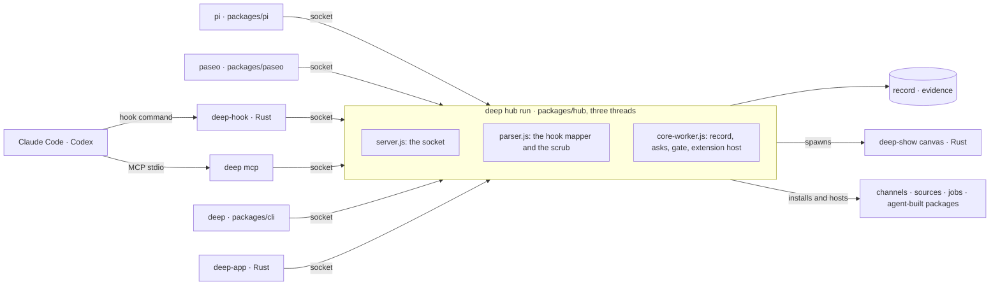

# Package audit and latency hill-climb, 2026-11-13

The commands you run most start 12 to 23% lighter, two tests that are red on this tree pass again, and every package and crate is placed in one picture below, with the pieces the product does not reach named.

Base: `41d712bf9`, main at `9b77cd2cd` merged into PR #2334's branch. The change is five source files (+19 −12) and three test files (+226), in PR #2334. Every number below was read on that base, after the change was final. Outputs are in [latency-audit-2026-11-13/](latency-audit-2026-11-13/).

## Not everything was read

- **Read line by line:** the files on a `deep` command's start path in `packages/cli` and `packages/hub` (`main.ts`, `index.ts`, `hub-command.ts`, `list.ts`, `client.ts`, `remote.ts`, `service.ts`, `canvas.ts`, `paths.ts`), `evidence/src/scrub.ts` and `patterns.ts`, `contracts/src/index.ts`, `schemas.ts` and `json.ts`, and the lease path of `hub/src/heavy.ts`.
- **Read by structure:** every other package and every crate, from its manifest, its card, its imports and who names its binaries. No Rust source was read line by line, and no Rust was changed.
- **Measured:** the CLI's commands, `deep mcp` and the hub's start. Nothing in the app, the canvas or the GPU layer was measured.
- **The machine was never quiet:** load was between 90 and 295 on 18 cores, and it restarted once mid-session. So the numbers are instructions retired, which load does not move. The one wall time given is a reading and says so.

## How the packages connect

There are 36 npm workspaces, ten plug-in folders that are not workspaces (four channels, two work sources, four jobs) and 43 crates. Read from the imports and the manifests:

- No workspace imports another in a cycle. Every `@deepbuild` import is declared, and every declared one is imported.
- Sorted by what each imports, the workspaces fall into eight layers, and no import points up.
- From `packages/cli/src/main.ts`, static imports, dynamic imports and sibling files named as text reach 362 source files in 28 workspaces. The other eight workspaces and the plug-in folders are reached another way, or not at all; the table after the picture says which.

### The spine



One hook call is the whole spine: the agent runs `deep-hook`, which matches the call against `rules.json`, sends it to the hub's socket and prints the reply. Every other way in (`deep mcp`, the CLI, the app, pi, paseo) is another client of the same socket. The hub is the one process behind it, and the one writer to the record.

### The workspaces, bottom to top

| Layer | Workspaces | What stands on them |
|---|---|---|
| 0 | `contracts`, `evidence`, `readings` | The shapes, the store and scrub, the pure folds. `contracts` is imported by 16 workspaces, `evidence` by 9 |
| 1 | `record`, `adapters` | The event log (16 importers) and one adapter per agent (8) |
| 2 | `asks`, `leases`, `verdicts`, `conformance`, `wiki`, `otlp` | The asks core (9), the lease table, the verdict engine, the kits (13) |
| 3 | `supervisor`, `budget`, `archive`, `workspaces`, `checks-numbers`, `checks-work`, `checks-host`, `proof`, `routing-replay` | The one process owner (8) and the ledger |
| 4 | `gate`, `runner`, `env-local`, `resolver-decisions`, `buying` | The gate's model, DeepBuild's own jobs, the stack |
| 5 | `extension-host`, `checks-command`, `checks-review`, `github`, `reading`, `config-eval` | The plug-in host and the checks that run processes |
| 6 | `hub`, `checks-journey` | The hub imports 25 workspaces; only the CLI imports the hub |
| 7 | `cli` | The `deep` command |

`paseo` and `pi` import no workspace: each is loaded by its own host and speaks the socket.

### What the hub loads, by thread

Read off Node's loader over one `deep hub run` to its ready line: 541 modules.

| Thread | Modules | Of them |
|---|---|---|
| server (`main.js`, then `server.js`) | 100 | hub 32, the contracts entry 18, SQLite 15, evidence 5 |
| core (`core-worker.js`) | 389 | hub 118, the YAML parser 72, extension-host 20, gate 18, the contracts entry 18, SQLite 15, record 10, and every first-party extension |
| parser (`parser.js`) | 52 | the contracts entry 18, hub 12, evidence 5 |

The first-party extensions (`archive`, `github`, `resolver-decisions`, `wiki`, `env-local` and the four check packages the hub depends on) are plain imports of the hub. The extension host is opened with `release: []` (`packages/hub/src/core.ts:868`), so none of them loads through it. What it hosts is what `deep install` installs: the channels' and jobs' cards name that command, and each work source is a package of the same shape.

### The crates

| Group | Crates | Connected by |
|---|---|---|
| The hook | `deep-hook`, `deep-contracts` | `deep-hook` is the only crate that depends on `deep-contracts`, whose types `packages/contracts/src/generate.ts` writes. The release stages this binary and no other |
| The app | `deep-app`, `deep-panel-host`, `deep-replica` | `deep-app` reads the hub's lines as untyped JSON (`src/hub.rs`). It depends directly on marks, effects, cells, text, images and the GPU layer, and on no other canvas module |
| The canvas core | `deep-canvas`, `deep-canvas-seams` | 26 crates depend on the core; it depends on none |
| Canvas modules | `deep-canvas-cells`, `-drawn`, `-effects`, `-graph`, `-input`, `-loop`, `-marks`, `-media`, `-motion`, `-physics`, `-record`, `-sandbox`, `-scene3d`, `-sheet`, `-vector`, `-test-modules`, and `deep-logic` | Each depends on the core. Most register a module that a host compiles in; `deep-canvas-drawn` is data that marks and scene3d read |
| Backends | `deep-gpu`, `deep-text`, `deep-images`, `deep-codecs`, `deep-physics-rapier`, `deep-sandbox-wasmtime`, `deep-relay`, `deep-scene3d-render`, `deep-effects-render`, `deep-marks-vello`, `deep-marks-gpui`, `deep-text-gpui` | Behind a seam or a module's backend interface |
| Hosts | `deep-show`, `deep-gpu-layer`, `deep-marks-render` | `deep-show` depends on 30 workspace crates and is the process the hub runs as its canvas core. `deep-gpu-layer` (the `deep-gpu` binary) depends on 25, `deep-app` among them |
| Proof binaries | `deep-motion`, `deep-input`, `deep-text-render` | JSON lines in and out for the acceptance suites; no package under `packages/` names them |
| A tool | `deep-typeset` | Built to WebAssembly into `packages/jobs/typeset` by `scripts/typeset-wasm.mjs`; no crate depends on it |

The hub names six Rust binaries in code: `deep-hook` (`paths.ts`, `heavy.ts`, `setup.ts`), `deep-show` (`canvas.ts`), `deep-gpu` and `deep-canvas-render` (`canvas-doctor.ts`), `deep-drive` (`drive.ts`) and `deep-replica` (`panels.ts`). The last two are looked for under `target/debug` only.

Root folders shared by path: `adapters/` (named in six workspaces and `deep-hook`), `packs/` (the hub and five crates), `contracts/setup-steps.json` (the hub, `deep-app`), `contracts/plain-words.json` (the hub, `deep-app`, `deep-replica`), `crates/deep-hook/default-rules.json` (the hub, `conformance`, `deep-hook`) and `skills/deepbuild` (copied by `deep setup`).

## What the product does not reach

Each row was checked on this tree today unless it says otherwise. "Tests only" means no file under `packages/*/src`, `scripts/`, `benchmarks/` or `crates/` imports or runs it.

| Piece | How it is reached today | Tracked by |
|---|---|---|
| `packages/buying` | Tests only | #1982 |
| `packages/checks-journey` | Tests and `benchmarks/journeys.mjs`. The hub's kind table holds `command`, `review`, `numbers`, `service`, `data`, `document` and `message`, and no `journey` | #1982 |
| `packages/proof` | Tests, and its row in `contracts/shipped.json`. No `proof` kind in the hub's table | #1982 |
| `packages/checks-host` | Tests only. Its card says the hub's table doesn't hold `setting` and `machine` yet | Its card names #1946 and #1947 |
| `packages/routing-replay` | `tests/acceptance/1980` only. Its card says it runs in the local preflight; no lane names it, so it would run there only as test files of the unit lane | none found |
| `packages/config-eval` | `scripts/config-eval.mjs` imports it, and the preflight runs that script's `gate` command. Its card says the learned layer calls `runEval` too; nothing under `packages/` does | none found |
| `packages/hub/src/installer.ts`, `packages/cli/src/login-service.ts` | `tests/acceptance/41` only. The second writes the login service as `deep hub start`; the one the hub really writes (`service.ts`) runs `deep hub run` | Listed in the Nov 9 whole-project report; none of the four open issues a search for `login-service` returns is about it, by their titles |
| `packages/otlp`'s receiver | Its tests only; the CLI calls its doctor item | Its card says so |
| About 40% of `packages/gate` | Acceptance suites only. From #1982; not counted again today | #1982 |
| The extension host's asks and safe mode | `openExtensionHost` still gets no `asks` and no `safe` (`core.ts:868`). The two issues say what follows: a plug-in that needs your yes refuses, and `deep hub run --safe` loads what it always loads. I checked the call, not the effect | #1828, #1879 |
| `deep-panel-host` | `deep-app` starts it at three sites, all inside checks that take the host's path as `--host` (`panel_check.rs` `run_check` and `run_bench`, `panel_keys.rs` `run`). Nothing in the app's own run starts one | #358 is the open spike |
| Generated contract types in Rust | Only `deep-hook` depends on them; the app parses the same wire by hand | #1908 |

Three of the twelve have no open issue I could find and no card that says so: `routing-replay`, `config-eval`, and the two `#41` files.

## Found on the way

1. **`deep mcp` loads all of `@deepbuild/contracts` to get one function.** Since `c00ceff81` (Nov 11) `hub/src/tools.ts`, `codex-settings.ts` and `claude-settings.ts` import `isRecord` from the contracts entry, which evaluates 18 modules: the validator, the lint and both code generators. One `deep mcp` runs per agent session. In a throwaway copy of the build where those three files hold the one-line check themselves, `deep mcp` starts on 507.6 M instructions against 570.6 M (−11%) and peaks 1.6 MB lower. Not changed here: the clean fix is a light entry in `contracts`, as `record` has `./ids` and `asks` has `./duration`, and that changes the core's public surface. #1898 asks the same of the check packages; I found no open issue for this one.
2. **The same commit turned two tests red.** `packages/cli/test/loads.test.ts` fails its `deep inbox` case on the base, and PR #2334's `deep hub status` case fails once main is merged in. `hub/src/index.ts` and `canvas.ts`, which cause the first, are byte-identical to main's, so that case fails on main too; I did not run it on main itself. Both pass with this change.
3. **`deep hub stop` returns before the hub's process has ended.** In 12 of 12 runs on each tree the process was still alive when the command returned, and gone a median 39 ms later (54 ms at most). The command waits for the socket to go quiet, as its comment says. A caller that removes the hub's folder right after races the hub's writes: when my first measuring run stopped each hub as soon as `deep hub start` returned and removed its home, 23 of 24 homes were there again afterwards, rewritten by hubs still running after `deep hub stop` had returned. #2330's second criterion asks for the return to follow the hub's exit. `onboarding.test.ts`'s own teardown fails the same way on both trees (`ENOTEMPTY` removing a home).
4. **Two more tests fail on the base as they do on the change**, and neither is in `scripts/known-failures.json`: `packages/hub/test/onboarding.test.ts` ("deep setup says in one line what it added": two lines, not one) and `tests/acceptance/1338/proof.test.ts` AC5 (bob's read lists no session ID). I found no open issue for either.
5. **A comment names a function that is not there.** `hub/src/list.ts` says `when` writes a time "as the app's notification says it (`crates/deep-app/src/notify.rs`: `clock_time`)". The app writes it with `states::moment`, and in other words: "tomorrow 16:40" where the CLI says "tomorrow at 16:40". #2331's scope says the words stay the app's.
6. **Red on this tree and not from this change:** `scripts/size-ratchet.mjs` fails on 46 files (#2360) and `scripts/record-reader-guard.mjs` on `crates/deep-app/src/hub.rs` (#2148). Neither names a file this change touches.

## Latency

### What changed

| File | Change | Why it is safe |
|---|---|---|
| `hub/src/index.ts` | `deep export` and `deep kinds` load `canvas.js` when they run, as every other command in the file does. It was loaded with every command, and with it the contracts entry | Both commands print and exit as before, on six argument forms ([same-commands.txt](latency-audit-2026-11-13/same-commands.txt)) |
| `hub/src/hub-command.ts` | `authority.js` loads for `deep hub use` and the installed `deep hub stop`, the two commands that call it | `tests/acceptance/19/authority/authority.test.ts` passes, 2 of 2 |
| `hub/src/remote.ts` | TLS loads at the first connection to a joined hub, not with `deep` and `deep status` in every folder | `tests/acceptance/1338/generation.test.ts` and `port.test.ts` pass, 3 of 3 |
| `hub/src/list.ts` | A clock time is written from the date's own hours, minutes, weekday and month. Formatting it by locale loaded the date-format data: 420.5 M instructions for the first call in a bare script against 288.7 M | The same text as the locale's formatter for every minute of three daylight-saving weeks and every day of two years, in six time zones |
| `hub/src/service.ts` | `deep hub start` and `deep hub stop` look every 10 ms, not every 100 | The 15 s limit, the message and exit 3 are unchanged, by test |

### Before and after

Instructions retired by the command's own process (`/usr/bin/time -l node packages/cli/dist/main.js <command>`), median of 11 runs, base and change alternated, in a temp home that is set up. Output and exit status were the same on both sides in every row but `deep hub status`, whose output holds the hub's uptime ([readings.txt](latency-audit-2026-11-13/readings.txt)).

| Command | Home | Base | Change | | Peak memory |
|---|---|---|---|---|---|
| `deep` | hub up | 553.6 M | 425.3 M | −23.2% | 21.0 → 18.4 MB |
| `deep status` | hub up | 554.6 M | 425.4 M | −23.3% | 21.3 → 18.2 MB |
| `deep inbox` | hub up | 492.8 M | 420.3 M | −14.7% | 19.9 → 18.2 MB |
| `deep hub status` | hub up | 493.1 M | 411.3 M | −16.6% | 20.0 → 17.9 MB |
| `deep` | hub down, its database read | 1,014.2 M | 815.9 M | −19.6% | 34.3 → 28.7 MB |
| `deep status` | hub down, its database read | 1,029.4 M | 829.3 M | −19.4% | 34.6 → 29.0 MB |
| `deep inbox` | hub down, its database read | 922.5 M | 799.1 M | −13.4% | 31.2 → 28.5 MB |
| `deep lease -- /usr/bin/true` | hub up | 445.0 M | 445.6 M | none | 18.4 → 18.6 MB |
| `deep mcp` | hub up | 573.4 M | 569.6 M | none | 20.8 → 20.9 MB |
| `deep --version` | any | 325.5 M | 325.8 M | none | 13.8 → 13.9 MB |
| `deep hub run` to ready, then stopped | fresh | 4,116 to 4,188 M | 4,108 to 4,153 M | none | 81 to 84 MB |

An empty Node program retires 290.5 M, so `deep` with the hub up went from 263 M over the floor to 135 M. Where the tree sits on disk moves the base by about 5%: the same two builds copied under the temp folder read −20.8%, −20.5%, −12.2% and −13.6% for `deep`, `deep status`, `deep inbox` and `deep hub status` with no hub.

Modules loaded, with no hub ([modules.txt](latency-audit-2026-11-13/modules.txt)): `deep` and `deep status` 45 → 24, `deep inbox` 42 → 22, `deep hub status` 42 → 16.

`deep hub start --root` then `deep hub stop --root` on a dev hub, wall time, 12 rounds at a load near 100: start 183 → 163 ms at the median (159 → 135 at best), stop 65 → 52 ms (59 → 48). A reading, not a verdict.

These are on top of PR #2334, whose three changes are in the base.

### Proof

- **Fails before, passes after:** the three test files, unchanged, on the base's sources and build and then on the change's. Base: 7 of 16 fail, each on its own assertion ([before.txt](latency-audit-2026-11-13/before.txt)). Change: 16 of 16 pass ([after.txt](latency-audit-2026-11-13/after.txt)).

  ```
  loads.test.ts > deep inbox loads none of ... the contracts              expected [ Array(1) ] to deeply equal []
  loads.test.ts > deep, in a folder that joined no project's hub ...      expected [ …(2) ] to deeply equal []    (the contracts entry, node:tls)
  loads.test.ts > deep status, in a folder that joined no project's hub   expected [ …(2) ] to deeply equal []
  loads.test.ts > deep hub status ... loads none of the hub's own server  expected [ Array(1) ] to deeply equal []
  hub-waits.test.ts > deep hub start returns within 20 ms ...             expected 'pending' to be +0
  hub-waits.test.ts > deep hub stop returns within 20 ms ...              expected 'pending' to be +0
  clock.test.ts > deep status with the hub down ...                       expected [ 'toLocaleTimeString' ] to deeply equal []
  ```

- **Each new test fails on a wrong program** ([mutants.txt](latency-audit-2026-11-13/mutants.txt)), planted in a scratch copy: months abbreviated another way (3 cases fail), the clock in UTC (5 fail), a stop that doesn't wait for the socket (1 fails), a start that gives up at 5 s (1 fails).
- **Existing tests that see the change**, ten files run once, one at a time: 62 pass, 4 skip (Linux), 3 fail ([existing-tests.txt](latency-audit-2026-11-13/existing-tests.txt)). The three:
  - `cli.test.ts`: 1 case BLOCKED, no Node older than 24.22.0 on this machine.
  - `onboarding.test.ts` and `1338/proof.test.ts`: one case each, failing the same assertion on the base ([existing-tests-base.txt](latency-audit-2026-11-13/existing-tests-base.txt)).
- **Checks:** `tsc --noEmit` over the eight changed files, and over `packages/hub` and `packages/cli`, is clean. `tests/package-deps.test.mjs` passes, 2 of 2. `scripts/repo-rules.mjs` and `scripts/public-text.mjs` exit 0 with this report in the tree.

### Requirement to change to proof

| Asked | Done | Proof, and its limit |
|---|---|---|
| Pull the latest change | Fetched; worked on main at `9b77cd2cd` in a new worktree | The main checkout was not pulled: see Deviations |
| Audit package by package | Every workspace, plug-in folder and crate placed, from imports, manifests, cards and binary names | Structure, not behavior. Rust not read line by line |
| A coherent story, all packages connected | The spine, the layers, the threads, the crates, and the table of what is not reached | Twelve pieces are not reached by the product; three are untracked |
| Hill-climb on latency | Five source changes; four commands 14.7 to 23.3% lighter with the hub up | Instructions retired; no wall time claimed but the one reading |

## What is left, by what it would buy

1. **A light entry in `contracts`** (finding 1): `deep mcp` −11% and 1.6 MB per session. It needs the owner's yes.
2. **The hub's start, #2332.** It retires about 4.1 G instructions, unchanged here. Measured levers, each the cost of one import alone in a bare process over an empty one's 284.9 M, so they overlap and do not add:
   - The contracts entry, +114 M, loaded on all three threads.
   - `evidence`'s scrub tables, +138 M at `scrub.js`'s load (the 222-rule file read, converted and indexed), loaded on all three threads.
   - The YAML parser, +155 M and 72 modules, on the core thread.
   - Whole-process totals for the heaviest entries, each with what it imports: `checks-command` 855.4 M, `github` 829.2 M, `gate` 828.6 M, `env-local` 772.9 M, `extension-host` 739.0 M.
3. **`deep lease`, #2328.** Its 18 modules are already few: 445 M against the 290 M floor. What it costs in time is the `ps` runs, one after another, which this audit did not change: the peer check decides whose session a command acts as, and its tests should come first.
4. **`deep hub stop`, #2330.** It could return on the close of the connection that carried `hub.stop`, and should not return before the process ends (finding 3).
5. **The rest of #2331:** the app's side, and a preload test over `deep inbox` with an ask that has a default.

## Deviations and unrun checks

- **The main checkout was not pulled.** It holds uncommitted edits to `Cargo.lock` and `scripts/repo-rules.json`, both changed on main since, 535 untracked files of other sessions, and an untracked `tests/acceptance/2072/README.md` that differs from main's. A fast-forward there stops on those files unless that work is stashed or overwritten. Its branch tracks an old PR branch, so a plain `git pull` would merge that, not main. Four agent processes were running in it when I started.
- **Main was merged twice:** `41d712bf9` before the work, and `9ebdab71f` (main at `e0c90a5a5`, 150 commits later) before the push. None of those commits touches a file this change edits.
- **After the second merge** the three test files pass again, 16 of 16, and `tsc --noEmit` over the eight changed files is clean. Nothing else was rerun there: every reading and the ten existing test files are from the first merge.
- **`scripts/repo-rules.mjs` fails after the second merge**, with 47 FAIL lines in nine files, all of them main's and byte-identical to main's: 46 dependencies not listed (`tests/acceptance/12/twins/*/package.json`, `crates/deep-canvas-export`, `deep-lottie`, `deep-lottie-reader`, `deep-show` and `spikes/2435`) and one home path in `packages/contracts/fixtures/staged.undone@1/01.json`. None names a file this change touches. It exited 0 at the first merge. `scripts/public-text.mjs` exits 0 on both.
- **`deep-hook` does not build on main at `e0c90a5a5`.** `cargo build --locked -p deep-hook` stops in `crates/deep-contracts/src/generated.rs`, which defines `RULE_340` and `RULE_341` twice (E0428). The crate is byte-identical to main's and this change touches no Rust. I found no open issue for it. The tests above ran with the `deep-hook` built at the first merge.
- **`node scripts/affected.mjs` was not run.** It selects 1,072 test files and `cargo test` for `deep-app` for this change, with no WIDE line ([affected-selection.txt](latency-audit-2026-11-13/affected-selection.txt)). Thirteen test files ran.
- **I started it once by mistake**, with a flag it does not have, and stopped it by PID after 40 s. It had begun the workspace build, which I let finish; no test of it ran.
- **Not run:** the root `tsc --noEmit`, the timed and slow lanes, the perf lane, the preflight, clippy and `cargo test`. Of `tests/acceptance/1463` only `inbox.test.ts` ran (5 of 5).
- **Part of #2330 and #2331, not all of either.** #2330's criteria name wall-clock bounds against a stand-in hub; the test here proves the step in timer time. #2331's first criterion names `deep inbox`; the test here proves `deep status` with the hub down, and the text for every branch.
- **Size:** the source change is +19 −12 and the tests +226. With PR #2334's lines, this report and the saved outputs the branch is well over 400 lines; the outputs are the proof and the report was asked for.
